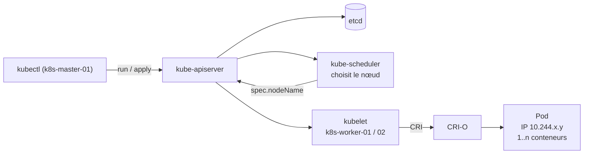

# Lab 01_03 : Pods en mode impératif et déclaratif

## Objectifs

À la fin de ce lab, vous saurez :

- créer, inspecter, modifier et supprimer un Pod avec `kubectl` (mode impératif) ;
- écrire un manifeste YAML de Pod et l'appliquer (mode déclaratif) ;
- dire quels champs d'un Pod peuvent être modifiés à chaud et lesquels ne le peuvent pas ;
- lire le cycle de vie d'un Pod (phase, `STATUS`, `RESTARTS`, `Events`) ;
- diagnostiquer `ErrImagePull`, `ImagePullBackOff`, `CrashLoopBackOff`, `OOMKilled` et `Pending` ;
- contraindre le placement avec `nodeSelector` ;
- utiliser les raccourcis utiles à l'examen CKA (`--dry-run=client -o yaml`, `kubectl explain`, `kubectl replace --force`).

### Vue d'ensemble



## Contexte du cluster et prérequis

| Élément               | Valeur                                                                                 |
|-----------------------|----------------------------------------------------------------------------------------|
| Poste de travail      | `ssh ubuntu@10.10.10.11`                                                               |
| Kubernetes            | v1.37.2                                                                                |
| Runtime               | CRI-O (pas de Docker : inspection côté nœud avec `crictl`)                             |
| Nœuds                 | 3 control-plane (avec taint `NoSchedule`) + 2 workers                                  |
| Namespace du lab      | `pod-lab`                                                                              |
| Répertoire de travail | `~/k8s-pod-lab`                                                                        |
| Images                | `nginx:1.27`, `nginx:1.28`, `busybox:1.36`, `httpd:2.4`, `redis:7.4`, `polinux/stress` |

> Les masters ont le taint `node-role.kubernetes.io/control-plane:NoSchedule`. Vos Pods
> seront donc toujours placés sur `k8s-worker-01` ou `k8s-worker-02`.


## Étape 0 : préparer l'environnement

```bash
ssh ubuntu@10.10.10.11
```

```bash
kubectl version
# Attendu : Client Version: v1.37.2 / Server Version: v1.37.2

kubectl get nodes -o wide
# Attendu : 5 nœuds Ready, CONTAINER-RUNTIME cri-o://1.37.x

kubectl create namespace pod-lab
# Attendu : namespace/pod-lab created

kubectl config set-context --current --namespace=pod-lab
# Attendu : Context "kubernetes-admin@kubernetes" modified.

kubectl config view --minify | grep namespace
# Attendu : namespace: pod-lab

mkdir -p ~/k8s-pod-lab && cd ~/k8s-pod-lab
```

> Comme `pod-lab` est le namespace par défaut du contexte, vous n'avez plus besoin d'ajouter `-n pod-lab`.
> Pour l'examen, prenez l'habitude de vérifier le namespace courant avant chaque question.

Activez l'autocomplétion et l'alias `k`, que vous utiliserez aussi à l'examen :

```bash
source <(kubectl completion bash)
alias k=kubectl
complete -o default -F __start_kubectl k
```


# Partie 1 : mode impératif

## Étape 1 : créer un premier Pod

```bash
kubectl run nginx --image=nginx:1.27 --port=80 --labels=app=nginx,env=lab
# Attendu : pod/nginx created
```

| Paramètre   | Rôle                                                                |
|-------------|---------------------------------------------------------------------|
| `run`       | Crée un Pod                                                         |
| `nginx`     | Nom du Pod (et nom du conteneur)                                    |
| `--image`   | Image du conteneur                                                  |
| `--port=80` | Déclare `containerPort: 80`. **N'expose rien** (aucun Service créé) |
| `--labels`  | Labels posés sur le Pod (sinon, label par défaut `run=nginx`)       |

Attendez que le Pod soit prêt :

```bash
kubectl wait --for=condition=Ready pod/nginx --timeout=90s
# Attendu : pod/nginx condition met
```

## Étape 2 : observer le Pod

```bash
kubectl get pods
# NAME    READY   STATUS    RESTARTS   AGE
# nginx   1/1     Running   0          10s

kubectl get pod nginx -o wide
# Attendu : une IP en 10.244.x.y et NODE = k8s-worker-01 ou k8s-worker-02

kubectl get pods --show-labels
# Attendu : LABELS app=nginx,env=lab
```

**Question :** que signifie la colonne `READY 1/1` ?

<details><summary>Réponse</summary>

Nombre de conteneurs prêts / nombre total de conteneurs dans le Pod.
</details>

## Étape 3 : inspecter le Pod et lire les événements

```bash
kubectl describe pod nginx
```

Repérez les sections `Node`, `IP`, `Containers`, `Conditions`, puis lisez seulement les événements :

```bash
kubectl describe pod nginx | sed -n '/^Events:/,$p'
```

Résultat attendu (ordre des événements) :

```
Normal  Scheduled  default-scheduler  Successfully assigned pod-lab/nginx to k8s-worker-01
Normal  Pulled     kubelet            Container image "nginx:1.27" already present on machine ...
Normal  Created    kubelet            Container created
Normal  Started    kubelet            Container started
```

> `Scheduled` vient du **scheduler**. `Pulled`, `Created` et `Started` viennent du **kubelet** du nœud choisi.

## Étape 4 : logs, exec et test réseau

```bash
kubectl logs nginx
kubectl logs nginx --tail=3

kubectl exec nginx -- nginx -v
# Attendu : nginx version: nginx/1.27.x

kubectl exec -it nginx -- bash
# Dans le conteneur :
cat /etc/os-release | head -2
exit
```

Testez l'accès HTTP au Pod depuis un **Pod temporaire** :

```bash
POD_IP=$(kubectl get pod nginx -o jsonpath='{.status.podIP}')
echo $POD_IP

kubectl run tmp --image=busybox:1.36 --rm -it --restart=Never -- wget -qO- http://$POD_IP
# Attendu : le HTML "Welcome to nginx!", puis : pod "tmp" deleted
```

> `--rm -it --restart=Never` crée un Pod jetable : il est supprimé dès que la commande se termine.

## Étape 5 : options supplémentaires de `kubectl run`

### 5.1 Variables d'environnement

```bash
kubectl run nginx-env --image=nginx:1.27 \
  --env="APP_ENV=production" \
  --env="APP_VERSION=1.0"

kubectl wait --for=condition=Ready pod/nginx-env --timeout=60s
kubectl exec nginx-env -- printenv APP_ENV APP_VERSION
# Attendu :
# production
# 1.0
```

### 5.2 Commande personnalisée et `restartPolicy`

```bash
kubectl run test-command --image=busybox:1.36 --restart=Never \
  --command -- sleep 3600
# Attendu : pod/test-command created
```

> ⚠️ Avec `kubectl run`, **tout ce qui suit `--` est envoyé au conteneur**. Les options comme `-n`
> doivent être placées **avant** `--`. Par exemple, `... --command -- sleep 3600 -n pod-lab`
> transmet `-n pod-lab` à `sleep`.

```bash
kubectl get pod test-command -o jsonpath='{.spec.restartPolicy} {.spec.containers[0].command}{"\n"}'
# Attendu : Never ["sleep","3600"]

kubectl get pod nginx -o jsonpath='{.spec.restartPolicy}{"\n"}'
# Attendu : Always   (valeur par défaut)
```

| Option `kubectl run`               | Champ YAML généré                                   |
|------------------------------------|-----------------------------------------------------|
| `--command -- sleep 3600`          | `command: ["sleep","3600"]` (remplace l'ENTRYPOINT) |
| `-- sleep 3600` (sans `--command`) | `args: ["sleep","3600"]` (remplace le CMD)          |
| `--restart=Never`                  | `restartPolicy: Never`                              |

### 5.3 Générer un manifeste sans rien créer (astuce CKA)

```bash
kubectl run nginx-gen --image=nginx:1.27 --port=80 --dry-run=client -o yaml
```

Résultat attendu :

```yaml
apiVersion: v1
kind: Pod
metadata:
  labels:
    run: nginx-gen
  name: nginx-gen
spec:
  containers:
  - image: nginx:1.27
    name: nginx-gen
    ports:
    - containerPort: 80
    resources: {}
  dnsPolicy: ClusterFirst
  restartPolicy: Always
status: {}
```

> À l'examen, on génère souvent le squelette avec `--dry-run=client -o yaml > pod.yaml`, puis on le
> complète dans `vim`. C'est plus rapide et plus fiable que de tout écrire à la main.

```bash
kubectl get pods
# Attendu : nginx, nginx-env, test-command en Running ; nginx-gen n'existe PAS
```


# Partie 2 : mode déclaratif

## Étape 6 : écrire le manifeste

```bash
cd ~/k8s-pod-lab
cat > pod-nginx.yaml <<'EOF'
apiVersion: v1
kind: Pod
metadata:
  name: nginx-declarative
  namespace: pod-lab
  labels:
    app: nginx
    environment: lab
    tier: frontend
  annotations:
    description: "Pod Nginx for Kubernetes lab"
spec:
  containers:
    - name: nginx-container
      image: nginx:1.27
      imagePullPolicy: IfNotPresent
      ports:
        - name: http
          containerPort: 80
          protocol: TCP
      env:
        - name: APP_ENV
          value: "production"
      resources:
        requests:
          cpu: "100m"
          memory: "64Mi"
        limits:
          cpu: "500m"
          memory: "256Mi"
      livenessProbe:
        httpGet:
          path: /
          port: 80
        initialDelaySeconds: 10
        periodSeconds: 10
      readinessProbe:
        httpGet:
          path: /
          port: 80
        initialDelaySeconds: 5
        periodSeconds: 5
  restartPolicy: Always
EOF
```

Rappel de la structure : `apiVersion` (version de l'API) → `kind` (type d'objet) → `metadata` (identité :
name, namespace, labels, annotations) → `spec` (état souhaité).

Utilisez `kubectl explain` pour retrouver la documentation d'un champ sans navigateur :

```bash
kubectl explain pod.spec.containers.livenessProbe
kubectl explain pod.spec.containers.resources
kubectl explain pod.spec --recursive | less
```

## Étape 7 : valider puis appliquer

```bash
kubectl apply --dry-run=client -f pod-nginx.yaml
# Attendu : pod/nginx-declarative created (dry run)

kubectl apply --dry-run=server -f pod-nginx.yaml
# Attendu : pod/nginx-declarative created (server dry run)
```

> `client` vérifie seulement la syntaxe localement. `server` envoie l'objet à l'API Server
> (validation complète et admission) **sans l'enregistrer**.

```bash
kubectl apply -f pod-nginx.yaml
# Attendu : pod/nginx-declarative created

kubectl get pod nginx-declarative -w
# Observez : ContainerCreating -> Running 0/1 -> Running 1/1   (Ctrl+C pour quitter)
```

**Question :** pourquoi le Pod reste-t-il quelques secondes en `Running 0/1` avant de passer à `1/1` ?

<details><summary>Réponse</summary>

Le conteneur est démarré, mais la `readinessProbe` n'a pas encore réussi (`initialDelaySeconds: 5`).
Tant qu'elle n'a pas réussi, le Pod n'est pas `Ready`.
</details>

## Étape 8 : ce que Kubernetes ajoute au manifeste

```bash
kubectl get pod nginx-declarative -o yaml | less
```

Repérez les champs que vous **n'avez pas écrits** :

```bash
kubectl get pod nginx-declarative -o jsonpath='{.spec.nodeName}{"\n"}{.spec.dnsPolicy} {.spec.schedulerName} {.spec.serviceAccountName} {.spec.terminationGracePeriodSeconds}{"\n"}{.status.qosClass}{"\n"}'
# Attendu :
# k8s-worker-0X
# ClusterFirst default-scheduler default 30
# Burstable
```

| Champ ajouté                                                                        | Origine                                 |
|-------------------------------------------------------------------------------------|-----------------------------------------|
| `metadata.uid`, `creationTimestamp`, `resourceVersion`                              | API Server                              |
| `spec.nodeName`                                                                     | Scheduler                               |
| `dnsPolicy`, `schedulerName`, `serviceAccountName`, `terminationGracePeriodSeconds` | Valeurs par défaut                      |
| `status.*` (dont `qosClass`)                                                        | Kubelet / API Server : état **observé** |
| `annotations.kubectl.kubernetes.io/last-applied-configuration`                      | `kubectl apply`                         |

> **QoS `Burstable`** : les requests sont inférieures aux limits. Si requests = limits pour CPU et
> mémoire dans tous les conteneurs, la classe est `Guaranteed`. Sans aucune request ni limit, elle est `BestEffort`.

## Étape 9 : labels, sélecteurs et annotations

```bash
kubectl get pods -l app=nginx
# Attendu : nginx et nginx-declarative

kubectl get pods -l 'app=nginx,tier=frontend'
# Attendu : nginx-declarative seulement

kubectl get pods -L environment,tier
# Attendu : colonnes ENVIRONMENT / TIER

kubectl get pods -l 'env!=lab'
# Attendu : tous les Pods qui n'ont pas env=lab

kubectl get pod nginx-declarative -o jsonpath='{.metadata.annotations.description}{"\n"}'
# Attendu : Pod Nginx for Kubernetes lab
```

Ajoutez ou supprimez un label de façon impérative :

```bash
kubectl label pod nginx owner=equipe-paiement
kubectl label pod nginx owner-          # le "-" final supprime le label
kubectl annotate pod nginx ticket="CHG-1234"
kubectl get pod nginx --show-labels
```


# Partie 3 : modifier un Pod

## Étape 10 : changer l'image (modification autorisée)

```bash
sed -i 's/nginx:1.27/nginx:1.28/' pod-nginx.yaml
grep image: pod-nginx.yaml
# Attendu : image: nginx:1.28

kubectl diff -f pod-nginx.yaml
# Attendu : -    image: nginx:1.27
#           +    image: nginx:1.28

kubectl apply -f pod-nginx.yaml
# Attendu : pod/nginx-declarative configured
```

Attendez une quinzaine de secondes, puis :

```bash
kubectl get pod nginx-declarative
# Attendu : RESTARTS 1  (le conteneur a été recréé, le Pod est le même)

kubectl exec nginx-declarative -- nginx -v
# Attendu : nginx version: nginx/1.28.x

kubectl describe pod nginx-declarative | sed -n '/^Events:/,$p'
# Attendu : Killing  "Container nginx-container definition changed, will be restarted"
```

> Le Pod garde son nom, son UID, son IP et son nœud. Seul le **conteneur** est redémarré.

## Étape 11 : changer un champ immuable (modification refusée)

Changez le port :

```bash
sed -i 's/containerPort: 80$/containerPort: 8080/' pod-nginx.yaml
kubectl apply -f pod-nginx.yaml
```

Résultat attendu :

```
The Pod "nginx-declarative" is invalid: spec: Forbidden: pod updates may not change fields other than
`spec.containers[*].image`,`spec.initContainers[*].image`,`spec.activeDeadlineSeconds`,
`spec.tolerations` (only additions to existing tolerations),`spec.terminationGracePeriodSeconds` ...
```

> **À retenir :** dans le `spec` d'un Pod existant, on peut seulement modifier les **images**,
> `activeDeadlineSeconds`, ajouter des **tolerations** et changer `terminationGracePeriodSeconds`.
> Les **labels et annotations** (`metadata`) restent modifiables.

Pour appliquer un changement immuable, il faut **recréer** le Pod :

```bash
kubectl replace --force -f pod-nginx.yaml
# Attendu :
# pod "nginx-declarative" deleted from pod-lab namespace
# pod/nginx-declarative replaced

kubectl get pod nginx-declarative -o jsonpath='{.spec.containers[0].ports[0].containerPort}{"\n"}'
# Attendu : 8080
```

> `replace --force` = `delete` + `create`, ce qui interrompt le service. En production, on utilise un
> **Deployment** (voir le module 03), qui fait un rolling update.

Remettez le port 80 :

```bash
sed -i 's/containerPort: 8080/containerPort: 80/' pod-nginx.yaml
kubectl replace --force -f pod-nginx.yaml
kubectl wait --for=condition=Ready pod/nginx-declarative --timeout=60s
```

## Étape 12 : modifier les ressources à chaud (In-Place Pod Resize)

Une modification des `resources` avec `kubectl apply` est refusée (essayez si vous voulez). Depuis
Kubernetes 1.35, le **redimensionnement en place** est GA. Il passe par la sous-ressource `resize` :

```bash
kubectl patch pod nginx-declarative --subresource resize \
  -p '{"spec":{"containers":[{"name":"nginx-container","resources":{"limits":{"memory":"300Mi"}}}]}}'
# Attendu : pod/nginx-declarative patched

kubectl get pod nginx-declarative -o jsonpath='{.spec.containers[0].resources.limits}{"\n"}{.status.containerStatuses[0].restartCount}{"\n"}'
# Attendu :
# {"cpu":"500m","memory":"300Mi"}
# 0          <- aucun redémarrage
```


# Partie 4 : cycle de vie et diagnostic

Phases officielles d'un Pod : `Pending`, `Running`, `Succeeded`, `Failed`, `Unknown`.
La colonne `STATUS` de `kubectl get pods` est **plus détaillée** : elle affiche aussi `ContainerCreating`,
`ErrImagePull`, `CrashLoopBackOff`, `OOMKilled`, `Completed`, et ainsi de suite.

Lancez les 6 scénarios suivants, puis analysez-les un par un.

```bash
cd ~/k8s-pod-lab

# A - Image inexistante
kubectl run nginx-error --image=nginx:9999

# B - Dépassement mémoire
cat > pod-memory.yaml <<'EOF'
apiVersion: v1
kind: Pod
metadata:
  name: memory-test
  namespace: pod-lab
spec:
  containers:
    - name: memory-container
      image: polinux/stress
      command: ["stress"]
      args: ["--vm", "1", "--vm-bytes", "200M", "--vm-hang", "1"]
      resources:
        requests:
          memory: "50Mi"
        limits:
          memory: "100Mi"
EOF
kubectl apply -f pod-memory.yaml

# C - Ressources insuffisantes
cat > pod-pending.yaml <<'EOF'
apiVersion: v1
kind: Pod
metadata:
  name: pending-test
  namespace: pod-lab
spec:
  containers:
    - name: nginx
      image: nginx:1.27
      resources:
        requests:
          memory: "64Gi"
EOF
kubectl apply -f pod-pending.yaml

# D - Application qui plante au démarrage
kubectl run crash-test --image=busybox:1.36 --command -- \
  sh -c 'echo "Demarrage..."; sleep 3; echo "Erreur fatale"; exit 1'

# E et F - Pods "batch" avec restartPolicy Never
kubectl run job-ok --image=busybox:1.36 --restart=Never -- sh -c 'echo OK; exit 0'
kubectl run job-ko --image=busybox:1.36 --restart=Never -- sh -c 'echo KO; exit 2'
```

Attendez environ 45 secondes, puis :

```bash
kubectl get pods
```

Résultat attendu (proche de) :

```
NAME                READY   STATUS             RESTARTS      AGE
crash-test          0/1     CrashLoopBackOff   2 (20s ago)   45s
job-ko              0/1     Error              0             45s
job-ok              0/1     Completed          0             45s
memory-test         0/1     OOMKilled          2 (29s ago)   45s
nginx-error         0/1     ImagePullBackOff   0             45s
pending-test        0/1     Pending            0             45s
...
```

> Les `STATUS` alternent selon le moment : `ErrImagePull` ↔ `ImagePullBackOff`, `Error`/`OOMKilled` ↔
> `CrashLoopBackOff`. Le **back-off** double le délai entre deux tentatives (10 s, 20 s, 40 s… jusqu'à 5 min).

### Scénario A : `ErrImagePull` / `ImagePullBackOff`

```bash
kubectl describe pod nginx-error | sed -n '/^Events:/,$p'
```

```
Normal   Pulling  kubelet  Pulling image "nginx:9999"
Warning  Failed   kubelet  Failed to pull image "nginx:9999": ... reading manifest 9999 in docker.io/library/nginx: manifest unknown
Warning  Failed   kubelet  Error: ErrImagePull
Normal   BackOff  kubelet  Back-off pulling image "nginx:9999"
Warning  Failed   kubelet  Error: ImagePullBackOff
```

**Cause :** le tag n'existe pas. Le Pod est **planifié**, mais le conteneur ne démarre pas (phase `Pending`).
**Correction :** l'image est modifiable, on peut donc la corriger sans recréer le Pod :

```bash
kubectl set image pod/nginx-error nginx-error=nginx:1.27
kubectl get pod nginx-error -w      # -> Running 1/1  (Ctrl+C)
```

### Scénario B : `OOMKilled`

```bash
kubectl get pod memory-test -o jsonpath='{.status.containerStatuses[0].lastState.terminated.reason} {.status.containerStatuses[0].lastState.terminated.exitCode}{"\n"}'
# Attendu : OOMKilled 137

kubectl describe pod memory-test | grep -A4 'Last State'
```

**Cause :** le processus essaie d'allouer 200 Mo alors que sa limite est de 100 Mi. Le noyau le tue (OOM killer),
code de sortie `137` = 128 + 9 (SIGKILL). Comme `restartPolicy: Always`, le Pod redémarre en boucle.

### Scénario C : `Pending` / `FailedScheduling`

```bash
kubectl describe pod pending-test | sed -n '/^Events:/,$p'
```

```
Warning  FailedScheduling  default-scheduler  0/5 nodes are available: 2 Insufficient memory,
3 node(s) had untolerated taint(s). preemption: 0/5 nodes are available: ...
```

**Lecture :** les 2 workers n'ont pas assez de mémoire allouable (≈ 3,2 Gi chacun) et les 3 masters sont
exclus par leur taint. Le scheduler se base sur les **requests**, pas sur la consommation réelle.

```bash
kubectl describe node k8s-worker-01 | grep -A6 Allocatable
```

### Scénario D : `CrashLoopBackOff`

```bash
kubectl logs crash-test
# Attendu :
# Demarrage...
# Erreur fatale

kubectl get pod crash-test -o jsonpath='{.status.phase} / exit={.status.containerStatuses[0].lastState.terminated.exitCode}{"\n"}'
# Attendu : Running / exit=1
```

> `kubectl logs <pod> --previous` affiche les logs de l'instance **précédente** du conteneur. Avec CRI-O,
> cette instance est parfois déjà supprimée. Dans ce cas, `kubectl logs <pod>` affiche les logs de la
> dernière exécution terminée.

**Remarque :** la phase reste `Running`. `CrashLoopBackOff` n'est **pas** une phase, c'est une raison d'attente
(`state.waiting.reason`).

### Scénarios E et F : `restartPolicy: Never`

```bash
kubectl get pod job-ok job-ko \
  -o custom-columns=NAME:.metadata.name,PHASE:.status.phase,EXIT:.status.containerStatuses[0].state.terminated.exitCode
# Attendu :
# NAME     PHASE       EXIT
# job-ok   Succeeded   0
# job-ko   Failed      2
```

### Vue globale des problèmes du namespace

```bash
kubectl get events --field-selector type=Warning --sort-by=.lastTimestamp
```

### Récapitulatif du diagnostic

| STATUS                              | Phase     | Où regarder                       | Cause typique                              |
|-------------------------------------|-----------|-----------------------------------|--------------------------------------------|
| `Pending` (sans nœud)               | Pending   | `describe` → `FailedScheduling`   | requests trop grandes, taint, nodeSelector |
| `ErrImagePull` / `ImagePullBackOff` | Pending   | `describe` → Events               | tag faux, registry privée, réseau          |
| `CrashLoopBackOff` / `Error`        | Running   | `logs`, `logs --previous`         | bug applicatif, mauvaise commande          |
| `OOMKilled`                         | Running   | `describe` → Last State, exit 137 | limit mémoire trop basse                   |
| `Completed`                         | Succeeded | `logs`                            | fin normale (exit 0)                       |

Nettoyez les Pods de diagnostic :

```bash
kubectl delete pod nginx-error memory-test pending-test crash-test job-ok job-ko
```


# Partie 5 : placement avec `nodeSelector`

## Étape 13 : un Pod qui ne trouve pas de nœud

```bash
cat > pod-ssd.yaml <<'EOF'
apiVersion: v1
kind: Pod
metadata:
  name: nginx-ssd
  namespace: pod-lab
spec:
  nodeSelector:
    disktype: ssd
  containers:
    - name: nginx
      image: nginx:1.27
EOF
kubectl apply -f pod-ssd.yaml

kubectl get pod nginx-ssd -o wide
# Attendu : Pending, NODE <none>

kubectl describe pod nginx-ssd | sed -n '/^Events:/,$p'
# Attendu : 0/5 nodes are available: 2 node(s) didn't match Pod's node affinity/selector,
#           3 node(s) had untolerated taint(s).
```

## Étape 14 : poser le label sur un worker

```bash
kubectl label node k8s-worker-02 disktype=ssd
# Attendu : node/k8s-worker-02 labeled

kubectl get nodes -L disktype

kubectl wait --for=condition=Ready pod/nginx-ssd --timeout=60s
kubectl get pod nginx-ssd -o wide
# Attendu : Running sur k8s-worker-02
```

> Le scheduler réessaie régulièrement de placer les Pods `Pending`. Dès que le label existe, le Pod est planifié,
> sans qu'on ait besoin de le recréer.


# Partie 6 : Pod multi-conteneurs et vue côté nœud

## Étape 15 : deux conteneurs qui partagent un volume et le réseau

```bash
cat > pod-multi.yaml <<'EOF'
apiVersion: v1
kind: Pod
metadata:
  name: web-sidecar
  namespace: pod-lab
spec:
  containers:
    - name: web
      image: nginx:1.27
      volumeMounts:
        - name: html
          mountPath: /usr/share/nginx/html
    - name: content
      image: busybox:1.36
      command: ["sh", "-c", "while true; do echo \"<h1>Generated at $(date)</h1>\" > /data/index.html; sleep 5; done"]
      volumeMounts:
        - name: html
          mountPath: /data
  volumes:
    - name: html
      emptyDir: {}
EOF
kubectl apply -f pod-multi.yaml
kubectl wait --for=condition=Ready pod/web-sidecar --timeout=60s

kubectl get pod web-sidecar
# Attendu : READY 2/2
```

Vérifiez le partage du **réseau** (`localhost`) et du **volume** :

```bash
kubectl exec web-sidecar -c content -- wget -qO- http://localhost
# Attendu : <h1>Generated at ...</h1>   (le conteneur busybox interroge nginx via localhost)

kubectl logs web-sidecar -c web --tail=1
# Attendu : 127.0.0.1 - - [...] "GET / HTTP/1.1" 200 ...
```

> Sans `-c`, `kubectl exec` et `kubectl logs` utilisent le **premier** conteneur et affichent
> `Defaulted container "web" out of: web, content`.

## Étape 16 : voir le Pod depuis le nœud avec `crictl`

```bash
NODE=$(kubectl get pod web-sidecar -o jsonpath='{.spec.nodeName}')
echo $NODE
ssh $NODE

# Sur le worker :
sudo crictl pods --name web-sidecar
# Attendu : 1 sandbox, STATE Ready, NAMESPACE pod-lab

sudo crictl ps --pod $(sudo crictl pods --name web-sidecar -q)
# Attendu : 2 conteneurs Running : web et content, même POD ID

exit
```

> Un Pod correspond à **un sandbox** (qui porte l'IP et les namespaces réseau) et à **N conteneurs** rattachés
> à ce sandbox.


# Partie 7 : exercices d'évaluation

Faites les exercices **sans regarder les solutions**, dans le namespace `pod-lab`.

**Exercice 1 :** créez un Pod `apache` avec l'image `httpd:2.4` qui déclare le port 80.

**Exercice 2 :** affichez l'IP du Pod `apache`, son nœud, ses événements et ses logs. Vérifiez
qu'il répond en HTTP (`It works!`).

**Exercice 3 :** créez un Pod `toolbox` (`busybox:1.36`) qui exécute `sleep 3600` avec les variables
`APP_NAME=natixis-app` et `APP_VERSION=2.1`. Affichez les deux variables depuis le conteneur.

**Exercice 4 :** en déclaratif, créez un fichier `pod-redis.yaml` qui définit un Pod `redis` (`redis:7.4`),
label `app=redis`, port `6379`, avec :
- requests : CPU `200m`, mémoire `128Mi` ;
- limits : CPU `500m`, mémoire `256Mi` ;
- une `livenessProbe` **tcpSocket** sur 6379 ;
- une `readinessProbe` **exec** `redis-cli ping`.

**Exercice 5 :** quelle est la classe QoS du Pod `redis` ? Pourquoi ?

**Exercice 6 :** passez `redis` en `redis:8.0` en mode déclaratif. Vérifiez la version avec `redis-server --version`.

**Exercice 7 :** essayez de changer la limite mémoire de `redis` à `512Mi` avec `kubectl apply`. Que se passe-t-il ?
Appliquez ensuite ce changement **sans redémarrer** le conteneur.

**Exercice 8 :** générez avec une seule commande, **sans créer le Pod**, le fichier `pod-web.yaml` d'un Pod `web`
(`nginx:1.27`, label `tier=web`).

**Exercice 9 :** listez uniquement les Pods qui ont le label `app` (quelle que soit sa valeur), puis ceux
qui ne l'ont pas.

**Exercice 10 :** supprimez tous les Pods du namespace en une commande.

<details><summary><b>Solutions</b></summary>

**1.**
```bash
kubectl run apache --image=httpd:2.4 --port=80
```

**2.**
```bash
kubectl get pod apache -o wide
kubectl describe pod apache | sed -n '/^Events:/,$p'
kubectl logs apache
kubectl run tmp --image=busybox:1.36 --rm -it --restart=Never -- \
  wget -qO- http://$(kubectl get pod apache -o jsonpath='{.status.podIP}')
# Attendu : <title>It works! Apache httpd</title> ... <p>It works!</p>
```

**3.**
```bash
kubectl run toolbox --image=busybox:1.36 \
  --env=APP_NAME=natixis-app --env=APP_VERSION=2.1 \
  --command -- sleep 3600
kubectl exec toolbox -- sh -c 'echo $APP_NAME $APP_VERSION'
# natixis-app 2.1
```

**4.**
```yaml
apiVersion: v1
kind: Pod
metadata:
  name: redis
  namespace: pod-lab
  labels:
    app: redis
spec:
  containers:
    - name: redis
      image: redis:7.4
      ports:
        - name: redis
          containerPort: 6379
      resources:
        requests:
          cpu: "200m"
          memory: "128Mi"
        limits:
          cpu: "500m"
          memory: "256Mi"
      livenessProbe:
        tcpSocket:
          port: 6379
        initialDelaySeconds: 5
        periodSeconds: 10
      readinessProbe:
        exec:
          command: ["redis-cli", "ping"]
        initialDelaySeconds: 3
        periodSeconds: 5
```
```bash
kubectl apply -f pod-redis.yaml
kubectl exec redis -- redis-cli ping      # PONG
```

**5.**
```bash
kubectl get pod redis -o jsonpath='{.status.qosClass}{"\n"}'   # Burstable
```
Les requests sont différentes des limits. Pour obtenir `Guaranteed`, il faudrait requests = limits pour CPU **et** mémoire.

**6.**
```bash
sed -i 's/redis:7.4/redis:8.0/' pod-redis.yaml
kubectl diff -f pod-redis.yaml
kubectl apply -f pod-redis.yaml
kubectl exec redis -- redis-server --version     # Redis server v=8.0.x
```

**7.** `kubectl apply` est refusé (`Forbidden: pod updates may not change fields other than ...`). Il faut passer par la sous-ressource `resize` :
```bash
kubectl patch pod redis --subresource resize \
  -p '{"spec":{"containers":[{"name":"redis","resources":{"limits":{"memory":"512Mi"}}}]}}'
kubectl get pod redis -o jsonpath='{.spec.containers[0].resources.limits.memory} restarts={.status.containerStatuses[0].restartCount}{"\n"}'
```

**8.**
```bash
kubectl run web --image=nginx:1.27 --labels=tier=web --dry-run=client -o yaml > pod-web.yaml
```

**9.**
```bash
kubectl get pods -l app
kubectl get pods -l '!app'
```

**10.**
```bash
kubectl delete pods --all
```
</details>


## Nettoyage

```bash
kubectl delete namespace pod-lab
# Attendu : namespace "pod-lab" deleted  (supprime tous les Pods du lab)

kubectl label node k8s-worker-02 disktype-
# Attendu : node/k8s-worker-02 unlabeled

kubectl config set-context --current --namespace=default
rm -rf ~/k8s-pod-lab

kubectl get nodes -L disktype       # plus aucun label disktype
kubectl get ns pod-lab              # Attendu : NotFound
```


## Commande

| Commande                                                               | Utilité                                                  |
|------------------------------------------------------------------------|----------------------------------------------------------|
| `kubectl run NAME --image=IMG`                                         | Créer un Pod en mode impératif                           |
| `kubectl run ... --dry-run=client -o yaml > f.yaml`                    | Générer un manifeste                                     |
| `kubectl run tmp --image=busybox:1.36 --rm -it --restart=Never -- CMD` | Pod jetable de test                                      |
| `kubectl get pods -o wide` / `--show-labels` / `-L key`                | Lister les Pods avec IP, nœud ou labels                  |
| `kubectl get pods -l k=v` / `-l '!k'`                                  | Filtrer par label                                        |
| `kubectl describe pod NAME`                                            | Détails et **Events**                                    |
| `kubectl logs NAME [-c CONT] [--previous]`                             | Logs                                                     |
| `kubectl exec -it NAME [-c CONT] -- sh`                                | Shell dans un conteneur                                  |
| `kubectl apply -f` / `kubectl diff -f`                                 | Appliquer ou comparer un manifeste                       |
| `kubectl replace --force -f`                                           | Recréer un Pod (champ immuable)                          |
| `kubectl set image pod/NAME CONT=IMG`                                  | Changer l'image                                          |
| `kubectl patch pod NAME --subresource resize -p ...`                   | Modifier CPU/mémoire sans redémarrage                    |
| `kubectl explain pod.spec... [--recursive]`                            | Documentation d'un champ                                 |
| `kubectl get events --field-selector type=Warning`                     | Problèmes récents                                        |
| `kubectl label` / `kubectl annotate`                                   | Ajouter ou supprimer (`key-`) un label ou une annotation |

