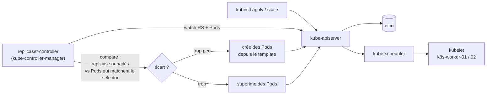

# Lab 02_03 : ReplicaSets en mode impératif et déclaratif

## Objectifs

À la fin de ce lab, vous saurez :

- expliquer ce que le ReplicaSet apporte par rapport à un Pod autonome (réplication, auto-réparation) ;
- générer, créer, inspecter, scaler et supprimer un ReplicaSet ;
- écrire un manifeste de ReplicaSet (`replicas`, `selector`, `template`) et l'appliquer ;
- comprendre la boucle de réconciliation et le rôle des labels (`ownerReferences`, adoption, isolement d'un Pod) ;
- dire ce qui se passe quand on modifie le template et pourquoi le selector est immuable ;
- diagnostiquer un selector incorrect et des Pods `Pending` faute de ressources ;
- faire le lien entre Deployment, ReplicaSet et Pod.

### Vue d'ensemble



## Contexte du cluster et prérequis

| Élément               | Valeur                                                 |
|-----------------------|--------------------------------------------------------|
| Poste de travail      | `ssh k8s-master-01`                                    |
| Kubernetes            | v1.37.2                                                |
| Runtime               | CRI-O                                                  |
| Nœuds                 | 3 control-plane (avec taint `NoSchedule`) + 2 workers  |
| Namespace du lab      | `rs-lab`                                               |
| Répertoire de travail | `~/k8s-rs-lab`                                         |
| Images                | `nginx:1.27`, `nginx:1.28`, `httpd:2.4`, `redis:7.4`   |
| Prérequis             | Lab `01_03_pods_natixis.md` (Pods, labels, sélecteurs) |

> Les masters ont le taint `node-role.kubernetes.io/control-plane:NoSchedule`. Les Pods des
> ReplicaSets seront donc toujours répartis sur `k8s-worker-01` et `k8s-worker-02`.


## Étape 0 : préparer l'environnement

```bash
ssh k8s-master-01
```

```bash
kubectl get nodes
# Attendu : 5 nœuds Ready

kubectl create namespace rs-lab
# Attendu : namespace/rs-lab created

kubectl config set-context --current --namespace=rs-lab
kubectl config view --minify | grep namespace
# Attendu : namespace: rs-lab

mkdir -p ~/k8s-rs-lab && cd ~/k8s-rs-lab

source <(kubectl completion bash)
alias k=kubectl
complete -o default -F __start_kubectl k
```


# Partie 1 : le problème à résoudre

## Étape 1 : un Pod autonome ne revient pas

```bash
kubectl run solo --image=nginx:1.27
kubectl wait --for=condition=Ready pod/solo --timeout=60s

kubectl delete pod solo
# Attendu : pod "solo" deleted from rs-lab namespace

kubectl get pods
# Attendu : No resources found in rs-lab namespace.
```

**Question :** que se passerait-il en production si le nœud qui héberge ce Pod tombait en panne ?

<details><summary>Réponse</summary>

Le Pod serait perdu et rien ne le recréerait. Un Pod autonome n'a **aucun contrôleur** pour le surveiller.
Le ReplicaSet résout ce problème : il maintient en permanence le **nombre souhaité** de Pods.
</details>

### Les trois éléments d'un ReplicaSet

| Champ           | Rôle                                                                           |
|-----------------|--------------------------------------------------------------------------------|
| `spec.replicas` | **Combien** de Pods on veut (1 par défaut)                                     |
| `spec.selector` | **Quels** Pods sont comptés (sélection par labels). Obligatoire et immuable    |
| `spec.template` | **Comment** créer un Pod qui manque (un Pod complet, sans `apiVersion`/`kind`) |

> **Règle :** les labels de `spec.template.metadata.labels` **doivent** correspondre à `spec.selector`.


# Partie 2 : mode impératif

## Étape 2 : générer un manifeste de ReplicaSet

Il n'existe pas de commande `kubectl create replicaset` :

```bash
kubectl create replicaset
# Attendu : error: Unexpected args: [replicaset]
```

**Astuce CKA :** on génère un **Deployment** (même structure), puis on le transforme en ReplicaSet :

```bash
kubectl create deployment nginx-rs --image=nginx:1.27 --replicas=3 \
  --dry-run=client -o yaml > replicaset.yaml
cat replicaset.yaml
```

Le résultat contient `kind: Deployment`, `strategy: {}` et `status: {}`. Il faut donc :
1. remplacer `Deployment` par `ReplicaSet` ;
2. supprimer `strategy: {}`, un champ qui n'existe que pour le Deployment ;
3. supprimer `status: {}`.

```bash
sed -i -e 's/^kind: Deployment/kind: ReplicaSet/' \
       -e '/strategy: {}/d' \
       -e '/^status: {}/d' replicaset.yaml
cat replicaset.yaml
```

Résultat attendu :

```yaml
apiVersion: apps/v1
kind: ReplicaSet
metadata:
  labels:
    app: nginx-rs
  name: nginx-rs
spec:
  replicas: 3
  selector:
    matchLabels:
      app: nginx-rs
  template:
    metadata:
      labels:
        app: nginx-rs
    spec:
      containers:
      - image: nginx:1.27
        name: nginx
        resources: {}
```

## Étape 3 : créer le ReplicaSet avec `kubectl create`

```bash
kubectl create -f replicaset.yaml
# Attendu : replicaset.apps/nginx-rs created

kubectl wait --for=condition=Ready pod -l app=nginx-rs --timeout=90s
```

> `kubectl create -f` est **impératif** : il échoue si l'objet existe déjà.
>
> ```bash
> kubectl create -f replicaset.yaml
> # Attendu : Error from server (AlreadyExists): ... replicasets.apps "nginx-rs" already exists
> ```

## Étape 4 : observer le ReplicaSet et ses Pods

```bash
kubectl get rs
# NAME       DESIRED   CURRENT   READY   AGE
# nginx-rs   3         3         3       10s

kubectl get rs -o wide
# Attendu : colonnes CONTAINERS, IMAGES et SELECTOR (app=nginx-rs)

kubectl get pods -o wide --show-labels
# Attendu : 3 Pods nginx-rs-xxxxx, label app=nginx-rs, répartis sur k8s-worker-01 et k8s-worker-02
```

| Colonne   | Signification                                |
|-----------|----------------------------------------------|
| `DESIRED` | `spec.replicas` (état souhaité)              |
| `CURRENT` | Pods existants qui correspondent au selector |
| `READY`   | Pods dont la condition `Ready` est vraie     |

**Question :** d'où vient le suffixe aléatoire `-xxxxx` des Pods ?

<details><summary>Réponse</summary>

Le ReplicaSet crée ses Pods avec `metadata.generateName: nginx-rs-`. L'API Server ajoute 5 caractères
aléatoires pour que chaque nom soit unique.
</details>

## Étape 5 : inspecter le ReplicaSet et le lien de propriété

```bash
kubectl describe rs nginx-rs
```

Repérez `Selector`, `Replicas: 3 current / 3 desired`, `Pods Status`, `Pod Template`, puis les événements :

```
Events:
  Normal  SuccessfulCreate  replicaset-controller  Created pod: nginx-rs-kdq8w
  Normal  SuccessfulCreate  replicaset-controller  Created pod: nginx-rs-2lng6
  Normal  SuccessfulCreate  replicaset-controller  Created pod: nginx-rs-6rx8n
```

Chaque Pod connaît son propriétaire :

```bash
P=$(kubectl get pods -l app=nginx-rs -o jsonpath='{.items[0].metadata.name}')
kubectl get pod $P -o jsonpath='{.metadata.ownerReferences}{"\n"}'
# Attendu :
# [{"apiVersion":"apps/v1","blockOwnerDeletion":true,"controller":true,"kind":"ReplicaSet","name":"nginx-rs","uid":"..."}]
```

> `ownerReferences` sert au **garbage collector** : quand on supprime le ReplicaSet, ses Pods sont supprimés
> en cascade.

## Étape 6 : scaler le ReplicaSet

### Scale up

```bash
kubectl scale rs nginx-rs --replicas=5
# Attendu : replicaset.apps/nginx-rs scaled

kubectl get rs,pods -o wide
# Attendu : DESIRED 5 / CURRENT 5 ; 2 nouveaux Pods (AGE plus récent)
```

### Scale down

```bash
kubectl scale rs nginx-rs --replicas=2
kubectl get pods -o wide
# Attendu : 2 Pods restants

kubectl describe rs nginx-rs | sed -n '/^Events:/,$p'
# Attendu : 2 x SuccessfulCreate puis 3 x SuccessfulDelete
```

> **Quels Pods sont supprimés ?** Le contrôleur supprime d'abord les Pods non planifiés, puis `Pending`,
> puis non `Ready`. Ensuite, il supprime en priorité les Pods des nœuds qui en ont le plus, puis les plus **récents**.
> Vous ne choisissez pas directement le Pod supprimé.

### Scale avec précondition (sécurité)

```bash
kubectl scale rs nginx-rs --current-replicas=4 --replicas=3
# Attendu : error: Expected replicas to be 4, was 2

kubectl scale rs nginx-rs --current-replicas=2 --replicas=3
# Attendu : replicaset.apps/nginx-rs scaled
```

## Étape 7 : l'auto-réparation (self-healing)

Ouvrez un **second terminal** et lancez une surveillance :

```bash
kubectl get pods -w
```

Dans le premier terminal, supprimez un Pod :

```bash
P=$(kubectl get pods -l app=nginx-rs -o jsonpath='{.items[0].metadata.name}')
kubectl delete pod $P
```

Dans le second terminal, observez : l'ancien Pod passe à `Terminating` et un **nouveau Pod** (nouveau nom) est
créé presque aussitôt (`Pending` → `ContainerCreating` → `Running`).

Supprimez ensuite **tous** les Pods :

```bash
kubectl delete pods -l app=nginx-rs --wait=false
kubectl get pods
# Attendu : 3 anciens Pods Terminating et 3 nouveaux Pods déjà Running
```

> Le ReplicaSet **ne redémarre pas** les Pods supprimés : il en **crée de nouveaux** à partir du template.
> Les noms, les IP et parfois les nœuds changent.

## Étape 8 : supprimer un ReplicaSet sans supprimer ses Pods

```bash
kubectl delete rs nginx-rs --cascade=orphan
# Attendu : replicaset.apps "nginx-rs" deleted from rs-lab namespace

kubectl get rs
# Attendu : No resources found in rs-lab namespace.

kubectl get pods
# Attendu : les 3 Pods sont toujours Running

P=$(kubectl get pods -l app=nginx-rs -o jsonpath='{.items[0].metadata.name}')
kubectl get pod $P -o jsonpath='owner={.metadata.ownerReferences}{"\n"}'
# Attendu : owner=      (les Pods sont devenus orphelins)
```

Recréez le ReplicaSet :

```bash
kubectl create -f replicaset.yaml
kubectl get pods
# Attendu : les MÊMES 3 Pods (même nom, même AGE) ; aucun nouveau Pod créé

kubectl get pod $P -o jsonpath='{.metadata.ownerReferences[0].kind}/{.metadata.ownerReferences[0].name}{"\n"}'
# Attendu : ReplicaSet/nginx-rs   -> les Pods orphelins ont été ADOPTÉS

kubectl describe rs nginx-rs | sed -n '/^Events:/,$p'
# Attendu : Events: <none>   (aucune création nécessaire)
```

Supprimez maintenant le ReplicaSet **avec** ses Pods (comportement par défaut, `--cascade=background`) :

```bash
kubectl delete rs nginx-rs
kubectl get pods
# Attendu : No resources found (après quelques secondes)
```


# Partie 3 : mode déclaratif

## Étape 9 : écrire le manifeste

```bash
cd ~/k8s-rs-lab
cat > replicaset-nginx.yaml <<'EOF'
apiVersion: apps/v1
kind: ReplicaSet
metadata:
  name: frontend
  namespace: rs-lab
  labels:
    app: frontend
    environment: lab
spec:
  replicas: 3
  selector:
    matchLabels:
      app: frontend
    matchExpressions:
      - key: tier
        operator: In
        values: ["web"]
  template:
    metadata:
      labels:
        app: frontend
        tier: web
    spec:
      containers:
        - name: nginx
          image: nginx:1.27
          ports:
            - name: http
              containerPort: 80
          resources:
            requests:
              cpu: "50m"
              memory: "32Mi"
            limits:
              cpu: "200m"
              memory: "128Mi"
          readinessProbe:
            httpGet:
              path: /
              port: 80
            initialDelaySeconds: 3
            periodSeconds: 5
EOF
```

| Champ                       | Explication                                                                                 |
|-----------------------------|---------------------------------------------------------------------------------------------|
| `apiVersion: apps/v1`       | Les ReplicaSets sont dans le groupe d'API `apps` (≠ `v1` pour les Pods)                     |
| `metadata.labels`           | Labels **du ReplicaSet** lui-même (pas des Pods)                                            |
| `selector.matchLabels`      | Égalité stricte : `app=frontend`                                                            |
| `selector.matchExpressions` | Opérateurs `In`, `NotIn`, `Exists`, `DoesNotExist`                                          |
| `template.metadata.labels`  | Labels posés sur chaque Pod créé ; ils doivent satisfaire **toutes** les règles du selector |
| `template.spec`             | Spec d'un Pod (identique au lab 01_03)                                                      |

Documentation intégrée :

```bash
kubectl explain rs.spec
kubectl explain rs.spec.selector.matchExpressions
```

## Étape 10 : valider et appliquer

```bash
kubectl apply --dry-run=client -f replicaset-nginx.yaml
# Attendu : replicaset.apps/frontend created (dry run)

kubectl apply --dry-run=server -f replicaset-nginx.yaml
# Attendu : replicaset.apps/frontend created (server dry run)

kubectl apply -f replicaset-nginx.yaml
# Attendu : replicaset.apps/frontend created

kubectl get rs frontend -o wide
# Attendu : DESIRED 3, READY 3, SELECTOR app=frontend,tier in (web)

kubectl get pods -l app=frontend -L tier -o wide
```

**Question :** juste après l'`apply`, pourquoi la colonne `READY` du ReplicaSet reste-t-elle un instant
inférieure à `CURRENT` ?

<details><summary>Réponse</summary>

Les Pods existent (`CURRENT`), mais leur `readinessProbe` n'a pas encore réussi (`initialDelaySeconds: 3`).
</details>

## Étape 11 : scaler en mode déclaratif

```bash
sed -i 's/replicas: 3/replicas: 5/' replicaset-nginx.yaml

kubectl diff -f replicaset-nginx.yaml | grep -E '^[-+] '
# Attendu :
# -  replicas: 3
# +  replicas: 5

kubectl apply -f replicaset-nginx.yaml
# Attendu : replicaset.apps/frontend configured

kubectl get rs frontend
# Attendu : DESIRED 5, READY 5
```

### Conflit entre impératif et déclaratif (dérive de configuration)

```bash
kubectl scale rs frontend --replicas=2
kubectl get rs frontend
# Attendu : DESIRED 2

kubectl diff -f replicaset-nginx.yaml | grep -E '^[-+] '
# Attendu : -  replicas: 2   /   +  replicas: 5

kubectl apply -f replicaset-nginx.yaml
kubectl get rs frontend
# Attendu : DESIRED 5   -> le fichier fait foi au prochain apply
```

> En équipe, si le YAML est la source de vérité (Git, CI/CD), un `kubectl scale` manuel sera **écrasé**
> au prochain déploiement.

## Étape 12 : modifier le template (image)

```bash
sed -i 's/nginx:1.27/nginx:1.28/' replicaset-nginx.yaml
kubectl apply -f replicaset-nginx.yaml
# Attendu : replicaset.apps/frontend configured

kubectl get rs frontend -o wide
# Attendu : IMAGES nginx:1.28

kubectl get pods -l app=frontend -o custom-columns=NAME:.metadata.name,IMAGE:.spec.containers[0].image
# Attendu : les 5 Pods sont TOUJOURS en nginx:1.27 !
```

Supprimez un Pod :

```bash
P=$(kubectl get pods -l app=frontend -o jsonpath='{.items[0].metadata.name}')
kubectl delete pod $P

kubectl get pods -l app=frontend -o custom-columns=NAME:.metadata.name,IMAGE:.spec.containers[0].image
# Attendu : 4 Pods en nginx:1.27 + 1 nouveau Pod en nginx:1.28
```

> **À retenir :** le ReplicaSet compte seulement les Pods qui correspondent au **selector**. Il ne compare jamais
> leur contenu au template. Le nouveau template ne sert que pour les **prochains** Pods créés.
> Pour remplacer progressivement les Pods (rolling update), il faut un **Deployment** (Partie 5).

## Étape 13 : le selector est immuable

```bash
cp replicaset-nginx.yaml rs-selector.yaml
sed -i 's/values: \["web"\]/values: ["web", "api"]/' rs-selector.yaml
kubectl apply -f rs-selector.yaml
```

Résultat attendu :

```
The ReplicaSet "frontend" is invalid: spec.selector: Invalid value:
{"matchLabels":{"app":"frontend"},"matchExpressions":[{"key":"tier","operator":"In","values":["web","api"]}]}: field is immutable
```

> Pour changer le selector, il faut supprimer le ReplicaSet et le recréer, éventuellement avec `--cascade=orphan`
> pour garder les Pods.

Revenez à 3 réplicas pour la suite :

```bash
kubectl scale rs frontend --replicas=3
```


# Partie 4 : labels, adoption et diagnostic

## Étape 14 : selector et labels du template ne correspondent pas

```bash
cat > replicaset-error.yaml <<'EOF'
apiVersion: apps/v1
kind: ReplicaSet
metadata:
  name: backend
  namespace: rs-lab
spec:
  replicas: 3
  selector:
    matchLabels:
      app: backend
  template:
    metadata:
      labels:
        app: api
    spec:
      containers:
        - name: httpd
          image: httpd:2.4
EOF
kubectl apply -f replicaset-error.yaml
```

Résultat attendu :

```
The ReplicaSet "backend" is invalid: spec.template.metadata.labels: Invalid value: {"app":"api"}: `selector` does not match template `labels`
```

**Question :** pourquoi l'API Server refuse-t-il ce manifeste au lieu de le créer ?

<details><summary>Réponse</summary>

Les Pods créés (`app=api`) ne correspondraient jamais au selector (`app=backend`). Le ReplicaSet n'en
compterait aucun et en créerait à l'infini. La validation empêche cette boucle.
</details>

Corrigez puis appliquez :

```bash
sed -i 's/app: api/app: backend/' replicaset-error.yaml
kubectl apply -f replicaset-error.yaml
# Attendu : replicaset.apps/backend created

kubectl get rs backend
# Attendu : DESIRED 3, READY 3
```

## Étape 15 : adoption d'un Pod « intrus »

Le ReplicaSet `frontend` a 3 Pods. Créez un Pod **à la main** avec les mêmes labels :

```bash
kubectl get pods -l app=frontend
kubectl run frontend-manual --image=nginx:1.27 --labels=app=frontend,tier=web

kubectl get pods -l app=frontend
# Attendu : toujours 3 Pods ; frontend-manual a disparu

kubectl describe rs frontend | sed -n '/^Events:/,$p' | tail -1
# Attendu : Normal  SuccessfulDelete  replicaset-controller  Deleted pod: frontend-manual
```

> Le ReplicaSet a **adopté** le Pod, puisqu'il correspond au selector et n'a pas de propriétaire. Il avait alors
> 4 Pods pour 3 souhaités et a supprimé le plus récent, ici le Pod manuel.

### Adoption au moment de la création

```bash
kubectl delete rs frontend
kubectl run frontend-manual --image=nginx:1.27 --labels=app=frontend,tier=web
kubectl wait --for=condition=Ready pod/frontend-manual --timeout=60s

kubectl apply -f replicaset-nginx.yaml        # replicas: 5, image nginx:1.28
kubectl get pods -l app=frontend
# Attendu : frontend-manual + 4 nouveaux Pods (5 au total)

kubectl get pod frontend-manual -o jsonpath='{.metadata.ownerReferences[0].kind}/{.metadata.ownerReferences[0].name} {.spec.containers[0].image}{"\n"}'
# Attendu : ReplicaSet/frontend nginx:1.27
```

> Le Pod adopté tourne en **nginx:1.27** alors que le template demande **1.28**. Cela confirme que le ReplicaSet
> ne regarde que les labels. **Enseignement :** utilisez des selectors précis, propres à chaque application.

## Étape 16 : isoler un Pod pour le déboguer

Technique utile en production : on retire un Pod défaillant du ReplicaSet **sans le supprimer**, pour l'analyser.

```bash
P=$(kubectl get pods -l app=frontend,tier=web -o jsonpath='{.items[1].metadata.name}')
kubectl label pod $P tier=debug --overwrite

kubectl get pods -L app,tier
# Attendu : le Pod $P a tier=debug et un nouveau Pod tier=web a été créé
#           (5 Pods tier=web + 1 Pod tier=debug)

kubectl get pod $P -o jsonpath='owner=[{.metadata.ownerReferences}]{"\n"}'
# Attendu : owner=[]   -> le Pod est orphelin, le ReplicaSet l'a relâché

kubectl get rs frontend
# Attendu : DESIRED 5, CURRENT 5
```

> Le Pod isolé reste disponible pour `kubectl logs` et `kubectl exec`. Un Service qui sélectionne `tier=web` ne lui
> enverrait plus de trafic. Une fois l'analyse terminée, supprimez-le :

```bash
kubectl delete pod $P
```

## Étape 17 : ressources insuffisantes

Chaque worker a environ **3,2 Gi** de mémoire allouable. Demandez 3 Pods de 2 Gi chacun :

```bash
cat > replicaset-big.yaml <<'EOF'
apiVersion: apps/v1
kind: ReplicaSet
metadata:
  name: big
  namespace: rs-lab
spec:
  replicas: 3
  selector:
    matchLabels:
      app: big
  template:
    metadata:
      labels:
        app: big
    spec:
      containers:
        - name: nginx
          image: nginx:1.27
          resources:
            requests:
              memory: "2Gi"
EOF
kubectl apply -f replicaset-big.yaml
sleep 10

kubectl get rs big
# Attendu : DESIRED 3, CURRENT 3, READY 2

kubectl get pods -l app=big -o wide
# Attendu : 1 Pod Running par worker + 1 Pod Pending (NODE <none>)
```

Diagnostic :

```bash
P=$(kubectl get pods -l app=big --field-selector=status.phase=Pending -o jsonpath='{.items[0].metadata.name}')
kubectl describe pod $P | sed -n '/^Events:/,$p'
```

```
Warning  FailedScheduling  default-scheduler  0/5 nodes are available: 2 Insufficient memory,
3 node(s) had untolerated taint(s). preemption: ... No preemption victims found for incoming pod ...
```

> Le ReplicaSet a bien **créé** les 3 Pods (`CURRENT 3`), mais il ne garantit pas qu'ils seront **planifiés**.
> C'est le rôle du scheduler. Dans `describe rs`, on voit seulement `SuccessfulCreate`. Il faut donc toujours
> regarder les Events **des Pods**.

```bash
kubectl scale rs big --replicas=2
kubectl get pods -l app=big
# Attendu : le Pod Pending est supprimé en premier

kubectl delete rs big frontend backend
```


# Partie 5 : Deployment, ReplicaSet et Pod

## Étape 18 : le ReplicaSet créé par un Deployment

```bash
kubectl create deployment web --image=nginx:1.27 --replicas=3
kubectl rollout status deployment web
# Attendu : deployment "web" successfully rolled out

kubectl get deploy,rs,pods -l app=web --show-labels
```

Résultat attendu (proche de) :

```
NAME                  READY   UP-TO-DATE   AVAILABLE   LABELS
deployment.apps/web   3/3     3            3           app=web

NAME                             DESIRED   CURRENT   READY   LABELS
replicaset.apps/web-69c6f74b8b   3         3         3       app=web,pod-template-hash=69c6f74b8b

NAME                       READY   STATUS    LABELS
pod/web-69c6f74b8b-d9hjz   1/1     Running   app=web,pod-template-hash=69c6f74b8b
...
```

Suivez la chaîne de propriété :

```bash
RS=$(kubectl get rs -l app=web -o jsonpath='{.items[0].metadata.name}')
kubectl get rs $RS -o jsonpath='{.metadata.ownerReferences[0].kind}/{.metadata.ownerReferences[0].name}{"\n"}'
# Attendu : Deployment/web

P=$(kubectl get pods -l app=web -o jsonpath='{.items[0].metadata.name}')
kubectl get pod $P -o jsonpath='{.metadata.ownerReferences[0].kind}/{.metadata.ownerReferences[0].name}{"\n"}'
# Attendu : ReplicaSet/web-69c6f74b8b
```

```
Deployment web ──owns──▶ ReplicaSet web-<hash> ──owns──▶ Pods web-<hash>-xxxxx
```

> Le label `pod-template-hash` est ajouté par le Deployment : il garantit que chaque ReplicaSet d'un même
> Deployment sélectionne **seulement ses propres** Pods.

## Étape 19 : on ne pilote pas un ReplicaSet géré par un Deployment

```bash
kubectl scale rs $RS --replicas=5
kubectl get rs -l app=web
# Attendu : DESIRED 3   -> le Deployment a immédiatement remis sa valeur
```

## Étape 20 : ce que le Deployment apporte

```bash
kubectl set image deployment/web nginx=nginx:1.28
kubectl rollout status deployment web

kubectl get rs -l app=web -o wide
# Attendu :
# web-69c6f74b8b   0   0   0   ...  nginx:1.27   <- ancien RS conservé à 0 (pour le rollback)
# web-6f9bcdc979   3   3   3   ...  nginx:1.28   <- nouveau RS
```

Comparez avec l'étape 12 : ici, **tous** les Pods ont été remplacés progressivement, sans intervention.

| Fonctionnalité          | Pod | ReplicaSet   | Deployment |
|-------------------------|-----|--------------|------------|
| Exécuter des conteneurs | ✅   | via template | via RS     |
| Nombre de réplicas      | ❌   | ✅            | ✅          |
| Auto-réparation         | ❌   | ✅            | ✅          |
| Scale up / down         | ❌   | ✅            | ✅          |
| Rolling update          | ❌   | ❌            | ✅          |
| Historique et rollback  | ❌   | ❌            | ✅          |

> **En production**, on n'écrit presque jamais de ReplicaSet à la main : on utilise un **Deployment**, qui gère
> les ReplicaSets à votre place. Les Deployments sont détaillés dans le module 03.

```bash
kubectl delete deployment web
# Attendu : le Deployment, ses ReplicaSets et ses Pods sont supprimés en cascade
```

---

# Partie 6 : exercices d'évaluation

Faites les exercices **sans regarder les solutions**, dans le namespace `rs-lab`.

**Exercice 1 :** créez un ReplicaSet `apache-rs` de 3 Pods `httpd:2.4`, en partant d'un manifeste généré avec `--dry-run`.

**Exercice 2 :** affichez avec **une seule commande** `jsonpath` le nombre de réplicas souhaités, actuels, prêts et
disponibles de `apache-rs`.

**Exercice 3 :** passez `apache-rs` à 6 réplicas **seulement s'il en a actuellement 3**.

**Exercice 4 :** supprimez 2 Pods de `apache-rs` en une commande et vérifiez qu'il revient à 6 Pods prêts.

**Exercice 5 :** posez le label `disktype=ssd` sur `k8s-worker-02`. Créez ensuite `redis-rs.yaml` qui définit un
ReplicaSet `redis-rs` de 5 réplicas `redis:7.4`, avec :
- selector et labels `app=redis`, `tier=cache` ;
- requests CPU `200m` / mémoire `128Mi`, limits CPU `500m` / mémoire `256Mi` ;
- `livenessProbe` tcpSocket 6379, `readinessProbe` exec `redis-cli ping` ;
- placement **uniquement** sur les nœuds `disktype=ssd`.

Vérifiez sur quel(s) nœud(s) les Pods sont placés.

**Exercice 6 :** que se passe-t-il si vous retirez le label `disktype` de `k8s-worker-02` ? Les Pods `redis-rs` déjà en place
sont-ils supprimés ? Et si vous supprimez ensuite un de ces Pods ?

**Exercice 7 :** sans supprimer de Pod, retirez un Pod de `apache-rs` pour le déboguer. Combien de Pods ont maintenant
le label `app=apache-rs` ?

**Exercice 8 :** supprimez `apache-rs` en conservant ses Pods, puis recréez-le avec `replicas: 2`. Que devient le surplus de Pods ?

**Exercice 9 :** créez un Deployment `api` (`nginx:1.27`, 2 réplicas). Donnez le nom de son ReplicaSet et la valeur
du label `pod-template-hash`.

**Exercice 10 :** nettoyez tout : namespace, label du nœud, contexte.

<details><summary><b>Solutions</b></summary>

**1.**
```bash
kubectl create deployment apache-rs --image=httpd:2.4 --replicas=3 --dry-run=client -o yaml \
  | sed -e 's/^kind: Deployment/kind: ReplicaSet/' -e '/strategy: {}/d' -e '/^status: {}/d' > apache-rs.yaml
kubectl apply -f apache-rs.yaml
```

**2.**
```bash
kubectl get rs apache-rs -o jsonpath='{.spec.replicas} {.status.replicas} {.status.readyReplicas} {.status.availableReplicas}{"\n"}'
# 3 3 3 3
```

**3.**
```bash
kubectl scale rs apache-rs --current-replicas=3 --replicas=6
```

**4.**
```bash
kubectl delete pod $(kubectl get pods -l app=apache-rs -o jsonpath='{.items[0].metadata.name} {.items[1].metadata.name}')
kubectl get rs apache-rs        # DESIRED 6, READY 6 après quelques secondes
```

**5.**
```bash
kubectl label node k8s-worker-02 disktype=ssd
```
```yaml
apiVersion: apps/v1
kind: ReplicaSet
metadata:
  name: redis-rs
  namespace: rs-lab
  labels:
    app: redis
spec:
  replicas: 5
  selector:
    matchLabels:
      app: redis
      tier: cache
  template:
    metadata:
      labels:
        app: redis
        tier: cache
    spec:
      nodeSelector:
        disktype: ssd
      containers:
        - name: redis
          image: redis:7.4
          ports:
            - containerPort: 6379
          resources:
            requests:
              cpu: "200m"
              memory: "128Mi"
            limits:
              cpu: "500m"
              memory: "256Mi"
          livenessProbe:
            tcpSocket:
              port: 6379
            initialDelaySeconds: 5
            periodSeconds: 10
          readinessProbe:
            exec:
              command: ["redis-cli", "ping"]
            initialDelaySeconds: 3
            periodSeconds: 5
```
```bash
kubectl apply -f redis-rs.yaml
kubectl get pods -l app=redis -o wide     # les 5 Pods sur k8s-worker-02
```

**6.** `nodeSelector` n'est vérifié **qu'au moment du scheduling**. Les Pods déjà en place restent `Running`. En revanche,
un Pod supprimé est recréé par le ReplicaSet, puis reste `Pending`, car aucun nœud ne porte plus le label :
```bash
kubectl label node k8s-worker-02 disktype-
kubectl get pods -l app=redis                 # toujours Running
kubectl delete pod $(kubectl get pods -l app=redis -o jsonpath='{.items[0].metadata.name}')
kubectl get pods -l app=redis                 # 4 Running + 1 Pending
kubectl label node k8s-worker-02 disktype=ssd # le Pod Pending est planifié
```

**7.**
```bash
P=$(kubectl get pods -l app=apache-rs -o jsonpath='{.items[0].metadata.name}')
kubectl label pod $P app=apache-debug --overwrite
kubectl get pods -l app=apache-rs     # 6 Pods : le RS en a recréé un
```

**8.**
```bash
kubectl delete rs apache-rs --cascade=orphan
sed -i 's/replicas: .*/replicas: 2/' apache-rs.yaml
kubectl apply -f apache-rs.yaml
kubectl get pods -l app=apache-rs     # le RS adopte les 6 Pods orphelins puis en supprime 4
kubectl describe rs apache-rs | sed -n '/^Events:/,$p'   # 4 x SuccessfulDelete
```

**9.**
```bash
kubectl create deployment api --image=nginx:1.27 --replicas=2
kubectl get rs -l app=api
kubectl get rs -l app=api -o jsonpath='{.items[0].metadata.labels.pod-template-hash}{"\n"}'
```

**10.** Voir la section Nettoyage ci-dessous.
</details>


## Nettoyage

```bash
kubectl delete namespace rs-lab
# Attendu : namespace "rs-lab" deleted

kubectl label node k8s-worker-02 disktype-
# Attendu : node/k8s-worker-02 unlabeled   (ou "label 'disktype' not found" si déjà retiré)

kubectl config set-context --current --namespace=default
rm -rf ~/k8s-rs-lab

kubectl get nodes -L disktype       # plus aucun label disktype
kubectl get ns rs-lab               # Attendu : NotFound
```


## Questions de compréhension

1. Quelle différence y a-t-il entre `replicas`, `selector` et `template` ?
2. Pourquoi les labels du template doivent-ils correspondre au selector ?
3. Quelle est la différence entre `CURRENT` et `READY` ?
4. Pourquoi modifier l'image du template ne met-il pas à jour les Pods existants ?
5. Qu'est-ce que l'adoption d'un Pod ? Dans quel cas est-ce dangereux ?
6. À quoi sert `--cascade=orphan` ?
7. Un ReplicaSet de 3 réplicas peut-il placer ses 3 Pods sur le même worker ?
8. Pourquoi `kubectl scale` sur un ReplicaSet géré par un Deployment n'a-t-il aucun effet durable ?

<details><summary>Réponses</summary>

1. `replicas` indique **combien** de Pods, `selector` **lesquels** compter, `template` **comment** créer ceux qui manquent.
2. Sinon, les Pods créés ne seraient jamais comptés et le contrôleur en créerait à l'infini. L'API refuse donc ce manifeste.
3. `CURRENT` compte les Pods existants qui matchent le selector. `READY` compte ceux dont la readiness est OK.
4. Le ReplicaSet ne compare que des **nombres** de Pods (via les labels), jamais leur contenu.
5. Un Pod sans propriétaire qui matche le selector est pris en charge par le ReplicaSet. C'est dangereux avec un
   selector trop générique : des Pods sans rapport peuvent être adoptés, puis supprimés.
6. Supprimer le contrôleur en gardant les Pods, par exemple pour changer un selector immuable sans coupure.
7. Oui. Le ReplicaSet ne garantit pas la répartition : le scheduler répartit « au mieux ». Pour l'imposer, on
   utilise `podAntiAffinity` ou `topologySpreadConstraints`.
8. Le Deployment est le propriétaire et réconcilie le `replicas` de son ReplicaSet avec sa propre valeur.
</details>


## commands

| Commande                                                                  | Utilité                                            |
|---------------------------------------------------------------------------|----------------------------------------------------|
| `kubectl create deploy N --image=I --replicas=3 --dry-run=client -o yaml` | Squelette (remplacer `kind` et retirer `strategy`) |
| `kubectl get rs [-o wide]`                                                | Lister les ReplicaSets (selector, images)          |
| `kubectl describe rs N`                                                   | Détails et Events (`SuccessfulCreate/Delete`)      |
| `kubectl scale rs N --replicas=X [--current-replicas=Y]`                  | Scaler, avec précondition éventuelle               |
| `kubectl apply -f` / `kubectl diff -f`                                    | Mode déclaratif                                    |
| `kubectl delete rs N`                                                     | Supprimer le RS **et** ses Pods                    |
| `kubectl delete rs N --cascade=orphan`                                    | Supprimer le RS, garder les Pods                   |
| `kubectl get pod P -o jsonpath='{.metadata.ownerReferences}'`             | Trouver le propriétaire d'un Pod                   |
| `kubectl label pod P key=val --overwrite`                                 | Sortir un Pod du selector (isolement)              |
| `kubectl explain rs.spec.selector`                                        | Documentation d'un champ                           |
| `kubectl get deploy,rs,pods -l app=X`                                     | Voir toute la chaîne Deployment → RS → Pods        |
