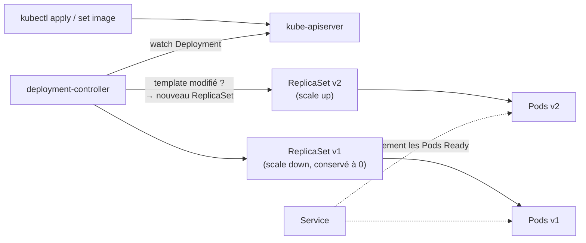

# Lab 03_02 : Deployments, rolling updates et rollbacks

## Objectifs

À la fin de ce lab, vous saurez :

- créer, inspecter, scaler et supprimer un Deployment en mode impératif et déclaratif ;
- expliquer la chaîne Deployment → ReplicaSet → Pod et le rôle de `pod-template-hash` ;
- faire un rolling update **sans interruption de service** et le prouver avec un client qui interroge l'application en continu ;
- régler `maxSurge`, `maxUnavailable`, `minReadySeconds`, `progressDeadlineSeconds` et `revisionHistoryLimit` ;
- lire l'historique des révisions, documenter un changement (`change-cause`) et revenir en arrière (`rollout undo`) ;
- utiliser `rollout pause`, `resume`, `restart` et la stratégie `Recreate` ;
- diagnostiquer un rollout bloqué (image inexistante, readiness probe en échec, `ProgressDeadlineExceeded`).

### Vue d'ensemble



## Contexte du cluster et prérequis

| Élément               | Valeur                                                                                                 |
|-----------------------|--------------------------------------------------------------------------------------------------------|
| Poste de travail      | `ssh k8s-master-01`                                                                                    |
| Kubernetes            | v1.37.2                                                                                                |
| Runtime               | CRI-O                                                                                                  |
| Nœuds                 | 3 control-plane (avec taint `NoSchedule`) + 2 workers                                                  |
| Namespace du lab      | `deployment-lab`                                                                                       |
| Répertoire de travail | `~/k8s-deployment-lab`                                                                                 |
| Images                | `nginx:1.27`, `nginx:1.28`, `nginx:1.29`, `httpd:2.4`, `httpd:2.4-alpine`, `busybox:1.36`, `redis:7.4` |
| Prérequis             | Labs `01_03_pods_natixis.md` et `02_03_replicaset_natixis.md`                                          |

> Un rollout prend entre 20 et 40 secondes dans ce lab, à cause de `minReadySeconds` et de `maxUnavailable: 0`.
> C'est voulu : vous avez le temps d'observer ce qui se passe.

---

## Étape 0 : préparer l'environnement

```bash
ssh k8s-master-01
```

```bash
kubectl get nodes
# Attendu : 5 nœuds Ready

kubectl create namespace deployment-lab
kubectl config set-context --current --namespace=deployment-lab
kubectl config view --minify | grep namespace
# Attendu : namespace: deployment-lab

mkdir -p ~/k8s-deployment-lab && cd ~/k8s-deployment-lab

source <(kubectl completion bash)
alias k=kubectl
complete -o default -F __start_kubectl k
```

> Ouvrez **deux terminaux** sur `k8s-master-01`. Le second servira à observer (`-w`) pendant les mises à jour.
> Dans le second terminal, refaites `cd ~/k8s-deployment-lab` et vérifiez que le namespace courant est bien `deployment-lab`.


# Partie 1 : mode impératif

## Étape 1 : créer un Deployment

```bash
kubectl create deployment nginx-app --image=nginx:1.27 --replicas=3 --port=80
# Attendu : deployment.apps/nginx-app created

kubectl rollout status deployment/nginx-app
# Attendu : deployment "nginx-app" successfully rolled out
```

| Paramètre           | Rôle                                                                    |
|---------------------|-------------------------------------------------------------------------|
| `create deployment` | Crée un Deployment (contrairement au ReplicaSet, cette commande existe) |
| `nginx-app`         | Nom du Deployment ; il sert aussi au label `app=nginx-app`              |
| `--image`           | Image ; le conteneur s'appelle `nginx` (déduit de l'image)              |
| `--replicas`        | Nombre de Pods souhaités                                                |
| `--port`            | Déclare `containerPort: 80`                                             |

## Étape 2 : observer la chaîne Deployment → ReplicaSet → Pods

```bash
kubectl get deploy nginx-app -o wide
# NAME        READY   UP-TO-DATE   AVAILABLE   AGE   CONTAINERS   IMAGES       SELECTOR
# nginx-app   3/3     3            3           10s   nginx        nginx:1.27   app=nginx-app

kubectl get rs -l app=nginx-app
# NAME                   DESIRED   CURRENT   READY   AGE
# nginx-app-78574bc4b7   3         3         3       10s

kubectl get pods -l app=nginx-app --show-labels
# nginx-app-78574bc4b7-49wbh   1/1   Running   ...   app=nginx-app,pod-template-hash=78574bc4b7
```

| Colonne      | Signification                                    |
|--------------|--------------------------------------------------|
| `READY`      | Pods prêts / Pods souhaités                      |
| `UP-TO-DATE` | Pods qui ont **la dernière version** du template |
| `AVAILABLE`  | Pods prêts depuis au moins `minReadySeconds`     |

**Question :** que représente `78574bc4b7` dans les noms ?

<details><summary>Réponse</summary>

C'est le `pod-template-hash`, un hash du template de Pod. Chaque version du template donne un hash différent, donc
un ReplicaSet différent. Ce label est aussi ajouté au selector du ReplicaSet : ainsi, chaque ReplicaSet ne
gère que ses propres Pods.
</details>

Vérifiez la chaîne de propriété :

```bash
RS=$(kubectl get rs -l app=nginx-app -o jsonpath='{.items[0].metadata.name}')
kubectl get rs $RS -o jsonpath='{.metadata.ownerReferences[0].kind}/{.metadata.ownerReferences[0].name}{"\n"}'
# Attendu : Deployment/nginx-app

P=$(kubectl get pods -l app=nginx-app -o jsonpath='{.items[0].metadata.name}')
kubectl get pod $P -o jsonpath='{.metadata.ownerReferences[0].kind}/{.metadata.ownerReferences[0].name}{"\n"}'
# Attendu : ReplicaSet/nginx-app-<hash>
```

## Étape 3 : scaler (pas de nouveau ReplicaSet)

```bash
kubectl scale deployment nginx-app --replicas=5
kubectl rollout status deployment/nginx-app

kubectl get rs -l app=nginx-app
# Attendu : TOUJOURS le même ReplicaSet, DESIRED 5

kubectl scale deployment nginx-app --replicas=2
kubectl get rs -l app=nginx-app
# Attendu : même ReplicaSet, DESIRED 2
```

> **À retenir :** `replicas` ne fait **pas** partie du template de Pod. Un scale modifie le ReplicaSet existant
> et **ne crée pas** de nouvelle révision.

## Étape 4 : mettre à jour l'image

```bash
kubectl set image deployment/nginx-app nginx=nginx:1.28
# Attendu : deployment.apps/nginx-app image updated
#                         ^^^^^ nom du CONTENEUR, pas du Deployment

kubectl rollout status deployment/nginx-app
# Attendu : ... successfully rolled out

kubectl get rs -l app=nginx-app -o wide
# Attendu :
# nginx-app-78574bc4b7   0   0   0   ...   nginx:1.27   <- ancien RS conservé à 0
# nginx-app-8cbfbd798    2   2   2   ...   nginx:1.28   <- nouveau RS
```

Une erreur fréquente à l'examen consiste à donner un mauvais nom de conteneur :

```bash
kubectl set image deployment/nginx-app nginxx=nginx:1.28
# Attendu : error: unable to find container named "nginxx"
```

Lisez les événements :

```bash
kubectl describe deploy nginx-app | sed -n '/^Events:/,$p'
```

```
Scaled up replica set nginx-app-78574bc4b7 from 0 to 3
Scaled up replica set nginx-app-78574bc4b7 from 3 to 5
Scaled down replica set nginx-app-78574bc4b7 from 5 to 2
Scaled up replica set nginx-app-8cbfbd798 from 0 to 1
Scaled down replica set nginx-app-78574bc4b7 from 2 to 1
Scaled up replica set nginx-app-8cbfbd798 from 1 to 2
Scaled down replica set nginx-app-78574bc4b7 from 1 to 0
```

> Le **deployment-controller** pilote seulement des ReplicaSets : il les « scale » à la hausse ou à la baisse.
> Ce sont les ReplicaSets qui créent et suppriment les Pods.

## Étape 5 : historique et `change-cause`

```bash
kubectl rollout history deployment/nginx-app
# REVISION  CHANGE-CAUSE
# 1         <none>
# 2         <none>

kubectl annotate deployment nginx-app kubernetes.io/change-cause="Passage nginx 1.28"

kubectl rollout history deployment/nginx-app
# REVISION  CHANGE-CAUSE
# 1         <none>
# 2         Passage nginx 1.28
```

> L'annotation `kubernetes.io/change-cause` est copiée sur le ReplicaSet de la révision **courante**. Ajoutez-la
> à **chaque** changement, sinon la révision suivante affichera l'ancien texte. L'option `--record` a été
> supprimée de kubectl.

## Étape 6 : générer un manifeste (astuce CKA)

```bash
kubectl create deployment gen --image=nginx:1.27 --replicas=3 --port=80 --dry-run=client -o yaml
```

```yaml
apiVersion: apps/v1
kind: Deployment
metadata:
  labels:
    app: gen
  name: gen
spec:
  replicas: 3
  selector:
    matchLabels:
      app: gen
  strategy: {}
  template:
    metadata:
      labels:
        app: gen
    spec:
      containers:
      - image: nginx:1.27
        name: nginx
        ports:
        - containerPort: 80
        resources: {}
status: {}
```

Nettoyez la Partie 1 :

```bash
kubectl delete deployment nginx-app
# Attendu : le Deployment, ses 2 ReplicaSets et ses Pods sont supprimés en cascade
```

---

# Partie 2 : mode déclaratif

## Étape 7 : écrire le manifeste

```bash
cd ~/k8s-deployment-lab
cat > deployment-nginx.yaml <<'EOF'
apiVersion: apps/v1
kind: Deployment
metadata:
  name: nginx-deployment
  namespace: deployment-lab
  labels:
    app: nginx
    environment: lab
  annotations:
    description: "Nginx Kubernetes Deployment lab"
    kubernetes.io/change-cause: "v1 - nginx 1.27"
spec:
  replicas: 4
  revisionHistoryLimit: 5
  minReadySeconds: 5
  progressDeadlineSeconds: 60
  strategy:
    type: RollingUpdate
    rollingUpdate:
      maxSurge: 1
      maxUnavailable: 0
  selector:
    matchLabels:
      app: nginx
  template:
    metadata:
      labels:
        app: nginx
        environment: lab
    spec:
      containers:
        - name: nginx
          image: nginx:1.27
          ports:
            - name: http
              containerPort: 80
          resources:
            requests:
              cpu: "50m"
              memory: "32Mi"
            limits:
              cpu: "200m"
              memory: "128Mi"
          livenessProbe:
            httpGet:
              path: /
              port: 80
            initialDelaySeconds: 10
            periodSeconds: 10
          readinessProbe:
            httpGet:
              path: /
              port: 80
            initialDelaySeconds: 2
            periodSeconds: 3
EOF
```

| Champ                     | Valeur          | Explication                                                                                         |
|---------------------------|-----------------|-----------------------------------------------------------------------------------------------------|
| `replicas`                | 4               | Nombre de Pods souhaités                                                                            |
| `revisionHistoryLimit`    | 5               | Nombre d'**anciens** ReplicaSets conservés pour le rollback (défaut 10)                             |
| `minReadySeconds`         | 5               | Un Pod doit rester Ready 5 s avant d'être compté `AVAILABLE` (défaut 0)                             |
| `progressDeadlineSeconds` | 60              | Délai sans progression avant `ProgressDeadlineExceeded` (défaut 600)                                |
| `strategy.type`           | `RollingUpdate` | Remplacement progressif (défaut). Autre valeur : `Recreate`                                         |
| `maxSurge`                | 1               | Pods **en plus** de `replicas` autorisés pendant la mise à jour (défaut 25 %, arrondi au supérieur) |
| `maxUnavailable`          | 0               | Pods **en moins** tolérés pendant la mise à jour (défaut 25 %, arrondi à l'inférieur)               |
| `selector`                | `app: nginx`    | **Immuable** après création ; doit correspondre aux labels du template                              |
| `template`                | Pod             | Toute modification du template crée une **nouvelle révision**                                       |

```bash
kubectl explain deployment.spec.strategy.rollingUpdate
kubectl explain deployment.spec.progressDeadlineSeconds
```

## Étape 8 : appliquer et inspecter

```bash
kubectl apply --dry-run=server -f deployment-nginx.yaml
# Attendu : deployment.apps/nginx-deployment created (server dry run)

kubectl apply -f deployment-nginx.yaml
kubectl rollout status deployment/nginx-deployment
# Attendu : successfully rolled out (après environ 10 s, à cause de minReadySeconds)

kubectl get deploy nginx-deployment
# NAME               READY   UP-TO-DATE   AVAILABLE   AGE
# nginx-deployment   4/4     4            4           10s

kubectl describe deploy nginx-deployment | grep -E 'Replicas|StrategyType|MinReady|RollingUpdateStrategy|NewReplicaSet'
# Replicas:               4 desired | 4 updated | 4 total | 4 available | 0 unavailable
# StrategyType:           RollingUpdate
# MinReadySeconds:        5
# RollingUpdateStrategy:  0 max unavailable, 1 max surge
# NewReplicaSet:   nginx-deployment-7f8465db48 (4/4 replicas created)

kubectl describe deploy nginx-deployment | sed -n '/^Conditions/,/^OldReplicaSets/p'
# Available      True    MinimumReplicasAvailable
# Progressing    True    NewReplicaSetAvailable

kubectl rollout history deployment/nginx-deployment
# REVISION  CHANGE-CAUSE
# 1         v1 - nginx 1.27
```

