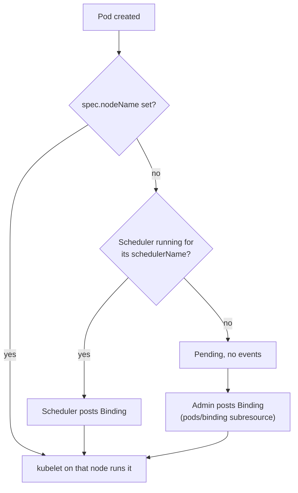

# Lab: Manual Scheduling

## Objective & CKA Context

The scheduler only does one thing: it sets `spec.nodeName` on a Pod. You can do the same job by
hand, either with `nodeName` in the manifest or with a `Binding` object for a Pod that already
exists. The CKA exam asks you to place Pods when the scheduler is missing, and to explain why a
Pod is `Pending` with no events.

### Concept Diagram

The diagram shows how a Pod gets a node: from the scheduler's Binding, from `nodeName` set in the manifest, or from a Binding you post yourself when no scheduler runs.




### Setup

```bash
# On k8s-master-01
kubectl version
# Expected: Server Version: v1.37.2

kubectl get nodes -o wide
# Expected: 5 nodes, all STATUS Ready

kubectl create namespace lab-manual-scheduling --dry-run=client -o yaml | kubectl apply -f -
kubectl config set-context --current --namespace=lab-manual-scheduling
# Expected: namespace/lab-manual-scheduling created (or configured)
#           Context "..." modified.
```

## Scenario 1
**Use case:** A team wants one test web server pinned to `k8s-worker-02`, without asking the
scheduler for a decision.

### Step 1 – Create a Pod with `nodeName`

```bash
cat <<'EOF' | kubectl apply -f -
apiVersion: v1
kind: Pod
metadata:
  name: pinned-web
  namespace: lab-manual-scheduling
spec:
  nodeName: k8s-worker-02
  containers:
  - name: nginx
    image: nginx:1.27-alpine
EOF
kubectl wait --for=condition=Ready pod/pinned-web --timeout=60s
# Expected: pod/pinned-web condition met

kubectl get pod pinned-web -o wide
# Expected: STATUS Running, NODE k8s-worker-02
```

### Step 2 – Prove the scheduler was not involved

```bash
kubectl get events --field-selector involvedObject.name=pinned-web
# Expected: Pulled / Created / Started from the kubelet, but NO "Scheduled" event

kubectl get pod pinned-web -o jsonpath='{.spec.schedulerName}{"\n"}'
# Expected: default-scheduler   (the field is set, but the scheduler skipped the Pod
#                                because nodeName was already filled in)
```

### Step 3 – `nodeName` cannot be changed later

```bash
kubectl patch pod pinned-web -p '{"spec":{"nodeName":"k8s-worker-01"}}'
# Expected: The Pod "pinned-web" is invalid: spec: Forbidden: pod updates may not change
#           fields other than `spec.containers[*].image`, ...
```

To move a Pod you must delete it and create it again (or let a controller do that).

## Scenario 2

**Use case:** A Pod asks for a scheduler that does not exist, so it waits forever. You bind it to
a node yourself, exactly as a scheduler would.

### Step 1 – Create a Pod that no scheduler handles

```bash
cat <<'EOF' | kubectl apply -f -
apiVersion: v1
kind: Pod
metadata:
  name: waiting
  namespace: lab-manual-scheduling
spec:
  schedulerName: no-such-scheduler
  containers:
  - name: nginx
    image: nginx:1.27-alpine
EOF
sleep 5
kubectl get pod waiting -o wide
# Expected: STATUS Pending, NODE <none>

kubectl describe pod waiting | grep -A2 '^Events'
# Expected: Events: <none>   (no FailedScheduling: nobody even tried)
```

A Pending Pod **with no events** points to a missing scheduler (wrong `schedulerName`, or the
kube-scheduler static Pods are down). A Pending Pod with `FailedScheduling` events means the
scheduler ran but found no fitting node.

### Step 2 – Post a Binding object

`nodeName` is immutable once set, but the `pods/binding` subresource sets it the first time.

```bash
cat <<'EOF' | kubectl create --raw /api/v1/namespaces/lab-manual-scheduling/pods/waiting/binding -f -
{
  "apiVersion": "v1",
  "kind": "Binding",
  "metadata": { "name": "waiting" },
  "target": { "apiVersion": "v1", "kind": "Node", "name": "k8s-worker-01" }
}
EOF
# Expected: {"kind":"Status","apiVersion":"v1","metadata":{},"status":"Success","code":201}
```

### Step 3 – Verify

```bash
kubectl wait --for=condition=Ready pod/waiting --timeout=60s
kubectl get pod waiting -o wide
# Expected: STATUS Running, NODE k8s-worker-01

kubectl get pod waiting -o jsonpath='{.spec.schedulerName} -> {.spec.nodeName}{"\n"}'
# Expected: no-such-scheduler -> k8s-worker-01
```

## Scenario 3

**Use case:** An operator needs a probe Pod on a control-plane node, and a colleague's Pod pinned
with `nodeName` refuses to start.

### Setup

```bash
cat <<'EOF' | kubectl apply -f -
apiVersion: v1
kind: Pod
metadata:
  name: pinned
  namespace: lab-manual-scheduling
spec:
  nodeName: k8s-worker-01
  nodeSelector:
    kubernetes.io/hostname: k8s-worker-02
  containers:
  - name: nginx
    image: nginx:1.27-alpine
EOF
sleep 5
kubectl get pod pinned -o wide
# Expected: STATUS NodeAffinity, NODE k8s-worker-01
```

### Task (~8 min)

1. Create a Pod `cp-probe` in namespace `lab-manual-scheduling`, image
   `registry.k8s.io/pause:3.10`, that runs on `k8s-master-01`. Do **not** add tolerations and do
   **not** change the node's taints. Explain why the control-plane taint does not stop it.
2. Pod `pinned` does not start. Find the reason and fix it so that a Pod `pinned` with the same
   image runs on `k8s-worker-02`.
3. Delete `cp-probe` when you have checked it is Running (nothing of the lab may stay on a
   control-plane node).

<details><summary>Solution</summary>

### Step 1 – Bypass the scheduler with `nodeName`

```bash
kubectl describe node k8s-master-01 | grep Taints
# Expected: Taints: node-role.kubernetes.io/control-plane:NoSchedule

cat <<'EOF' | kubectl apply -f -
apiVersion: v1
kind: Pod
metadata:
  name: cp-probe
  namespace: lab-manual-scheduling
spec:
  nodeName: k8s-master-01
  containers:
  - name: pause
    image: registry.k8s.io/pause:3.10
EOF
kubectl wait --for=condition=Ready pod/cp-probe --timeout=60s
kubectl get pod cp-probe -o wide
# Expected: STATUS Running, NODE k8s-master-01
```

`NoSchedule` taints are enforced by the **scheduler**. With `nodeName` set, the scheduler never
sees the Pod, and the kubelet does not check `NoSchedule` taints. (A `NoExecute` taint would
still evict it.)

### Step 2 – Diagnose and fix `pinned`

```bash
kubectl get pod pinned -o jsonpath='{.status.phase} {.status.reason}: {.status.message}{"\n"}'
# Expected: Failed NodeAffinity: Pod was rejected: Predicate NodeAffinity failed: node(s) didn't
#           match Pod's node affinity/selector

kubectl delete pod pinned
cat <<'EOF' | kubectl apply -f -
apiVersion: v1
kind: Pod
metadata:
  name: pinned
  namespace: lab-manual-scheduling
spec:
  nodeName: k8s-worker-02
  containers:
  - name: nginx
    image: nginx:1.27-alpine
EOF
kubectl wait --for=condition=Ready pod/pinned --timeout=60s
```

The kubelet runs its own admission check: it re-checks `nodeSelector`/node affinity even when
the scheduler was bypassed, and rejects the Pod for good (phase `Failed`, no retry).

### Step 3 – Remove the probe

```bash
kubectl delete pod cp-probe --ignore-not-found
# Expected: pod "cp-probe" deleted
```

</details>

### Verify

```bash
kubectl get pod pinned -o wide
# Expected: STATUS Running, NODE k8s-worker-02

kubectl get pods -o wide | grep k8s-master
# Expected: no output (cp-probe is gone)
```

## Cleanup

```bash
kubectl delete namespace lab-manual-scheduling --ignore-not-found
# Expected: namespace "lab-manual-scheduling" deleted

kubectl config set-context --current --namespace=default

# Final health check
kubectl get nodes
# Expected: 5 nodes, all Ready

kubectl get ns | grep lab-
# Expected: no output
```
