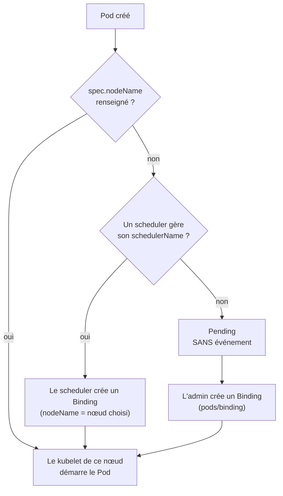

# Lab : Scheduling manuel

## Objectifs

- expliquer ce que fait réellement le scheduler : remplir `spec.nodeName` ;
- placer un Pod sur un nœud **sans scheduler**, avec `nodeName` ;
- lier un Pod `Pending` à un nœud avec un objet **Binding** (sous-ressource `pods/binding`) ;
- distinguer un Pod `Pending` **sans événement** (aucun scheduler) d'un Pod `Pending` avec `FailedScheduling` ;
- comprendre pourquoi `nodeName` contourne les taints `NoSchedule` mais pas les vérifications du kubelet.

### Vue d'ensemble



## Contexte du cluster et prérequis

| Élément          | Valeur                                                   |
|------------------|----------------------------------------------------------|
| Poste de travail | `ssh k8s-master-01`                                      |
| Kubernetes       | v1.37.2                                                  |
| Nœuds            | 3 masters (taint `control-plane:NoSchedule`) + 2 workers |
| Namespace du lab | `sched-manual`                                           |
| Images           | `nginx:1.27`, `registry.k8s.io/pause:3.10`               |


## Étape 0 : préparer l'environnement

```bash
ssh k8s-master-01

kubectl get nodes
# Attendu : 5 nœuds Ready

kubectl create namespace sched-manual
kubectl config set-context --current --namespace=sched-manual

kubectl -n kube-system get pods -l component=kube-scheduler -o wide
# Attendu : 3 Pods kube-scheduler-k8s-master-0X Running (un par master, un seul est leader)
```


# Partie 1 : `nodeName`

## Étape 1 : créer un Pod avec `nodeName`

```bash
cat <<'EOF' | kubectl apply -f -
apiVersion: v1
kind: Pod
metadata:
  name: pinned-web
  namespace: sched-manual
spec:
  nodeName: k8s-worker-02
  containers:
  - name: nginx
    image: nginx:1.27
EOF
kubectl wait --for=condition=Ready pod/pinned-web --timeout=60s

kubectl get pod pinned-web -o wide
# Attendu : Running, NODE k8s-worker-02
```

## Étape 2 : prouver que le scheduler n'est pas intervenu

```bash
kubectl get events --field-selector involvedObject.name=pinned-web \
  -o custom-columns=REASON:.reason,FROM:.source.component
# REASON    FROM
# Pulled    kubelet
# Created   kubelet
# Started   kubelet
#   -> AUCUN événement "Scheduled" venant de default-scheduler

kubectl get pod pinned-web -o jsonpath='{.spec.schedulerName}{"\n"}'
# Attendu : default-scheduler   (le champ existe, mais le scheduler a ignoré le Pod déjà placé)
```

> Le scheduler ne s'occupe que des Pods dont `spec.nodeName` est **vide**. Dès que ce champ est rempli, que ce soit par vous ou par 
> le scheduler, c'est le **kubelet** du nœud indiqué qui prend la main.

## Étape 3 : `nodeName` est immuable

```bash
kubectl patch pod pinned-web -p '{"spec":{"nodeName":"k8s-worker-01"}}'
# Attendu : The Pod "pinned-web" is invalid: spec: Forbidden: pod updates may not change fields other than ...
#           - "NodeName": "k8s-worker-02",
#           + "NodeName": "k8s-worker-01",
```

> Pour déplacer un Pod, il faut le **supprimer et le recréer**, ou laisser un contrôleur (Deployment...) le faire.


# Partie 2 : l'objet Binding

## Étape 4 : un Pod qu'aucun scheduler ne gère

```bash
cat <<'EOF' | kubectl apply -f -
apiVersion: v1
kind: Pod
metadata:
  name: waiting
  namespace: sched-manual
spec:
  schedulerName: no-such-scheduler
  containers:
  - name: nginx
    image: nginx:1.27
EOF
sleep 5

kubectl get pod waiting -o wide
# Attendu : Pending, NODE <none>

kubectl describe pod waiting | grep -A1 '^Events'
# Attendu : Events: <none>
```

| Symptôme                          | Signification                                                                         |
|-----------------------------------|---------------------------------------------------------------------------------------|
| `Pending` **sans** événement      | Aucun scheduler n'a traité le Pod : `schedulerName` inconnu, ou kube-scheduler arrêté |
| `Pending` avec `FailedScheduling` | Le scheduler a essayé, mais aucun nœud ne convient (ressources, taints, sélecteurs)   |

## Étape 5 : lier le Pod à la main

C'est exactement ce que fait le scheduler : il envoie un **Binding** à l'API.

```bash
cat <<'EOF' | kubectl create --raw /api/v1/namespaces/sched-manual/pods/waiting/binding -f -
{
  "apiVersion": "v1",
  "kind": "Binding",
  "metadata": { "name": "waiting" },
  "target": { "apiVersion": "v1", "kind": "Node", "name": "k8s-worker-01" }
}
EOF
# Attendu : {"kind":"Status","apiVersion":"v1","metadata":{},"status":"Success","code":201}

kubectl wait --for=condition=Ready pod/waiting --timeout=60s
kubectl get pod waiting -o jsonpath='{.spec.schedulerName} -> {.spec.nodeName}{"\n"}'
# Attendu : no-such-scheduler -> k8s-worker-01
```

Un Binding ne peut servir qu'**une fois** :

```bash
cat <<'EOF' | kubectl create --raw /api/v1/namespaces/sched-manual/pods/waiting/binding -f -
{"apiVersion":"v1","kind":"Binding","metadata":{"name":"waiting"},"target":{"apiVersion":"v1","kind":"Node","name":"k8s-worker-02"}}
EOF
# Attendu : Error from server (Conflict): ... pod waiting is already assigned to node "k8s-worker-01"
```


# Partie 3 : ce que `nodeName` contourne, et ce qu'il ne contourne pas

## Étape 6 : `nodeName` ignore les taints `NoSchedule`

```bash
kubectl describe node k8s-master-01 | grep Taints
# Attendu : Taints: node-role.kubernetes.io/control-plane:NoSchedule

cat <<'EOF' | kubectl apply -f -
apiVersion: v1
kind: Pod
metadata:
  name: cp-probe
  namespace: sched-manual
spec:
  nodeName: k8s-master-01
  containers:
  - name: pause
    image: registry.k8s.io/pause:3.10
EOF
kubectl wait --for=condition=Ready pod/cp-probe --timeout=60s
kubectl get pod cp-probe -o wide
# Attendu : Running sur k8s-master-01   (sans aucune toleration !)

kubectl delete pod cp-probe
```

> Les taints `NoSchedule` sont appliqués par le **scheduler**. Avec `nodeName`, il est contourné. Un taint `NoExecute`, en
> revanche, est appliqué sur le nœud lui-même et expulserait le Pod. **Ne laissez jamais de Pods applicatifs sur les masters.**

## Étape 7 : le kubelet revérifie le `nodeSelector`

```bash
cat <<'EOF' | kubectl apply -f -
apiVersion: v1
kind: Pod
metadata:
  name: pinned
  namespace: sched-manual
spec:
  nodeName: k8s-worker-01
  nodeSelector:
    kubernetes.io/hostname: k8s-worker-02
  containers:
  - name: nginx
    image: nginx:1.27
EOF
sleep 5

kubectl get pod pinned -o wide
# Attendu : STATUS NodeAffinity, NODE k8s-worker-01

kubectl get pod pinned -o jsonpath='{.status.phase} {.status.reason}: {.status.message}{"\n"}'
# Attendu : Failed NodeAffinity: Pod was rejected: Predicate NodeAffinity failed: node(s) didn't match Pod's node affinity/selector
```

> Le kubelet fait sa propre **admission** : il revérifie `nodeSelector` et l'affinité, même quand le scheduler a été contourné.
> Le Pod passe en phase `Failed`, **définitivement** (pas de nouvelle tentative).

## Étape 8 : un nœud qui n'existe pas

```bash
cat <<'EOF' | kubectl apply -f -
apiVersion: v1
kind: Pod
metadata:
  name: ghost
  namespace: sched-manual
spec:
  nodeName: k8s-worker-09
  containers:
  - name: nginx
    image: nginx:1.27
EOF
sleep 5
kubectl get pod ghost -o wide
# Attendu : Pending, NODE k8s-worker-09   -> aucun kubelet ne le prendra, et aucune erreur n'est affichée

kubectl delete pod ghost pinned
```


# Partie 4 : exercices d'évaluation

**Exercice 1 :** sans `nodeName` dans le manifeste, faites tourner un Pod `bound` (`nginx:1.27`) sur `k8s-worker-02` alors que
son `schedulerName` est `manual`.

**Exercice 2 :** listez tous les Pods du namespace avec leur `schedulerName` et leur nœud dans des colonnes.

**Exercice 3 :** un collègue dit « mon Pod est Pending, le scheduler doit être en panne ». Quelles deux commandes lancez-vous pour
confirmer ou infirmer ?

**Exercice 4 :** sur quel nœud tourne le Pod `waiting` ? Déplacez-le sur `k8s-worker-02`.

<details><summary><b>Solutions</b></summary>

**1.**
```bash
cat <<'EOF' | kubectl apply -f -
apiVersion: v1
kind: Pod
metadata:
  name: bound
  namespace: sched-manual
spec:
  schedulerName: manual
  containers:
  - name: nginx
    image: nginx:1.27
EOF
cat <<'EOF' | kubectl create --raw /api/v1/namespaces/sched-manual/pods/bound/binding -f -
{"apiVersion":"v1","kind":"Binding","metadata":{"name":"bound"},"target":{"apiVersion":"v1","kind":"Node","name":"k8s-worker-02"}}
EOF
kubectl get pod bound -o wide
```

**2.**
```bash
kubectl get pods -o custom-columns=NAME:.metadata.name,SCHEDULER:.spec.schedulerName,NODE:.spec.nodeName
```

**3.**
```bash
kubectl describe pod <pod> | sed -n '/^Events:/,$p'      # FailedScheduling = le scheduler tourne
kubectl -n kube-system get pods -l component=kube-scheduler
```
Sans événement, vérifiez aussi `spec.schedulerName`.

**4.** `nodeName` est immuable : il faut recréer le Pod.
```bash
kubectl get pod waiting -o yaml > waiting.yaml
kubectl delete pod waiting
sed -i 's/nodeName: k8s-worker-01/nodeName: k8s-worker-02/' waiting.yaml
kubectl apply -f waiting.yaml
kubectl get pod waiting -o wide
```
</details>


## Nettoyage

```bash
kubectl delete namespace sched-manual
kubectl config set-context --current --namespace=default
kubectl get pods -A -o wide | grep -E 'k8s-master' | grep -v kube-system
# Attendu : aucun Pod du lab sur les masters
```

## Questions de compréhension

1. Quel champ le scheduler remplit-il ? Par quel mécanisme ?
2. Pourquoi un Pod avec `nodeName: k8s-master-01` démarre-t-il malgré le taint du master ?
3. Un Pod `Pending` n'a aucun événement. Quelles sont les causes possibles ?
4. Pourquoi le Pod `pinned` est-il en `Failed` alors que le scheduler n'a pas été utilisé ?

<details><summary>Réponses</summary>

1. `spec.nodeName`, en envoyant un objet `Binding` à la sous-ressource `pods/binding`.
2. Les taints `NoSchedule` sont vérifiés par le scheduler, qui est contourné. Le kubelet ne vérifie que `NoExecute`.
3. Aucun scheduler ne gère son `schedulerName` (nom erroné, scheduler secondaire absent), ou kube-scheduler est arrêté.
4. Le kubelet revérifie `nodeSelector` et l'affinité à l'admission : `k8s-worker-01` ne porte pas `kubernetes.io/hostname=k8s-worker-02`.
</details>

## commands

| Commande / champ                                                       | Utilité                                   |
|------------------------------------------------------------------------|-------------------------------------------|
| `spec.nodeName: <nœud>`                                                | Placer un Pod sans scheduler              |
| `spec.schedulerName: <nom>`                                            | Choisir le scheduler                      |
| `kubectl create --raw /api/v1/namespaces/<ns>/pods/<pod>/binding -f -` | Lier un Pod existant                      |
| `kubectl get events --field-selector involvedObject.name=<pod>`        | Qui a traité le Pod (scheduler / kubelet) |
| `kubectl -n kube-system get pods -l component=kube-scheduler`          | État du scheduler                         |
