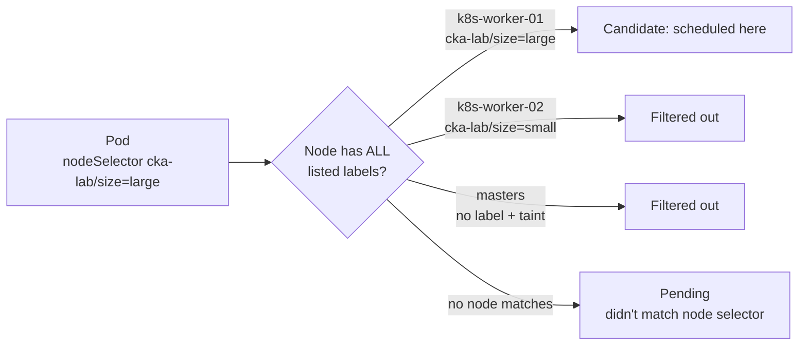

# Lab: Node Selectors

## Objective & CKA Context

`nodeSelector` is the simplest way to attract a Pod to nodes: the Pod is only placed on nodes
that carry **all** the listed labels. The CKA exam asks you to label a node, pin a workload to it,
and fix a Pod that stays `Pending` because its selector matches no node.

### Concept Diagram

The diagram shows `nodeSelector cka-lab/size=large` filtering the nodes down to `k8s-worker-01`.




### Setup

```bash
# On k8s-master-01
kubectl version
# Expected: Server Version: v1.37.2

kubectl get nodes -o wide
# Expected: 5 nodes, all STATUS Ready

kubectl create namespace lab-node-selectors --dry-run=client -o yaml | kubectl apply -f -
kubectl config set-context --current --namespace=lab-node-selectors
# Expected: namespace/lab-node-selectors created (or configured)
#           Context "..." modified.
```

## Scenario 1

**Use case:** A memory-hungry job must run on the larger worker.

### Step 1 – Label the nodes

```bash
kubectl label node k8s-worker-01 cka-lab/size=large
kubectl label node k8s-worker-02 cka-lab/size=small
# Expected: node/k8s-worker-01 labeled
#           node/k8s-worker-02 labeled

kubectl get nodes -L cka-lab/size
# Expected: SIZE large on k8s-worker-01, small on k8s-worker-02
```

### Step 2 – A Pod with `nodeSelector`

```bash
cat <<'EOF' | kubectl apply -f -
apiVersion: v1
kind: Pod
metadata:
  name: big-job
  namespace: lab-node-selectors
spec:
  nodeSelector:
    cka-lab/size: large
  containers:
  - name: job
    image: busybox:1.36
    command: ["sh", "-c", "sleep 3600"]
EOF
kubectl wait --for=condition=Ready pod/big-job --timeout=60s
kubectl get pod big-job -o wide
# Expected: Running on k8s-worker-01
```

### Step 3 – Check the scheduler's decision

```bash
kubectl get events --field-selector involvedObject.name=big-job,reason=Scheduled
# Expected: Successfully assigned lab-node-selectors/big-job to k8s-worker-01
```

## Scenario 2

**Use case:** All replicas of a frontend must run on the "small" worker, and the selector must
survive scaling.

### Step 1 – Deployment with a nodeSelector in the Pod template

```bash
cat <<'EOF' | kubectl apply -f -
apiVersion: apps/v1
kind: Deployment
metadata:
  name: frontend
  namespace: lab-node-selectors
spec:
  replicas: 3
  selector:
    matchLabels:
      app: frontend
  template:
    metadata:
      labels:
        app: frontend
    spec:
      nodeSelector:
        cka-lab/size: small
      containers:
      - name: nginx
        image: nginx:1.27-alpine
EOF
kubectl rollout status deploy/frontend --timeout=90s
kubectl get pods -l app=frontend -o wide
# Expected: 3 Pods Running, all on k8s-worker-02
```

### Step 2 – Scale and check again

```bash
kubectl scale deploy frontend --replicas=5
kubectl rollout status deploy/frontend --timeout=90s
kubectl get pods -l app=frontend -o custom-columns=NAME:.metadata.name,NODE:.spec.nodeName
# Expected: 5 Pods, all on k8s-worker-02
```

### Step 3 – Labels are checked only at scheduling time

```bash
kubectl label node k8s-worker-02 cka-lab/size=medium --overwrite
kubectl get pods -l app=frontend -o wide
# Expected: the 5 Pods keep running on k8s-worker-02 (no eviction)

kubectl label node k8s-worker-02 cka-lab/size=small --overwrite
# Expected: node/k8s-worker-02 labeled
```

`nodeSelector` behaves like `requiredDuringScheduling**IgnoredDuringExecution**`: changing node
labels later never moves running Pods.

## Scenario 3

**Use case:** An ML inference Pod stays Pending after a node label rename.

### Setup

```bash
kubectl label node k8s-worker-02 cka-lab/gpu=true --overwrite
cat <<'EOF' | kubectl apply -f -
apiVersion: apps/v1
kind: Deployment
metadata:
  name: inference
  namespace: lab-node-selectors
spec:
  replicas: 1
  selector:
    matchLabels:
      app: inference
  template:
    metadata:
      labels:
        app: inference
    spec:
      nodeSelector:
        cka-lab/accelerator: gpu
        cka-lab/size: small
      containers:
      - name: app
        image: busybox:1.36
        command: ["sh", "-c", "sleep 3600"]
EOF
sleep 10
kubectl get pods -l app=inference
# Expected: STATUS Pending
```

### Task

1. Find why the `inference` Pod in namespace `lab-node-selectors` is Pending.
2. The GPU node is the one labelled `cka-lab/gpu=true`. Fix the **Deployment** (do not add new
   labels to any node) so the Pod runs on that node.
3. Confirm that the fixed selector matches exactly one node.

<details><summary>Solution</summary>

### Step 1 – Read the scheduler's message

```bash
kubectl get events --field-selector reason=FailedScheduling | grep inference
# Expected: 0/5 nodes are available: 2 node(s) didn't match Pod's node affinity/selector,
#           3 node(s) had untolerated taint(s). ...

kubectl get nodes -l cka-lab/accelerator=gpu
# Expected: No resources found   (no node has this label)

kubectl get nodes -L cka-lab/gpu,cka-lab/size
# Expected: k8s-worker-02 has GPU true and SIZE small
```

All keys of a `nodeSelector` must match. The first key matches no node.

### Step 2 – Fix the nodeSelector

```bash
kubectl patch deploy inference --type=json -p '[
  {"op":"remove","path":"/spec/template/spec/nodeSelector/cka-lab~1accelerator"},
  {"op":"add","path":"/spec/template/spec/nodeSelector/cka-lab~1gpu","value":"true"}]'
kubectl rollout status deploy/inference --timeout=90s
# Expected: deployment "inference" successfully rolled out
```

In a JSON patch path, `/` inside a key is written `~1`. `kubectl edit deploy inference` works
too.

### Step 3 – Check the selector

```bash
kubectl get nodes -l cka-lab/gpu=true,cka-lab/size=small -o name
# Expected: node/k8s-worker-02
```

</details>

### Verify

```bash
kubectl get pods -l app=inference -o wide
# Expected: 1 Pod Running on k8s-worker-02

kubectl get deploy inference -o jsonpath='{.spec.template.spec.nodeSelector}{"\n"}'
# Expected: {"cka-lab/gpu":"true","cka-lab/size":"small"}
```

## Verification Checklist

| Check                | Command                                     | Expected result                        |
|----------------------|---------------------------------------------|----------------------------------------|
| Node labels set      | `kubectl get nodes -L cka-lab/size`         | large on worker-01, small on worker-02 |
| Pod follows selector | `kubectl get pod big-job -o wide`           | on k8s-worker-01                       |
| Deployment pinned    | `kubectl get pods -l app=frontend -o wide`  | 5 Pods on k8s-worker-02                |
| Fixed selector       | `kubectl get pods -l app=inference -o wide` | Running on k8s-worker-02               |

## Cleanup

```bash
kubectl delete namespace lab-node-selectors --ignore-not-found
# Expected: namespace "lab-node-selectors" deleted

kubectl label node k8s-worker-01 k8s-worker-02 cka-lab/size- cka-lab/gpu-
# Expected: node/k8s-worker-01 unlabeled, node/k8s-worker-02 unlabeled
#           ('label ... not found.' lines are fine)

kubectl config set-context --current --namespace=default

# Final health check
kubectl get nodes --show-labels | grep cka-lab
# Expected: no output

kubectl get nodes
# Expected: 5 nodes, all Ready

kubectl get ns | grep lab-
# Expected: no output
```
