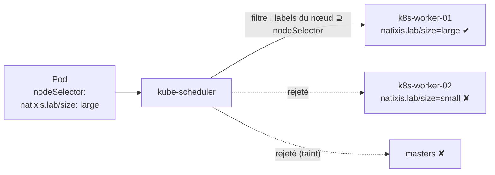

# Lab : nodeSelector

## Objectifs

- étiqueter des nœuds et placer un Pod avec `nodeSelector` ;
- appliquer un `nodeSelector` à tous les Pods d'un Deployment ;
- comprendre que le sélecteur n'est vérifié **qu'au moment du placement** ;
- combiner plusieurs clés (ET logique) et connaître les limites du `nodeSelector` ;
- corriger un `nodeSelector` avec un patch JSON (clé contenant `/`).

### Vue d'ensemble



## Contexte du cluster et prérequis

| Élément          | Valeur                                                |
|------------------|-------------------------------------------------------|
| Poste de travail | `ssh k8s-master-01`                                   |
| Namespace du lab | `sched-nodesel`                                       |
| Labels du lab    | `natixis.lab/size`, `natixis.lab/gpu` sur les workers |
| Images           | `nginx:1.27`, `busybox:1.36`                          |


## Étape 0 : préparer l'environnement

```bash
ssh k8s-master-01
kubectl create namespace sched-nodesel
kubectl config set-context --current --namespace=sched-nodesel
```


# Partie 1 : placer un Pod

## Étape 1 : étiqueter les nœuds

```bash
kubectl label node k8s-worker-01 natixis.lab/size=large
kubectl label node k8s-worker-02 natixis.lab/size=small
kubectl get nodes -L natixis.lab/size
# Attendu : large sur k8s-worker-01, small sur k8s-worker-02
```

## Étape 2 : Pod avec `nodeSelector`

```bash
cat <<'EOF' | kubectl apply -f -
apiVersion: v1
kind: Pod
metadata:
  name: big-job
  namespace: sched-nodesel
spec:
  nodeSelector:
    natixis.lab/size: large
  containers:
  - name: job
    image: busybox:1.36
    command: ["sh", "-c", "sleep 3600"]
EOF
kubectl wait --for=condition=Ready pod/big-job --timeout=60s

kubectl get pod big-job -o wide
# Attendu : Running sur k8s-worker-01

kubectl get events --field-selector involvedObject.name=big-job,reason=Scheduled -o custom-columns=MSG:.message
# Successfully assigned sched-nodesel/big-job to k8s-worker-01
```

En impératif, `kubectl run` n'a pas d'option `--node-selector`. On passe par `--overrides` :

```bash
kubectl run quick --image=nginx:1.27 --overrides='{"spec":{"nodeSelector":{"natixis.lab/size":"large"}}}'
kubectl wait --for=condition=Ready pod/quick --timeout=60s
kubectl get pod quick -o wide
# Attendu : k8s-worker-01
```

## Étape 3 : `nodeSelector` ne contourne pas les taints

```bash
kubectl run master --image=nginx:1.27 --overrides='{"spec":{"nodeSelector":{"kubernetes.io/hostname":"k8s-master-01"}}}'
sleep 5
kubectl get pod master
# Attendu : Pending

kubectl get events --field-selector involvedObject.name=master,reason=FailedScheduling -o custom-columns=MSG:.message
# 0/5 nodes are available: 2 node(s) didn't match Pod's node affinity/selector, 3 node(s) had untolerated taint(s). ...

kubectl delete pod master quick
```

> Contrairement à `nodeName` (lab 01), `nodeSelector` passe par le scheduler, qui applique **aussi** les taints. Il faudrait en plus une
> toleration.


# Partie 2 : `nodeSelector` dans un Deployment

## Étape 4 : toutes les réplicas sur le nœud « small »

```bash
cat <<'EOF' | kubectl apply -f -
apiVersion: apps/v1
kind: Deployment
metadata:
  name: frontend
  namespace: sched-nodesel
spec:
  replicas: 3
  selector:
    matchLabels:
      app: frontend
  template:
    metadata:
      labels:
        app: frontend
    spec:
      nodeSelector:
        natixis.lab/size: small
      containers:
      - name: nginx
        image: nginx:1.27
EOF
kubectl rollout status deployment/frontend
kubectl scale deployment frontend --replicas=5
kubectl rollout status deployment/frontend

kubectl get pods -l app=frontend -o custom-columns=NAME:.metadata.name,NODE:.spec.nodeName
# Attendu : 5 Pods, tous sur k8s-worker-02
```

> Le `nodeSelector` se met dans le **template** de Pod (`spec.template.spec`), pas dans le `spec` du Deployment.

## Étape 5 : le sélecteur n'est vérifié qu'au placement

```bash
kubectl label node k8s-worker-02 natixis.lab/size=medium --overwrite
sleep 3
kubectl get pods -l app=frontend --no-headers | awk '{print $3}' | sort | uniq -c
# Attendu : 5 Running   -> aucune expulsion

kubectl delete pod $(kubectl get pods -l app=frontend -o jsonpath='{.items[0].metadata.name}')
sleep 4
kubectl get pods -l app=frontend --no-headers | awk '{print $3}' | sort | uniq -c
# Attendu : 1 Pending, 4 Running   -> le remplaçant ne trouve plus de nœud "small"

kubectl label node k8s-worker-02 natixis.lab/size=small --overwrite
sleep 4
kubectl get pods -l app=frontend --no-headers | awk '{print $3}' | sort | uniq -c
# Attendu : 5 Running   -> le scheduler réessaie dès que le label revient
```

> `nodeSelector` se comporte comme une affinité `requiredDuringScheduling`**`IgnoredDuringExecution`** : changer les labels d'un nœud
> ne déplace jamais les Pods déjà en cours d'exécution.


# Partie 3 : diagnostic

## Étape 6 : le Pod `inference` reste `Pending`

```bash
kubectl label node k8s-worker-02 natixis.lab/gpu=true --overwrite

cat <<'EOF' | kubectl apply -f -
apiVersion: apps/v1
kind: Deployment
metadata:
  name: inference
  namespace: sched-nodesel
spec:
  replicas: 1
  selector:
    matchLabels:
      app: inference
  template:
    metadata:
      labels:
        app: inference
    spec:
      nodeSelector:
        natixis.lab/accelerator: gpu
        natixis.lab/size: small
      containers:
      - name: app
        image: busybox:1.36
        command: ["sh", "-c", "sleep 3600"]
EOF
sleep 6
kubectl get pods -l app=inference
# Attendu : Pending
```

**À vous :** le nœud GPU est celui qui porte `natixis.lab/gpu=true`. Corrigez le **Deployment**, sans ajouter de label à un nœud.

<details><summary>Solution</summary>

```bash
kubectl get nodes -l natixis.lab/accelerator=gpu          # No resources found
kubectl get nodes -L natixis.lab/gpu,natixis.lab/size     # worker-02 : gpu=true, size=small
```
Toutes les clés d'un `nodeSelector` doivent correspondre (ET logique).
```bash
kubectl patch deploy inference --type=json -p '[
  {"op":"remove","path":"/spec/template/spec/nodeSelector/natixis.lab~1accelerator"},
  {"op":"add","path":"/spec/template/spec/nodeSelector/natixis.lab~1gpu","value":"true"}]'
kubectl rollout status deploy/inference
kubectl get pods -l app=inference -o wide                 # Running sur k8s-worker-02
kubectl get deploy inference -o jsonpath='{.spec.template.spec.nodeSelector}{"\n"}'
# {"natixis.lab/gpu":"true","natixis.lab/size":"small"}
```
Dans un chemin de patch JSON, le `/` d'une clé s'écrit `~1`. `kubectl edit` fonctionne aussi.
</details>

### Limites de `nodeSelector`

| Besoin                                  | `nodeSelector` | Solution                          |
|-----------------------------------------|----------------|-----------------------------------|
| Égalité sur une ou plusieurs clés (ET)  | OK             |                                   |
| OU, `In`, `NotIn`, `Exists`, `Gt`, `Lt` | X              | `nodeAffinity` (lab 05)           |
| Préférence (« si possible »)            | X              | `preferredDuringScheduling...`    |
| Placer **par rapport à d'autres Pods**  | X              | `podAffinity` / `podAntiAffinity` |


# Partie 4 : exercices d'évaluation

**Exercice 1 :** créez un Pod `ssd-only` qui ne peut tourner que sur un nœud ayant **à la fois** `natixis.lab/size=large` et `natixis.lab/gpu=true`.
Que se passe-t-il ? Pourquoi ?

**Exercice 2 :** affichez le `nodeSelector` de tous les Deployments du namespace.

**Exercice 3 :** retirez le `nodeSelector` du Deployment `frontend` et passez-le à 6 réplicas. Comment se répartissent les Pods ?

<details><summary><b>Solutions</b></summary>

**1.**
```bash
kubectl run ssd-only --image=nginx:1.27 \
  --overrides='{"spec":{"nodeSelector":{"natixis.lab/size":"large","natixis.lab/gpu":"true"}}}'
kubectl get pod ssd-only      # Pending : aucun nœud n'a les DEUX labels
```

**2.**
```bash
kubectl get deploy -o custom-columns=NAME:.metadata.name,SELECTOR:.spec.template.spec.nodeSelector
```

**3.**
```bash
kubectl patch deploy frontend --type=json -p '[{"op":"remove","path":"/spec/template/spec/nodeSelector"}]'
kubectl scale deploy frontend --replicas=6
kubectl rollout status deploy/frontend
kubectl get pods -l app=frontend -o wide --no-headers | awk '{print $7}' | sort | uniq -c
```
Le rolling update recrée les Pods, qui se répartissent alors sur les deux workers.
</details>


## Nettoyage

```bash
kubectl delete namespace sched-nodesel
kubectl label node k8s-worker-01 k8s-worker-02 natixis.lab/size- natixis.lab/gpu- 2>/dev/null
kubectl config set-context --current --namespace=default
kubectl get nodes --show-labels | grep -c natixis.lab
# Attendu : 0
```

## Questions de compréhension

1. Que se passe-t-il si aucun nœud ne correspond au `nodeSelector` ?
2. Un nœud perd le label demandé : que deviennent les Pods déjà placés ? Et leurs remplaçants ?
3. Pourquoi un `nodeSelector` vers un master ne suffit-il pas ?

<details><summary>Réponses</summary>

1. Le Pod reste `Pending` avec `FailedScheduling: ... didn't match Pod's node affinity/selector`.
2. Les Pods déjà placés restent (`IgnoredDuringExecution`). Les remplaçants restent `Pending` jusqu'au retour du label.
3. Le scheduler applique aussi les taints : il faut une toleration `control-plane`.
</details>

## Commands

| Commande / champ                                                        | Utilité                    |
|-------------------------------------------------------------------------|----------------------------|
| `kubectl label node N k=v`                                              | Étiqueter un nœud          |
| `spec.nodeSelector: {k: v}`                                             | Placer un Pod (ET logique) |
| `kubectl run P --image=I --overrides='{"spec":{"nodeSelector":{...}}}'` | En impératif               |
| `kubectl get nodes -L k`                                                | Voir les labels            |
| `kubectl patch ... --type=json` avec `~1` pour `/`                      | Modifier une clé préfixée  |
