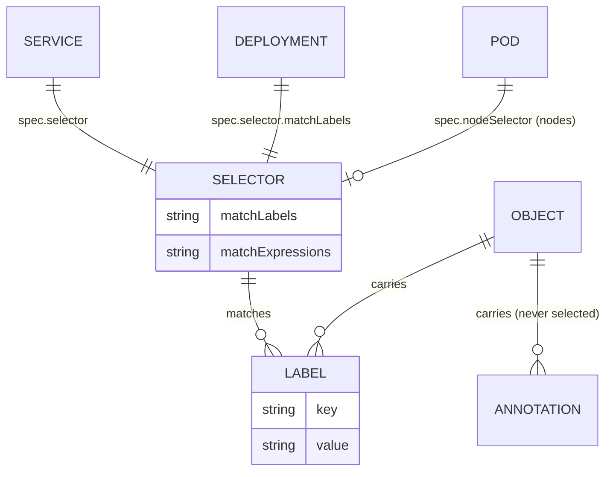

# Lab: Labels and Selectors

## Objective & CKA Context

Labels are key/value pairs that Services, Deployments, ReplicaSets and the scheduler use to find
objects; annotations hold extra data that nothing selects on. Most "my Service has no endpoints"
and "my Deployment owns no Pods" problems on the CKA exam are label/selector mismatches, so you
must query, change and compare labels fast.

### Concept Diagram

The diagram shows how objects carry labels and annotations, and which fields use a selector to match labels.




### Setup

```bash
# On k8s-master-01
kubectl version
# Expected: Server Version: v1.37.2

kubectl get nodes -o wide
# Expected: 5 nodes, all STATUS Ready

kubectl create namespace lab-labels-and-selectors --dry-run=client -o yaml | kubectl apply -f -
kubectl config set-context --current --namespace=lab-labels-and-selectors
# Expected: namespace/lab-labels-and-selectors created (or configured)
#           Context "..." modified.
```

## Scenario 1

**Use case:** A namespace holds Pods of several apps, tiers and environments, and you need to
list exactly the ones you care about.

### Step 1 – Create labelled Pods

```bash
kubectl run web-prod --image=nginx:1.27-alpine --labels=app=web,tier=frontend,env=prod
kubectl run web-dev  --image=nginx:1.27-alpine --labels=app=web,tier=frontend,env=dev
kubectl run api-prod --image=nginx:1.27-alpine --labels=app=api,tier=backend,env=prod
kubectl run tool     --image=busybox:1.36 --labels=app=tool -- sleep 3600
kubectl get pods --show-labels
# Expected: 4 Pods with their labels in the LABELS column
```

### Step 2 – Equality-based and set-based queries

```bash
kubectl get pods -l app=web
# Expected: web-dev, web-prod

kubectl get pods -l 'env!=prod'
# Expected: tool, web-dev   (!= also matches Pods WITHOUT the key)

kubectl get pods -l 'tier in (frontend,backend),env notin (dev)'
# Expected: api-prod, web-prod   (comma = AND)

kubectl get pods -l '!tier'
# Expected: tool   (Pods that have no "tier" key)

kubectl get pods -L app,tier,env
# Expected: extra columns APP, TIER, ENV (empty for tool's missing keys)
```

### Step 3 – Change and remove labels

```bash
kubectl label pod web-dev env=staging
# Expected: error: 'env' already has a value (dev), and --overwrite is false

kubectl label pod web-dev env=staging --overwrite
kubectl label pod tool app-
# Expected: pod/web-dev labeled
#           pod/tool unlabeled

kubectl get pods -L app,env
# Expected: web-dev ENV staging; tool APP empty
```

## Scenario 2

**Use case:** The storage team marks which worker has SSD disks so that Pods can be placed on
them later.

### Step 1 – Label the workers

```bash
kubectl label node k8s-worker-01 cka-lab/disk=ssd
kubectl label node k8s-worker-02 cka-lab/disk=hdd
# Expected: node/k8s-worker-01 labeled
#           node/k8s-worker-02 labeled

kubectl get nodes -L cka-lab/disk
# Expected: DISK column: ssd on k8s-worker-01, hdd on k8s-worker-02, empty on the masters
```

The `cka-lab/` prefix keeps lab labels apart from real ones (`kubernetes.io/...`,
`node-role.kubernetes.io/...`) and makes them easy to find and remove.

### Step 2 – Select nodes

```bash
kubectl get nodes -l cka-lab/disk=ssd
# Expected: k8s-worker-01

kubectl get nodes -l 'cka-lab/disk in (ssd,hdd)' -o name
# Expected: node/k8s-worker-01
#           node/k8s-worker-02

kubectl get nodes -l '!node-role.kubernetes.io/control-plane'
# Expected: the two workers (built-in labels work the same way)
```

### Step 3 – Overwrite a node label and use it

```bash
kubectl label node k8s-worker-02 cka-lab/disk=ssd --overwrite
kubectl get nodes -l cka-lab/disk=ssd -o name
# Expected: node/k8s-worker-01
#           node/k8s-worker-02

kubectl run on-ssd --image=nginx:1.27-alpine \
  --overrides='{"spec":{"nodeSelector":{"cka-lab/disk":"ssd"}}}'
kubectl wait --for=condition=Ready pod/on-ssd --timeout=60s
kubectl get pod on-ssd -o wide
# Expected: Running on k8s-worker-01 or k8s-worker-02 (both are now "ssd")
```

## Scenario 3

**Use case:** The `shop` web app is running, but its Service sends traffic nowhere.

### Setup

```bash
cat <<'EOF' | kubectl apply -f -
apiVersion: apps/v1
kind: Deployment
metadata:
  name: shop
  namespace: lab-labels-and-selectors
spec:
  replicas: 3
  selector:
    matchLabels:
      app: shop
  template:
    metadata:
      labels:
        app: shop
        tier: frontend
    spec:
      containers:
      - name: nginx
        image: nginx:1.27-alpine
        ports:
        - containerPort: 80
---
apiVersion: v1
kind: Service
metadata:
  name: shop
  namespace: lab-labels-and-selectors
spec:
  selector:
    app: shop
    tier: front
  ports:
  - port: 80
    targetPort: 80
EOF
kubectl rollout status deploy/shop --timeout=90s
# Expected: deployment "shop" successfully rolled out
```

### Task (~8 min)

1. Service `shop` in namespace `lab-labels-and-selectors` has no endpoints. Fix it **without
   changing the Deployment**. The Service must select exactly the 3 `shop` Pods.
2. Add the metadata `contact=ops-team` to Deployment `shop` so that it is **not** usable in a
   selector.
3. Print the `shop` Pods with `app` and `tier` shown as columns.

<details><summary>Solution</summary>

### Step 1 – Compare the selector with the Pod labels

```bash
kubectl get endpointslices -l kubernetes.io/service-name=shop
# Expected: ENDPOINTS <unset>

kubectl get svc shop -o jsonpath='{.spec.selector}{"\n"}'
# Expected: {"app":"shop","tier":"front"}

kubectl get pods -l app=shop --show-labels
# Expected: 3 Pods with app=shop,pod-template-hash=...,tier=frontend
```

All keys of a Service selector must match. `tier=front` matches no Pod.

### Step 2 – Fix the Service selector

```bash
kubectl patch svc shop -p '{"spec":{"selector":{"app":"shop","tier":"frontend"}}}'
# Expected: service/shop patched
```

### Step 3 – Annotation, not label

```bash
kubectl annotate deploy shop contact=ops-team
# Expected: deployment.apps/shop annotated
```

### Step 4 – Show labels as columns

```bash
kubectl get pods -l app=shop -L app,tier
```

</details>

### Verify

```bash
kubectl get endpointslices -l kubernetes.io/service-name=shop \
  -o jsonpath='{range .items[*].endpoints[*]}{.addresses[0]}{"\n"}{end}' | wc -l
# Expected: 3

kubectl run probe --rm -i --restart=Never --image=busybox:1.36 -- wget -qO- -T 3 http://shop | grep title
# Expected: <title>Welcome to nginx!</title>

kubectl get deploy shop -o jsonpath='{.metadata.annotations.contact}{"\n"}'
# Expected: ops-team

kubectl get deploy -l contact=ops-team
# Expected: No resources found   (annotations are not selectable)
```

## Verification Checklist

| Check                 | Command                                                                    | Expected result        |
|-----------------------|----------------------------------------------------------------------------|------------------------|
| Set-based query       | `kubectl get pods -l 'tier in (frontend,backend),env notin (dev)' -o name` | `api-prod`, `web-prod` |
| Label overwritten     | `kubectl get pod web-dev -L env`                                           | ENV `staging`          |
| Node labels set       | `kubectl get nodes -l cka-lab/disk=ssd -o name`                            | both workers           |
| Service has endpoints | `kubectl get endpointslices -l kubernetes.io/service-name=shop`            | 3 addresses            |
| Annotation set        | `kubectl get deploy shop -o jsonpath='{.metadata.annotations.contact}'`    | `ops-team`             |

## Cleanup

```bash
kubectl delete namespace lab-labels-and-selectors --ignore-not-found
# Expected: namespace "lab-labels-and-selectors" deleted

kubectl label node k8s-worker-01 k8s-worker-02 cka-lab/disk-
# Expected: node/k8s-worker-01 unlabeled, node/k8s-worker-02 unlabeled
#           (or 'label "cka-lab/disk" not found.' if already removed)

kubectl config set-context --current --namespace=default

# Final health check
kubectl get nodes --show-labels | grep cka-lab
# Expected: no output

kubectl get nodes
# Expected: 5 nodes, all Ready

kubectl get ns | grep lab-
# Expected: no output
```
