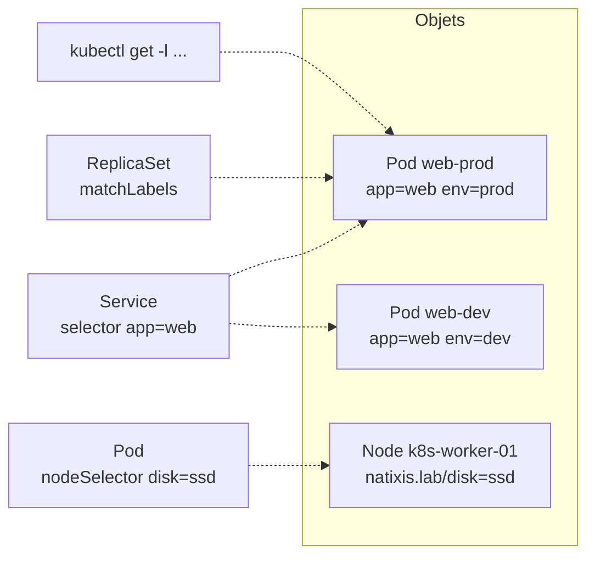

# Lab : Labels et sélecteurs

## Objectifs

- poser, modifier et supprimer des labels sur des Pods et des nœuds ;
- écrire des sélecteurs **par égalité** (`=`, `!=`) et **par ensemble** (`in`, `notin`, `exists`, `!key`) ;
- connaître les règles de syntaxe d'un label (préfixe, longueur, caractères) ;
- distinguer labels, **annotations** et **field selectors** ;
- diagnostiquer un Service sans endpoint à cause d'un sélecteur incorrect.

### Vue d'ensemble



## Contexte du cluster et prérequis

| Élément                    | Valeur                                                   |
|----------------------------|----------------------------------------------------------|
| Poste de travail           | `ssh k8s-master-01`                                      |
| Namespace du lab           | `sched-labels`                                           |
| Préfixe des labels de nœud | `natixis.lab/` (facile à retrouver et à supprimer)       |
| Images                     | `nginx:1.27`, `busybox:1.36`                             |
| Impact                     | Labels ajoutés sur les 2 workers, supprimés au nettoyage |


## Étape 0 : préparer l'environnement

```bash
ssh k8s-master-01
kubectl create namespace sched-labels
kubectl config set-context --current --namespace=sched-labels
```


# Partie 1 : labels sur les Pods

## Étape 1 : créer des Pods étiquetés

```bash
kubectl run web-prod --image=nginx:1.27 --labels=app=web,tier=frontend,env=prod
kubectl run web-dev  --image=nginx:1.27 --labels=app=web,tier=frontend,env=dev
kubectl run api-prod --image=nginx:1.27 --labels=app=api,tier=backend,env=prod
kubectl run tool     --image=busybox:1.36 --labels=app=tool -- sleep 3600

kubectl get pods --show-labels
# NAME       ...   LABELS
# api-prod   ...   app=api,env=prod,tier=backend
# tool       ...   app=tool
# web-dev    ...   app=web,env=dev,tier=frontend
# web-prod   ...   app=web,env=prod,tier=frontend
```

## Étape 2 : sélecteurs par égalité et par ensemble

```bash
kubectl get pods -l app=web -o name
# pod/web-dev
# pod/web-prod

kubectl get pods -l 'env!=prod' -o name
# pod/tool        <- != inclut aussi les objets SANS la clé
# pod/web-dev

kubectl get pods -l 'tier in (frontend,backend),env notin (dev)' -o name
# pod/api-prod    <- la virgule = ET
# pod/web-prod

kubectl get pods -l env -o name
# pod/api-prod    <- la clé existe (quelle que soit la valeur)
# pod/web-dev
# pod/web-prod

kubectl get pods -l '!tier' -o name
# pod/tool        <- la clé n'existe pas

kubectl get pods -L app,tier,env
# Attendu : colonnes APP, TIER, ENV (vides pour tool)
```

| Opérateur     | Exemple                      | Sélectionne                              |
|---------------|------------------------------|------------------------------------------|
| `=` / `==`    | `app=web`                    | clé présente avec cette valeur           |
| `!=`          | `env!=prod`                  | valeur différente **ou clé absente**     |
| `in`          | `tier in (frontend,backend)` | une des valeurs                          |
| `notin`       | `env notin (dev)`            | aucune de ces valeurs **ou clé absente** |
| existence     | `env`                        | clé présente                             |
| non-existence | `!tier`                      | clé absente                              |
| `,`           | `a=1,b=2`                    | ET logique (il n'y a **pas** de OU)      |

## Étape 3 : modifier et supprimer

```bash
kubectl label pod web-dev env=staging
# Attendu : error: 'env' already has a value (dev), and --overwrite is false

kubectl label pod web-dev env=staging --overwrite
kubectl label pod tool app-
# pod/web-dev labeled
# pod/tool unlabeled

kubectl label pods -l app=web team=digital     # sur plusieurs Pods d'un coup
kubectl get pods -L app,env,team
```

## Étape 4 : les règles de syntaxe

```bash
kubectl label pod web-prod 'bad key=x'
# Attendu : Invalid value: "bad key": name part must consist of alphanumeric characters, '-', '_' or '.' ...

kubectl label pod web-prod app=$(printf 'a%.0s' {1..70})
# Attendu : error: invalid label value: ... must be no more than 63 bytes
```

| Partie              | Règle                                                                                   |
|---------------------|-----------------------------------------------------------------------------------------|
| Préfixe (optionnel) | Nom DNS ≤ 253 caractères, suivi de `/` (`natixis.lab/`, `kubernetes.io/`)               |
| Nom                 | ≤ 63 caractères, alphanumérique, `-`, `_`, `.`, commence et finit par un alphanumérique |
| Valeur              | ≤ 63 caractères, mêmes caractères, peut être vide                                       |
| Préfixes réservés   | `kubernetes.io/` et `k8s.io/` sont réservés au système                                  |


# Partie 2 : labels sur les nœuds

## Étape 5 : étiqueter les workers

```bash
kubectl label node k8s-worker-01 natixis.lab/disk=ssd
kubectl label node k8s-worker-02 natixis.lab/disk=hdd

kubectl get nodes -L natixis.lab/disk
# NAME            ...   DISK
# k8s-master-01   ...
# k8s-worker-01   ...   ssd
# k8s-worker-02   ...   hdd

kubectl get nodes -l 'natixis.lab/disk in (ssd,hdd)' -o name
kubectl get nodes -l '!node-role.kubernetes.io/control-plane' -o name
# node/k8s-worker-01
# node/k8s-worker-02
```

Labels posés automatiquement par le kubelet, utilisables dans les sélecteurs :

```bash
kubectl get nodes -L kubernetes.io/hostname,kubernetes.io/os,kubernetes.io/arch | head -3
```

> Les labels de nœud servent aux règles de placement : `nodeSelector` (lab 04) et `nodeAffinity` (lab 05).


# Partie 3 : annotations et field selectors

## Étape 6 : une annotation n'est pas sélectionnable

```bash
kubectl annotate pod web-prod contact=ops-team
kubectl get pods -l contact=ops-team
# Attendu : No resources found   -> une annotation n'est PAS un label
kubectl get pod web-prod -o jsonpath='{.metadata.annotations.contact}{"\n"}'
# Attendu : ops-team
```

| Labels                                                | Annotations                                               |
|-------------------------------------------------------|-----------------------------------------------------------|
| Identifient et **sélectionnent** (Services, RS, `-l`) | **Documentent** (contact, ticket, configuration d'outils) |
| Valeur ≤ 63 caractères                                | Valeur jusqu'à 256 Ko au total                            |

## Étape 7 : field selectors

```bash
kubectl get pods --field-selector status.phase=Running,spec.nodeName=k8s-worker-01 -o name
# Attendu : les Pods Running sur k8s-worker-01
```

> `--field-selector` filtre sur des **champs** de l'objet (`metadata.name`, `status.phase`, `spec.nodeName`...). Seuls quelques champs
> sont pris en charge.


# Partie 4 : diagnostic

## Étape 8 : un Service qui ne trouve pas ses Pods

```bash
cat <<'EOF' | kubectl apply -f -
apiVersion: apps/v1
kind: Deployment
metadata:
  name: shop
  namespace: sched-labels
spec:
  replicas: 3
  selector:
    matchLabels:
      app: shop
  template:
    metadata:
      labels:
        app: shop
        tier: frontend
    spec:
      containers:
      - name: nginx
        image: nginx:1.27
        ports:
        - containerPort: 80
---
apiVersion: v1
kind: Service
metadata:
  name: shop
  namespace: sched-labels
spec:
  selector:
    app: shop
    tier: front
  ports:
  - port: 80
    targetPort: 80
EOF
kubectl rollout status deployment/shop

kubectl get endpointslices -l kubernetes.io/service-name=shop
# Attendu : ENDPOINTS <unset>
```

**À vous :** corrigez le Service **sans modifier le Deployment**.

<details><summary>Solution</summary>

```bash
kubectl get svc shop -o jsonpath='{.spec.selector}{"\n"}'     # {"app":"shop","tier":"front"}
kubectl get pods -l app=shop --show-labels                     # tier=frontend
kubectl patch svc shop -p '{"spec":{"selector":{"app":"shop","tier":"frontend"}}}'
kubectl get endpointslices -l kubernetes.io/service-name=shop  # 3 endpoints
kubectl run probe --rm -it --restart=Never --image=busybox:1.36 -- wget -qO- -T 3 http://shop | grep title
# <title>Welcome to nginx!</title>
```
Toutes les clés du sélecteur d'un Service doivent correspondre.
</details>


# Partie 5 : exercices d'évaluation

**Exercice 1 :** listez les Pods qui ont `app=web` **et** n'ont **pas** `env=prod`.

**Exercice 2 :** ajoutez le label `owner=natixis-cib` à tous les Pods qui ont un label `tier`, en une commande.

**Exercice 3 :** affichez les nœuds qui ne sont **pas** des masters, avec la colonne `natixis.lab/disk`.

**Exercice 4 :** supprimez le label `team` de tous les Pods en une commande.

<details><summary><b>Solutions</b></summary>

```bash
kubectl get pods -l 'app=web,env!=prod'
kubectl label pods -l tier owner=natixis-cib
kubectl get nodes -l '!node-role.kubernetes.io/control-plane' -L natixis.lab/disk
kubectl label pods --all team-
```
</details>


## Nettoyage

```bash
kubectl delete namespace sched-labels
kubectl label node k8s-worker-01 k8s-worker-02 natixis.lab/disk-
kubectl config set-context --current --namespace=default

kubectl get nodes --show-labels | grep -c natixis.lab
# Attendu : 0
```

## Questions de compréhension

1. Pourquoi `env!=prod` renvoie-t-il aussi les Pods sans label `env` ?
2. Comment exprimer un OU entre deux valeurs d'une même clé ? Entre deux clés différentes ?
3. Quand utiliser une annotation plutôt qu'un label ?
4. Pourquoi préfixer vos labels (`natixis.lab/...`) ?

<details><summary>Réponses</summary>

1. `!=` signifie « n'a pas cette valeur », ce qui inclut le cas où la clé est absente.
2. Même clé : `key in (a,b)`. Deux clés : impossible en un seul sélecteur (la virgule est un ET). Il faut deux requêtes.
3. Pour des informations qui ne servent pas à sélectionner : contact, ticket, configuration d'outils, valeurs longues.
4. Pour éviter les collisions avec les labels système ou d'autres équipes, et pour retrouver ou supprimer facilement ses labels.
</details>

## Commands


| Commande                                            | Utilité                    |
|-----------------------------------------------------|----------------------------|
| `kubectl label <type> <nom> k=v [--overwrite]`      | Poser ou modifier un label |
| `kubectl label <type> <nom> k-`                     | Supprimer un label         |
| `kubectl label pods -l <sel> k=v`                   | Étiqueter en masse         |
| `kubectl get <type> -l <sel>`                       | Filtrer                    |
| `kubectl get <type> --show-labels` / `-L k1,k2`     | Afficher les labels        |
| `kubectl annotate <type> <nom> k=v`                 | Annotation                 |
| `kubectl get pods --field-selector spec.nodeName=X` | Filtrer sur un champ       |
