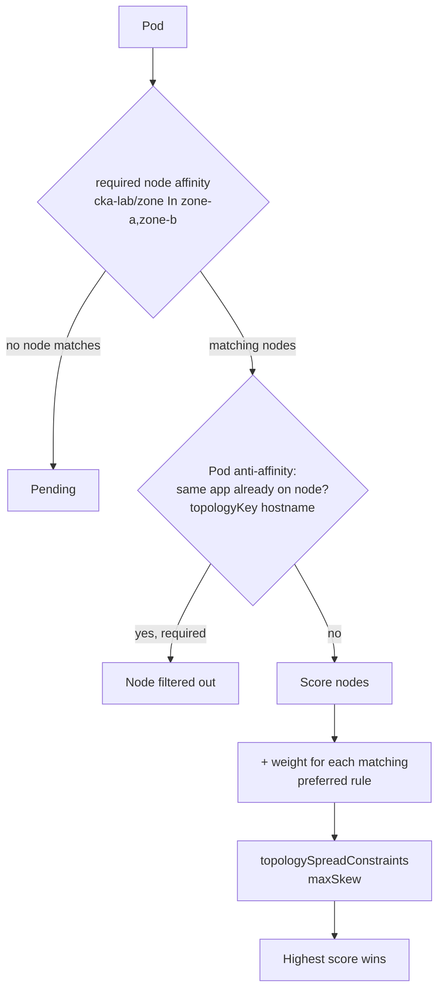

# Lab: Node Affinity and Anti-Affinity

## Objective & CKA Context

Node affinity is an expressive `nodeSelector`: hard (`required…`) or soft (`preferred…` with
weights) rules using `In`, `NotIn`, `Exists`, `DoesNotExist`, `Gt`, `Lt`. Pod anti-affinity and
topology spread constraints place Pods relative to *other Pods*, for example one replica per
node. The CKA exam expects you to write these blocks from memory and to explain a Pending Pod.

### Concept Diagram

The diagram shows the order in which required node affinity, Pod anti-affinity, preferred weights and topology spread decide where a Pod goes.



### Setup

```bash
# On k8s-master-01
kubectl version
# Expected: Server Version: v1.37.2

kubectl get nodes -o wide
# Expected: 5 nodes, all STATUS Ready

kubectl create namespace lab-node-affinity-and-anti-affinity --dry-run=client -o yaml | kubectl apply -f -
kubectl config set-context --current --namespace=lab-node-affinity-and-anti-affinity
# Expected: namespace/lab-node-affinity-and-anti-affinity created (or configured)
#           Context "..." modified.
```

## Scenario 1

**Use case:** A database Pod must run in zone A only.

### Step 1 – Label the workers with a zone

```bash
kubectl label node k8s-worker-01 cka-lab/zone=zone-a
kubectl label node k8s-worker-02 cka-lab/zone=zone-b
kubectl get nodes -L cka-lab/zone
# Expected: ZONE zone-a on k8s-worker-01, zone-b on k8s-worker-02
```

### Step 2 – Required node affinity with `In`

```bash
cat <<'EOF' | kubectl apply -f -
apiVersion: v1
kind: Pod
metadata:
  name: db
  namespace: lab-node-affinity-and-anti-affinity
spec:
  affinity:
    nodeAffinity:
      requiredDuringSchedulingIgnoredDuringExecution:
        nodeSelectorTerms:
        - matchExpressions:
          - key: cka-lab/zone
            operator: In
            values: ["zone-a"]
  containers:
  - name: db
    image: busybox:1.36
    command: ["sh", "-c", "sleep 3600"]
EOF
kubectl wait --for=condition=Ready pod/db --timeout=60s
kubectl get pod db -o wide
# Expected: Running on k8s-worker-01
```

### Step 3 – A required rule that matches nothing

```bash
kubectl run db-c --image=busybox:1.36 --overrides='{"spec":{"affinity":{"nodeAffinity":{
  "requiredDuringSchedulingIgnoredDuringExecution":{"nodeSelectorTerms":[{"matchExpressions":[
  {"key":"cka-lab/zone","operator":"In","values":["zone-c"]}]}]}}}}}' -- sleep 3600
sleep 5
kubectl get pod db-c
# Expected: STATUS Pending (no node is in zone-c)

kubectl delete pod db-c
```

## Scenario 2

**Use case:** A cache must run on a zoned node, never in zone C, and *preferably* in zone B.

### Step 1 – `Exists` + `NotIn` (required) and a weighted preference

```bash
cat <<'EOF' | kubectl apply -f -
apiVersion: apps/v1
kind: Deployment
metadata:
  name: cache
  namespace: lab-node-affinity-and-anti-affinity
spec:
  replicas: 4
  selector:
    matchLabels:
      app: cache
  template:
    metadata:
      labels:
        app: cache
    spec:
      affinity:
        nodeAffinity:
          requiredDuringSchedulingIgnoredDuringExecution:
            nodeSelectorTerms:
            - matchExpressions:
              - key: cka-lab/zone
                operator: Exists
              - key: cka-lab/zone
                operator: NotIn
                values: ["zone-c"]
          preferredDuringSchedulingIgnoredDuringExecution:
          - weight: 100
            preference:
              matchExpressions:
              - key: cka-lab/zone
                operator: In
                values: ["zone-b"]
      containers:
      - name: cache
        image: registry.k8s.io/pause:3.10
EOF
kubectl rollout status deploy/cache --timeout=90s
kubectl get pods -l app=cache -o custom-columns=NAME:.metadata.name,NODE:.spec.nodeName
# Expected: all 4 (or most) on k8s-worker-02 (zone-b is preferred)
```

Expressions inside one `matchExpressions` list are ANDed. Several `nodeSelectorTerms` are ORed.

### Step 2 – Preferences are soft

```bash
kubectl patch deploy cache --type=json -p '[{"op":"replace",
  "path":"/spec/template/spec/affinity/nodeAffinity/preferredDuringSchedulingIgnoredDuringExecution/0/preference/matchExpressions/0/values",
  "value":["zone-x"]}]'
kubectl rollout status deploy/cache --timeout=90s
kubectl get pods -l app=cache -o wide
# Expected: 4 new Pods Running on the workers (old ones may still show Terminating):
#           an unmatched preference never blocks scheduling
```

## Scenario 3

**Use case:** A web app must never have two replicas on the same node, but one replica never
starts.

### Setup

```bash
cat <<'EOF' | kubectl apply -f -
apiVersion: apps/v1
kind: Deployment
metadata:
  name: web
  namespace: lab-node-affinity-and-anti-affinity
spec:
  replicas: 3
  selector:
    matchLabels:
      app: web
  template:
    metadata:
      labels:
        app: web
    spec:
      affinity:
        podAntiAffinity:
          requiredDuringSchedulingIgnoredDuringExecution:
          - labelSelector:
              matchLabels:
                app: web
            topologyKey: kubernetes.io/hostname
      containers:
      - name: nginx
        image: nginx:1.27-alpine
EOF
sleep 10
kubectl get pods -l app=web -o wide
# Expected: 2 Pods Running (one per worker), 1 Pod Pending
```

### Task (~8 min)

1. Explain why one `web` replica in namespace `lab-node-affinity-and-anti-affinity` is Pending.
2. Change Deployment `web` so that all **3** replicas run on the workers, spread as evenly as
   possible (the difference between the two workers is at most 1). Use a
   `topologySpreadConstraints` rule with `whenUnsatisfiable: DoNotSchedule`.
3. Do not remove the control-plane taint and do not add tolerations.

<details><summary>Solution</summary>

### Step 1 – Read the reason

```bash
kubectl get events --field-selector reason=FailedScheduling | tail -1
# Expected: 0/5 nodes are available: 2 node(s) didn't match pod anti-affinity rules,
#           3 node(s) had untolerated taint(s). ...
```

Required anti-affinity on `kubernetes.io/hostname` allows one `app=web` Pod per node. Only 2
nodes are schedulable, so the third replica can never be placed.

### Step 2 – Replace the anti-affinity with a spread constraint

A rolling update would get stuck: the old Pods' *required* anti-affinity also blocks new
`app=web` Pods from their nodes. Recreate the Deployment instead:

```bash
kubectl delete deploy web
cat <<'EOF' | kubectl apply -f -
apiVersion: apps/v1
kind: Deployment
metadata:
  name: web
  namespace: lab-node-affinity-and-anti-affinity
spec:
  replicas: 3
  selector:
    matchLabels:
      app: web
  template:
    metadata:
      labels:
        app: web
    spec:
      topologySpreadConstraints:
      - maxSkew: 1
        topologyKey: kubernetes.io/hostname
        whenUnsatisfiable: DoNotSchedule
        nodeTaintsPolicy: Honor
        labelSelector:
          matchLabels:
            app: web
      containers:
      - name: nginx
        image: nginx:1.27-alpine
EOF
kubectl rollout status deploy/web --timeout=90s
```

`nodeTaintsPolicy: Honor` is the trap: by default (`Ignore`) the 3 tainted masters still count
as topology domains with 0 Pods, so a worker may hold only 1 Pod (skew vs 0) and the third replica
stays Pending with "didn't match pod topology spread constraints". `Honor` leaves untolerated
nodes out of the calculation. (A `preferred…` pod anti-affinity also works, but does not
guarantee the 2/1 split.)

</details>

### Verify

```bash
kubectl get deploy web
# Expected: READY 3/3

kubectl get pods -l app=web -o jsonpath='{range .items[*]}{.spec.nodeName}{"\n"}{end}' | sort | uniq -c
# Expected: 2 on one worker, 1 on the other

kubectl describe nodes k8s-master-01 k8s-master-02 k8s-master-03 | grep Taints
# Expected: 3 × node-role.kubernetes.io/control-plane:NoSchedule (unchanged)
```

## Verification Checklist

| Check              | Command                                              | Expected result                          |
|--------------------|------------------------------------------------------|------------------------------------------|
| Required `In`      | `kubectl get pod db -o wide`                         | on k8s-worker-01                         |
| Zone labels set    | `kubectl get nodes -L cka-lab/zone`                  | zone-a on worker-01, zone-b on worker-02 |
| Preference is soft | `kubectl get deploy cache`                           | READY 4/4                                |
| Spread fixed       | `kubectl get deploy web`                             | READY 3/3, split 2/1                     |
| Masters untouched  | `kubectl describe node k8s-master-01 \| grep Taints` | control-plane taint present              |

## Cleanup

```bash
kubectl delete namespace lab-node-affinity-and-anti-affinity --ignore-not-found
# Expected: namespace "lab-node-affinity-and-anti-affinity" deleted

kubectl label node k8s-worker-01 k8s-worker-02 cka-lab/zone-
# Expected: node/k8s-worker-01 unlabeled, node/k8s-worker-02 unlabeled
#           ('label ... not found.' lines are fine)

kubectl config set-context --current --namespace=default

# Final health check
kubectl get nodes --show-labels | grep cka-lab
# Expected: no output

kubectl get nodes
# Expected: 5 nodes, all Ready

kubectl get ns | grep lab-
# Expected: no output
```
