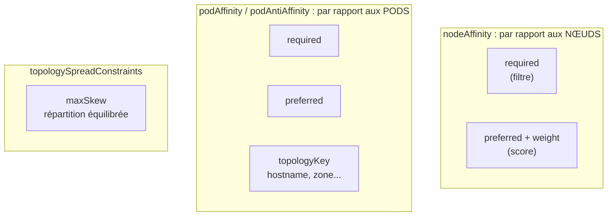

# Lab : Node affinity, pod affinity et anti-affinity

## Objectifs

- écrire une `nodeAffinity` **obligatoire** (`required...`) et **préférée** (`preferred...`, `weight`) ;
- utiliser les opérateurs `In`, `NotIn`, `Exists`, `DoesNotExist`, `Gt`, `Lt` ;
- combiner des conditions en **ET** (`matchExpressions`) et en **OU** (`nodeSelectorTerms`) ;
- placer des Pods **par rapport à d'autres Pods** (`podAffinity`, `podAntiAffinity`, `topologyKey`) ;
- répartir des réplicas avec `topologySpreadConstraints` et éviter le piège `nodeTaintsPolicy`.

### Vue d'ensemble



## Contexte du cluster et prérequis

| Élément          | Valeur                                                              |
|------------------|---------------------------------------------------------------------|
| Poste de travail | `ssh k8s-master-01`                                                 |
| Namespace du lab | `sched-affinity`                                                    |
| Labels du lab    | `natixis.lab/zone` (zone-a / zone-b), `natixis.lab/cpu-gen` (3 / 5) |
| Images           | `nginx:1.27`, `busybox:1.36`, `registry.k8s.io/pause:3.10`          |
| Prérequis        | Labs 05-02 (labels), 05-03 (taints), 05-04 (nodeSelector)           |


## Étape 0 : préparer l'environnement

```bash
ssh k8s-master-01
kubectl create namespace sched-affinity
kubectl config set-context --current --namespace=sched-affinity

kubectl label node k8s-worker-01 natixis.lab/zone=zone-a natixis.lab/cpu-gen=3
kubectl label node k8s-worker-02 natixis.lab/zone=zone-b natixis.lab/cpu-gen=5
kubectl get nodes -L natixis.lab/zone,natixis.lab/cpu-gen
```


# Partie 1 : `nodeAffinity` obligatoire

## Étape 1 : opérateur `In`

```bash
cat <<'EOF' | kubectl apply -f -
apiVersion: v1
kind: Pod
metadata:
  name: db
  namespace: sched-affinity
  labels:
    app: db
spec:
  affinity:
    nodeAffinity:
      requiredDuringSchedulingIgnoredDuringExecution:
        nodeSelectorTerms:
        - matchExpressions:
          - key: natixis.lab/zone
            operator: In
            values: ["zone-a"]
  containers:
  - name: db
    image: busybox:1.36
    command: ["sh", "-c", "sleep 3600"]
EOF
kubectl wait --for=condition=Ready pod/db --timeout=60s
kubectl get pod db -o wide
# Attendu : Running sur k8s-worker-01
```

> `requiredDuringScheduling` = **obligatoire** au placement. `IgnoredDuringExecution` = sans effet sur les Pods déjà placés si les labels
> changent ensuite.

## Étape 2 : une règle que rien ne satisfait

```bash
kubectl run db-c --image=busybox:1.36 --overrides='{"spec":{"affinity":{"nodeAffinity":{
  "requiredDuringSchedulingIgnoredDuringExecution":{"nodeSelectorTerms":[{"matchExpressions":[
  {"key":"natixis.lab/zone","operator":"In","values":["zone-c"]}]}]}}}}}' -- sleep 3600
sleep 5
kubectl get pod db-c
# Attendu : Pending
kubectl get events --field-selector involvedObject.name=db-c,reason=FailedScheduling -o custom-columns=MSG:.message
# 0/5 nodes are available: 2 node(s) didn't match Pod's node affinity/selector, 3 node(s) had untolerated taint(s). ...
kubectl delete pod db-c
```

## Étape 3 : `Gt` / `Lt` et le OU entre termes

```bash
# Gt : nœuds dont natixis.lab/cpu-gen > 4
kubectl run newcpu --image=busybox:1.36 --overrides='{"spec":{"affinity":{"nodeAffinity":{
  "requiredDuringSchedulingIgnoredDuringExecution":{"nodeSelectorTerms":[{"matchExpressions":[
  {"key":"natixis.lab/cpu-gen","operator":"Gt","values":["4"]}]}]}}}}}' -- sleep 3600
kubectl wait --for=condition=Ready pod/newcpu --timeout=60s
kubectl get pod newcpu -o wide
# Attendu : k8s-worker-02 (cpu-gen=5)

# Deux nodeSelectorTerms = OU : zone-z (n'existe pas) OU cpu-gen < 4
kubectl run orterm --image=busybox:1.36 --overrides='{"spec":{"affinity":{"nodeAffinity":{
  "requiredDuringSchedulingIgnoredDuringExecution":{"nodeSelectorTerms":[
  {"matchExpressions":[{"key":"natixis.lab/zone","operator":"In","values":["zone-z"]}]},
  {"matchExpressions":[{"key":"natixis.lab/cpu-gen","operator":"Lt","values":["4"]}]}]}}}}}' -- sleep 3600
kubectl wait --for=condition=Ready pod/orterm --timeout=60s
kubectl get pod orterm -o wide
# Attendu : k8s-worker-01 (cpu-gen=3, 2e terme)

kubectl delete pod newcpu orterm
```

| Opérateur                 | Signification                               | `values`       |
|---------------------------|---------------------------------------------|----------------|
| `In` / `NotIn`            | valeur dans / hors de la liste              | liste          |
| `Exists` / `DoesNotExist` | clé présente / absente                      | aucune         |
| `Gt` / `Lt`               | comparaison **entière** (strictement > / <) | un seul entier |

| Structure                                             | Logique                                   |
|-------------------------------------------------------|-------------------------------------------|
| Plusieurs expressions dans un `matchExpressions`      | **ET**                                    |
| Plusieurs `nodeSelectorTerms`                         | **OU**                                    |
| `nodeSelector` **et** `nodeAffinity` dans le même Pod | **ET** : les deux doivent être satisfaits |


# Partie 2 : `nodeAffinity` préférée

## Étape 4 : obligatoire + préférence pondérée

```bash
cat <<'EOF' | kubectl apply -f -
apiVersion: apps/v1
kind: Deployment
metadata:
  name: cache
  namespace: sched-affinity
spec:
  replicas: 4
  selector:
    matchLabels:
      app: cache
  template:
    metadata:
      labels:
        app: cache
    spec:
      affinity:
        nodeAffinity:
          requiredDuringSchedulingIgnoredDuringExecution:
            nodeSelectorTerms:
            - matchExpressions:
              - key: natixis.lab/zone
                operator: Exists
              - key: natixis.lab/zone
                operator: NotIn
                values: ["zone-c"]
          preferredDuringSchedulingIgnoredDuringExecution:
          - weight: 100
            preference:
              matchExpressions:
              - key: natixis.lab/zone
                operator: In
                values: ["zone-b"]
      containers:
      - name: cache
        image: registry.k8s.io/pause:3.10
EOF
kubectl rollout status deployment/cache
kubectl get pods -l app=cache -o wide --no-headers | awk '{print $7}' | sort | uniq -c
# Attendu : 4 k8s-worker-02   (zone-b préférée)
```

> `weight` va de 1 à 100. Le scheduler ajoute ce poids au **score** des nœuds qui correspondent. La préférence **influence**
> le choix, mais n'**empêche** jamais le placement : sans nœud en zone-b, les Pods iraient en zone-a.


# Partie 3 : `podAffinity` et `podAntiAffinity`

## Étape 5 : placer l'API à côté de la base

```bash
cat <<'EOF' | kubectl apply -f -
apiVersion: apps/v1
kind: Deployment
metadata:
  name: api
  namespace: sched-affinity
spec:
  replicas: 3
  selector:
    matchLabels:
      app: api
  template:
    metadata:
      labels:
        app: api
    spec:
      affinity:
        podAffinity:
          requiredDuringSchedulingIgnoredDuringExecution:
          - labelSelector:
              matchLabels:
                app: db
            topologyKey: kubernetes.io/hostname
      containers:
      - name: api
        image: registry.k8s.io/pause:3.10
EOF
kubectl rollout status deployment/api
kubectl get pods -l app=api -o wide --no-headers | awk '{print $7}' | sort | uniq -c
# Attendu : 3 k8s-worker-01   -> le nœud où tourne le Pod db
```

> `topologyKey` définit ce que « à côté » veut dire : `kubernetes.io/hostname` = même **nœud**, `topology.kubernetes.io/zone` =
> même **zone**. L'affinité de Pod lit les **labels des Pods**, puis regroupe les nœuds selon la **valeur** de `topologyKey`.

## Étape 6 : anti-affinité obligatoire, une réplique par nœud

```bash
cat <<'EOF' | kubectl apply -f -
apiVersion: apps/v1
kind: Deployment
metadata:
  name: web
  namespace: sched-affinity
spec:
  replicas: 3
  selector:
    matchLabels:
      app: web
  template:
    metadata:
      labels:
        app: web
    spec:
      affinity:
        podAntiAffinity:
          requiredDuringSchedulingIgnoredDuringExecution:
          - labelSelector:
              matchLabels:
                app: web
            topologyKey: kubernetes.io/hostname
      containers:
      - name: nginx
        image: nginx:1.27
EOF
sleep 10
kubectl get pods -l app=web -o wide --no-headers | awk '{print $3, $7}'
# Running k8s-worker-01
# Running k8s-worker-02
# Pending <none>

kubectl get events --field-selector reason=FailedScheduling -o custom-columns=MSG:.message | tail -1
# 0/5 nodes are available: 2 node(s) didn't match pod anti-affinity rules, 3 node(s) had untolerated taint(s). ...
```

> Avec seulement 2 workers utilisables, la 3e réplique ne peut **jamais** être placée.


# Partie 4 : `topologySpreadConstraints`

## Étape 7 : répartir au mieux, et le piège des nœuds taintés

Remplacez l'anti-affinité par une contrainte de répartition. Il faut supprimer puis recréer le Deployment : un rolling update
resterait bloqué, car l'anti-affinité **obligatoire** des anciens Pods repousse aussi les nouveaux.

```bash
kubectl delete deployment web
cat > web-spread.yaml <<'EOF'
apiVersion: apps/v1
kind: Deployment
metadata:
  name: web
  namespace: sched-affinity
spec:
  replicas: 3
  selector:
    matchLabels:
      app: web
  template:
    metadata:
      labels:
        app: web
    spec:
      topologySpreadConstraints:
      - maxSkew: 1
        topologyKey: kubernetes.io/hostname
        whenUnsatisfiable: DoNotSchedule
        labelSelector:
          matchLabels:
            app: web
      containers:
      - name: nginx
        image: nginx:1.27
EOF
kubectl apply -f web-spread.yaml
sleep 10
kubectl get pods -l app=web -o wide --no-headers | awk '{print $3, $7}'
# Running k8s-worker-01
# Running k8s-worker-02
# Pending <none>      <- encore !

P=$(kubectl get pods -l app=web --field-selector status.phase=Pending -o jsonpath='{.items[0].metadata.name}')
kubectl get events --field-selector involvedObject.name=$P,reason=FailedScheduling -o custom-columns=MSG:.message
# 0/5 nodes are available: 2 node(s) didn't match pod topology spread constraints, 3 node(s) had untolerated taint(s). ...
```

**Question :** pourquoi un worker ne peut-il pas accueillir un 2e Pod avec `maxSkew: 1` ?

<details><summary>Réponse</summary>

Par défaut (`nodeTaintsPolicy: Ignore`), les **3 masters** comptent comme des domaines de topologie, avec **0** Pod. Un worker à
2 Pods aurait un écart de 2 avec les masters, ce qui dépasse `maxSkew: 1`. `nodeTaintsPolicy: Honor` retire du calcul les nœuds
dont le Pod ne tolère pas les taints.
</details>

```bash
kubectl delete deployment web
sed -i 's/        whenUnsatisfiable: DoNotSchedule/        whenUnsatisfiable: DoNotSchedule\n        nodeTaintsPolicy: Honor/' web-spread.yaml
kubectl apply -f web-spread.yaml
kubectl rollout status deployment/web

kubectl get pods -l app=web -o jsonpath='{range .items[*]}{.spec.nodeName}{"\n"}{end}' | sort | uniq -c
# Attendu : 2 sur un worker, 1 sur l'autre

kubectl scale deployment web --replicas=6
kubectl rollout status deployment/web
kubectl get pods -l app=web -o jsonpath='{range .items[*]}{.spec.nodeName}{"\n"}{end}' | sort | uniq -c
# Attendu : 3 k8s-worker-01, 3 k8s-worker-02
```

| Champ               | Rôle                                                                    |
|---------------------|-------------------------------------------------------------------------|
| `maxSkew`           | Écart maximal du nombre de Pods entre deux domaines                     |
| `topologyKey`       | Ce qui définit un domaine (nœud, zone...)                               |
| `whenUnsatisfiable` | `DoNotSchedule` (obligatoire) ou `ScheduleAnyway` (préférence)          |
| `nodeTaintsPolicy`  | `Ignore` (défaut) ou `Honor` : exclure les nœuds aux taints non tolérés |
| `labelSelector`     | Les Pods comptés                                                        |

| Besoin                                   | Outil                                         |
|------------------------------------------|-----------------------------------------------|
| Au plus 1 réplique par nœud, strictement | `podAntiAffinity` required                    |
| Étaler « si possible »                   | `podAntiAffinity` preferred                   |
| Répartition **équilibrée** garantie      | `topologySpreadConstraints` + `DoNotSchedule` |
| Rapprocher deux applications             | `podAffinity`                                 |


# Partie 5 : exercices d'évaluation

**Exercice 1 :** créez un Pod `not-a` qui peut tourner sur n'importe quel worker **sauf** ceux de `zone-a`, sans utiliser `In`.

**Exercice 2 :** créez un Deployment `batch` (2 réplicas, `pause`) qui **préfère** les nœuds `cpu-gen` ≥ 5 avec un poids de 80, mais
peut tourner partout ailleurs.

**Exercice 3 :** créez un Deployment `sidecar-cache` (2 réplicas) qui ne doit **jamais** tourner sur le même nœud qu'un Pod `app=db`.

**Exercice 4 :** expliquez pourquoi `podAntiAffinity` avec `topologyKey: topology.kubernetes.io/zone` ne fonctionnerait pas dans
ce cluster.

<details><summary><b>Solutions</b></summary>

**1.**
```bash
kubectl run not-a --image=busybox:1.36 --overrides='{"spec":{"affinity":{"nodeAffinity":{
  "requiredDuringSchedulingIgnoredDuringExecution":{"nodeSelectorTerms":[{"matchExpressions":[
  {"key":"natixis.lab/zone","operator":"NotIn","values":["zone-a"]}]}]}}}}}' -- sleep 3600
kubectl get pod not-a -o wide     # k8s-worker-02
```

**2.**
```yaml
      affinity:
        nodeAffinity:
          preferredDuringSchedulingIgnoredDuringExecution:
          - weight: 80
            preference:
              matchExpressions:
              - key: natixis.lab/cpu-gen
                operator: Gt
                values: ["4"]
```

**3.**
```yaml
      affinity:
        podAntiAffinity:
          requiredDuringSchedulingIgnoredDuringExecution:
          - labelSelector:
              matchLabels:
                app: db
            topologyKey: kubernetes.io/hostname
```
Les 2 Pods vont sur `k8s-worker-02`, puisque `db` est sur worker-01.

**4.** Aucun nœud ne porte le label `topology.kubernetes.io/zone` (il n'est rempli que par un cloud provider ou à la main). Sans
ce label, un nœud n'appartient à aucun domaine.
</details>


## Nettoyage

```bash
kubectl delete namespace sched-affinity
kubectl label node k8s-worker-01 k8s-worker-02 natixis.lab/zone- natixis.lab/cpu-gen-
kubectl config set-context --current --namespace=default
rm -f web-spread.yaml
kubectl get nodes --show-labels | grep -c natixis.lab
# Attendu : 0
```

## Questions de compréhension

1. Différence entre `required...` et `preferred...` ?
2. Comment exprimer « zone-a OU cpu-gen < 4 » ? Et « zone-a ET cpu-gen < 4 » ?
3. Quel est le rôle de `topologyKey` ?
4. Pourquoi faut-il `nodeTaintsPolicy: Honor` dans ce cluster ?

<details><summary>Réponses</summary>

1. `required` filtre les nœuds (Pod `Pending` sinon). `preferred` ajoute du score (jamais bloquant).
2. OU : deux `nodeSelectorTerms`. ET : deux expressions dans le même `matchExpressions`.
3. Il définit l'étendue de « même endroit » : le nœud, la zone, la région.
4. Sinon, les masters taintés comptent comme des domaines vides et bloquent l'équilibrage sur les workers.
</details>

## Commands

| Champ                                                                                    | Effet                       |
|------------------------------------------------------------------------------------------|-----------------------------|
| `affinity.nodeAffinity.requiredDuringSchedulingIgnoredDuringExecution.nodeSelectorTerms` | Filtre sur les nœuds        |
| `affinity.nodeAffinity.preferredDuringSchedulingIgnoredDuringExecution[].weight`         | Préférence (1-100)          |
| `affinity.podAffinity` / `podAntiAffinity` + `topologyKey`                               | Par rapport à d'autres Pods |
| `topologySpreadConstraints` + `maxSkew` + `nodeTaintsPolicy`                             | Répartition équilibrée      |
| `kubectl explain pod.spec.affinity --recursive`                                          | Rappel de la syntaxe        |


