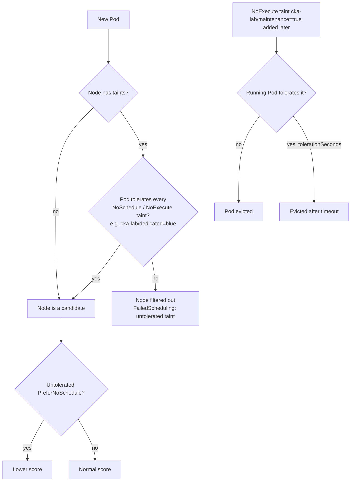

# Lab: Taints and Tolerations

## Objective & CKA Context

A taint on a node repels Pods; a toleration on a Pod lets it ignore a matching taint. Taints
keep workloads off control-plane nodes, reserve nodes for a team, and (with `NoExecute`) evict
running Pods. The CKA exam asks you to add and remove taints, write tolerations, and explain a
`Pending` Pod from its `FailedScheduling` message.

### Concept Diagram

The diagram shows how taints filter or lower the score of a node for a new Pod, and how a later `NoExecute` taint evicts running Pods.




### Setup

```bash
# On k8s-master-01
kubectl version
# Expected: Server Version: v1.37.2

kubectl get nodes -o wide
# Expected: 5 nodes, all STATUS Ready

kubectl create namespace lab-taints-and-tolerations --dry-run=client -o yaml | kubectl apply -f -
kubectl config set-context --current --namespace=lab-taints-and-tolerations
# Expected: namespace/lab-taints-and-tolerations created (or configured)
#           Context "..." modified.
```

## Scenario 1

**Use case:** You check why application Pods never land on masters, then reserve
`k8s-worker-01` for the "blue" team.

### Step 1 – Read the existing taints (read-only)

```bash
kubectl get nodes -o custom-columns='NAME:.metadata.name,TAINTS:.spec.taints[*].key,EFFECT:.spec.taints[*].effect'
# Expected: k8s-master-01..03  node-role.kubernetes.io/control-plane  NoSchedule
#           k8s-worker-01/02   <none>                                 <none>
```

### Step 2 – Taint k8s-worker-01

```bash
kubectl taint node k8s-worker-01 cka-lab/dedicated=blue:NoSchedule
# Expected: node/k8s-worker-01 tainted

kubectl describe node k8s-worker-01 | grep Taints
# Expected: Taints: cka-lab/dedicated=blue:NoSchedule
```

### Step 3 – Observe placement

```bash
kubectl create deployment plain --image=nginx:1.27-alpine --replicas=4
kubectl rollout status deploy/plain --timeout=90s
kubectl get pods -l app=plain -o wide
# Expected: 4 Pods Running, ALL on k8s-worker-02
```

`NoSchedule` affects only new placements. Pods already on k8s-worker-01 keep running.

## Scenario 2

**Use case:** The blue team's Pod must be allowed on its reserved node, and a maintenance taint
must drain a node after a grace period.

### Step 1 – A matching toleration

```bash
cat <<'EOF' | kubectl apply -f -
apiVersion: v1
kind: Pod
metadata:
  name: blue-app
  namespace: lab-taints-and-tolerations
spec:
  nodeSelector:
    kubernetes.io/hostname: k8s-worker-01
  tolerations:
  - key: cka-lab/dedicated
    operator: Equal
    value: blue
    effect: NoSchedule
  containers:
  - name: nginx
    image: nginx:1.27-alpine
EOF
kubectl wait --for=condition=Ready pod/blue-app --timeout=60s
kubectl get pod blue-app -o wide
# Expected: Running on k8s-worker-01
```

The `nodeSelector` only forces the node so the toleration is visible. A toleration *allows* a
tainted node; it never *attracts* a Pod to it (see lab 06).

### Step 2 – Two Pods with different NoExecute tolerations

```bash
cat <<'EOF' | kubectl apply -f -
apiVersion: v1
kind: Pod
metadata:
  name: stays
  namespace: lab-taints-and-tolerations
spec:
  nodeSelector:
    kubernetes.io/hostname: k8s-worker-01
  tolerations:
  - key: cka-lab/dedicated
    operator: Exists
  - key: cka-lab/maintenance
    operator: Exists
    effect: NoExecute
  containers:
  - name: pause
    image: registry.k8s.io/pause:3.10
---
apiVersion: v1
kind: Pod
metadata:
  name: leaves-in-30s
  namespace: lab-taints-and-tolerations
spec:
  nodeSelector:
    kubernetes.io/hostname: k8s-worker-01
  tolerations:
  - key: cka-lab/dedicated
    operator: Exists
  - key: cka-lab/maintenance
    operator: Exists
    effect: NoExecute
    tolerationSeconds: 30
  containers:
  - name: pause
    image: registry.k8s.io/pause:3.10
EOF
kubectl wait --for=condition=Ready pod/stays pod/leaves-in-30s --timeout=60s
# Expected: both conditions met
```

### Step 3 – Apply the NoExecute taint and watch

```bash
kubectl taint node k8s-worker-01 cka-lab/maintenance=true:NoExecute
sleep 5
kubectl get pods -o wide
# Expected: blue-app is gone (no NoExecute toleration -> evicted at once)
#           stays and leaves-in-30s are still Running

sleep 35
kubectl get pods -o wide
# Expected: only "stays" is left on k8s-worker-01; leaves-in-30s was evicted after 30 s

kubectl get events --field-selector reason=TaintManagerEviction
# Expected: "Marking for deletion Pod lab-taints-and-tolerations/blue-app" and ".../leaves-in-30s"
```

### Step 4 – End maintenance

```bash
kubectl taint node k8s-worker-01 cka-lab/maintenance-
kubectl delete pod stays
# Expected: node/k8s-worker-01 untainted
#           pod "stays" deleted
```

## Scenario 3

**Use case:** A nightly report Pod is Pending while k8s-worker-01 is reserved and k8s-worker-02
is under maintenance.

### Setup

```bash
kubectl taint node k8s-worker-01 cka-lab/dedicated=blue:NoSchedule --overwrite
kubectl cordon k8s-worker-02
cat <<'EOF' | kubectl apply -f -
apiVersion: apps/v1
kind: Deployment
metadata:
  name: report
  namespace: lab-taints-and-tolerations
spec:
  replicas: 1
  selector:
    matchLabels:
      app: report
  template:
    metadata:
      labels:
        app: report
    spec:
      tolerations:
      - key: cka-lab/dedicated
        operator: Equal
        value: red
        effect: NoSchedule
      containers:
      - name: report
        image: busybox:1.36
        command: ["sh", "-c", "sleep 3600"]
EOF
sleep 10
kubectl get pods -l app=report
# Expected: STATUS Pending
```

### Task (~8 min)

1. Explain from the scheduler's message why the `report` Pod is Pending on every node.
2. The report belongs to team blue. Make it run on `k8s-worker-01` **without** removing the
   `cka-lab/dedicated` taint and **without** uncordoning `k8s-worker-02`.
3. Then end the maintenance on `k8s-worker-02`. The `plain` Deployment must not move.

<details><summary>Solution</summary>

### Step 1 – Read FailedScheduling

```bash
kubectl get events --field-selector reason=FailedScheduling | grep report
# Expected: ... 0/5 nodes are available: 1 node(s) were unschedulable,
#           4 node(s) had untolerated taint(s). ...

kubectl describe node k8s-worker-02 | grep -E 'Taints|Unschedulable'
# Expected: Taints: node.kubernetes.io/unschedulable:NoSchedule
#           Unschedulable: true
```

Masters: control-plane taint. k8s-worker-01: `blue` taint, but the toleration says `red`
(`Equal` compares the value). k8s-worker-02: cordon = a `NoSchedule` taint added for you.

### Step 2 – Fix the toleration value

```bash
kubectl patch deploy report --type=json \
  -p '[{"op":"replace","path":"/spec/template/spec/tolerations/0/value","value":"blue"}]'
kubectl rollout status deploy/report --timeout=90s
# Expected: deployment "report" successfully rolled out
```

### Step 3 – End maintenance

```bash
kubectl uncordon k8s-worker-02
# Expected: node/k8s-worker-02 uncordoned
```

Uncordon never moves Pods: `plain` stays where it is.

</details>

### Verify

```bash
kubectl get pods -l app=report -o wide
# Expected: 1 Pod Running on k8s-worker-01

kubectl describe node k8s-worker-01 | grep Taints
# Expected: Taints: cka-lab/dedicated=blue:NoSchedule   (unchanged)

kubectl get node k8s-worker-02
# Expected: STATUS Ready   (no SchedulingDisabled)

kubectl get pods -l app=plain -o wide
# Expected: still 4 Pods on k8s-worker-02
```

## Verification Checklist

| Check                         | Command                                                           | Expected result                                    |
|-------------------------------|-------------------------------------------------------------------|----------------------------------------------------|
| Control-plane taint untouched | `kubectl describe node k8s-master-01 \| grep Taints`              | `node-role.kubernetes.io/control-plane:NoSchedule` |
| NoSchedule avoided            | `kubectl get pods -l app=plain -o wide`                           | all on k8s-worker-02                               |
| NoExecute evicted             | `kubectl get events --field-selector reason=TaintManagerEviction` | `blue-app`, `leaves-in-30s`                        |
| Fixed toleration              | `kubectl get pods -l app=report -o wide`                          | Running on k8s-worker-01                           |
| Worker-02 schedulable         | `kubectl get node k8s-worker-02`                                  | Ready, no SchedulingDisabled                       |

## Cleanup

```bash
kubectl delete namespace lab-taints-and-tolerations --ignore-not-found
# Expected: namespace "lab-taints-and-tolerations" deleted

kubectl taint node k8s-worker-01 cka-lab/dedicated- || true
kubectl taint node k8s-worker-01 cka-lab/maintenance- || true
# Expected: node/k8s-worker-01 untainted, or 'error: taint ... not found' (already removed)

kubectl uncordon k8s-worker-02
# Expected: node/k8s-worker-02 uncordoned (or already uncordoned)

kubectl config set-context --current --namespace=default

# Final health check
kubectl describe nodes k8s-worker-01 k8s-worker-02 | grep Taints
# Expected: Taints: <none>   (twice)

kubectl get nodes
# Expected: 5 nodes, all Ready

kubectl get ns | grep lab-
# Expected: no output
```
