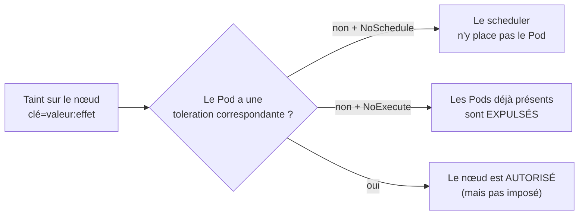

# Lab : Taints et tolerations

## Objectifs


- lire, poser et retirer un **taint** sur un nœud ;
- distinguer les effets `NoSchedule`, `PreferNoSchedule` et `NoExecute` ;
- écrire une **toleration** (`Equal`, `Exists`, `tolerationSeconds`) ;
- observer l'**éviction** d'un Pod par un taint `NoExecute` ;
- comprendre le lien entre `kubectl cordon` et le taint `node.kubernetes.io/unschedulable` ;
- diagnostiquer un Pod `Pending` à cause d'un taint non toléré.

### Vue d'ensemble



> **Taint** = « repousse » posé sur un **nœud**. **Toleration** = « laissez-passer » porté par un **Pod**. Une toleration
> **autorise** un nœud, elle n'**attire** jamais le Pod vers lui (voir le lab 06).


> Ne touchez **jamais** au taint des masters.

## Étape 0 : préparer l'environnement

```bash
ssh k8s-master-01
kubectl create namespace sched-taints
kubectl config set-context --current --namespace=sched-taints
```

# Partie 1 : `NoSchedule`

## Étape 1 : lire les taints existants

```bash
kubectl get nodes -o custom-columns='NAME:.metadata.name,TAINTS:.spec.taints[*].key,EFFECT:.spec.taints[*].effect'
# NAME            TAINTS                                  EFFECT
# k8s-master-01   node-role.kubernetes.io/control-plane   NoSchedule
# k8s-master-02   node-role.kubernetes.io/control-plane   NoSchedule
# k8s-master-03   node-role.kubernetes.io/control-plane   NoSchedule
# k8s-worker-01   <none>                                  <none>
# k8s-worker-02   <none>                                  <none>
```

> C'est ce taint qui empêche les Pods applicatifs d'arriver sur les masters depuis le début de la formation.

## Étape 2 : réserver `k8s-worker-01` à l'équipe « blue »

```bash
kubectl taint node k8s-worker-01 natixis.lab/dedicated=blue:NoSchedule
# Attendu : node/k8s-worker-01 tainted

kubectl describe node k8s-worker-01 | grep Taints
# Attendu : Taints: natixis.lab/dedicated=blue:NoSchedule
```

Un deuxième taint avec la même clé et le même effet est refusé :

```bash
kubectl taint node k8s-worker-01 natixis.lab/dedicated=green:NoSchedule
# Attendu : error: node k8s-worker-01 already has natixis.lab/dedicated taint(s) with same effect(s) and --overwrite is false
```

## Étape 3 : observer le placement

```bash
kubectl create deployment plain --image=nginx:1.27 --replicas=4
kubectl rollout status deployment/plain

kubectl get pods -l app=plain -o wide --no-headers | awk '{print $7}' | sort | uniq -c
# Attendu : 4 k8s-worker-02   -> worker-01 est évité
```

> `NoSchedule` ne concerne que les **nouveaux** placements : les Pods déjà présents sur `k8s-worker-01` y restent.


# Partie 2 : tolerations et `NoExecute`

## Étape 4 : une toleration correspondante

```bash
cat <<'EOF' | kubectl apply -f -
apiVersion: v1
kind: Pod
metadata:
  name: blue-app
  namespace: sched-taints
spec:
  nodeSelector:
    kubernetes.io/hostname: k8s-worker-01
  tolerations:
  - key: natixis.lab/dedicated
    operator: Equal
    value: blue
    effect: NoSchedule
  containers:
  - name: nginx
    image: nginx:1.27
EOF
kubectl wait --for=condition=Ready pod/blue-app --timeout=60s
kubectl get pod blue-app -o wide
# Attendu : Running sur k8s-worker-01
```

> Le `nodeSelector` sert seulement à **forcer** le nœud pour la démonstration. Sans lui, le Pod pourrait aussi aller sur worker-02.

Regardez les tolerations réellement présentes :

```bash
kubectl get pod blue-app -o jsonpath='{.spec.tolerations}{"\n"}'
# [{"effect":"NoSchedule","key":"natixis.lab/dedicated","operator":"Equal","value":"blue"},
#  {"effect":"NoExecute","key":"node.kubernetes.io/not-ready","operator":"Exists","tolerationSeconds":300},
#  {"effect":"NoExecute","key":"node.kubernetes.io/unreachable","operator":"Exists","tolerationSeconds":300}]
```

> Les deux dernières sont ajoutées **automatiquement** par un contrôleur d'admission (`DefaultTolerationSeconds`). Si un nœud
> devient `NotReady` ou injoignable, ses Pods sont expulsés au bout de **5 minutes**.

| Champ               | Valeurs                                             | Remarque                                        |
|---------------------|-----------------------------------------------------|-------------------------------------------------|
| `key`               | clé du taint                                        | Vide + `Exists` = tolère **tous** les taints    |
| `operator`          | `Equal` (défaut), `Exists`                          | `Exists` : pas de `value`                       |
| `value`             | valeur du taint                                     | Comparée avec `Equal`                           |
| `effect`            | `NoSchedule`, `PreferNoSchedule`, `NoExecute`, vide | Vide = tous les effets                          |
| `tolerationSeconds` | secondes                                            | Uniquement avec `NoExecute` : durée de maintien |

## Étape 5 : préparer deux Pods avec des tolerations `NoExecute` différentes

```bash
cat <<'EOF' | kubectl apply -f -
apiVersion: v1
kind: Pod
metadata:
  name: stays
  namespace: sched-taints
spec:
  nodeSelector:
    kubernetes.io/hostname: k8s-worker-01
  tolerations:
  - key: natixis.lab/dedicated
    operator: Exists
  - key: natixis.lab/maintenance
    operator: Exists
    effect: NoExecute
  containers:
  - name: pause
    image: registry.k8s.io/pause:3.10
---
apiVersion: v1
kind: Pod
metadata:
  name: leaves-in-30s
  namespace: sched-taints
spec:
  nodeSelector:
    kubernetes.io/hostname: k8s-worker-01
  tolerations:
  - key: natixis.lab/dedicated
    operator: Exists
  - key: natixis.lab/maintenance
    operator: Exists
    effect: NoExecute
    tolerationSeconds: 30
  containers:
  - name: pause
    image: registry.k8s.io/pause:3.10
EOF
kubectl wait --for=condition=Ready pod/stays pod/leaves-in-30s --timeout=60s
```

## Étape 6 : poser un taint `NoExecute`

```bash
kubectl taint node k8s-worker-01 natixis.lab/maintenance=true:NoExecute
sleep 5
kubectl get pods -o wide | grep -E 'NAME|worker-01'
# Attendu : blue-app a DISPARU (pas de toleration NoExecute -> expulsion immédiate)
#           stays et leaves-in-30s sont encore Running

sleep 35
kubectl get pods -o wide | grep -E 'NAME|worker-01'
# Attendu : seul "stays" reste

kubectl get events --field-selector reason=TaintManagerEviction -o custom-columns=OBJ:.involvedObject.name,MSG:.message
# OBJ             MSG
# blue-app        Marking for deletion Pod sched-taints/blue-app
# leaves-in-30s   Marking for deletion Pod sched-taints/leaves-in-30s
```

| Effet              | Nouveaux Pods sans toleration | Pods déjà présents sans toleration                   |
|--------------------|-------------------------------|------------------------------------------------------|
| `NoSchedule`       | Refusés                       | Restent                                              |
| `PreferNoSchedule` | Évités si possible            | Restent                                              |
| `NoExecute`        | Refusés                       | **Expulsés** (après `tolerationSeconds` s'il existe) |

> Les Pods expulsés ne sont **pas recréés** : ce sont des Pods nus. Un Deployment, lui, les aurait remplacés ailleurs.

Fin de la maintenance :

```bash
kubectl taint node k8s-worker-01 natixis.lab/maintenance-
kubectl delete pod stays
```


# Partie 3 : `cordon` est un taint

## Étape 7 : cordonner un nœud

```bash
kubectl cordon k8s-worker-02
kubectl describe node k8s-worker-02 | grep -E 'Taints|Unschedulable'
# Taints:             node.kubernetes.io/unschedulable:NoSchedule
# Unschedulable:      true

kubectl get node k8s-worker-02
# Attendu : STATUS Ready,SchedulingDisabled
```

> `cordon` met `spec.unschedulable: true`, et Kubernetes ajoute **pour vous** le taint `node.kubernetes.io/unschedulable:NoSchedule`.
> `drain` = `cordon` + expulsion des Pods (lab maintenance).

## Étape 8 : diagnostic, le Pod `report` reste `Pending`

```bash
cat <<'EOF' | kubectl apply -f -
apiVersion: apps/v1
kind: Deployment
metadata:
  name: report
  namespace: sched-taints
spec:
  replicas: 1
  selector:
    matchLabels:
      app: report
  template:
    metadata:
      labels:
        app: report
    spec:
      tolerations:
      - key: natixis.lab/dedicated
        operator: Equal
        value: red
        effect: NoSchedule
      containers:
      - name: report
        image: busybox:1.36
        command: ["sh", "-c", "sleep 3600"]
EOF
sleep 8
kubectl get pods -l app=report
# Attendu : Pending

kubectl get events --field-selector reason=FailedScheduling -o custom-columns=MSG:.message | grep -m1 nodes
# 0/5 nodes are available: 1 node(s) were unschedulable, 4 node(s) had untolerated taint(s). ...
```

**À vous :** le rapport appartient à l'équipe **blue**. Faites-le tourner **sans** retirer le taint de `k8s-worker-01` et **sans**
décordonner `k8s-worker-02`.

<details><summary>Solution</summary>

Masters : taint control-plane. worker-01 : taint `blue`, mais la toleration dit `red` (`Equal` compare la valeur). worker-02 : cordon.
```bash
kubectl patch deploy report --type=json \
  -p '[{"op":"replace","path":"/spec/template/spec/tolerations/0/value","value":"blue"}]'
kubectl rollout status deploy/report
kubectl get pods -l app=report -o wide        # Running sur k8s-worker-01
```
</details>

Fin de la maintenance de worker-02 :

```bash
kubectl uncordon k8s-worker-02
kubectl get pods -l app=plain -o wide --no-headers | awk '{print $7}' | sort | uniq -c
# Attendu : toujours 4 k8s-worker-02   -> uncordon ne déplace jamais de Pods
```


# Partie 4 : exercices d'évaluation

**Exercice 1 :** posez sur `k8s-worker-02` le taint `natixis.lab/gpu=true:PreferNoSchedule`, puis passez `plain` à 8 réplicas. Que constatez-vous ?

**Exercice 2 :** écrivez une toleration qui tolère **n'importe quelle** valeur de la clé `natixis.lab/dedicated`, quel que soit l'effet.

**Exercice 3 :** écrivez la toleration qui permettrait à un Pod de tourner sur les masters.

**Exercice 4 :** listez les nœuds avec leurs taints au format `nœud clé=valeur:effet`.

<details><summary><b>Solutions</b></summary>

**1.**
```bash
kubectl taint node k8s-worker-02 natixis.lab/gpu=true:PreferNoSchedule
kubectl scale deploy plain --replicas=8
kubectl get pods -l app=plain -o wide --no-headers | awk '{print $7}' | sort | uniq -c
```
worker-01 est tainté `NoSchedule` et worker-02 `PreferNoSchedule` : le scheduler n'a pas d'autre choix et utilise worker-02 quand même.
`PreferNoSchedule` est une **préférence**.
```bash
kubectl taint node k8s-worker-02 natixis.lab/gpu-
```

**2.**
```yaml
tolerations:
- key: natixis.lab/dedicated
  operator: Exists
```

**3.**
```yaml
tolerations:
- key: node-role.kubernetes.io/control-plane
  operator: Exists
  effect: NoSchedule
```

**4.**
```bash
kubectl get nodes -o jsonpath='{range .items[*]}{.metadata.name}{" "}{range .spec.taints[*]}{.key}={.value}:{.effect}{" "}{end}{"\n"}{end}'
```
</details>


## Nettoyage

> **Obligatoire** : les taints et le cordon empêcheraient les labs suivants de fonctionner.

```bash
kubectl delete namespace sched-taints
kubectl taint node k8s-worker-01 natixis.lab/dedicated- natixis.lab/maintenance- 2>/dev/null
kubectl taint node k8s-worker-02 natixis.lab/gpu- 2>/dev/null
kubectl uncordon k8s-worker-02
kubectl config set-context --current --namespace=default

kubectl describe nodes k8s-worker-01 k8s-worker-02 | grep Taints
# Attendu : Taints: <none>   (deux fois)
```

## Questions de compréhension

1. Un Pod qui tolère le taint de `k8s-worker-01` ira-t-il forcément sur ce nœud ?
2. Quelle différence entre `NoSchedule` et `NoExecute` pour un Pod déjà en cours d'exécution ?
3. D'où viennent les tolerations `not-ready` et `unreachable` de 300 s ?
4. Pourquoi les DaemonSets (kube-proxy, calico) tournent-ils sur les masters ?

<details><summary>Réponses</summary>

1. Non : la toleration autorise le nœud, elle ne l'impose pas. Pour l'imposer, il faut aussi une affinité (lab 06).
2. `NoSchedule` laisse le Pod en place, `NoExecute` l'expulse (immédiatement ou après `tolerationSeconds`).
3. Du contrôleur d'admission `DefaultTolerationSeconds`, qui les ajoute à tous les Pods.
4. Ils portent des tolerations larges (souvent `operator: Exists` sans clé), voir le lab 08.
</details>

## Commandes

| Commande                                                          | Utilité                             |
|-------------------------------------------------------------------|-------------------------------------|
| `kubectl taint node N k=v:Effet`                                  | Poser un taint                      |
| `kubectl taint node N k=v:Effet --overwrite`                      | Modifier                            |
| `kubectl taint node N k-` / `k:Effet-`                            | Retirer (toutes valeurs / un effet) |
| `kubectl describe node N \| grep Taints`                          | Lire                                |
| `kubectl cordon N` / `uncordon N`                                 | Taint `unschedulable`               |
| `kubectl get events --field-selector reason=TaintManagerEviction` | Expulsions NoExecute                |
