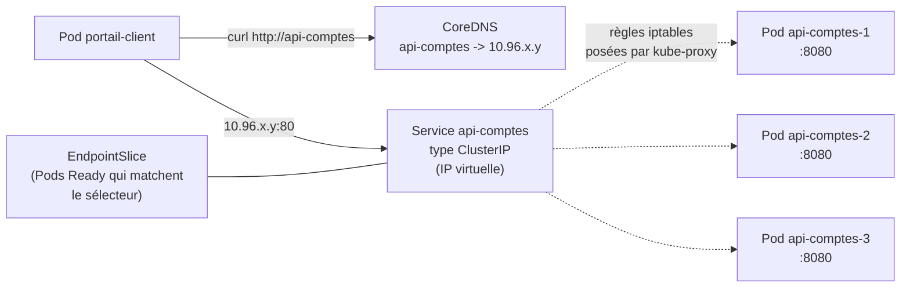

# Lab : Service ClusterIP

## Objectifs

- comprendre **pourquoi** un Service est indispensable devant des Pods (IP éphémères) ;
- créer un Service `ClusterIP` en YAML et avec `kubectl expose` ;
- maîtriser le trio `port` / `targetPort` / **port nommé** ;
- lire les **EndpointSlices** et comprendre le lien Service → Pods (sélecteur + readiness) ;
- joindre un Service par **DNS** (nom court, nom inter-namespace, FQDN) ;
- voir ce que fait **kube-proxy** (règles iptables) : la ClusterIP est **virtuelle** ;
- utiliser un Service **headless** et la **sessionAffinity** ;
- dépanner un Service « qui ne répond pas » (sélecteur, targetPort).

### Contexte métier

Vous êtes dans l'équipe plateforme d'une banque. L'application « banque en ligne » est découpée en micro-services :

| Composant         | Rôle                                       | Exposé à…                          |
|-------------------|--------------------------------------------|------------------------------------|
| `portail-client`  | Front web (ici : un simple client `curl`)  | Internet (labs suivants)           |
| `api-comptes`     | API REST qui renvoie les soldes des comptes | **uniquement** les autres services |
| `batch-releves`   | Batch nocturne d'une autre équipe          | tourne dans **un autre namespace** |

L'API `api-comptes` ne doit **jamais** être exposée hors du cluster : c'est exactement le rôle d'un Service `ClusterIP`
(type par défaut).

### Vue d'ensemble



> **À retenir :** un Service n'est **pas** un processus ni un Pod. C'est un objet de l'API qui réserve une IP virtuelle
> (la ClusterIP) et un nom DNS. Sur **chaque nœud**, kube-proxy traduit cette IP virtuelle en IP de Pod (DNAT).

### Les 4 types de Service (vue d'ensemble de ce module)

| Type           | Accessible depuis                          | Construit sur…                 | Lab        |
|----------------|--------------------------------------------|--------------------------------|------------|
| `ClusterIP`    | l'intérieur du cluster uniquement          | –                              | **ce lab** |
| `NodePort`     | `IP-de-n'importe-quel-nœud:30000-32767`    | ClusterIP                      | 03_02      |
| `LoadBalancer` | une IP externe dédiée (ici : MetalLB)      | NodePort + ClusterIP           | 03_03      |
| `Ingress`      | (pas un type de Service) routage HTTP L7   | un Service du contrôleur       | 03_04      |

## Étape 0 : préparer l'environnement

```bash
ssh k8s-master-01
kubectl create namespace svc-clusterip
kubectl config set-context --current --namespace=svc-clusterip
```

> Image utilisée : `traefik/whoami`. C'est un petit serveur HTTP qui renvoie **le nom du Pod** qui a répondu. Idéal pour
> voir le load-balancing. Il expose aussi `/health`, dont on peut changer le code retour (pratique pour la readiness).


# Partie 1 : le problème, les IP de Pods sont éphémères

## Étape 1 : déployer l'API `api-comptes`

```bash
cat <<'EOF' | kubectl apply -f -
apiVersion: apps/v1
kind: Deployment
metadata:
  name: api-comptes
  namespace: svc-clusterip
  labels:
    app: api-comptes
spec:
  replicas: 3
  selector:
    matchLabels:
      app: api-comptes
  template:
    metadata:
      labels:
        app: api-comptes        # <- c'est CE label que le Service va sélectionner
        tier: backend
    spec:
      containers:
      - name: api
        image: traefik/whoami:v1.11.0
        args: ["--port", "8080"]
        ports:
        - name: http            # port NOMMÉ : le Service pourra s'y référer par son nom
          containerPort: 8080
        readinessProbe:         # tant que /health != 200, le Pod n'est PAS Ready
          httpGet:
            path: /health
            port: http
          periodSeconds: 2
          failureThreshold: 1
EOF
kubectl rollout status deployment/api-comptes
kubectl get pods -l app=api-comptes -o wide
# Attendu : 3 Pods Running, répartis sur k8s-worker-01 et k8s-worker-02, chacun avec une IP 10.244.x.y
```

## Étape 2 : déployer le client `portail-client`

On utilise un **Deployment** (et non un Pod nu) : en production, même un outil de diagnostic doit être recréé s'il
tombe.

```bash
kubectl create deployment portail-client --image=curlimages/curl:8.11.1 -- sleep infinity
kubectl rollout status deployment/portail-client
```

> `kubectl exec deploy/portail-client -- ...` exécute la commande dans **un** des Pods du Deployment. On n'a donc pas
> besoin de connaître le nom aléatoire du Pod.

## Étape 3 : appeler l'API par l'IP d'un Pod… puis la perdre

```bash
POD_IP=$(kubectl get pods -l app=api-comptes -o jsonpath='{.items[0].status.podIP}')
POD_NAME=$(kubectl get pods -l app=api-comptes -o jsonpath='{.items[0].metadata.name}')
echo "$POD_NAME -> $POD_IP"

kubectl exec deploy/portail-client -- curl -s http://$POD_IP:8080 | head -1
# Attendu : Hostname: api-comptes-xxxxxxxxxx-yyyyy  (le Pod ciblé)

# Un incident : le Pod est supprimé (crash, drain du nœud, mise à jour…)
kubectl delete pod $POD_NAME
kubectl rollout status deployment/api-comptes

kubectl exec deploy/portail-client -- curl -s -m 3 http://$POD_IP:8080
# Attendu : échec (timeout, code de sortie 28) : le nouveau Pod a une AUTRE IP
kubectl get pods -l app=api-comptes -o wide
```

**Constat :** le Deployment a bien recréé un Pod, mais avec une nouvelle IP. Un client qui aurait « codé en dur » l'IP
est cassé. Il faut une adresse **stable** devant un groupe de Pods **interchangeables** : c'est le Service.


# Partie 2 : créer le Service ClusterIP

## Étape 4 : le Service en YAML

```bash
cat <<'EOF' | kubectl apply -f -
apiVersion: v1
kind: Service
metadata:
  name: api-comptes
  namespace: svc-clusterip
  labels:
    app: api-comptes
spec:
  type: ClusterIP           # valeur par défaut, on l'écrit pour être explicite
  selector:
    app: api-comptes        # tous les Pods READY avec ce label reçoivent le trafic
  ports:
  - name: http
    protocol: TCP
    port: 80                # port du SERVICE (celui que les clients appellent)
    targetPort: http        # port du CONTENEUR, ici par son NOM (= 8080)
EOF

kubectl get service api-comptes -o wide
# NAME          TYPE        CLUSTER-IP      EXTERNAL-IP   PORT(S)   AGE   SELECTOR
# api-comptes   ClusterIP   10.x.y.z        <none>        80/TCP    5s    app=api-comptes
```

| Champ        | Signification                                                     | Défaut                  |
|--------------|-------------------------------------------------------------------|-------------------------|
| `port`       | Port exposé par le Service (côté client)                          | obligatoire             |
| `targetPort` | Port du conteneur : un **numéro** ou un **nom** de `containerPort` | = `port`                |
| `protocol`   | `TCP`, `UDP` ou `SCTP`                                            | `TCP`                   |
| `name`       | Obligatoire dès qu'il y a **plusieurs** ports                     | –                       |
| `clusterIP`  | Choisie automatiquement dans le Service CIDR `10.96.0.0/12`       | auto                    |

> **Pourquoi un `targetPort` nommé ?** Si l'équipe de dev passe l'appli de 8080 à 9090, elle change seulement le
> `containerPort` du Deployment. Le Service (`targetPort: http`) n'a pas à être modifié. C'est une bonne pratique.

## Étape 5 : les EndpointSlices, le « carnet d'adresses » du Service

```bash
kubectl describe service api-comptes
# ...
# Selector:          app=api-comptes
# Type:              ClusterIP
# IP:                10.x.y.z
# Port:              http  80/TCP
# TargetPort:        http/TCP
# Endpoints:         10.244.a.b:8080,10.244.c.d:8080,10.244.e.f:8080

kubectl get endpointslices -l kubernetes.io/service-name=api-comptes
# NAME                ADDRESSTYPE   PORTS   ENDPOINTS                               AGE
# api-comptes-xxxxx   IPv4          8080    10.244.a.b,10.244.c.d,10.244.e.f        30s

kubectl get pods -l app=api-comptes -o custom-columns=NAME:.metadata.name,IP:.status.podIP
# Attendu : les 3 mêmes IP que dans l'EndpointSlice
```

> Le contrôleur **EndpointSlice** (dans `kube-controller-manager`) surveille en permanence les Pods qui matchent le
> sélecteur **et** qui sont `Ready`, et met à jour l'EndpointSlice. kube-proxy lit ces EndpointSlices pour programmer
> les règles réseau sur chaque nœud.
> L'ancien objet `Endpoints` existe encore (`kubectl get endpoints`), mais il est **déprécié** depuis la v1.33 au profit
> d'`EndpointSlice`.

## Étape 6 : appeler l'API par le Service et observer le load-balancing

```bash
SVC_IP=$(kubectl get svc api-comptes -o jsonpath='{.spec.clusterIP}')
echo $SVC_IP

kubectl exec deploy/portail-client -- sh -c \
  "for i in \$(seq 1 12); do curl -s http://$SVC_IP | grep Hostname; done" | sort | uniq -c
# Attendu : 3 lignes, une par Pod, avec ~4 requêtes chacune (répartition aléatoire)
#       4 Hostname: api-comptes-xxxxxxxxxx-aaaaa
#       5 Hostname: api-comptes-xxxxxxxxxx-bbbbb
#       3 Hostname: api-comptes-xxxxxxxxxx-ccccc
```

> En mode iptables, kube-proxy choisit un Pod **au hasard** (probabilités égales) **pour chaque nouvelle connexion
> TCP**. Ce n'est pas du round-robin strict.
> Si vous lancez la boucle dans la seconde qui suit la création du Service, quelques requêtes peuvent échouer : kube-proxy
> n'a pas encore programmé les règles sur le nœud. Relancez-la.

Supprimez à nouveau un Pod : le Service continue de répondre, sans changer d'IP.

```bash
kubectl delete pod $(kubectl get pods -l app=api-comptes -o jsonpath='{.items[0].metadata.name}')
kubectl rollout status deployment/api-comptes
kubectl exec deploy/portail-client -- curl -s http://$SVC_IP | head -1
# Attendu : Hostname: api-comptes-...  -> toujours OK, même ClusterIP
kubectl get endpointslices -l kubernetes.io/service-name=api-comptes
# Attendu : la nouvelle IP a remplacé l'ancienne automatiquement
```


# Partie 3 : la découverte par DNS

En pratique, on n'utilise **jamais** la ClusterIP : on utilise le **nom DNS** du Service, créé automatiquement par
CoreDNS.

## Étape 7 : les noms DNS d'un Service

```bash
kubectl exec deploy/portail-client -- curl -s http://api-comptes | head -1
kubectl exec deploy/portail-client -- curl -s http://api-comptes.svc-clusterip | head -1
kubectl exec deploy/portail-client -- curl -s http://api-comptes.svc-clusterip.svc.cluster.local | head -1
# Attendu : les 3 fonctionnent -> Hostname: api-comptes-...

kubectl exec deploy/portail-client -- cat /etc/resolv.conf
# search svc-clusterip.svc.cluster.local svc.cluster.local cluster.local ...
# nameserver 10.96.0.10
# options ndots:5
```

| Nom utilisé                                    | Fonctionne depuis…                     |
|------------------------------------------------|----------------------------------------|
| `api-comptes`                                  | le **même** namespace seulement        |
| `api-comptes.svc-clusterip`                    | **tous** les namespaces                |
| `api-comptes.svc-clusterip.svc.cluster.local`  | partout (FQDN, aucune ambiguïté)       |

> Le nom court fonctionne grâce à la ligne `search` de `/etc/resolv.conf` : le Pod essaie successivement
> `api-comptes.svc-clusterip.svc.cluster.local`, puis `api-comptes.svc.cluster.local`, etc.
> `nameserver 10.96.0.10` est… la ClusterIP du Service `kube-dns` (CoreDNS) : DNS lui-même est un Service ClusterIP !

```bash
kubectl get svc -n kube-system kube-dns
# NAME       TYPE        CLUSTER-IP   EXTERNAL-IP   PORT(S)                  AGE
# kube-dns   ClusterIP   10.96.0.10   <none>        53/UDP,53/TCP,9153/TCP   22d

kubectl exec deploy/portail-client -- nslookup api-comptes.svc-clusterip.svc.cluster.local
# Name:    api-comptes.svc-clusterip.svc.cluster.local
# Address: 10.x.y.z            <- la ClusterIP
```

> L'outil `nslookup` de busybox/alpine n'applique **pas** la liste `search` : utilisez toujours le **FQDN** avec lui, ou
> bien `getent hosts api-comptes` qui, lui, passe par la même résolution que les applications.

## Étape 8 : une autre équipe, un autre namespace

Le batch `batch-releves` de l'équipe « Reporting » tourne dans son propre namespace et doit lire les soldes.

```bash
kubectl create namespace svc-clusterip-batch
kubectl -n svc-clusterip-batch create deployment batch-releves --image=curlimages/curl:8.11.1 -- sleep infinity
kubectl -n svc-clusterip-batch rollout status deployment/batch-releves

kubectl -n svc-clusterip-batch exec deploy/batch-releves -- curl -s -m 3 http://api-comptes
# Attendu : curl: (6) Could not resolve host: api-comptes
#           -> le nom court est cherché dans svc-clusterip-batch.svc.cluster.local

kubectl -n svc-clusterip-batch exec deploy/batch-releves -- curl -s http://api-comptes.svc-clusterip | head -1
# Attendu : Hostname: api-comptes-...
```

> Par défaut, **rien n'isole les namespaces au niveau réseau** : un namespace est une frontière de *nommage* et de
> *droits* (RBAC), pas de réseau. Pour interdire ce trafic, il faut des **NetworkPolicies**.

## Étape 9 : les variables d'environnement (méthode historique)

kubelet injecte aussi dans chaque conteneur des variables `<SERVICE>_SERVICE_HOST` / `_PORT`, mais **uniquement pour
les Services qui existaient au démarrage du Pod**.

```bash
kubectl exec deploy/portail-client -- env | grep API_COMPTES
# Attendu : rien  -> portail-client a démarré AVANT le Service

kubectl rollout restart deployment/portail-client
kubectl rollout status deployment/portail-client
kubectl exec deploy/portail-client -- env | grep API_COMPTES_SERVICE
# API_COMPTES_SERVICE_HOST=10.x.y.z
# API_COMPTES_SERVICE_PORT=80
# API_COMPTES_SERVICE_PORT_HTTP=80
```

> C'est pour cette raison d'ordre de création que **DNS est la méthode recommandée**.


# Partie 4 : sous le capot

## Étape 10 : la ClusterIP est virtuelle

```bash
SVC_IP=$(kubectl get svc api-comptes -o jsonpath='{.spec.clusterIP}')

ip addr | grep "$SVC_IP"
# Attendu : rien -> aucune interface ne porte cette IP

ping -c 2 -W 2 $SVC_IP
# Attendu : 2 packets transmitted, 0 received, 100% packet loss
#           -> seule la combinaison IP:port/protocole du Service est traduite, pas ICMP

curl -s http://$SVC_IP | head -1
# Attendu : Hostname: api-comptes-...  -> depuis le NŒUD, le Service répond (kube-proxy tourne aussi sur les masters)

kubectl get configmap -n kube-system kube-proxy -o yaml | grep 'mode:'
# Attendu : mode: iptables
```

Regardez les règles NAT écrites par kube-proxy sur le nœud (mot de passe `ubuntu`) :

```bash
sudo iptables -t nat -S KUBE-SERVICES | grep svc-clusterip/api-comptes
# -A KUBE-SERVICES -d 10.x.y.z/32 -p tcp -m comment --comment "svc-clusterip/api-comptes:http cluster IP" \
#    -m tcp --dport 80 -j KUBE-SVC-XXXXXXXXXXXXXXXX

CHAIN=$(sudo iptables -t nat -S KUBE-SERVICES | grep 'svc-clusterip/api-comptes:http cluster IP' | grep -o 'KUBE-SVC-[A-Z0-9]*')
sudo iptables -t nat -S $CHAIN | grep KUBE-SEP
# -A KUBE-SVC-... -m statistic --mode random --probability 0.33333333349 -j KUBE-SEP-AAAA
# -A KUBE-SVC-... -m statistic --mode random --probability 0.50000000000 -j KUBE-SEP-BBBB
# -A KUBE-SVC-... -j KUBE-SEP-CCCC
```

> Lecture : 1/3 des connexions vont au 1er Pod ; parmi les 2/3 restants, la moitié au 2e ; le reste au 3e.
> Chaque chaîne `KUBE-SEP-*` (Service EndPoint) fait un **DNAT** vers `IP-du-Pod:8080`.
> Ces règles existent sur **les 5 nœuds** : la traduction se fait sur le nœud du **client**, avant même que le paquet
> quitte le nœud.

## Étape 11 : la readiness décide qui reçoit du trafic

Scénario réel : un Pod de l'API perd sa connexion à la base de données. Il est vivant, mais ne doit plus recevoir de
requêtes. Simulons-le en forçant `/health` à renvoyer `503` sur **un seul** Pod.

```bash
SICK_IP=$(kubectl get pods -l app=api-comptes -o jsonpath='{.items[0].status.podIP}')
kubectl exec deploy/portail-client -- curl -s -X POST -d 503 http://$SICK_IP:8080/health
sleep 5

kubectl get pods -l app=api-comptes -o wide
# Attendu : un Pod affiche READY 0/1 (mais STATUS Running, RESTARTS 0)

kubectl get endpointslices -l kubernetes.io/service-name=api-comptes \
  -o jsonpath='{range .items[*].endpoints[*]}{.addresses[0]}{"  ready="}{.conditions.ready}{"\n"}{end}'
# Attendu : l'IP malade apparaît avec ready=false, les 2 autres ready=true

kubectl exec deploy/portail-client -- sh -c \
  'for i in $(seq 1 12); do curl -s http://api-comptes | grep Hostname; done' | sort | uniq -c
# Attendu : seulement 2 Hostnames différents -> le Pod non Ready est exclu du load-balancing
```

> Une **readinessProbe** qui échoue ne **redémarre pas** le conteneur (c'est le rôle de la `livenessProbe`) : elle le
> retire simplement du Service. Sans readinessProbe, Kubernetes considère le Pod prêt dès que le conteneur démarre.

Le Pod « guérit » :

```bash
kubectl exec deploy/portail-client -- curl -s -X POST -d 200 http://$SICK_IP:8080/health
sleep 5
kubectl get pods -l app=api-comptes
# Attendu : 3/3 Pods READY 1/1
```

## Étape 12 : la montée en charge est automatique

Fin de mois, le trafic double : on passe à 5 réplicas. **Aucune** modification du Service n'est nécessaire.

```bash
kubectl scale deployment api-comptes --replicas=5
kubectl rollout status deployment/api-comptes
kubectl get endpointslices -l kubernetes.io/service-name=api-comptes
# Attendu : 5 adresses dans ENDPOINTS
kubectl scale deployment api-comptes --replicas=3
```


# Partie 5 : variantes utiles

## Étape 13 : Service headless (`clusterIP: None`)

Cas réel : un client qui veut connaître **toutes** les IP des Pods (driver de base de données en cluster, Prometheus,
gRPC qui fait son propre load-balancing, StatefulSet…). Un Service headless n'a **pas** de ClusterIP : le DNS renvoie
directement les IP des Pods.

```bash
cat <<'EOF' | kubectl apply -f -
apiVersion: v1
kind: Service
metadata:
  name: api-comptes-headless
  namespace: svc-clusterip
spec:
  clusterIP: None           # <- headless
  selector:
    app: api-comptes
  ports:
  - name: http
    port: 8080
    targetPort: http
EOF

kubectl get svc
# NAME                   TYPE        CLUSTER-IP   EXTERNAL-IP   PORT(S)    AGE
# api-comptes            ClusterIP   10.x.y.z     <none>        80/TCP     10m
# api-comptes-headless   ClusterIP   None         <none>        8080/TCP   5s

kubectl exec deploy/portail-client -- nslookup api-comptes.svc-clusterip.svc.cluster.local
# Attendu : UNE adresse (la ClusterIP)
kubectl exec deploy/portail-client -- nslookup api-comptes-headless.svc-clusterip.svc.cluster.local
# Attendu : TROIS adresses (les IP des Pods Ready)
```

> Avec un Service headless, **kube-proxy ne fait rien** (aucune règle iptables) : c'est le client qui choisit le Pod.

## Étape 14 : affinité de session (`sessionAffinity: ClientIP`)

Cas réel : une vieille application garde la session de l'utilisateur **en mémoire** dans le Pod. Chaque client doit
toujours retomber sur le même Pod.

```bash
kubectl patch svc api-comptes -p '{"spec":{"sessionAffinity":"ClientIP"}}'

kubectl exec deploy/portail-client -- sh -c \
  'for i in $(seq 1 10); do curl -s http://api-comptes | grep Hostname; done' | sort | uniq -c
# Attendu : 10 Hostname: api-comptes-...   -> toujours le même Pod

kubectl get svc api-comptes -o jsonpath='{.spec.sessionAffinityConfig}{"\n"}'
# {"clientIP":{"timeoutSeconds":10800}}   -> l'affinité dure 3 h par défaut

kubectl patch svc api-comptes -p '{"spec":{"sessionAffinity":"None"}}'
```

> C'est une béquille : la bonne pratique est une application **sans état** (session dans Redis, jeton JWT…).


# Partie 6 : dépannage, « le Service ne répond pas »

## Étape 15 : un nouveau micro-service livré par l'équipe de dev

```bash
cat <<'EOF' | kubectl apply -f -
apiVersion: apps/v1
kind: Deployment
metadata:
  name: api-virements
  namespace: svc-clusterip
spec:
  replicas: 2
  selector:
    matchLabels:
      app: api-virements
  template:
    metadata:
      labels:
        app: api-virements
        tier: backend
    spec:
      containers:
      - name: api
        image: traefik/whoami:v1.11.0
        args: ["--port", "9000"]
        ports:
        - containerPort: 9000
---
apiVersion: v1
kind: Service
metadata:
  name: api-virements
  namespace: svc-clusterip
spec:
  selector:
    app: api-virement
  ports:
  - port: 80
    targetPort: 8080
EOF
kubectl rollout status deployment/api-virements

kubectl exec deploy/portail-client -- curl -s -m 3 http://api-virements
# Attendu : échec (code de sortie 7 : connection refused, ou 28 : timeout)
```

**À vous :** les Pods sont `Running` et pourtant le Service ne répond pas. Trouvez les **deux** erreurs et corrigez le
**Service** (pas le Deployment), puis vérifiez que `curl http://api-virements` répond.

<details><summary>Méthode et solution</summary>

La démarche de dépannage d'un Service, toujours dans cet ordre :

```bash
# 1. Le Service a-t-il des endpoints ?
kubectl get endpointslices -l kubernetes.io/service-name=api-virements
# ENDPOINTS <unset>  -> le sélecteur ne trouve AUCUN Pod

# 2. Comparer le sélecteur du Service et les labels des Pods
kubectl get svc api-virements -o jsonpath='{.spec.selector}{"\n"}'     # {"app":"api-virement"}
kubectl get pods --show-labels | grep virements                      # app=api-virements  (avec un "s")
kubectl get pods -l app=api-virement                                 # No resources found -> confirmé

# 3. Comparer targetPort et le port réellement écouté par le conteneur
kubectl get deploy api-virements -o jsonpath='{.spec.template.spec.containers[0].ports}{"\n"}'  # 9000
```

Correction :

```bash
kubectl patch svc api-virements --type=json -p '[
  {"op":"replace","path":"/spec/selector/app","value":"api-virements"},
  {"op":"replace","path":"/spec/ports/0/targetPort","value":9000}]'

kubectl get endpointslices -l kubernetes.io/service-name=api-virements
# Attendu : 2 adresses, PORTS 9000
kubectl exec deploy/portail-client -- curl -s http://api-virements | head -1
# Attendu : Hostname: api-virements-...
```

> Endpoints vides => problème de **sélecteur** (ou Pods non Ready). Endpoints présents mais connexion refusée =>
> problème de **targetPort**.
</details>


# Partie 7 : exercices d'évaluation

**Exercice 1 :** créez de façon **impérative** (sans YAML) un Deployment `api-cartes` (image `traefik/whoami:v1.11.0`,
2 réplicas, conteneur sur le port 80) et un Service ClusterIP `api-cartes` sur le port **8443** qui envoie vers le port 80
des Pods.

**Exercice 2 :** générez le YAML d'un Service ClusterIP `api-credits` (port 80 -> 8080, sélecteur `app=api-credits`)
**sans le créer**, dans le fichier `/tmp/api-credits.yaml`.

**Exercice 3 :** l'application doit appeler une API partenaire externe `example.com`. Créez un Service `partenaire` qui
permet aux Pods d'utiliser le nom `partenaire` à la place de `example.com`.

**Exercice 4 :** affichez, pour **tous** les Services du namespace, leur nom, leur ClusterIP et leur sélecteur.

<details><summary><b>Solutions</b></summary>

**1.**
```bash
kubectl create deployment api-cartes --image=traefik/whoami:v1.11.0 --replicas=2 --port=80
kubectl expose deployment api-cartes --port=8443 --target-port=80
kubectl rollout status deployment/api-cartes
kubectl exec deploy/portail-client -- curl -s http://api-cartes:8443 | head -1
```
`kubectl expose` récupère automatiquement le **sélecteur** du Deployment (`app=api-cartes`).

**2.**
```bash
kubectl create service clusterip api-credits --tcp=80:8080 --dry-run=client -o yaml > /tmp/api-credits.yaml
cat /tmp/api-credits.yaml
```
`kubectl create service` met le sélecteur `app=<nom>`. Vérifiez **toujours** qu'il correspond aux labels de vos Pods.

**3.** Un Service `ExternalName` : pas de sélecteur, pas d'IP, juste un **CNAME** DNS.
```bash
kubectl create service externalname partenaire --external-name=example.com
kubectl exec deploy/portail-client -- nslookup partenaire.svc-clusterip.svc.cluster.local
# partenaire.svc-clusterip.svc.cluster.local  canonical name = example.com
```
Avantage : le jour où le partenaire change d'URL, on modifie le Service, pas le code des applications.

**4.**
```bash
kubectl get svc -o custom-columns=NAME:.metadata.name,CLUSTER-IP:.spec.clusterIP,SELECTOR:.spec.selector
```
</details>


## Nettoyage

```bash
kubectl delete namespace svc-clusterip svc-clusterip-batch
kubectl config set-context --current --namespace=default
rm -f /tmp/api-credits.yaml
```

## Questions de compréhension

1. Que se passe-t-il pour le Service si tous les Pods de `api-comptes` sont supprimés puis recréés ?
2. Pourquoi `ping` vers une ClusterIP ne répond-il pas alors que `curl` fonctionne ?
3. Un Pod est `Running` mais n'apparaît pas dans l'EndpointSlice. Deux causes possibles ?
4. Quelle est la différence entre `port` et `targetPort` ?
5. Depuis le namespace `default`, quel nom DNS minimal faut-il utiliser pour joindre `api-comptes` ?

<details><summary>Réponses</summary>

1. Rien : la ClusterIP et le nom DNS ne changent pas. Seul l'EndpointSlice est mis à jour avec les nouvelles IP.
2. La ClusterIP n'est portée par aucune interface ; seules les règles iptables `IP:port/TCP` existent. ICMP n'est pas
   traduit.
3. Ses labels ne correspondent pas au sélecteur, ou il n'est pas `Ready` (readinessProbe en échec).
4. `port` = port du Service (appelé par le client) ; `targetPort` = port du conteneur vers lequel le trafic est envoyé.
5. `api-comptes.svc-clusterip`.
</details>

## Commandes

| Commande                                                              | Utilité                                   |
|-----------------------------------------------------------------------|-------------------------------------------|
| `kubectl expose deploy D --port=80 --target-port=8080`                | Créer un Service à partir d'un Deployment |
| `kubectl create service clusterip S --tcp=80:8080`                    | Créer un Service (sélecteur `app=S`)      |
| `kubectl get svc -o wide`                                             | Voir type, ClusterIP, ports, sélecteur    |
| `kubectl get endpointslices -l kubernetes.io/service-name=S`          | Pods derrière le Service                  |
| `kubectl describe svc S`                                              | Résumé complet (dont `Endpoints:`)        |
| `kubectl exec deploy/D -- curl -s http://S`                           | Tester depuis l'intérieur du cluster      |
| `kubectl exec deploy/D -- nslookup S.NS.svc.cluster.local`            | Tester la résolution DNS                  |
| `sudo iptables -t nat -S KUBE-SERVICES \| grep NS/S`                  | Règles kube-proxy d'un Service            |
