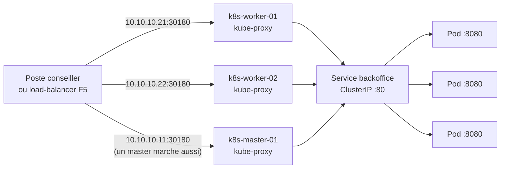

# Lab : Service NodePort

## Objectifs

- exposer un Deployment **hors du cluster** avec un Service `NodePort` ;
- comprendre la chaîne `nodePort` -> `port` -> `targetPort` ;
- vérifier qu'un NodePort est ouvert sur **tous** les nœuds, même ceux sans Pod ;
- fixer un `nodePort` ou le laisser choisir, et connaître la plage `30000-32767` ;
- comprendre `externalTrafficPolicy` (`Cluster` / `Local`) et la **préservation de l'IP source** ;
- dépanner un NodePort qui ne répond pas.

### Contexte métier

L'application **back-office des conseillers** (`backoffice`) doit être accessible depuis le réseau interne de l'agence.
Le réseau de la banque possède déjà un **load-balancer matériel** (F5, HAProxy…) géré par l'équipe réseau : il ne sait
viser que des **IP de serveurs + un port fixe**. On lui donne donc la liste des nœuds et le port `30180`.

L'équipe conformité exige en plus que les logs applicatifs contiennent **l'IP réelle du poste** qui se connecte.

### Vue d'ensemble



> Un Service `NodePort` est un Service `ClusterIP` **+** un port ouvert sur **chaque nœud** du cluster. Tout ce qui a
> été vu dans le lab ClusterIP (sélecteur, EndpointSlice, readiness, DNS) reste vrai.

| Port         | Où ?                    | Qui l'utilise ?                     | Exemple |
|--------------|-------------------------|-------------------------------------|---------|
| `nodePort`   | sur l'IP de chaque nœud | les clients **externes**            | `30180` |
| `port`       | sur la ClusterIP        | les clients **internes** au cluster | `80`    |
| `targetPort` | sur l'IP du Pod         | kube-proxy (destination finale)     | `8080`  |

## Étape 0 : préparer l'environnement

```bash
ssh k8s-master-01
kubectl create namespace svc-nodeport
kubectl config set-context --current --namespace=svc-nodeport

kubectl get nodes -o custom-columns=NAME:.metadata.name,IP:.status.addresses[0].address
# NAME            IP
# k8s-master-01   10.10.10.11
# k8s-master-02   10.10.10.12
# k8s-master-03   10.10.10.13
# k8s-worker-01   10.10.10.21
# k8s-worker-02   10.10.10.22
```


# Partie 1 : exposer le back-office

## Étape 1 : déployer `backoffice`

```bash
cat <<'EOF' | kubectl apply -f -
apiVersion: apps/v1
kind: Deployment
metadata:
  name: backoffice
  namespace: svc-nodeport
  labels:
    app: backoffice
spec:
  replicas: 3
  selector:
    matchLabels:
      app: backoffice
  template:
    metadata:
      labels:
        app: backoffice
    spec:
      containers:
      - name: web
        image: traefik/whoami:v1.11.0
        args: ["--port", "8080"]
        ports:
        - name: http
          containerPort: 8080
        readinessProbe:
          httpGet:
            path: /health
            port: http
          periodSeconds: 2
EOF
kubectl rollout status deployment/backoffice
kubectl get pods -l app=backoffice -o wide
# Attendu : 3 Pods Running sur les workers (les masters sont taintés)
```

## Étape 2 : créer le Service NodePort avec un port fixe

Le port `30180` a été communiqué à l'équipe réseau : on le **fixe** dans le manifeste.

```bash
cat <<'EOF' | kubectl apply -f -
apiVersion: v1
kind: Service
metadata:
  name: backoffice
  namespace: svc-nodeport
spec:
  type: NodePort
  selector:
    app: backoffice
  ports:
  - name: http
    protocol: TCP
    nodePort: 30180     # port ouvert sur CHAQUE nœud (plage 30000-32767)
    port: 80            # port de la ClusterIP
    targetPort: http    # port du conteneur (8080)
EOF

kubectl get svc backoffice
# NAME         TYPE       CLUSTER-IP   EXTERNAL-IP   PORT(S)        AGE
# backoffice   NodePort   10.x.y.z     <none>        80:30180/TCP   3s
```

> Lecture de `80:30180/TCP` : **port de la ClusterIP : port du nœud**. Le `targetPort` n'apparaît pas ici
> (`kubectl describe svc backoffice` le montre).

## Étape 3 : accéder au back-office depuis l'extérieur du cluster

> kube-proxy met en général moins d'une seconde à programmer les règles sur les 5 nœuds. Si la toute première requête
> échoue, relancez-la.

```bash
for ip in 10.10.10.21 10.10.10.22 10.10.10.11 10.10.10.12 10.10.10.13; do
  echo -n "$ip:30180 -> "; curl -s -m 3 http://$ip:30180 | grep Hostname
done
# Attendu : les 5 nœuds répondent, y compris les 3 masters qui n'hébergent AUCUN Pod backoffice
# 10.10.10.21:30180 -> Hostname: backoffice-xxxxxxxxxx-aaaaa
# 10.10.10.22:30180 -> Hostname: backoffice-xxxxxxxxxx-bbbbb
# ...
```

> Vous pouvez aussi ouvrir `http://10.10.10.21:30180` dans le navigateur de **votre poste** : c'est exactement ce que
> fera un conseiller (ou le F5 de la banque).

L'accès interne par la ClusterIP et le DNS fonctionne toujours :

```bash
kubectl create deployment outils --image=curlimages/curl:8.11.1 -- sleep infinity
kubectl rollout status deployment/outils
kubectl exec deploy/outils -- curl -s http://backoffice | head -1
# Attendu : Hostname: backoffice-...  (port 80, pas 30180)
```

## Étape 4 : sous le capot

```bash
ss -lntp | grep 30180
# Attendu : rien  -> kube-proxy (mode iptables) n'ouvre pas de socket, il pose des règles NAT

sudo iptables -t nat -S KUBE-NODEPORTS | grep svc-nodeport/backoffice
# -A KUBE-NODEPORTS -p tcp -m comment --comment "svc-nodeport/backoffice:http" -m tcp --dport 30180 -j KUBE-EXT-XXXX
```

> Le paquet qui arrive sur `nœud:30180` est envoyé dans la chaîne `KUBE-EXT-*`, qui rejoint ensuite la même
> chaîne `KUBE-SVC-*` que la ClusterIP : il est DNATé vers **un Pod au hasard**, potentiellement sur un **autre** nœud.
> Dans ce cas, le nœud fait aussi un **SNAT** (il remplace l'IP source par la sienne) pour que la réponse revienne par lui.


# Partie 2 : l'IP du client (exigence conformité)

## Étape 5 : avec `externalTrafficPolicy: Cluster` (défaut)

On se connecte depuis `k8s-master-01` (`10.10.10.11`) vers le NodePort de `k8s-worker-01`.

```bash
kubectl get svc backoffice -o jsonpath='{.spec.externalTrafficPolicy}{"\n"}'
# Cluster

for i in 1 2 3 4 5 6; do curl -s http://10.10.10.21:30180 | grep -E 'Hostname|RemoteAddr' | paste - -; done
# Attendu : jamais 10.10.10.11 !
# Hostname: backoffice-...-aaaaa   RemoteAddr: 10.10.10.21:26441     <- Pod sur worker-01 : SNAT vers l'IP du nœud
# Hostname: backoffice-...-ccccc   RemoteAddr: 10.244.36.192:13484   <- Pod sur worker-02 : SNAT vers l'IP tunl0 (Calico) de worker-01
```

**Constat :** l'application ne voit pas l'IP réelle du client mais celle du nœud d'entrée (après SNAT). Inacceptable
pour l'audit.

## Étape 6 : passer en `externalTrafficPolicy: Local`

```bash
kubectl patch svc backoffice -p '{"spec":{"externalTrafficPolicy":"Local"}}'
sleep 3

for i in 1 2 3 4 5 6; do curl -s http://10.10.10.21:30180 | grep -E 'Hostname|RemoteAddr' | paste - -; done
# Attendu : RemoteAddr: 10.10.10.11:port  -> la VRAIE IP du client
#           et uniquement les Hostnames des Pods qui tournent SUR k8s-worker-01
```

Mais il y a une contrepartie. Testez à nouveau les 5 nœuds :

```bash
for ip in 10.10.10.21 10.10.10.22 10.10.10.11 10.10.10.12 10.10.10.13; do
  echo -n "$ip:30180 -> "; curl -s -m 3 http://$ip:30180 | grep Hostname || echo "ÉCHEC"
done
# Attendu :
# 10.10.10.21:30180 -> Hostname: backoffice-...   (Pod local)
# 10.10.10.22:30180 -> Hostname: backoffice-...   (Pod local)
# 10.10.10.11:30180 -> Hostname: backoffice-...   (!) voir la remarque ci-dessous
# 10.10.10.12:30180 -> ÉCHEC                      (aucun Pod local -> paquet ignoré)
# 10.10.10.13:30180 -> ÉCHEC
```

> **Pourquoi `10.10.10.11` répond-il ?** Parce que la requête part de `k8s-master-01` **lui-même**. kube-proxy fait une
> exception pour le trafic émis par le nœud : il est toujours envoyé vers un Pod, où qu'il soit. Depuis un vrai client
> externe (votre poste), `http://10.10.10.11:30180` échouerait aussi. Vérifiez-le depuis votre navigateur ou :
> `ssh k8s-worker-01 curl -s -m 3 http://10.10.10.11:30180` (échec attendu).

| `externalTrafficPolicy` | Le nœud envoie vers…               | IP source vue par le Pod | Nœud sans Pod local      |
|-------------------------|------------------------------------|--------------------------|--------------------------|
| `Cluster` (défaut)      | n'importe quel Pod du cluster      | **masquée** (SNAT)       | répond quand même        |
| `Local`                 | **uniquement** les Pods de ce nœud | **préservée**            | **ne répond pas** (DROP) |

Poussons plus loin : avec **1 seul** réplica, un seul nœud peut répondre.

```bash
kubectl scale deployment backoffice --replicas=1
kubectl rollout status deployment/backoffice
# attendre la fin des Pods en Terminating (un Pod qui se termine peut encore servir en dernier recours)
while kubectl get pods -l app=backoffice | grep -q Terminating; do sleep 2; done
kubectl get pods -l app=backoffice -o wide

for ip in 10.10.10.21 10.10.10.22; do
  echo -n "$ip:30180 -> "; curl -s -m 3 http://$ip:30180 | grep Hostname || echo "ÉCHEC"
done
# Attendu : seul le worker qui héberge le Pod répond
```

> En production, avec `Local`, le load-balancer externe doit **vérifier la santé** de chaque nœud et retirer ceux qui
> n'ont pas de Pod. C'est automatique avec un Service `LoadBalancer` (champ `healthCheckNodePort`, lab suivant), mais
> à configurer à la main sur un F5 qui vise un NodePort. Il faut aussi assez de réplicas, bien répartis
> (anti-affinité / topologySpreadConstraints).

Remettez la configuration par défaut :

```bash
kubectl patch svc backoffice -p '{"spec":{"externalTrafficPolicy":"Cluster"}}'
kubectl scale deployment backoffice --replicas=3
kubectl rollout status deployment/backoffice
```


# Partie 3 : règles d'attribution des NodePorts

## Étape 7 : laisser Kubernetes choisir le port

L'équipe « Simulateur de crédit » veut juste tester son appli depuis son poste : peu importe le port.

```bash
kubectl create deployment simulateur --image=traefik/whoami:v1.11.0 --replicas=2
kubectl expose deployment simulateur --type=NodePort --port=80
kubectl rollout status deployment/simulateur

kubectl get svc simulateur
# NAME         TYPE       CLUSTER-IP   EXTERNAL-IP   PORT(S)        AGE
# simulateur   NodePort   10.x.y.z     <none>        80:3xxxx/TCP   3s    <- port aléatoire

NP=$(kubectl get svc simulateur -o jsonpath='{.spec.ports[0].nodePort}')
echo $NP
curl -s http://10.10.10.22:$NP | head -1
# Attendu : Hostname: simulateur-...
```

> Récupérer le nodePort par `jsonpath` est un réflexe utile à l'examen CKA.

## Étape 8 : les erreurs classiques

```bash
# Port hors de la plage autorisée
kubectl create service nodeport test-hors-plage --tcp=80:8080 --node-port=8080
# Attendu : The Service "test-hors-plage" is invalid: spec.ports[0].nodePort: Invalid value: 8080:
#           provided port is not in the valid range. The range of valid ports is 30000-32767

# Port déjà utilisé par un autre Service (backoffice)
kubectl create service nodeport test-doublon --tcp=80:8080 --node-port=30180
# Attendu : The Service "test-doublon" is invalid: spec.ports[0].nodePort: Invalid value: 30180:
#           provided port is already allocated
```

> Un nodePort est unique **dans tout le cluster** (tous namespaces confondus), car il est ouvert sur tous les nœuds.
> La plage se change par l'option `--service-node-port-range` de **kube-apiserver**
> (`/etc/kubernetes/manifests/kube-apiserver.yaml`).

```bash
sudo grep -- --service-node-port-range /etc/kubernetes/manifests/kube-apiserver.yaml
# Attendu : rien -> la plage par défaut 30000-32767 s'applique
```


# Partie 4 : dépannage

## Étape 9 : le portail « épargne » est injoignable

```bash
cat <<'EOF' | kubectl apply -f -
apiVersion: apps/v1
kind: Deployment
metadata:
  name: epargne
  namespace: svc-nodeport
spec:
  replicas: 2
  selector:
    matchLabels:
      app: epargne
  template:
    metadata:
      labels:
        app: epargne
    spec:
      containers:
      - name: web
        image: traefik/whoami:v1.11.0
        args: ["--port", "8080"]
        ports:
        - containerPort: 8080
        readinessProbe:       # copiée depuis une autre appli qui avait un port de management...
          httpGet:
            path: /health
            port: 8081
          periodSeconds: 2
---
apiVersion: v1
kind: Service
metadata:
  name: epargne
  namespace: svc-nodeport
spec:
  type: NodePort
  selector:
    app: epargne
  ports:
  - port: 80
    targetPort: 80
    nodePort: 30280
EOF
sleep 10
curl -s -m 3 http://10.10.10.21:30280
# Attendu : échec
```

**À vous :** le portail doit répondre sur `http://<n'importe quel nœud>:30280`. Il y a **deux** problèmes, l'un dans le
Deployment, l'autre dans le Service. Trouvez-les et corrigez-les.

<details><summary>Méthode et solution</summary>

```bash
kubectl get pods -l app=epargne
# READY 0/1 -> les Pods tournent mais ne sont pas Ready

kubectl describe pod -l app=epargne | grep Readiness: | head -1
#     Readiness:  http-get http://:8081/health ...
kubectl get events --field-selector reason=Unhealthy -o custom-columns=MSG:.message | tail -1
# Readiness probe failed: Get "http://10.244.x.y:8081/health": dial tcp ...:8081: connect: connection refused
#   -> la sonde vise le port 8081, mais l'appli écoute sur 8080

kubectl get endpointslices -l kubernetes.io/service-name=epargne
# PORTS 80 -> le Service vise le port 80 alors que le conteneur écoute sur 8080
# (les IP sont listées, mais avec la condition ready=false : kube-proxy ne les utilise pas)
```

Corrections :

```bash
kubectl patch deployment epargne --type=json \
  -p '[{"op":"replace","path":"/spec/template/spec/containers/0/readinessProbe/httpGet/port","value":8080}]'
kubectl rollout status deployment/epargne

kubectl patch svc epargne --type=json \
  -p '[{"op":"replace","path":"/spec/ports/0/targetPort","value":8080}]'
sleep 2

curl -s http://10.10.10.21:30280 | head -1
# Attendu : Hostname: epargne-...
```

> Ordre de diagnostic : **Pods Ready ?** -> **EndpointSlice rempli, bon port ?** -> **le Service répond en
> ClusterIP ?** -> **le NodePort répond ?** Chaque étape isole une couche.
</details>


# Partie 5 : exercices d'évaluation

**Exercice 1 :** créez de façon impérative un Service NodePort `simulateur-fixe` qui expose le Deployment `simulateur`
sur le nodePort **30380** (port 80, targetPort 80).

**Exercice 2 :** transformez le Service ClusterIP `interne` ci-dessous en NodePort **sans le supprimer**, et vérifiez que
sa ClusterIP n'a pas changé.

```bash
kubectl expose deployment simulateur --name=interne --port=80
```

**Exercice 3 :** listez **tous** les Services NodePort du cluster (tous namespaces) avec leur namespace, leur nom et leurs
nodePorts.

**Exercice 4 :** un collègue affirme : « avec un NodePort, si le nœud `k8s-worker-01` tombe, l'application est
coupée ». Vrai ou faux ? Dans quelles conditions ?

<details><summary><b>Solutions</b></summary>

**1.**
```bash
kubectl create service nodeport simulateur-fixe --tcp=80:80 --node-port=30380 --dry-run=client -o yaml \
  | sed 's/app: simulateur-fixe/app: simulateur/' | kubectl apply -f -
sleep 2
curl -s http://10.10.10.21:30380 | head -1
```
`kubectl create service` met `app=<nom du service>` comme sélecteur : il faut le corriger. Alternative plus simple :
`kubectl expose deployment simulateur --name=simulateur-fixe --type=NodePort --port=80`, puis
`kubectl patch svc simulateur-fixe --type=json -p '[{"op":"replace","path":"/spec/ports/0/nodePort","value":30380}]'`.

**2.**
```bash
kubectl get svc interne -o jsonpath='{.spec.clusterIP}{"\n"}'
kubectl patch svc interne -p '{"spec":{"type":"NodePort"}}'
kubectl get svc interne
# TYPE NodePort, même CLUSTER-IP, PORT(S) 80:3xxxx/TCP
```

**3.**
```bash
kubectl get svc -A --field-selector spec.type=NodePort \
  -o custom-columns=NS:.metadata.namespace,NAME:.metadata.name,NODEPORTS:.spec.ports[*].nodePort
```

**4.** Faux pour le cluster : les autres nœuds ouvrent aussi le port et le Deployment recrée les Pods ailleurs. Mais
vrai pour le **client** s'il vise **uniquement** `10.10.10.21` : un NodePort seul n'offre pas d'IP de bascule. D'où le
besoin d'un load-balancer devant les nœuds (F5, ou Service `LoadBalancer` : lab suivant).
</details>


## Nettoyage

```bash
kubectl delete namespace svc-nodeport
kubectl config set-context --current --namespace=default
```

## Questions de compréhension

1. Un Service NodePort a-t-il une ClusterIP ?
2. Pourquoi un master sans Pod `backoffice` répond-il sur le port 30180 (en mode `Cluster`) ?
3. Quel est l'avantage et l'inconvénient de `externalTrafficPolicy: Local` ?
4. Deux Services de namespaces différents peuvent-ils utiliser le même nodePort ?
5. Pourquoi ne pas exposer toutes les applications d'une banque en NodePort ?

<details><summary>Réponses</summary>

1. Oui : NodePort = ClusterIP + un port sur chaque nœud.
2. kube-proxy tourne sur **tous** les nœuds (DaemonSet) et pose partout les règles NodePort, qui redirigent vers les Pods
   des autres nœuds.
3. Avantage : l'IP source du client est préservée et pas de saut réseau supplémentaire. Inconvénient : les nœuds sans
   Pod ne répondent pas, la répartition dépend du placement des Pods.
4. Non, le nodePort est unique dans tout le cluster.
5. Ports non standard (30000+), une plage limitée (~2768 ports), il faut connaître les IP des nœuds, pas de TLS ni de
   routage par nom d'hôte. On préfère `LoadBalancer` et surtout un `Ingress` (labs suivants).
</details>

## Commandes

| Commande                                                                    | Utilité                              |
|-----------------------------------------------------------------------------|--------------------------------------|
| `kubectl expose deploy D --type=NodePort --port=80 --target-port=8080`      | NodePort avec port aléatoire         |
| `kubectl create service nodeport S --tcp=80:8080 --node-port=30180`         | NodePort fixe (sélecteur `app=S`)    |
| `kubectl get svc S -o jsonpath='{.spec.ports[0].nodePort}'`                 | Lire le nodePort                     |
| `kubectl patch svc S -p '{"spec":{"type":"NodePort"}}'`                     | Changer le type                      |
| `kubectl patch svc S -p '{"spec":{"externalTrafficPolicy":"Local"}}'`       | Préserver l'IP source                |
| `kubectl get svc -A --field-selector spec.type=NodePort`                    | Lister les NodePorts                 |
| `sudo iptables -t nat -S KUBE-NODEPORTS`                                    | Règles NodePort de kube-proxy        |
