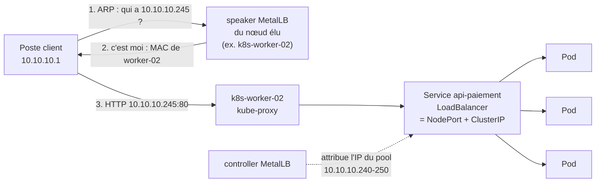

# Lab : Service LoadBalancer (avec MetalLB)

## Objectifs

- comprendre ce qu'un Service `LoadBalancer` ajoute à `NodePort` et à `ClusterIP` ;
- comprendre **qui** fournit l'IP externe : le cloud (AWS, Azure, GCP…) ou, on-premise, **MetalLB** ;
- obtenir une IP externe automatique, puis une IP **fixe** ;
- observer le mode **L2** de MetalLB (ARP, nœud « annonceur », bascule) ;
- sécuriser l'accès : `loadBalancerSourceRanges`, `allocateLoadBalancerNodePorts: false` ;
- préserver l'IP du client avec `externalTrafficPolicy: Local` et `healthCheckNodePort` ;
- dépanner un `EXTERNAL-IP <pending>`.

### Contexte métier

La banque ouvre une **API de paiement** (`api-paiement`) aux **commerçants partenaires**. Contraintes :

| Exigence                                                        | Solution Kubernetes                        |
|-----------------------------------------------------------------|--------------------------------------------|
| Une **adresse IP dédiée** sur le port standard **80/443**       | Service `LoadBalancer`                     |
| L'IP ne doit **jamais changer** (DNS + pare-feu des partenaires) | IP fixe (`metallb.io/loadBalancerIPs`)     |
| Seul le réseau des partenaires peut se connecter               | `loadBalancerSourceRanges`                 |
| Pas de « porte dérobée » par les NodePorts                      | `allocateLoadBalancerNodePorts: false`     |
| L'anti-fraude a besoin de **l'IP réelle** du commerçant         | `externalTrafficPolicy: Local`             |
| Résister à la perte d'un nœud                                   | bascule automatique de MetalLB             |

### Qui fournit l'IP externe ?

Kubernetes **ne sait pas** créer un load-balancer tout seul. Un Service `type: LoadBalancer` est une **demande** :

- **dans le cloud** : le *cloud-controller-manager* crée un vrai load-balancer (ELB AWS, Azure LB…) et écrit son IP dans
  `status.loadBalancer.ingress` ;
- **on-premise** (notre cas) : sans rien d'installé, le Service reste **`<pending>` à vie**. On installe donc
  **MetalLB**, qui attribue une IP d'un **pool** et la rend joignable sur le réseau.

### Vue d'ensemble



> **Mode L2** : un seul nœud à la fois « possède » l'IP (il répond aux requêtes ARP). Ce n'est donc pas un
> load-balancer **entre nœuds** : tout le trafic entre par ce nœud, puis kube-proxy répartit vers les Pods. Si ce nœud
> tombe, un autre reprend l'IP en quelques secondes. (En mode **BGP**, les routeurs répartiraient entre plusieurs nœuds.)

| Type           | ClusterIP | NodePort    | IP externe |
|----------------|-----------|-------------|------------|
| `ClusterIP`    | oui       | –           | –          |
| `NodePort`     | oui       | oui         | –          |
| `LoadBalancer` | oui       | oui (défaut)| **oui**    |

## Étape 0 : préparer l'environnement et vérifier MetalLB

```bash
ssh k8s-master-01
kubectl create namespace svc-loadbalancer
kubectl config set-context --current --namespace=svc-loadbalancer

kubectl get pods -n metallb-system -o wide
# Attendu : 1 Pod controller-... + 5 Pods speaker-... (un par nœud, DaemonSet), tous Running

kubectl get ipaddresspools,l2advertisements -n metallb-system
# NAME                                AUTO ASSIGN   AVOID BUGGY IPS   ADDRESSES
# ipaddresspool.metallb.io/lab-pool   true          false             ["10.10.10.240-10.10.10.250"]
#
# NAME                                IPADDRESSPOOLS   IPADDRESSPOOL SELECTORS   INTERFACES
# l2advertisement.metallb.io/lab-l2   ["lab-pool"]
```

| Objet MetalLB     | Rôle                                                                |
|-------------------|---------------------------------------------------------------------|
| `controller`      | Attribue une IP du pool à chaque Service `LoadBalancer`             |
| `speaker`         | Sur chaque nœud : annonce l'IP sur le réseau (ARP en L2, ou BGP)    |
| `IPAddressPool`   | La plage d'IP que MetalLB a le droit de distribuer                  |
| `L2Advertisement` | Indique que les IP de ce pool sont annoncées en mode L2             |

> La plage `10.10.10.240-250` est **réservée** sur le réseau (hors DHCP) : c'est l'équipe réseau qui la fournit.


# Partie 1 : exposer l'API de paiement

## Étape 1 : déployer `api-paiement`

```bash
cat <<'EOF' | kubectl apply -f -
apiVersion: apps/v1
kind: Deployment
metadata:
  name: api-paiement
  namespace: svc-loadbalancer
  labels:
    app: api-paiement
spec:
  replicas: 3
  selector:
    matchLabels:
      app: api-paiement
  template:
    metadata:
      labels:
        app: api-paiement
    spec:
      containers:
      - name: api
        image: traefik/whoami:v1.11.0
        args: ["--port", "8080"]
        ports:
        - name: http
          containerPort: 8080
        readinessProbe:
          httpGet:
            path: /health
            port: http
          periodSeconds: 2
EOF
kubectl rollout status deployment/api-paiement
```

## Étape 2 : créer le Service LoadBalancer

```bash
cat <<'EOF' | kubectl apply -f -
apiVersion: v1
kind: Service
metadata:
  name: api-paiement
  namespace: svc-loadbalancer
spec:
  type: LoadBalancer
  selector:
    app: api-paiement
  ports:
  - name: http
    port: 80            # port exposé sur l'IP EXTERNE (et sur la ClusterIP)
    targetPort: http    # port du conteneur (8080)
EOF

kubectl get svc api-paiement -w
# NAME           TYPE           CLUSTER-IP   EXTERNAL-IP    PORT(S)        AGE
# api-paiement   LoadBalancer   10.x.y.z     10.10.10.24x   80:3xxxx/TCP   2s
# (Ctrl+C pour quitter le -w)
```

Lecture de la ligne :

- `EXTERNAL-IP` : l'IP prise dans le pool MetalLB : c'est elle que l'on donnera aux partenaires ;
- `80:3xxxx/TCP` : un **NodePort** a aussi été créé automatiquement, et une **ClusterIP** existe toujours.
  Un `LoadBalancer` est bien un empilement des trois types.

```bash
kubectl describe svc api-paiement | sed -n '/Events/,$p'
# Events:
#   Type    Reason        Age   From                Message
#   Normal  IPAllocated   10s   metallb-controller  Assigned IP ["10.10.10.24x"]
#   Normal  nodeAssigned  10s   metallb-speaker     announcing from node "k8s-worker-0X" with protocol "layer2"

kubectl get servicel2statuses -n metallb-system
# NAME       ALLOCATED NODE   SERVICE NAME   SERVICE NAMESPACE
# l2-xxxxx   k8s-worker-0X    api-paiement   svc-loadbalancer
```

> Deux événements, deux composants : le **controller** a choisi l'IP, le **speaker** d'un nœud a été élu pour l'annoncer.

## Étape 3 : appeler l'API depuis l'extérieur

```bash
LB_IP=$(kubectl get svc api-paiement -o jsonpath='{.status.loadBalancer.ingress[0].ip}')
echo $LB_IP

for i in 1 2 3 4 5 6; do curl -s http://$LB_IP | grep Hostname; done
# Attendu : les 3 Pods répondent tour à tour, sur le port standard 80
```

Depuis **votre poste** (hors cluster, `10.10.10.1`), ouvrez un terminal ou un navigateur :

```bash
# Sur votre poste, pas sur le master
curl http://10.10.10.24x        # remplacez par l'EXTERNAL-IP
ip neigh show 10.10.10.24x      # Linux  (Windows : arp -a | findstr 10.10.10.24)
# 10.10.10.24x dev vmnet2 lladdr 00:0c:29:xx:xx:xx REACHABLE
```

Comparez cette adresse MAC avec celle du nœud annonceur :

```bash
# De retour sur k8s-master-01
NODE=$(kubectl get servicel2statuses -n metallb-system -o jsonpath='{.items[?(@.status.serviceName=="api-paiement")].status.node}')
echo $NODE
ssh $NODE ip -br link show ens33
# ens33   UP   00:0c:29:xx:xx:xx ...   <- la même MAC que dans la table ARP de votre poste
```

> **C'est tout le principe du mode L2** : l'IP `10.10.10.24x` n'est configurée sur **aucune** interface ; le speaker du
> nœud élu répond simplement « c'est moi » aux requêtes ARP. Le paquet arrive sur ce nœud, kube-proxy fait le reste.

## Étape 4 : bascule (simulation de perte du nœud annonceur)

On ne va pas éteindre une VM : on demande à MetalLB de ne plus annoncer depuis ce nœud grâce au label standard
`node.kubernetes.io/exclude-from-external-load-balancers`. C'est d'ailleurs ce qu'on fait avant une **maintenance**.

```bash
kubectl get nodes -L node.kubernetes.io/exclude-from-external-load-balancers
# Les 3 masters ont DÉJÀ ce label (posé par kubeadm, valeur vide) : seuls les 2 workers peuvent annoncer une IP.
```

Dans un **second terminal** sur votre poste, lancez un appel en continu :

```bash
# Sur votre poste
while true; do curl -s -m 1 http://10.10.10.24x | grep Hostname || echo "--- coupure ---"; sleep 0.5; done
```

Puis, sur le master :

```bash
kubectl label node $NODE node.kubernetes.io/exclude-from-external-load-balancers=true
sleep 5
kubectl describe svc api-paiement | sed -n '/Events/,$p'
# ...  nodeAssigned  ...  announcing from node "k8s-worker-0Y" with protocol "layer2"   <- un AUTRE nœud

kubectl get servicel2statuses -n metallb-system
# ALLOCATED NODE a changé
```

> Côté poste : l'appel continue (au pire une ou deux requêtes perdues). Le nouveau speaker envoie un **ARP gratuit**
> pour mettre à jour les tables ARP du réseau : `ip neigh show 10.10.10.24x` affiche maintenant la MAC de l'autre nœud.
> En panne réelle, la détection repose sur memberlist et prend quelques secondes.

Fin de la maintenance (arrêtez la boucle avec Ctrl+C) :

```bash
kubectl label node $NODE node.kubernetes.io/exclude-from-external-load-balancers-
```


# Partie 2 : une IP fixe pour les partenaires

## Étape 5 : réserver l'IP `10.10.10.245`

L'IP automatique est **imprévisible** : si on supprime et recrée le Service, on peut en obtenir une autre. Or
`api-paiement.banque.lab` est déjà déclaré dans le DNS public et dans les pare-feu des partenaires avec `10.10.10.245`.

```bash
cat <<'EOF' | kubectl apply -f -
apiVersion: v1
kind: Service
metadata:
  name: api-paiement
  namespace: svc-loadbalancer
  annotations:
    metallb.io/loadBalancerIPs: 10.10.10.245    # IP demandée (doit être dans un pool)
spec:
  type: LoadBalancer
  selector:
    app: api-paiement
  ports:
  - name: http
    port: 80
    targetPort: http
EOF
sleep 3
kubectl get svc api-paiement
# NAME           TYPE           CLUSTER-IP   EXTERNAL-IP    PORT(S)        AGE
# api-paiement   LoadBalancer   10.x.y.z     10.10.10.245   80:3xxxx/TCP   3m

curl -s http://10.10.10.245 | head -1
# Attendu : Hostname: api-paiement-...
```

> Le champ `spec.loadBalancerIP` fait la même chose mais est **déprécié** depuis Kubernetes v1.24 : on utilise
> l'annotation propre à l'implémentation (ici `metallb.io/loadBalancerIPs`).

Pour se protéger contre une suppression accidentelle, l'IP reste fixe même après recréation :

```bash
kubectl get svc api-paiement -o yaml > /tmp/api-paiement-svc.yaml
kubectl delete svc api-paiement
kubectl apply -f /tmp/api-paiement-svc.yaml
sleep 3
kubectl get svc api-paiement
# Attendu : EXTERNAL-IP 10.10.10.245 (de nouveau)
```

L'état du pool :

```bash
kubectl get ipaddresspool lab-pool -n metallb-system -o jsonpath='{.status}{"\n"}'
# {"assignedIPv4":1,"assignedIPv6":0,"availableIPv4":10,"availableIPv6":0}
```


# Partie 3 : sécuriser l'API

## Étape 6 : n'autoriser que le réseau des partenaires (`loadBalancerSourceRanges`)

Dans ce lab, le « réseau partenaire » est simulé par **`k8s-worker-01` (10.10.10.21)**. Le master (`10.10.10.11`) et
votre poste (`10.10.10.1`) jouent des clients **non autorisés**.

```bash
kubectl patch svc api-paiement -p '{"spec":{"loadBalancerSourceRanges":["10.10.10.21/32"]}}'
sleep 3

echo -n "depuis le master   : "; curl -s -m 3 -o /dev/null -w "%{http_code}\n" http://10.10.10.245 || echo "BLOQUÉ"
echo -n "depuis le partenaire : "; ssh k8s-worker-01 curl -s -m 3 -o /dev/null -w "%{http_code}" http://10.10.10.245; echo
# Attendu :
# depuis le master     : 000 BLOQUÉ   (timeout)
# depuis le partenaire : 200
```

Depuis votre poste aussi : `curl -m 3 http://10.10.10.245` -> timeout.

> kube-proxy implémente cette liste blanche par des règles iptables (`KUBE-FW-*`) : tout paquet vers l'IP externe dont
> la source n'est pas dans la liste est rejeté. Dans le cloud, c'est le load-balancer du fournisseur qui filtre.

## Étape 7 : la porte dérobée du NodePort

L'auditeur sécurité remarque ceci :

```bash
NP=$(kubectl get svc api-paiement -o jsonpath='{.spec.ports[0].nodePort}')
echo $NP
curl -s -m 3 -o /dev/null -w "%{http_code}\n" http://10.10.10.21:$NP
# Attendu : 200  !!  le master, client NON autorisé, passe par le NodePort
```

**Constat :** `loadBalancerSourceRanges` ne protège **que l'IP externe**. Le NodePort créé automatiquement reste
ouvert à tous. Avec MetalLB, le NodePort ne sert à rien (le trafic arrive directement sur l'IP externe) : on le
supprime.

```bash
kubectl patch svc api-paiement --type=json -p '[
  {"op":"add","path":"/spec/allocateLoadBalancerNodePorts","value":false},
  {"op":"remove","path":"/spec/ports/0/nodePort"}]'

kubectl get svc api-paiement
# NAME           TYPE           CLUSTER-IP   EXTERNAL-IP    PORT(S)   AGE
# api-paiement   LoadBalancer   10.x.y.z     10.10.10.245   80/TCP    10m      <- plus de NodePort

sleep 2
curl -s -m 3 -o /dev/null -w "%{http_code}\n" http://10.10.10.21:$NP || echo "FERMÉ"
# Attendu : 000 FERMÉ
ssh k8s-worker-01 curl -s -m 3 -o /dev/null -w "%{http_code}" http://10.10.10.245; echo
# Attendu : 200 (le partenaire passe toujours)
```

> Passer `allocateLoadBalancerNodePorts` à `false` **ne libère pas** un nodePort déjà attribué : il faut aussi retirer
> le champ `nodePort` (d'où la 2e opération du patch). À la création, mettre directement `false` suffit.
> Attention : certains load-balancers cloud **ont besoin** des NodePorts : ne le faites qu'avec MetalLB (ou équivalent).

Levez la restriction pour la suite :

```bash
kubectl patch svc api-paiement --type=json -p '[{"op":"remove","path":"/spec/loadBalancerSourceRanges"}]'
```

## Étape 8 : l'anti-fraude veut l'IP réelle du commerçant

**Depuis votre poste :**

```bash
# Sur votre poste
for i in 1 2 3 4; do curl -s http://10.10.10.245 | grep RemoteAddr; done
# Attendu : RemoteAddr: 10.10.10.2x:port ou 10.244.x.y:port   -> PAS 10.10.10.1
```

Comme pour le NodePort : avec `externalTrafficPolicy: Cluster`, le nœud d'entrée fait un SNAT. On passe en `Local`.

```bash
kubectl patch svc api-paiement -p '{"spec":{"externalTrafficPolicy":"Local"}}'
sleep 3
kubectl get svc api-paiement -o jsonpath='{.spec.healthCheckNodePort}{"\n"}'
# 3xxxx   <- un port de "health check" a été alloué automatiquement
```

```bash
# Sur votre poste
for i in 1 2 3 4; do curl -s http://10.10.10.245 | grep RemoteAddr; done
# Attendu : RemoteAddr: 10.10.10.1:port    -> la vraie IP du client
```

Que se passe-t-il si un seul Pod existe ?

```bash
kubectl scale deployment api-paiement --replicas=1
kubectl rollout status deployment/api-paiement
while kubectl get pods -l app=api-paiement | grep -q Terminating; do sleep 2; done
kubectl get pods -l app=api-paiement -o wide
sleep 3
kubectl get servicel2statuses -n metallb-system \
  -o custom-columns=SERVICE:.status.serviceName,NODE:.status.node
# Attendu : MetalLB annonce depuis le nœud qui héberge le Pod (et seulement lui)
```

Le `healthCheckNodePort` indique à un load-balancer externe quels nœuds ont un Pod local :

```bash
HC=$(kubectl get svc api-paiement -o jsonpath='{.spec.healthCheckNodePort}')
for n in 10.10.10.21 10.10.10.22; do
  echo -n "$n -> "; curl -s -o /dev/null -w "%{http_code}\n" http://$n:$HC/healthz
done
# Attendu : 200 sur le nœud qui héberge le Pod, 503 sur l'autre
curl -s http://10.10.10.21:$HC/healthz
# { "service": {...}, "localEndpoints": 0 ou 1, "serviceProxyHealthy": true }
```

> En mode L2, MetalLB fait ce travail lui-même : avec `Local`, il n'élit qu'un nœud **qui a un Pod Ready**. Un F5 ou un
> load-balancer cloud, lui, interroge `healthCheckNodePort` sur chaque nœud.

Remise en état :

```bash
kubectl patch svc api-paiement -p '{"spec":{"externalTrafficPolicy":"Cluster"}}'
kubectl scale deployment api-paiement --replicas=3
```


# Partie 4 : dépannage

## Étape 9 : le Service de l'équipe « change » reste `<pending>`

```bash
kubectl create deployment api-change --image=traefik/whoami:v1.11.0 --replicas=2
cat <<'EOF' | kubectl apply -f -
apiVersion: v1
kind: Service
metadata:
  name: api-change
  namespace: svc-loadbalancer
  annotations:
    metallb.io/loadBalancerIPs: 10.10.10.200
spec:
  type: LoadBalancer
  selector:
    app: api-change
  ports:
  - port: 80
EOF
sleep 5
kubectl get svc api-change
# NAME         TYPE           CLUSTER-IP   EXTERNAL-IP   PORT(S)        AGE
# api-change   LoadBalancer   10.x.y.z     <pending>     80:3xxxx/TCP   5s
```

**À vous :** trouvez pourquoi `api-change` n'obtient pas d'IP externe, puis corrigez le Service pour qu'il obtienne
**une IP quelconque du pool** et réponde sur le port 80.

<details><summary>Méthode et solution</summary>

```bash
kubectl describe svc api-change | sed -n '/Events/,$p'
# Warning  AllocationFailed  ...  metallb-controller  Failed to allocate IP for "svc-loadbalancer/api-change":
#          ["10.10.10.200"] is not allowed in config
```

L'IP demandée n'appartient à **aucun** `IPAddressPool`. Deux options : demander une IP du pool, ou retirer
l'annotation pour laisser MetalLB choisir.

```bash
kubectl annotate svc api-change metallb.io/loadBalancerIPs-
sleep 3
kubectl get svc api-change
# EXTERNAL-IP 10.10.10.24x
curl -s http://$(kubectl get svc api-change -o jsonpath='{.status.loadBalancer.ingress[0].ip}') | head -1
# Hostname: api-change-...
```

Les causes classiques d'un `<pending>` :

| Cause                                                   | Indice                                                       |
|---------------------------------------------------------|--------------------------------------------------------------|
| Aucun contrôleur LoadBalancer installé (pas de MetalLB)  | **aucun** événement sur le Service                           |
| IP demandée hors pool                                   | `AllocationFailed ... is not allowed in config`              |
| IP demandée déjà prise par un autre Service             | `AllocationFailed ... is already in use`                     |
| Pool épuisé                                             | `AllocationFailed ... no available IPs`                      |
| Pool avec `autoAssign: false` et pas d'IP/pool demandé  | `AllocationFailed`                                           |
</details>


# Partie 5 : exercices d'évaluation

**Exercice 1 :** l'équipe veut exposer, sur **la même IP** `10.10.10.246`, le site web (`web-paiement`, port 80) et
la console d'administration (`admin-paiement`, port 8443 vers le port 80 des Pods). Les deux Services ciblent les Pods
`app=api-paiement`. Créez les deux Services (indice : annotation `metallb.io/allow-shared-ip`).

**Exercice 2 :** transformez le Service ClusterIP `interne` en LoadBalancer **sans le supprimer** :

```bash
kubectl expose deployment api-paiement --name=interne --port=80 --target-port=8080
```

**Exercice 3 :** affichez l'IP externe de **tous** les Services LoadBalancer du cluster, au format
`namespace/nom  IP`.

**Exercice 4 :** créez un Service LoadBalancer `api-paiement-v2` (Pods `app=api-paiement`, port 80 -> 8080) **sans
NodePort** dès sa création, avec `kubectl create ... --dry-run=client -o yaml` comme point de départ.

<details><summary><b>Solutions</b></summary>

**1.** Deux Services peuvent partager une IP s'ils portent la **même clé** `allow-shared-ip` et n'utilisent pas les
mêmes ports.
```bash
cat <<'EOF' | kubectl apply -f -
apiVersion: v1
kind: Service
metadata:
  name: web-paiement
  namespace: svc-loadbalancer
  annotations:
    metallb.io/loadBalancerIPs: 10.10.10.246
    metallb.io/allow-shared-ip: paiement
spec:
  type: LoadBalancer
  selector:
    app: api-paiement
  ports:
  - name: http
    port: 80
    targetPort: 8080
---
apiVersion: v1
kind: Service
metadata:
  name: admin-paiement
  namespace: svc-loadbalancer
  annotations:
    metallb.io/loadBalancerIPs: 10.10.10.246
    metallb.io/allow-shared-ip: paiement
spec:
  type: LoadBalancer
  selector:
    app: api-paiement
  ports:
  - name: admin
    port: 8443
    targetPort: 8080
EOF
sleep 3
kubectl get svc web-paiement admin-paiement
# même EXTERNAL-IP 10.10.10.246, ports 80 et 8443
curl -s http://10.10.10.246 | head -1
curl -s http://10.10.10.246:8443 | head -1
```
Cas réel : économiser les IP publiques, qui sont rares et coûteuses.

**2.**
```bash
kubectl patch svc interne -p '{"spec":{"type":"LoadBalancer"}}'
sleep 3
kubectl get svc interne
# TYPE LoadBalancer, même CLUSTER-IP, un NodePort et une EXTERNAL-IP ont été ajoutés
```

**3.**
```bash
kubectl get svc -A --field-selector spec.type=LoadBalancer \
  -o jsonpath='{range .items[*]}{.metadata.namespace}/{.metadata.name}{"  "}{.status.loadBalancer.ingress[0].ip}{"\n"}{end}'
```

**4.**
```bash
kubectl create service loadbalancer api-paiement-v2 --tcp=80:8080 --dry-run=client -o yaml > /tmp/v2.yaml
# Éditer /tmp/v2.yaml : selector app: api-paiement, et ajouter sous spec: allocateLoadBalancerNodePorts: false
sed -i -e 's/app: api-paiement-v2/app: api-paiement/' \
       -e 's/^  type: LoadBalancer/  type: LoadBalancer\n  allocateLoadBalancerNodePorts: false/' /tmp/v2.yaml
kubectl apply -f /tmp/v2.yaml
sleep 3
kubectl get svc api-paiement-v2
# PORT(S) 80/TCP (pas de :3xxxx)
```
</details>


## Nettoyage

```bash
kubectl delete namespace svc-loadbalancer
kubectl label node k8s-worker-01 k8s-worker-02 node.kubernetes.io/exclude-from-external-load-balancers- 2>/dev/null
kubectl config set-context --current --namespace=default
rm -f /tmp/api-paiement-svc.yaml /tmp/v2.yaml

kubectl get ipaddresspool lab-pool -n metallb-system -o jsonpath='{.status}{"\n"}'
# Attendu : "assignedIPv4":0  -> toutes les IP sont rendues au pool
```

## Questions de compréhension

1. Sur un cluster kubeadm sans MetalLB, que montre `kubectl get svc` pour un Service LoadBalancer ? Est-il pour autant
   inutilisable ?
2. En mode L2, combien de nœuds reçoivent le trafic d'une IP externe donnée ?
3. Pourquoi `loadBalancerSourceRanges` seul ne suffit-il pas à protéger l'application ?
4. Quel est le rôle du `healthCheckNodePort` ?
5. Une entreprise a 40 applications web à exposer : 40 Services LoadBalancer, bonne idée ?

<details><summary>Réponses</summary>

1. `EXTERNAL-IP <pending>` indéfiniment. Le Service reste utilisable par sa ClusterIP et son NodePort.
2. Un seul (le nœud élu). kube-proxy répartit ensuite vers les Pods de tous les nœuds (en `Cluster`).
3. Il ne filtre que le trafic vers l'IP externe ; le NodePort reste ouvert. D'où `allocateLoadBalancerNodePorts: false`
   (et/ou des NetworkPolicies).
4. Avec `externalTrafficPolicy: Local`, il permet au load-balancer externe de savoir quels nœuds ont des Pods locaux
   (200) et lesquels n'en ont pas (503).
5. Non : 40 IP à gérer (dans le cloud, 40 load-balancers à payer), et chaque appli doit gérer son TLS. On met **un**
   Service LoadBalancer devant un **Ingress Controller** qui route par nom d'hôte et chemin : c'est le lab suivant.
</details>

## Commandes

| Commande                                                                                  | Utilité                              |
|-------------------------------------------------------------------------------------------|--------------------------------------|
| `kubectl expose deploy D --type=LoadBalancer --port=80 --target-port=8080`                | Créer un Service LoadBalancer        |
| `kubectl get svc S -o jsonpath='{.status.loadBalancer.ingress[0].ip}'`                    | Lire l'IP externe                    |
| `kubectl describe svc S \| sed -n '/Events/,$p'`                                          | Événements MetalLB (IP, nœud)        |
| `kubectl get servicel2statuses -n metallb-system`                                         | Nœud qui annonce chaque IP (L2)      |
| `kubectl get ipaddresspool -n metallb-system -o yaml`                                     | Pools et IP disponibles              |
| `metadata.annotations: metallb.io/loadBalancerIPs: <ip>`                                  | IP fixe                              |
| `metadata.annotations: metallb.io/allow-shared-ip: <clé>`                                 | Partager une IP entre Services       |
| `spec.loadBalancerSourceRanges: [cidr]`                                                   | Liste blanche de clients             |
| `spec.allocateLoadBalancerNodePorts: false`                                               | Pas de NodePort                      |
| `kubectl label node N node.kubernetes.io/exclude-from-external-load-balancers=true`       | Retirer un nœud des annonces         |
