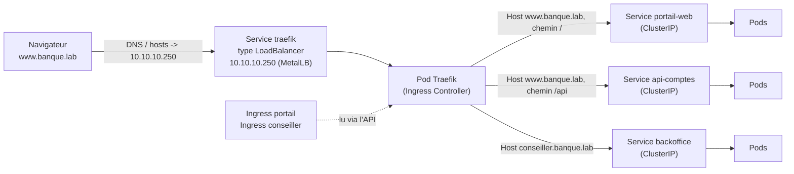

# Lab : Ingress

## Objectifs

- comprendre la différence entre une ressource **Ingress** et un **Ingress Controller** ;
- installer un Ingress Controller (Traefik) exposé par un Service **LoadBalancer** (MetalLB) ;
- router le trafic HTTP par **chemin** (`/`, `/api`) et par **nom d'hôte** (`www.`, `conseiller.`) ;
- comprendre `pathType` (`Prefix`, `Exact`) et `ingressClassName` ;
- définir un **backend par défaut** ;
- terminer le **TLS** (HTTPS) au niveau de l'Ingress avec un Secret `kubernetes.io/tls` ;
- créer un Ingress en **impératif** (`kubectl create ingress`), réflexe utile à l'examen CKA ;
- dépanner un Ingress qui renvoie `404` ou `503`.

### Contexte métier

La banque a maintenant plusieurs applications web à publier. Avec un Service `LoadBalancer` par application, il faudrait
une IP (et, dans le cloud, un load-balancer payant) **par application**, et chaque équipe gérerait son propre certificat.

La décision d'architecture : **une seule IP d'entrée** (`10.10.10.250`), un **reverse-proxy** commun qui route selon
l'URL et qui porte les certificats HTTPS.

| URL demandée                         | Application cible      | Type de routage  |
|--------------------------------------|------------------------|------------------|
| `http(s)://www.banque.lab/`          | `portail-web` (front)  | hôte + chemin    |
| `http(s)://www.banque.lab/api/...`   | `api-comptes`          | hôte + chemin    |
| `http://conseiller.banque.lab/`      | `backoffice`           | hôte             |
| n'importe quel autre nom             | `page-erreur`          | backend par défaut |

### Ingress vs Ingress Controller

| Élément                | Ce que c'est                                                                       | Qui le fournit ?          |
|------------------------|------------------------------------------------------------------------------------|---------------------------|
| **Ingress**            | Un objet de l'API (`networking.k8s.io/v1`) : une **liste de règles** HTTP          | vous (YAML)               |
| **Ingress Controller** | Un **reverse-proxy** (Traefik, NGINX, HAProxy, Contour…) qui lit les Ingress et s'auto-configure | à installer (Helm) |
| **IngressClass**       | Fait le lien entre un Ingress (`ingressClassName`) et le contrôleur qui doit le traiter | installée avec le contrôleur |

> Comme pour les Services LoadBalancer, Kubernetes **n'embarque aucun** Ingress Controller : sans contrôleur, un Ingress
> ne fait **rien**. Ce lab utilise **Traefik**. Le projet communautaire *ingress-nginx*, longtemps le plus répandu,
> a été retiré en 2026 ; le successeur officiel de l'API Ingress est la **Gateway API** (`Gateway`, `HTTPRoute`).
> L'objet Ingress reste au programme du CKA et très présent en production.

### Vue d'ensemble



> **Tout s'emboîte :** le contrôleur est un simple Deployment exposé par un Service **LoadBalancer** (lab 03_03) ; il
> envoie le trafic vers des Services **ClusterIP** (lab 03_01). L'Ingress n'est que la table de routage.
> (Techniquement, Traefik utilise le Service pour trouver les EndpointSlices et envoie directement aux IP des Pods.)

## Étape 0 : préparer l'environnement

```bash
ssh k8s-master-01
kubectl create namespace ingress-lab
kubectl config set-context --current --namespace=ingress-lab

kubectl get ingressclass
# Attendu : No resources found  -> aucun Ingress Controller installé

helm version --short
# Attendu : v3.x
```


# Partie 1 : les applications de la banque

## Étape 1 : trois Deployments et leurs Services ClusterIP

Un Ingress ne cible **jamais** des Pods directement : il cible des **Services**. On crée donc, pour chaque application,
un Deployment de 2 réplicas et un Service ClusterIP sur le port 80.

```bash
for app in portail-web api-comptes backoffice page-erreur; do
  kubectl create deployment $app --image=traefik/whoami:v1.11.0 --replicas=2 --port=80
  kubectl expose deployment $app --port=80 --target-port=80
done
kubectl rollout status deployment portail-web api-comptes backoffice page-erreur

kubectl get deploy,svc
# Attendu : 4 Deployments READY 2/2, 4 Services de type ClusterIP (aucune IP externe)
```

> `whoami` affiche le nom du Pod (`Hostname`) : on verra immédiatement **quelle application** a répondu.
> (Particularité de whoami : sur le chemin exact `/api`, il répond en JSON ; le nom du Pod y figure aussi.)


# Partie 2 : un Ingress sans contrôleur ne fait rien

## Étape 2 : déclarer les règles du portail

```bash
cat <<'EOF' | kubectl apply -f -
apiVersion: networking.k8s.io/v1
kind: Ingress
metadata:
  name: portail
  namespace: ingress-lab
spec:
  ingressClassName: traefik          # quel contrôleur doit traiter cet Ingress
  rules:
  - host: www.banque.lab             # routage par nom d'hôte (en-tête HTTP "Host")
    http:
      paths:
      - path: /api                   # routage par chemin
        pathType: Prefix
        backend:
          service:
            name: api-comptes        # un Service du MÊME namespace
            port:
              number: 80             # le port du SERVICE (pas du conteneur)
      - path: /
        pathType: Prefix
        backend:
          service:
            name: portail-web
            port:
              number: 80
EOF

kubectl get ingress
# NAME      CLASS     HOSTS            ADDRESS   PORTS   AGE
# portail   traefik   www.banque.lab             80      5s      <- ADDRESS vide

kubectl describe ingress portail
# Rules:
#   Host            Path  Backends
#   ----            ----  --------
#   www.banque.lab
#                   /api   api-comptes:80 (10.244.x.y:80,10.244.x.z:80)
#                   /      portail-web:80 (10.244.a.b:80,10.244.a.c:80)
```

**Constat :** l'objet est valide et l'API résout bien les backends, mais `ADDRESS` est vide et **rien n'écoute** :
l'IngressClass `traefik` n'existe même pas encore. Un Ingress est une **configuration** qui attend son contrôleur.


# Partie 3 : installer l'Ingress Controller

## Étape 3 : installer Traefik avec Helm

On fixe l'IP d'entrée `10.10.10.250` (pool MetalLB) : c'est elle que l'équipe réseau inscrira dans le DNS pour
`*.banque.lab`.

```bash
mkdir -p ~/ingress-lab && cd ~/ingress-lab

cat > traefik-values.yaml <<'EOF'
ingressClass:
  enabled: true
  name: traefik              # nom de l'IngressClass créée
  isDefaultClass: false      # true = traite aussi les Ingress sans ingressClassName
providers:
  kubernetesCRD:
    enabled: false           # on n'utilise que l'API standard Ingress dans ce lab
  kubernetesIngress:
    enabled: true
    strictPrefixMatching: true   # pathType Prefix conforme à la spec Kubernetes (voir étape 6)
service:
  spec:
    type: LoadBalancer       # le contrôleur est exposé par un Service LoadBalancer (lab 03_03)
  annotations:
    metallb.io/loadBalancerIPs: 10.10.10.250
EOF

helm install traefik oci://ghcr.io/traefik/helm/traefik --version 42.4.0 \
  --namespace ingress-traefik --create-namespace --skip-crds \
  -f traefik-values.yaml
kubectl -n ingress-traefik rollout status deployment traefik
```

Regardez ce qui a été installé :

```bash
kubectl -n ingress-traefik get deploy,svc
# NAME                      READY   UP-TO-DATE   AVAILABLE
# deployment.apps/traefik   1/1     1            1
#
# NAME              TYPE           CLUSTER-IP   EXTERNAL-IP    PORT(S)
# service/traefik   LoadBalancer   10.x.y.z     10.10.10.250   80:3xxxx/TCP,443:3xxxx/TCP

kubectl get ingressclass
# NAME      CONTROLLER                      PARAMETERS   AGE
# traefik   traefik.io/ingress-controller   <none>       20s
```

> Un Ingress Controller, c'est **un Deployment + un Service LoadBalancer + une IngressClass + des droits RBAC** pour
> lire les Ingress, Services et EndpointSlices de tout le cluster.

## Étape 4 : l'Ingress est maintenant pris en charge

```bash
kubectl get ingress portail
# NAME      CLASS     HOSTS            ADDRESS        PORTS   AGE
# portail   traefik   www.banque.lab   10.10.10.250   80      2m     <- Traefik a renseigné ADDRESS
```

Il n'y a pas de DNS pour `banque.lab` dans ce lab : on dit à `curl` de résoudre le nom vers l'IP du contrôleur avec
`--resolve nom:port:ip` (équivalent à une ligne dans `/etc/hosts`).

```bash
IP=10.10.10.250

curl -s --resolve www.banque.lab:80:$IP http://www.banque.lab/ | grep Hostname
# Hostname: portail-web-xxxxxxxxxx-yyyyy

curl -s --resolve www.banque.lab:80:$IP http://www.banque.lab/api/comptes/42 | grep -E 'Hostname|GET'
# Hostname: api-comptes-xxxxxxxxxx-yyyyy
# GET /api/comptes/42 HTTP/1.1          <- le chemin est transmis TEL QUEL à l'application
```

Le routage par hôte repose sur l'en-tête HTTP **`Host`**. Même IP, même port, mais un autre nom : la règle ne
correspond plus.

```bash
curl -s http://$IP/
# 404 page not found     <- Host: 10.10.10.250 ne correspond à aucune règle

curl -s -H "Host: www.banque.lab" http://$IP/ | grep Hostname
# Hostname: portail-web-...   <- on peut aussi forcer l'en-tête Host à la main
```

**Depuis votre poste** (navigateur), ajoutez dans `/etc/hosts` (Linux/Mac) ou
`C:\Windows\System32\drivers\etc\hosts` (Windows) :

```bash
# Sur votre poste (droits administrateur)
echo "10.10.10.250 www.banque.lab conseiller.banque.lab credit.banque.lab" | sudo tee -a /etc/hosts
```

puis ouvrez `http://www.banque.lab` et `http://www.banque.lab/api/test`.


# Partie 4 : les règles de routage

## Étape 5 : ce que voit l'application

```bash
curl -s --resolve www.banque.lab:80:$IP http://www.banque.lab/ | grep -E '^(RemoteAddr|X-Forwarded|X-Real)'
# RemoteAddr: 10.244.x.y:port               <- l'IP du Pod Traefik (c'est lui qui ouvre la connexion)
# X-Forwarded-For: 10.244.x.y               <- l'IP du client vue par Traefik
# X-Forwarded-Host: www.banque.lab
# X-Forwarded-Port: 80
# X-Forwarded-Proto: http
# X-Real-Ip: 10.244.x.y
```

> Derrière un Ingress, l'application doit lire l'IP du client dans **`X-Forwarded-For`**, pas dans l'adresse TCP. Ici
> on y voit une IP interne, car le Service LoadBalancer de Traefik est en `externalTrafficPolicy: Cluster` (SNAT, voir
> lab 03_03). En production on le passe en `Local` pour y voir la vraie IP du client.

## Étape 6 : `pathType` et l'ordre des règles

```bash
for p in / /api /api/ /api/comptes /apix /accueil; do
  printf "%-14s -> " "$p"
  curl -s --resolve www.banque.lab:80:$IP http://www.banque.lab$p | grep -oE 'portail-web|api-comptes' | head -1
done
# /              -> portail-web
# /api           -> api-comptes
# /api/          -> api-comptes
# /api/comptes   -> api-comptes
# /apix          -> portail-web     <- /apix ne commence PAS par l'élément de chemin /api
# /accueil       -> portail-web
```

| `pathType`               | `path: /api` correspond à…                                  | Ne correspond pas à…       |
|--------------------------|-------------------------------------------------------------|----------------------------|
| `Prefix`                 | `/api`, `/api/`, `/api/comptes` (élément par élément)       | `/apix`, `/ap`             |
| `Exact`                  | `/api` **uniquement**                                       | `/api/`, `/api/comptes`    |
| `ImplementationSpecific` | dépend du contrôleur                                        | –                          |

> Quand plusieurs chemins correspondent, c'est le **plus long** qui gagne : `/api/comptes` va vers `/api` et non vers
> `/`. L'ordre d'écriture dans le YAML n'a pas d'importance.
> Les contrôleurs n'appliquent pas tous la spec à la lettre : sans `strictPrefixMatching`, Traefik ferait correspondre
> `/apix` à `/api`. Testez toujours le comportement de **votre** contrôleur.

## Étape 7 : routage par nom d'hôte, le site des conseillers

Une **autre équipe** gère le back-office : elle a **son propre** Ingress (on ne modifie pas celui du portail).

```bash
cat <<'EOF' | kubectl apply -f -
apiVersion: networking.k8s.io/v1
kind: Ingress
metadata:
  name: conseiller
  namespace: ingress-lab
spec:
  ingressClassName: traefik
  rules:
  - host: conseiller.banque.lab
    http:
      paths:
      - path: /
        pathType: Prefix
        backend:
          service:
            name: backoffice
            port:
              number: 80
EOF
sleep 3

curl -s --resolve conseiller.banque.lab:80:$IP http://conseiller.banque.lab/ | grep Hostname
# Hostname: backoffice-...
curl -s --resolve conseiller.banque.lab:80:$IP http://conseiller.banque.lab/api/x | grep Hostname
# Hostname: backoffice-...   <- /api n'existe que pour www.banque.lab

kubectl get ingress
# NAME         CLASS     HOSTS                   ADDRESS        PORTS   AGE
# conseiller   traefik   conseiller.banque.lab   10.10.10.250   80      5s
# portail      traefik   www.banque.lab          10.10.10.250   80      5m
```

> **Une IP, N applications** : le contrôleur fusionne les règles de **tous** les Ingress du cluster (tous namespaces).
> Chaque équipe garde la main sur son Ingress, dans son namespace.

## Étape 8 : un backend par défaut

Un utilisateur tape une URL inconnue (`intranet.banque.lab`, ou l'IP directement) : plutôt qu'un `404` brut du proxy,
on veut afficher la page d'erreur de la banque.

```bash
curl -s --resolve intranet.banque.lab:80:$IP http://intranet.banque.lab/
# 404 page not found    <- réponse "brute" de Traefik

cat <<'EOF' | kubectl apply -f -
apiVersion: networking.k8s.io/v1
kind: Ingress
metadata:
  name: defaut
  namespace: ingress-lab
spec:
  ingressClassName: traefik
  defaultBackend:              # pas de "rules" : tout ce qui ne correspond à rien d'autre
    service:
      name: page-erreur
      port:
        number: 80
EOF
sleep 3

curl -s --resolve intranet.banque.lab:80:$IP http://intranet.banque.lab/ | grep Hostname
# Hostname: page-erreur-...
curl -s http://$IP/ | grep Hostname
# Hostname: page-erreur-...
curl -s --resolve www.banque.lab:80:$IP http://www.banque.lab/ | grep Hostname
# Hostname: portail-web-...   <- les règles explicites restent prioritaires
```


# Partie 5 : HTTPS

## Étape 9 : un certificat pour `www.banque.lab`

En production, le certificat vient de la PKI de la banque (ou de cert-manager). Ici on génère un certificat
auto-signé.

```bash
cd ~/ingress-lab
openssl req -x509 -nodes -days 365 -newkey rsa:2048 \
  -keyout www.key -out www.crt \
  -subj "/CN=www.banque.lab/O=Banque Lab" \
  -addext "subjectAltName=DNS:www.banque.lab" 2>/dev/null

kubectl create secret tls www-banque-tls --cert=www.crt --key=www.key
kubectl get secret www-banque-tls
# NAME             TYPE                DATA   AGE
# www-banque-tls   kubernetes.io/tls   2      3s       <- deux clés : tls.crt et tls.key
```

> Le Secret doit être dans le **même namespace** que l'Ingress qui l'utilise.

## Étape 10 : activer TLS sur l'Ingress du portail

```bash
kubectl patch ingress portail --type=json -p '[{"op":"add","path":"/spec/tls","value":[
  {"hosts":["www.banque.lab"],"secretName":"www-banque-tls"}]}]'

kubectl get ingress portail
# NAME      CLASS     HOSTS            ADDRESS        PORTS     AGE
# portail   traefik   www.banque.lab   10.10.10.250   80, 443   10m
sleep 3

curl -sk --resolve www.banque.lab:443:$IP https://www.banque.lab/api/solde | grep -E 'Hostname|X-Forwarded-Proto'
# Hostname: api-comptes-...
# X-Forwarded-Proto: https       <- l'application sait que le client est en HTTPS

curl -skv --resolve www.banque.lab:443:$IP https://www.banque.lab/ 2>&1 | grep -E 'subject:|issuer:'
# *   subject: CN=www.banque.lab; O=Banque Lab
# *   issuer: CN=www.banque.lab; O=Banque Lab   <- notre certificat (auto-signé, d'où -k)
```

> **Terminaison TLS** : le chiffrement s'arrête au contrôleur ; entre Traefik et les Pods, le trafic est en HTTP
> clair dans le réseau du cluster. Les équipes applicatives n'ont plus à gérer de certificat.
> Ici, `http://www.banque.lab` répond toujours : la **redirection HTTP -> HTTPS** n'est pas dans la spec Ingress, elle
> se configure dans le contrôleur (option Helm ou annotation propre à Traefik/NGINX…).

Un hôte sans section `tls` reçoit le certificat **par défaut** du contrôleur :

```bash
curl -skv --resolve conseiller.banque.lab:443:$IP https://conseiller.banque.lab/ 2>&1 | grep 'subject:'
# *   subject: CN=TRAEFIK DEFAULT CERT
```


# Partie 6 : dépannage

## Étape 11 : le simulateur de crédit est injoignable

L'équipe « Crédit » a recopié un manifeste depuis un autre cluster.

```bash
kubectl create deployment simulateur-credit --image=traefik/whoami:v1.11.0 --replicas=2
kubectl expose deployment simulateur-credit --port=80
cat <<'EOF' | kubectl apply -f -
apiVersion: networking.k8s.io/v1
kind: Ingress
metadata:
  name: credit
  namespace: ingress-lab
spec:
  ingressClassName: nginx
  rules:
  - host: credit.banque.lab
    http:
      paths:
      - path: /
        pathType: Prefix
        backend:
          service:
            name: simulateur-credit
            port:
              number: 8080
EOF
kubectl rollout status deployment simulateur-credit
sleep 3

curl -s --resolve credit.banque.lab:80:$IP http://credit.banque.lab/ | grep Hostname
# Hostname: page-erreur-...     <- c'est le backend par défaut qui répond, pas le simulateur
```

**À vous :** `http://credit.banque.lab/` doit afficher un Pod `simulateur-credit`. Il y a **deux** erreurs dans
l'Ingress `credit`.

<details><summary>Méthode et solution</summary>

**1. L'Ingress est-il pris en charge par un contrôleur ?**

```bash
kubectl get ingress credit
# NAME     CLASS   HOSTS               ADDRESS   PORTS   AGE
# credit   nginx   credit.banque.lab             80      1m     <- CLASS nginx, ADDRESS vide
kubectl get ingressclass
# seule "traefik" existe : aucun contrôleur ne traite la classe "nginx"

kubectl patch ingress credit --type=json \
  -p '[{"op":"replace","path":"/spec/ingressClassName","value":"traefik"}]'
sleep 3
kubectl get ingress credit
# ADDRESS 10.10.10.250  -> pris en charge
curl -s --resolve credit.banque.lab:80:$IP http://credit.banque.lab/ | grep Hostname
# Hostname: page-erreur-...   <- toujours pas le simulateur !
```

**2. Le backend est-il valide ?** `kubectl describe` ne suffit pas ici :

```bash
kubectl describe ingress credit | grep -A3 Path
#   credit.banque.lab
#                      /   simulateur-credit:8080 (10.244.x.y:80,10.244.x.z:80)
#   -> il affiche les Pods... mais sur le port 80 : il ne vérifie PAS que le Service expose 8080
```

Les journaux du contrôleur, eux, sont explicites :

```bash
kubectl -n ingress-traefik logs deployment/traefik | grep -i "cannot create service" | tail -1
# ERR Cannot create service error="service port not found" ingress=credit ... servicePort=...Number:8080
kubectl get svc simulateur-credit
# PORT(S) 80/TCP   -> le Service expose 80, pas 8080
```

`backend.service.port` désigne le port **du Service** (`port`), jamais celui du conteneur.

```bash
kubectl patch ingress credit --type=json \
  -p '[{"op":"replace","path":"/spec/rules/0/http/paths/0/backend/service/port/number","value":80}]'
sleep 3
curl -s --resolve credit.banque.lab:80:$IP http://credit.banque.lab/ | grep Hostname
# Hostname: simulateur-credit-...
```

| Symptôme                   | Causes probables                                                                 |
|----------------------------|----------------------------------------------------------------------------------|
| `ADDRESS` vide             | mauvaise `ingressClassName`, contrôleur absent ou en panne                       |
| `404` du contrôleur        | Ingress ignoré (classe), hôte/chemin ne correspond pas, Service ou port inexistant |
| `503` (`no available server`) | le Service existe mais **aucun Pod Ready** (sélecteur, readiness, 0 réplica)  |
| `502` / `504`              | le Pod est Ready mais l'appli ne répond pas sur le `targetPort`                  |
</details>

Vérifiez aussi le cas `503` :

```bash
kubectl scale deployment simulateur-credit --replicas=0
sleep 3
curl -s -w '  [HTTP %{http_code}]\n' --resolve credit.banque.lab:80:$IP http://credit.banque.lab/
# no available server  [HTTP 503]
kubectl scale deployment simulateur-credit --replicas=2
```


# Partie 7 : exercices d'évaluation

**Exercice 1 (style CKA) :** sans écrire de YAML, créez un Ingress `epargne` (classe `traefik`) qui envoie
`epargne.banque.lab/` (préfixe) vers un Service `epargne` sur le port 80. Créez le Deployment et le Service
nécessaires.

**Exercice 2 :** toujours en impératif, créez un Ingress `www-v2` pour l'hôte `v2.banque.lab` : le chemin `/api`
(préfixe) vers `api-comptes:80`, le reste vers `portail-web:80`, en HTTPS avec le Secret `www-banque-tls`.

**Exercice 3 :** affichez pour **tous** les Ingress du cluster : namespace, nom, classe et la liste des hôtes.

**Exercice 4 :** le Pod Traefik est un point unique de défaillance. Rendez le contrôleur hautement disponible
(2 réplicas sur des nœuds différents) et vérifiez que le portail répond toujours.

<details><summary><b>Solutions</b></summary>

**1.**
```bash
kubectl create deployment epargne --image=traefik/whoami:v1.11.0 --replicas=2
kubectl expose deployment epargne --port=80
kubectl create ingress epargne --class=traefik --rule="epargne.banque.lab/*=epargne:80"
kubectl rollout status deployment epargne
sleep 3
curl -s --resolve epargne.banque.lab:80:$IP http://epargne.banque.lab/ | grep Hostname
```
Syntaxe de `--rule` : `hôte/chemin=service:port`. Un `*` final donne `pathType: Prefix`, sans `*` c'est `Exact`.

**2.**
```bash
kubectl create ingress www-v2 --class=traefik \
  --rule="v2.banque.lab/api*=api-comptes:80,tls=www-banque-tls" \
  --rule="v2.banque.lab/*=portail-web:80,tls=www-banque-tls"
sleep 3
curl -sk --resolve v2.banque.lab:443:$IP https://v2.banque.lab/api/x | grep Hostname
# Hostname: api-comptes-...
```
(Le certificat est émis pour `www.banque.lab` : un vrai navigateur afficherait une alerte de nom.)

**3.**
```bash
kubectl get ingress -A -o custom-columns=NS:.metadata.namespace,NAME:.metadata.name,CLASS:.spec.ingressClassName,HOSTS:.spec.rules[*].host
```

**4.**
```bash
kubectl -n ingress-traefik scale deployment traefik --replicas=2
kubectl -n ingress-traefik rollout status deployment traefik
kubectl -n ingress-traefik get pods -o wide
# 2 Pods, idéalement sur k8s-worker-01 et k8s-worker-02
curl -s --resolve www.banque.lab:80:$IP http://www.banque.lab/ | grep Hostname
```
Pour **garantir** la répartition, ajoutez une `podAntiAffinity` ou une `topologySpreadConstraints` (lab scheduling),
de préférence via les valeurs Helm (`replicas`, `affinity`) plutôt qu'un `kubectl scale` qui serait écrasé au prochain
`helm upgrade`.
</details>


## Nettoyage

```bash
kubectl delete namespace ingress-lab
helm uninstall traefik -n ingress-traefik
kubectl delete namespace ingress-traefik
kubectl config set-context --current --namespace=default
rm -rf ~/ingress-lab

kubectl get ingressclass
# Attendu : No resources found
```

Sur votre poste, retirez la ligne `banque.lab` ajoutée dans le fichier `hosts`.

## Questions de compréhension

1. Que se passe-t-il si on crée un Ingress sur un cluster sans Ingress Controller ?
2. Un Ingress peut-il envoyer du trafic vers un Service d'un **autre** namespace ?
3. Quelle est la différence entre `pathType: Prefix` et `Exact` pour `path: /api` et la requête `/api/comptes` ?
4. Pourquoi l'Ingress Controller est-il exposé par un Service `LoadBalancer` (ou `NodePort`) ?
5. Où se trouve la clé privée du certificat HTTPS, et qui la lit ?
6. Un Ingress `ingressClassName: traefik` et un autre sans `ingressClassName` : lequel est traité si aucune
   IngressClass n'est marquée par défaut ?

<details><summary>Réponses</summary>

1. L'objet est accepté par l'API, mais rien ne se passe : pas d'`ADDRESS`, aucun proxy ne route le trafic.
2. Non : `backend.service.name` désigne un Service du **même namespace** que l'Ingress. Chaque namespace crée ses
   propres Ingress.
3. `Prefix` : `/api/comptes` correspond. `Exact` : seule la requête `/api` correspond.
4. Parce que le contrôleur est un Pod comme un autre : il faut un Service pour le rendre joignable depuis l'extérieur.
   Ingress = couche 7 **au-dessus** d'un Service de couche 4.
5. Dans un Secret de type `kubernetes.io/tls` (clé `tls.key`), dans le namespace de l'Ingress ; c'est le contrôleur
   qui le lit (il a les droits RBAC pour lire les Secrets).
6. Selon la spec, celui avec la bonne classe. Le traitement d'un Ingress **sans** classe dépend du contrôleur
   (Traefik le prend en charge, d'autres l'ignorent). Bonne pratique : toujours renseigner `ingressClassName`, ou
   marquer une IngressClass par défaut (`ingressclass.kubernetes.io/is-default-class: "true"`).
</details>

## Commandes

| Commande                                                                                  | Utilité                                  |
|-------------------------------------------------------------------------------------------|------------------------------------------|
| `kubectl get ingressclass`                                                                | Contrôleurs disponibles                  |
| `kubectl create ingress I --class=C --rule="hôte/chemin*=svc:port"`                       | Ingress impératif (`*` = Prefix)         |
| `kubectl create ingress I --rule="hôte/*=svc:port,tls=secret"`                            | Avec TLS                                 |
| `kubectl create ingress I --class=C --default-backend=svc:port`                           | Backend par défaut                       |
| `kubectl create secret tls S --cert=f.crt --key=f.key`                                    | Secret TLS                               |
| `kubectl get ingress -o wide` / `kubectl describe ingress I`                              | Règles, backends, ADDRESS                |
| `curl --resolve hôte:80:IP http://hôte/chemin`                                            | Tester sans DNS                          |
| `curl -H "Host: hôte" http://IP/`                                                         | Forcer l'en-tête Host                    |
| `kubectl -n ingress-traefik logs deploy/traefik`                                          | Erreurs du contrôleur                    |
