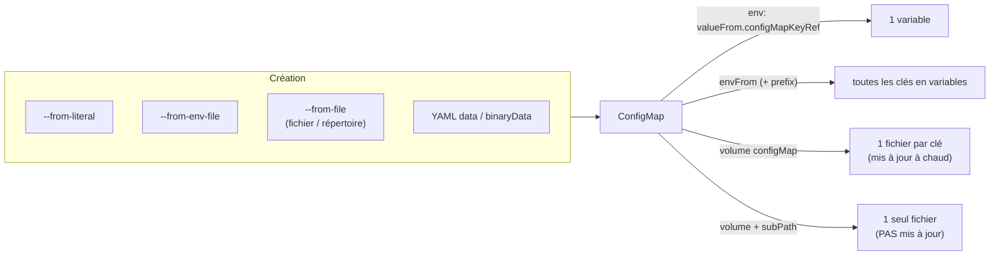

# Lab : ConfigMap

## Objectifs

- comprendre **pourquoi** on sépare la configuration de l'image (12-factor app) ;
- créer un ConfigMap de **toutes** les façons : `--from-literal`, `--from-env-file`, `--from-file` (fichier, clé
  renommée, répertoire), YAML (`data`, blocs multi-lignes, `binaryData`) ;
- consommer un ConfigMap : variable unique (`configMapKeyRef`), toutes les clés (`envFrom` + `prefix`), arguments
  `$(VAR)`, volume complet, volume avec `items` / `defaultMode`, fichier unique avec `subPath` ;
- maîtriser `optional: true` et les erreurs `CreateContainerConfigError` / `FailedMount` ;
- savoir **ce qui est mis à jour à chaud** (volume) et ce qui ne l'est **pas** (variables d'environnement, `subPath`) ;
- appliquer une nouvelle configuration proprement : `rollout restart`, annotation de hash, ConfigMaps **immuables et
  versionnés** avec rollback.

### Contexte métier

La même image est déployée en recette, en pré-production et en production : seule la **configuration** change. Deux
équipes ont besoin de ConfigMaps :

| Application   | Image              | Configuration                                                                   |
|---------------|--------------------|---------------------------------------------------------------------------------|
| `api-comptes` | `busybox` (simulée) | paramètres métier (devise, plafond de virement, niveau de logs), *feature flags* |
| `portail-web` | `nginx`            | fichier `default.conf` de nginx, page d'accueil HTML, logo                       |

> **ConfigMap** = données de configuration **non sensibles**, en clair, limitées à **1 MiB**. Pour les mots de passe,
> jetons et certificats : **Secret** (lab 04_02).

### Vue d'ensemble



## Étape 0 : préparer l'environnement

```bash
ssh k8s-master-01
kubectl create namespace config-lab
kubectl config set-context --current --namespace=config-lab
mkdir -p ~/config-lab && cd ~/config-lab
```


# Partie 1 : créer des ConfigMaps (toutes les méthodes)

## Étape 1 : `--from-literal`, quelques paramètres simples

```bash
kubectl create configmap api-comptes-params \
  --from-literal=DEVISE=EUR \
  --from-literal=PLAFOND_VIREMENT=5000 \
  --from-literal=LOG_LEVEL=info

kubectl get configmap api-comptes-params
# NAME                 DATA   AGE
# api-comptes-params   3      2s       <- DATA = nombre de clés

kubectl describe configmap api-comptes-params
# Data
# ====
# DEVISE:
# ----
# EUR
# ...
```

> Toutes les valeurs d'un ConfigMap sont des **chaînes de caractères** : `5000` est stocké `"5000"`. C'est à
> l'application de convertir.

## Étape 2 : `--from-env-file` contre `--from-file` sur le même fichier

Les développeurs livrent un fichier `.env` par environnement :

```bash
cat > production.env <<'EOF'
# Paramètres de production de l'API comptes
ENVIRONNEMENT=production
URL_CORE_BANKING=http://core-banking.svc-core:8080
TIMEOUT_MS=3000

DEVISE=EUR
EOF

kubectl create configmap api-comptes-env --from-env-file=production.env
kubectl create configmap api-comptes-envfichier --from-file=production.env

kubectl get configmap api-comptes-env api-comptes-envfichier
# NAME                     DATA   AGE
# api-comptes-env          4      2s     <- 4 clés (commentaires et lignes vides ignorés)
# api-comptes-envfichier   1      2s     <- 1 seule clé : "production.env", contenant tout le fichier

kubectl get configmap api-comptes-env -o jsonpath='{.data}{"\n"}'
# {"DEVISE":"EUR","ENVIRONNEMENT":"production","TIMEOUT_MS":"3000","URL_CORE_BANKING":"http://core-banking.svc-core:8080"}
```

| Option                     | Résultat                                       | Usage typique                     |
|----------------------------|------------------------------------------------|-----------------------------------|
| `--from-env-file=f.env`    | **une clé par ligne** `CLE=valeur`             | à injecter en variables (`envFrom`) |
| `--from-file=f`            | **une seule clé** (`f`), valeur = fichier entier | à monter comme **fichier**        |

## Étape 3 : `--from-file`, fichiers de configuration et répertoires

Le fichier de configuration nginx du portail, et des *feature flags* au format `.properties` :

```bash
cat > default.conf <<'EOF'
server {
    listen 80;
    server_name _;
    root /usr/share/nginx/html;

    location / {
        index index.html;
    }
    # sonde de santé, sans log
    location = /healthz {
        access_log off;
        return 200 "ok\n";
    }
}
EOF

cat > flags.properties <<'EOF'
virement.instantane.actif=true
paiement.mobile.actif=false
EOF

# Clé = nom du fichier ; la seconde clé est RENOMMÉE en "feature-flags.properties"
kubectl create configmap portail-nginx --from-file=default.conf
kubectl create configmap api-comptes-flags --from-file=feature-flags.properties=flags.properties

kubectl get configmap api-comptes-flags -o yaml | sed -n '/^data:/,/^kind/p'
# data:
#   feature-flags.properties: |
#     virement.instantane.actif=true
#     paiement.mobile.actif=false
# kind: ConfigMap
```

Un **répertoire** entier (une clé par fichier), par exemple les modèles d'e-mails :

```bash
mkdir -p modeles
echo "Bonjour {{nom}}, votre virement de {{montant}} EUR a été exécuté." > modeles/virement.txt
echo "Bonjour {{nom}}, votre carte a été mise en opposition."             > modeles/opposition.txt

kubectl create configmap modeles-mail --from-file=modeles/
kubectl get configmap modeles-mail
# NAME           DATA   AGE
# modeles-mail   2      2s     <- opposition.txt et virement.txt
```

## Étape 4 : YAML déclaratif, multi-lignes et `binaryData`

En production, les ConfigMaps sont **versionnés dans Git** et appliqués par `kubectl apply` (ou ArgoCD / Flux). Pour
obtenir le YAML à partir d'une commande impérative :

```bash
kubectl create configmap portail-html --from-literal=titre="Banque en ligne" \
  --dry-run=client -o yaml > portail-html.yaml
cat portail-html.yaml
```

Complétez-le à la main avec une page HTML multi-lignes (`|` conserve les retours à la ligne) :

```bash
cat > portail-html.yaml <<'EOF'
apiVersion: v1
kind: ConfigMap
metadata:
  name: portail-html
  namespace: config-lab
  labels:
    app: portail-web
data:
  titre: "Banque en ligne"
  index.html: |
    <!DOCTYPE html>
    <html><head><meta charset="utf-8"><title>Banque en ligne</title></head>
    <body style="font-family:sans-serif;background:#0d47a1;color:white;text-align:center;padding-top:80px">
      <h1>Banque en ligne</h1>
      <p>Bienvenue sur votre espace client.</p>
      <p><small>Configuration : version 1</small></p>
    </body></html>
EOF
kubectl apply -f portail-html.yaml
```

Un contenu **binaire** (image, keystore…) ne peut pas aller dans `data` (UTF-8 uniquement) : `kubectl` le place
automatiquement dans **`binaryData`**, encodé en base64.

```bash
printf '\x89PNG\r\n\x1a\n\x00\x00logo-fictif' > logo.png
kubectl create configmap portail-logo --from-file=logo.png
kubectl get configmap portail-logo -o yaml | grep -A1 binaryData
# binaryData:
#   logo.png: iVBORw0KGgoAAGxvZ28tZmljdGlm
```

Récapitulatif :

```bash
kubectl get configmaps
# NAME                     DATA   AGE
# api-comptes-env          4      ...
# api-comptes-envfichier   1
# api-comptes-flags        1
# api-comptes-params       3
# kube-root-ca.crt         1      <- créé automatiquement dans CHAQUE namespace (CA du cluster)
# modeles-mail             2
# portail-html             2
# portail-logo             1
# portail-nginx            1
```


# Partie 2 : consommer un ConfigMap

## Étape 5 : variables d'environnement (`configMapKeyRef`, `envFrom`, `prefix`, `$(VAR)`)

L'API simulée affiche sa configuration au démarrage puis toutes les 10 s.

```bash
cat > api-comptes.yaml <<'EOF'
apiVersion: apps/v1
kind: Deployment
metadata:
  name: api-comptes
  namespace: config-lab
spec:
  replicas: 2
  selector:
    matchLabels:
      app: api-comptes
  template:
    metadata:
      labels:
        app: api-comptes
    spec:
      containers:
      - name: api
        image: busybox:1.36
        # $(VAR) est remplacé par Kubernetes (pas par le shell) à partir des variables déclarées ci-dessous
        command: ["sh", "-c"]
        args:
        - |
          trap 'echo "Arret propre (SIGTERM)"; exit 0' TERM
          echo "Demarrage API comptes - devise=$(DEVISE_COMPTE) env=$(CFG_ENVIRONNEMENT)"
          while true; do
            echo "$(date +%T) plafond=$PLAFOND niveau=$LOG_LEVEL timeout=$CFG_TIMEOUT_MS flags=[$(cat /etc/api/feature-flags.properties | tr '\n' ' ')]"
            sleep 10 & wait $!
          done
        env:
        # 1) UNE clé, avec un nom de variable différent du nom de la clé
        - name: PLAFOND
          valueFrom:
            configMapKeyRef:
              name: api-comptes-params
              key: PLAFOND_VIREMENT
        - name: DEVISE_COMPTE
          valueFrom:
            configMapKeyRef:
              name: api-comptes-params
              key: DEVISE
        envFrom:
        # 2) TOUTES les clés d'un ConfigMap
        - configMapRef:
            name: api-comptes-params
        # 3) TOUTES les clés, avec un préfixe pour éviter les collisions
        - prefix: CFG_
          configMapRef:
            name: api-comptes-env
        volumeMounts:
        - name: flags
          mountPath: /etc/api
          readOnly: true
      volumes:
      - name: flags
        configMap:
          name: api-comptes-flags
EOF
kubectl apply -f api-comptes.yaml
kubectl rollout status deployment/api-comptes

kubectl logs deployment/api-comptes | head -2
# Demarrage API comptes - devise=EUR env=production
# 10:20:01 plafond=5000 niveau=info timeout=3000 flags=[virement.instantane.actif=true paiement.mobile.actif=false ]

kubectl exec deploy/api-comptes -- env | sort | grep -E 'PLAFOND|DEVISE|LOG_LEVEL|CFG_'
# CFG_DEVISE=EUR
# CFG_ENVIRONNEMENT=production
# CFG_TIMEOUT_MS=3000
# CFG_URL_CORE_BANKING=http://core-banking.svc-core:8080
# DEVISE=EUR
# DEVISE_COMPTE=EUR
# LOG_LEVEL=info
# PLAFOND=5000
# PLAFOND_VIREMENT=5000
```

| Syntaxe                          | Effet                                              | Remarque                                         |
|----------------------------------|----------------------------------------------------|--------------------------------------------------|
| `env[].valueFrom.configMapKeyRef` | 1 clé -> 1 variable, nom libre                     | le plus explicite                                |
| `envFrom[].configMapRef`         | toutes les clés -> variables de même nom           | une clé ajoutée plus tard = variable ajoutée au prochain redémarrage |
| `envFrom[].prefix`               | préfixe ajouté à chaque nom                        | évite les collisions entre ConfigMaps            |
| `$(VAR)` dans `command` / `args` | substitué par **Kubernetes** avant le lancement    | la variable doit être déclarée dans `env`/`envFrom` |

> Le `trap ... TERM` et le `sleep 10 & wait $!` font que l'appli simulée **s'arrête immédiatement** sur SIGTERM. Sans
> cela, un script shell ignore le signal et chaque ancien Pod resterait 30 s en `Terminating`
> (`terminationGracePeriodSeconds`) à chaque redémarrage.

> **Priorité** : si une même variable est définie plusieurs fois, `env` l'emporte sur `envFrom`, et dans `envFrom` la
> dernière source gagne.

## Étape 6 : le portail nginx, volumes, `items`, `defaultMode` et `subPath`

Trois besoins différents pour le portail :

- `default.conf` doit **remplacer un seul fichier** dans `/etc/nginx/conf.d/` → `subPath` ;
- la page d'accueil : seule la clé `index.html` du ConfigMap `portail-html` nous intéresse → `items` ;
- le logo doit apparaître dans `/usr/share/nginx/html/img/` en lecture seule pour tous → `defaultMode`.

```bash
cat > portail-web.yaml <<'EOF'
apiVersion: apps/v1
kind: Deployment
metadata:
  name: portail-web
  namespace: config-lab
spec:
  replicas: 2
  selector:
    matchLabels:
      app: portail-web
  template:
    metadata:
      labels:
        app: portail-web
    spec:
      containers:
      - name: nginx
        image: nginx:1.27-alpine
        ports:
        - name: http
          containerPort: 80
        readinessProbe:
          httpGet:
            path: /healthz
            port: http
        volumeMounts:
        # a) un SEUL fichier, sans masquer le reste du répertoire
        - name: nginx-conf
          mountPath: /etc/nginx/conf.d/default.conf
          subPath: default.conf
        # b) un répertoire contenant uniquement les clés choisies
        - name: html
          mountPath: /usr/share/nginx/html
        - name: logo
          mountPath: /usr/share/nginx/html/img
      volumes:
      - name: nginx-conf
        configMap:
          name: portail-nginx
      - name: html
        configMap:
          name: portail-html
          items:                      # seulement ces clés, éventuellement renommées
          - key: index.html
            path: index.html
      - name: logo
        configMap:
          name: portail-logo
          defaultMode: 0444           # permissions des fichiers (octal) ; défaut 0644
---
apiVersion: v1
kind: Service
metadata:
  name: portail-web
  namespace: config-lab
spec:
  type: NodePort
  selector:
    app: portail-web
  ports:
  - port: 80
    targetPort: http
    nodePort: 30410
EOF
kubectl apply -f portail-web.yaml
kubectl rollout status deployment/portail-web
```

Vérifiez dans le conteneur :

```bash
kubectl exec deploy/portail-web -- ls /etc/nginx/conf.d/ /usr/share/nginx/html/
# /etc/nginx/conf.d/:
# default.conf                  <- notre fichier (subPath), le répertoire n'est pas masqué
#
# /usr/share/nginx/html/:
# img
# index.html                    <- uniquement la clé choisie (pas "titre")

kubectl exec deploy/portail-web -- ls -l /usr/share/nginx/html/img/..data/
# -r--r--r--    1 root   root   ...  logo.png       <- 0444

curl -s http://10.10.10.21:30410/healthz
# ok
curl -s http://10.10.10.21:30410/ | grep -E 'h1|Configuration'
#   <h1>Banque en ligne</h1>
#   <p><small>Configuration : version 1</small></p>
```

Ouvrez **`http://10.10.10.21:30410`** dans votre navigateur : la page bleue « Banque en ligne » s'affiche.

> **Attention :** monter un volume sur un répertoire **masque** tout son contenu d'origine. Sans `subPath`, monter
> `portail-nginx` sur `/etc/nginx/conf.d` remplacerait tout le répertoire. Ici c'est voulu pour
> `/usr/share/nginx/html` (la page par défaut de nginx disparaît).

## Étape 7 : comment Kubernetes écrit les fichiers d'un volume ConfigMap

```bash
kubectl exec deploy/api-comptes -- ls -la /etc/api
# drwxr-xr-x  ..2026_11_24_10_20_01.123456789          <- répertoire horodaté avec le contenu réel
# lrwxrwxrwx  ..data -> ..2026_11_24_10_20_01.123456789
# lrwxrwxrwx  feature-flags.properties -> ..data/feature-flags.properties
```

> Lors d'une mise à jour, kubelet écrit un **nouveau** répertoire horodaté puis bascule le lien `..data` d'un seul
> coup (opération atomique) : l'application ne lit jamais un fichier à moitié écrit. Un `subPath` monte directement le
> fichier, sans ce mécanisme de lien : c'est pour cela qu'il n'est **jamais** mis à jour.


# Partie 3 : mettre à jour la configuration

## Étape 8 : ce qui change à chaud… et ce qui ne change pas

L'équipe métier relève le plafond de virement, active le paiement mobile, et le portail change de couleur.

```bash
kubectl patch configmap api-comptes-params -p '{"data":{"PLAFOND_VIREMENT":"10000"}}'
kubectl patch configmap api-comptes-flags --type=merge -p '{"data":{"feature-flags.properties":"virement.instantane.actif=true\npaiement.mobile.actif=true\n"}}'
sed -i -e 's/#0d47a1/#2e7d32/' -e 's/version 1/version 2/' portail-html.yaml
kubectl apply -f portail-html.yaml
sed -i 's/return 200 "ok\\n";/return 200 "ok v2\\n";/' default.conf
kubectl create configmap portail-nginx --from-file=default.conf --dry-run=client -o yaml | kubectl apply -f -
```

> Cette dernière ligne est **l'astuce** pour mettre à jour un ConfigMap créé à partir d'un fichier :
> `kubectl create ... --dry-run=client -o yaml | kubectl apply -f -`.
> Le premier `apply` sur un objet créé par `kubectl create` affiche un avertissement
> `missing the kubectl.kubernetes.io/last-applied-configuration annotation` : il est sans gravité (l'annotation est
> ajoutée automatiquement).

kubelet ne recopie pas le ConfigMap immédiatement : il le fait lors de la resynchronisation périodique du Pod
(`syncFrequency`, 1 min par défaut, + délai du cache). Comptez **jusqu'à 1 à 2 minutes**. Attendez que le fichier
change :

```bash
time (until kubectl exec deploy/api-comptes -- grep -q 'mobile.actif=true' /etc/api/feature-flags.properties 2>/dev/null; do sleep 5; done)
# real  1m31s        <- mesuré sur ce cluster ; variable, de quelques secondes à ~2 minutes

sleep 10
kubectl logs deployment/api-comptes --tail=1
# 10:25:01 plafond=5000 niveau=info timeout=3000 flags=[virement.instantane.actif=true paiement.mobile.actif=true ]
#                 ^^^^ variable : INCHANGÉE                                    fichier (volume) : MIS À JOUR ^^^^

curl -s http://10.10.10.21:30410/ | grep Configuration
#   <p><small>Configuration : version 2</small></p>      <- volume (items) : MIS À JOUR
curl -s http://10.10.10.21:30410/healthz
# ok                                                       <- subPath : INCHANGÉ (toujours "ok")
```

Dans le navigateur, F5 : la page est devenue **verte**.

| Mode de consommation            | Mis à jour sans redémarrer le Pod ?                                    |
|---------------------------------|------------------------------------------------------------------------|
| variable (`env`, `envFrom`)     | **non**, jamais : les variables sont fixées au démarrage du conteneur  |
| volume (avec ou sans `items`)   | **oui**, sous ~1-2 minutes (l'appli doit relire le fichier)            |
| volume avec `subPath`           | **non**                                                                |

> Même quand le fichier est à jour, encore faut-il que **l'application le relise**. nginx, par exemple, ne relit sa
> configuration que sur `nginx -s reload` : c'est pourquoi on préfère souvent redémarrer les Pods.

## Étape 9 : appliquer la configuration avec un rolling restart

```bash
kubectl rollout restart deployment/api-comptes deployment/portail-web
kubectl rollout status deployment/api-comptes
kubectl rollout status deployment/portail-web
sleep 5

kubectl logs deployment/api-comptes --tail=1
# ... plafond=10000 ...      <- nouvelle valeur
curl -s http://10.10.10.21:30410/healthz
# ok v2                      <- nouveau default.conf
```

> `rollout restart` ajoute l'annotation `kubectl.kubernetes.io/restartedAt` au template : c'est un rolling update
> normal, donc **sans interruption** si le Deployment est bien réglé (voir lab 04_03).

Inconvénient : **rien ne trace** quelle configuration tourne, et un `rollout undo` ne restaure pas l'ancienne
configuration (le ConfigMap, lui, a été écrasé). Deux bonnes pratiques répondent à ce problème.

## Étape 10 : bonne pratique n°1, une annotation avec le hash de la configuration

C'est ce que font la plupart des charts Helm : le template contient un hash de la configuration ; si la configuration
change, le hash change, donc le template change, donc un rollout est déclenché **automatiquement**.

```bash
HASH=$(kubectl get configmap api-comptes-params -o jsonpath='{.data}' | sha256sum | cut -c1-12)
kubectl patch deployment api-comptes -p "{\"spec\":{\"template\":{\"metadata\":{\"annotations\":{\"config/hash\":\"$HASH\"}}}}}"
kubectl rollout status deployment/api-comptes
kubectl get deployment api-comptes -o jsonpath='{.spec.template.metadata.annotations}{"\n"}'
# {"config/hash":"3f2a...","kubectl.kubernetes.io/restartedAt":"..."}
```

## Étape 11 : bonne pratique n°2, ConfigMaps immuables et versionnés

Chaque version de configuration est un **nouveau** ConfigMap (`-v1`, `-v2`…) marqué `immutable: true`. Changer de
configuration = changer le nom référencé dans le Deployment = rollout traçable **et réversible**.

```bash
cat > params-v1.yaml <<'EOF'
apiVersion: v1
kind: ConfigMap
metadata:
  name: api-comptes-params-v1
  namespace: config-lab
immutable: true
data:
  DEVISE: EUR
  PLAFOND_VIREMENT: "10000"
  LOG_LEVEL: info
EOF
kubectl apply -f params-v1.yaml

# Toute modification est refusée
kubectl patch configmap api-comptes-params-v1 -p '{"data":{"LOG_LEVEL":"debug"}}'
# The ConfigMap "api-comptes-params-v1" is invalid: data: Forbidden: field is immutable when `immutable` is set
```

Basculez le Deployment sur la v1 (le `sed` remplace toutes les références à `api-comptes-params`) :

```bash
sed -i 's/name: api-comptes-params$/name: api-comptes-params-v1/' api-comptes.yaml
grep -n 'api-comptes-params' api-comptes.yaml
kubectl apply -f api-comptes.yaml
kubectl annotate deployment api-comptes kubernetes.io/change-cause="config params-v1"
kubectl rollout status deployment/api-comptes
```

Incident de production : il faut passer les logs en `debug`. On crée la v2 et on bascule :

```bash
sed -e 's/-v1/-v2/' -e 's/LOG_LEVEL: info/LOG_LEVEL: debug/' params-v1.yaml > params-v2.yaml
kubectl apply -f params-v2.yaml
sed -i 's/api-comptes-params-v1/api-comptes-params-v2/' api-comptes.yaml
kubectl apply -f api-comptes.yaml
kubectl annotate deployment api-comptes kubernetes.io/change-cause="config params-v2 (debug)"
kubectl rollout status deployment/api-comptes
sleep 5      # laisser les anciens Pods finir de s'arrêter (sinon kubectl logs peut en choisir un)
kubectl logs deployment/api-comptes --tail=1
# ... niveau=debug ...
```

L'incident est résolu, retour arrière **en une commande** :

```bash
kubectl rollout history deployment/api-comptes
kubectl rollout undo deployment/api-comptes
kubectl rollout status deployment/api-comptes
sleep 5      # laisser les anciens Pods finir de s'arrêter (sinon kubectl logs peut en choisir un)
kubectl logs deployment/api-comptes --tail=1
# ... niveau=info ...       <- l'ancien ConfigMap v1 existe toujours, inchangé
```

> **Avantages d'`immutable: true`** : protection contre les modifications accidentelles, et kubelet n'a plus besoin de
> surveiller le ConfigMap (moins de charge sur l'API server dans les gros clusters). Un ConfigMap immuable ne peut
> qu'être **supprimé** et recréé. C'est le principe de `configMapGenerator` dans **Kustomize** (suffixe de hash
> automatique).


# Partie 4 : dépannage

## Étape 12 : `optional`, et les deux erreurs classiques

```bash
cat <<'EOF' | kubectl apply -f -
apiVersion: apps/v1
kind: Deployment
metadata:
  name: api-cartes
  namespace: config-lab
spec:
  replicas: 1
  selector:
    matchLabels:
      app: api-cartes
  template:
    metadata:
      labels:
        app: api-cartes
    spec:
      containers:
      - name: api
        image: busybox:1.36
        command: ["sh", "-c", "echo plafond=$PLAFOND_CARTE; sleep 3600"]
        env:
        - name: PLAFOND_CARTE
          valueFrom:
            configMapKeyRef:
              name: api-cartes-params
              key: PLAFOND
        volumeMounts:
        - name: regles
          mountPath: /etc/regles
      volumes:
      - name: regles
        configMap:
          name: regles-fraude
EOF
sleep 10
kubectl get pods -l app=api-cartes
# NAME                          READY   STATUS              RESTARTS   AGE
# api-cartes-xxxxxxxxxx-yyyyy   0/1     ContainerCreating   0          10s
```

**À vous :** le Pod ne démarre pas. Diagnostiquez puis corrigez de façon à ce que :

- `api-cartes-params` contienne `PLAFOND=1500` ;
- le ConfigMap `regles-fraude` soit **facultatif** : l'appli doit démarrer même s'il n'existe pas.

<details><summary>Méthode et solution</summary>

```bash
kubectl describe pod -l app=api-cartes | sed -n '/Events/,$p'
# Warning  FailedMount  ...  MountVolume.SetUp failed for volume "regles" : configmap "regles-fraude" not found
```

Un volume ConfigMap absent bloque le Pod en `ContainerCreating`. On le rend facultatif :

```bash
kubectl patch deployment api-cartes --type=json -p '[
  {"op":"add","path":"/spec/template/spec/volumes/0/configMap/optional","value":true}]'
sleep 10
kubectl get pods -l app=api-cartes
# STATUS CreateContainerConfigError        <- étape suivante !
kubectl get events --field-selector reason=Failed -o custom-columns=MSG:.message | tail -1
# Error: configmap "api-cartes-params" not found
```

La variable fait référence à un ConfigMap absent : le conteneur n'est **pas** créé. On crée le ConfigMap… avec une
erreur de clé pour voir le message suivant :

```bash
kubectl create configmap api-cartes-params --from-literal=PLAFOND_CARTE=1500
sleep 15
kubectl get events --field-selector reason=Failed -o custom-columns=MSG:.message | tail -1
# Error: couldn't find key PLAFOND in ConfigMap config-lab/api-cartes-params

kubectl create configmap api-cartes-params --from-literal=PLAFOND=1500 --dry-run=client -o yaml | kubectl apply -f -
sleep 15
kubectl get pods -l app=api-cartes
# READY 1/1 Running           (kubelet réessaie tout seul, pas besoin de recréer le Pod)
kubectl logs deployment/api-cartes
# plafond=1500
kubectl exec deploy/api-cartes -- ls /etc/regles
# (vide : le ConfigMap facultatif n'existe pas, le répertoire est vide)
```

| Symptôme                                 | Cause                                                        |
|------------------------------------------|--------------------------------------------------------------|
| `ContainerCreating` + `FailedMount`      | volume ConfigMap introuvable (ou clé de `items` absente)      |
| `CreateContainerConfigError`             | variable (`configMapKeyRef` / `envFrom`) : ConfigMap ou clé introuvable |
| démarre, mais valeur vide                | `optional: true` et ConfigMap / clé absents                   |

`optional: true` existe pour `configMapKeyRef`, `configMapRef` (envFrom) et les volumes `configMap`.
</details>


# Partie 5 : exercices d'évaluation

**Exercice 1 :** créez en une commande un ConfigMap `recette` avec `ENVIRONNEMENT=recette` et `LOG_LEVEL=debug`, puis
un Deployment `api-recette` (image `busybox:1.36`, commande `sleep 3600`) qui charge **toutes** ses clés en variables.

**Exercice 2 :** affichez **uniquement** la valeur de la clé `index.html` du ConfigMap `portail-html`.

**Exercice 3 :** montez la clé `virement.txt` du ConfigMap `modeles-mail` dans le Deployment `portail-web`, sous le
chemin `/usr/share/nginx/html/modeles/virement.txt`, puis vérifiez avec `curl`.

**Exercice 4 :** listez les ConfigMaps du namespace utilisés par au moins un Pod en cours d'exécution (volumes ou
variables).

<details><summary><b>Solutions</b></summary>

**1.**
```bash
kubectl create configmap recette --from-literal=ENVIRONNEMENT=recette --from-literal=LOG_LEVEL=debug
kubectl create deployment api-recette --image=busybox:1.36 -- sleep 3600
kubectl patch deployment api-recette --type=json -p '[{"op":"add",
  "path":"/spec/template/spec/containers/0/envFrom","value":[{"configMapRef":{"name":"recette"}}]}]'
kubectl rollout status deployment/api-recette
kubectl exec deploy/api-recette -- env | grep -E 'ENVIRONNEMENT|LOG_LEVEL'
```
Attention : `kubectl set env deployment/api-recette --from=configmap/recette` fonctionne aussi, mais génère une entrée
`env[].valueFrom` **par clé** (pas d'`envFrom`) : une clé ajoutée plus tard au ConfigMap ne sera pas prise en compte.

**2.**
```bash
kubectl get configmap portail-html -o jsonpath='{.data.index\.html}'
```
Le `.` du nom de clé doit être échappé (`\.`) en jsonpath.

**3.**
```bash
kubectl patch deployment portail-web --type=json -p '[
  {"op":"add","path":"/spec/template/spec/volumes/-","value":{"name":"modeles","configMap":{"name":"modeles-mail","items":[{"key":"virement.txt","path":"virement.txt"}]}}},
  {"op":"add","path":"/spec/template/spec/containers/0/volumeMounts/-","value":{"name":"modeles","mountPath":"/usr/share/nginx/html/modeles"}}]'
kubectl rollout status deployment/portail-web
curl -s http://10.10.10.21:30410/modeles/virement.txt
# Bonjour {{nom}}, votre virement de {{montant}} EUR a été exécuté.
```

**4.**
```bash
kubectl get pods -o jsonpath='{range .items[*]}{.spec.volumes[*].configMap.name}{" "}{.spec.containers[*].envFrom[*].configMapRef.name}{" "}{.spec.containers[*].env[*].valueFrom.configMapKeyRef.name}{"\n"}{end}' \
  | tr ' ' '\n' | grep -v '^$' | sort -u
```
Le ConfigMap `kube-root-ca.crt`, pourtant monté dans **chaque** Pod, n'apparaît pas : il arrive par un volume
`projected` (avec le jeton du ServiceAccount), pas par un volume `configMap`.
</details>


## Nettoyage

```bash
kubectl delete namespace config-lab
kubectl config set-context --current --namespace=default
rm -rf ~/config-lab
```

## Questions de compréhension

1. Quelle différence entre `--from-env-file=app.env` et `--from-file=app.env` ?
2. On modifie un ConfigMap utilisé en `envFrom`. Quand l'application verra-t-elle la nouvelle valeur ?
3. Pourquoi un fichier monté avec `subPath` n'est-il jamais mis à jour ?
4. Que se passe-t-il au démarrage d'un Pod si une clé référencée par `configMapKeyRef` n'existe pas ? Et avec
   `optional: true` ?
5. Quels sont les avantages d'un ConfigMap `immutable: true` ?
6. Peut-on stocker un mot de passe de base de données dans un ConfigMap ?

<details><summary>Réponses</summary>

1. `--from-env-file` crée une clé par ligne `CLE=valeur` ; `--from-file` crée une seule clé dont la valeur est le
   fichier entier.
2. Seulement au prochain démarrage du conteneur (`kubectl rollout restart`, nouveau rollout…).
3. Le fichier est monté directement, sans le lien symbolique `..data` que kubelet bascule lors des mises à jour.
4. `CreateContainerConfigError` : le conteneur n'est pas créé (kubelet réessaie). Avec `optional: true`, la variable
   est simplement absente et le Pod démarre.
5. Protection contre les modifications, moins de charge (kubelet ne le surveille plus), rollback fiable avec des
   ConfigMaps versionnés.
6. Techniquement oui, mais il ne faut pas : un ConfigMap est lisible par toute personne ayant `get configmaps`, et
   s'affiche en clair. On utilise un Secret (RBAC séparé, chiffrement au repos possible, tmpfs).
</details>

## Commandes

| Commande                                                                         | Utilité                               |
|----------------------------------------------------------------------------------|---------------------------------------|
| `kubectl create cm N --from-literal=K=V`                                         | Clé/valeur                            |
| `kubectl create cm N --from-env-file=f.env`                                      | Une clé par ligne                     |
| `kubectl create cm N --from-file=f` / `--from-file=cle=f` / `--from-file=rep/`   | Fichier(s) -> clé(s)                  |
| `kubectl create cm N ... --dry-run=client -o yaml \| kubectl apply -f -`         | Créer **ou mettre à jour**            |
| `kubectl get cm N -o jsonpath='{.data.cle}'`                                     | Lire une valeur                       |
| `kubectl describe cm N`                                                          | Voir toutes les clés                  |
| `kubectl rollout restart deploy/D`                                               | Prendre en compte une nouvelle config |
| `kubectl exec deploy/D -- env` / `-- cat /chemin`                                | Vérifier dans le conteneur            |
