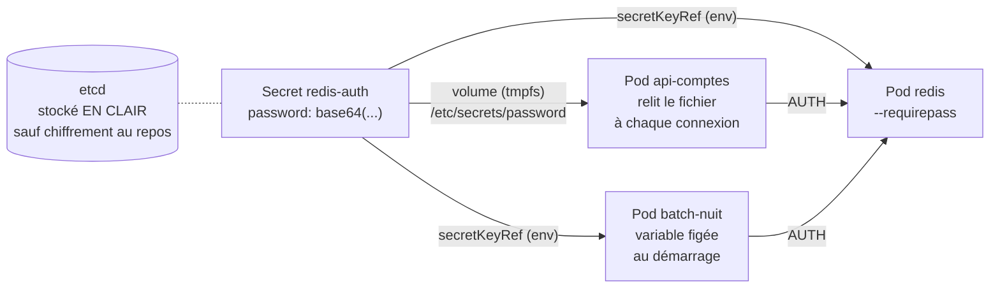

# Lab : Secret

## Objectifs

- comprendre qu'un Secret est **encodé** (base64), pas **chiffré**, et ce que cela implique ;
- créer des Secrets : `generic` (`--from-literal`, `--from-file`, `--from-env-file`), YAML (`data` vs `stringData`),
  `tls`, `docker-registry`, types `basic-auth` / `ssh-auth` ;
- consommer un Secret : variable (`secretKeyRef`), `envFrom`, volume (`items`, `defaultMode`), volume `projected`,
  `imagePullSecrets` ;
- faire une **rotation de mot de passe** et comprendre pourquoi un fichier monté vaut mieux qu'une variable ;
- protéger les Secrets : RBAC avec `resourceNames`, `immutable`, chiffrement au repos dans etcd ;
- dépanner les erreurs classiques (namespace, `echo` sans `-n`, clé absente).

### Contexte métier

L'application `api-comptes` stocke les **sessions** des clients dans un cache **Redis** protégé par mot de passe. La
politique de sécurité de la banque impose :

| Exigence                                                     | Mise en œuvre                                          |
|--------------------------------------------------------------|--------------------------------------------------------|
| aucun mot de passe dans l'image ni dans le dépôt Git en clair | Secret Kubernetes                                       |
| rotation trimestrielle **sans interruption**                  | Secret monté en **fichier**, relu par l'application    |
| seule l'application peut lire **son** Secret                  | RBAC `resourceNames` + ServiceAccount dédié            |
| les images viennent du registre privé de la banque            | `imagePullSecrets` (`docker-registry`)                 |
| le portail est en HTTPS                                       | Secret `kubernetes.io/tls`                             |

### Vue d'ensemble



| ConfigMap                         | Secret                                                         |
|-----------------------------------|----------------------------------------------------------------|
| données non sensibles             | mots de passe, jetons, clés, certificats                       |
| `data` en clair                   | `data` en **base64** (ou `stringData` en clair à l'écriture)    |
| volume sur disque                 | volume en **tmpfs** (RAM du nœud, jamais écrit sur disque)      |
| RBAC `configmaps`                 | RBAC `secrets`, séparé (souvent beaucoup plus restreint)       |
| –                                 | chiffrement au repos dans etcd possible (`EncryptionConfiguration`) |
| taille max 1 MiB                  | taille max 1 MiB                                               |

## Étape 0 : préparer l'environnement

```bash
ssh k8s-master-01
kubectl create namespace secret-lab
kubectl config set-context --current --namespace=secret-lab
mkdir -p ~/secret-lab && cd ~/secret-lab
```


# Partie 1 : base64 n'est pas du chiffrement

## Étape 1 : créer et relire un Secret

```bash
kubectl create secret generic redis-auth --from-literal=password='Ancien-2026'

kubectl get secret redis-auth
# NAME         TYPE     DATA   AGE
# redis-auth   Opaque   1      2s

kubectl describe secret redis-auth
# Type:  Opaque
# Data
# ====
# password:  11 bytes          <- describe n'affiche PAS la valeur…

kubectl get secret redis-auth -o yaml | grep -A1 '^data'
# data:
#   password: QW5jaWVuLTIwMjY=  <- …mais -o yaml l'affiche, en base64

kubectl get secret redis-auth -o jsonpath='{.data.password}' | base64 -d; echo
# Ancien-2026                 <- n'importe qui ayant le droit "get secrets" lit le mot de passe
```

> **base64 est un encodage, pas un chiffrement** : il sert uniquement à pouvoir stocker des données binaires
> (certificats, keystores) dans du JSON/YAML. La protection d'un Secret repose sur le **RBAC**, le **tmpfs** et le
> **chiffrement au repos** (partie 4).

Raccourci sans `base64` :

```bash
kubectl get secret redis-auth -o go-template='{{.data.password | base64decode}}{{"\n"}}'
# Ancien-2026
```

## Étape 2 : `data`, `stringData` et le piège du retour à la ligne

En YAML, `data` attend des valeurs **déjà encodées** ; `stringData` accepte du **clair** (Kubernetes encode à votre
place, et `stringData` n'est jamais relu : il est fusionné dans `data`).

```bash
echo    'Recette-2026' | base64        # UkVjZXR0ZS0yMDI2Cg==   <- encode AUSSI le retour à la ligne final !
echo -n 'Recette-2026' | base64        # UmVjZXR0ZS0yMDI2       <- correct

cat > partenaire-secret.yaml <<'EOF'
apiVersion: v1
kind: Secret
metadata:
  name: api-partenaire
  namespace: secret-lab
  labels:
    app: api-comptes
type: Opaque
data:
  client-id: YmFucXVlLWxhYg==          # echo -n 'banque-lab' | base64
stringData:
  client-secret: "Tr3s-S3cr3t!"         # en clair dans le fichier, encodé par l'API server
  config.json: |
    {"url": "https://api.partenaire.example", "timeout": 3000}
EOF
kubectl apply -f partenaire-secret.yaml

kubectl get secret api-partenaire -o jsonpath='{.data}' ; echo
# {"client-id":"YmFucXVlLWxhYg==","client-secret":"VHIzcy1TM2NyM3Qh","config.json":"eyJ1cmwi..."}
```

> Ne versionnez **jamais** ce fichier tel quel dans Git : il contient le secret en clair (ou en base64, ce qui revient
> au même). En production : **Sealed Secrets**, **SOPS**, **External Secrets Operator** + Vault / coffre du cloud.

## Étape 3 : les autres façons de créer un Secret `generic`

```bash
# --from-file : la clé est le nom du fichier (ici renommée en "id_ed25519")
ssh-keygen -t ed25519 -N '' -C 'batch@banque.lab' -f ./cle-sftp -q
kubectl create secret generic sftp-releves --from-file=id_ed25519=./cle-sftp --from-file=id_ed25519.pub=./cle-sftp.pub

# --from-env-file : une clé par ligne
cat > smtp.env <<'EOF'
SMTP_USER=notifications@banque.lab
SMTP_PASSWORD=Mail-2026
EOF
kubectl create secret generic smtp --from-env-file=smtp.env

kubectl get secrets
# NAME             TYPE     DATA   AGE
# api-partenaire   Opaque   3      ...
# redis-auth       Opaque   1
# sftp-releves     Opaque   2
# smtp             Opaque   2
```

## Étape 4 : les Secrets typés

Le champ `type` fait **valider** le contenu par l'API server.

```bash
# TLS : certificat + clé
openssl req -x509 -nodes -days 365 -newkey rsa:2048 -keyout portail.key -out portail.crt \
  -subj "/CN=www.banque.lab" 2>/dev/null
kubectl create secret tls portail-tls --cert=portail.crt --key=portail.key

# Registre d'images privé
kubectl create secret docker-registry registre-banque \
  --docker-server=registry.banque.lab:5000 \
  --docker-username=ci-robot --docker-password='R0bot-Tok3n' --docker-email=ci@banque.lab

kubectl get secrets portail-tls registre-banque
# NAME              TYPE                             DATA   AGE
# portail-tls       kubernetes.io/tls                2      ...    <- clés tls.crt et tls.key
# registre-banque   kubernetes.io/dockerconfigjson   1      ...    <- clé .dockerconfigjson

kubectl get secret registre-banque -o jsonpath='{.data.\.dockerconfigjson}' | base64 -d; echo
# {"auths":{"registry.banque.lab:5000":{"username":"ci-robot","password":"R0bot-Tok3n",...,"auth":"Y2ktcm9ib3Q6UjBib3QtVG9rM24="}}}
```

La validation en action : un Secret `basic-auth` sans `username`, un Secret `tls` sans clé privée :

```bash
cat <<'EOF' | kubectl apply -f -
apiVersion: v1
kind: Secret
metadata:
  name: backoffice-basic
  namespace: secret-lab
type: kubernetes.io/basic-auth
stringData:
  user: conseiller
EOF
# The Secret "backoffice-basic" is invalid:
# * data[username]: Required value
# * data[password]: Required value

cat <<'EOF' | kubectl apply -f -
apiVersion: v1
kind: Secret
metadata:
  name: tls-incomplet
  namespace: secret-lab
type: kubernetes.io/tls
stringData:
  tls.crt: "-----BEGIN CERTIFICATE-----..."
EOF
# The Secret "tls-incomplet" is invalid: data[tls.key]: Required value
```

| `type`                                | Création                              | Clés obligatoires              |
|---------------------------------------|---------------------------------------|--------------------------------|
| `Opaque` (défaut)                     | `kubectl create secret generic`       | libres                         |
| `kubernetes.io/tls`                   | `kubectl create secret tls`           | `tls.crt`, `tls.key`           |
| `kubernetes.io/dockerconfigjson`      | `kubectl create secret docker-registry` | `.dockerconfigjson`          |
| `kubernetes.io/basic-auth`            | YAML                                  | `username`, `password`         |
| `kubernetes.io/ssh-auth`              | YAML                                  | `ssh-privatekey`               |
| `kubernetes.io/service-account-token` | YAML (+ annotation du ServiceAccount) | remplies par Kubernetes        |


# Partie 2 : consommer les Secrets

## Étape 5 : le cache Redis (mot de passe en variable)

```bash
cat > redis.yaml <<'EOF'
apiVersion: apps/v1
kind: Deployment
metadata:
  name: redis
  namespace: secret-lab
spec:
  replicas: 1
  selector:
    matchLabels:
      app: redis
  template:
    metadata:
      labels:
        app: redis
    spec:
      securityContext:
        runAsUser: 999          # utilisateur "redis" de l'image : on ne tourne pas en root
        runAsGroup: 999
      containers:
      - name: redis
        image: redis:7.4-alpine
        command: ["sh", "-c", "exec redis-server --requirepass \"$REDIS_PASSWORD\""]
        env:
        - name: REDIS_PASSWORD
          valueFrom:
            secretKeyRef:
              name: redis-auth
              key: password
        ports:
        - containerPort: 6379
        readinessProbe:
          tcpSocket:
            port: 6379
          periodSeconds: 3
---
apiVersion: v1
kind: Service
metadata:
  name: redis
  namespace: secret-lab
spec:
  selector:
    app: redis
  ports:
  - port: 6379
EOF
kubectl apply -f redis.yaml
kubectl rollout status deployment/redis
```

## Étape 6 : deux clients, deux façons de lire le mot de passe

- `api-comptes` lit le mot de passe dans un **fichier** (volume Secret) **à chaque connexion** ;
- `batch-nuit` le lit dans une **variable d'environnement**.

Les deux testent la connexion toutes les 5 s (`PING` -> `PONG`).

```bash
cat > clients.yaml <<'EOF'
apiVersion: apps/v1
kind: Deployment
metadata:
  name: api-comptes
  namespace: secret-lab
spec:
  replicas: 1
  selector:
    matchLabels:
      app: api-comptes
  template:
    metadata:
      labels:
        app: api-comptes
    spec:
      containers:
      - name: api
        image: redis:7.4-alpine
        command: ["sh", "-c"]
        args:
        - |
          trap 'exit 0' TERM
          while true; do
            echo "$(date +%T) api-comptes (fichier) : $(redis-cli -h redis --no-auth-warning -a "$(cat /etc/secrets/redis/password)" ping 2>&1)"
            sleep 5 & wait $!
          done
        volumeMounts:
        - name: redis-auth
          mountPath: /etc/secrets/redis
          readOnly: true
      volumes:
      - name: redis-auth
        secret:
          secretName: redis-auth
          defaultMode: 0400           # lecture seule pour le propriétaire
---
apiVersion: apps/v1
kind: Deployment
metadata:
  name: batch-nuit
  namespace: secret-lab
spec:
  replicas: 1
  selector:
    matchLabels:
      app: batch-nuit
  template:
    metadata:
      labels:
        app: batch-nuit
    spec:
      containers:
      - name: batch
        image: redis:7.4-alpine
        command: ["sh", "-c"]
        args:
        - |
          trap 'exit 0' TERM
          while true; do
            echo "$(date +%T) batch-nuit  (variable) : $(redis-cli -h redis --no-auth-warning -a "$REDIS_PASSWORD" ping 2>&1)"
            sleep 5 & wait $!
          done
        env:
        - name: REDIS_PASSWORD
          valueFrom:
            secretKeyRef:
              name: redis-auth
              key: password
EOF
kubectl apply -f clients.yaml
kubectl rollout status deployment/api-comptes
kubectl rollout status deployment/batch-nuit
sleep 6

kubectl logs deployment/api-comptes --tail=1
# 10:30:05 api-comptes (fichier) : PONG
kubectl logs deployment/batch-nuit --tail=1
# 10:30:05 batch-nuit  (variable) : PONG
```

Regardez **comment** le Secret est monté :

```bash
kubectl exec deploy/api-comptes -- sh -c 'mount | grep /etc/secrets; ls -l /etc/secrets/redis/..data/'
# tmpfs on /etc/secrets/redis type tmpfs (ro,relatime,...)      <- en RAM, jamais écrit sur le disque du nœud
# -r--------    1 root     root    11 ... password             <- defaultMode 0400
```

> Le Secret n'est envoyé par l'API server **qu'aux nœuds qui exécutent un Pod qui l'utilise**, et il disparaît du nœud
> avec le Pod.

## Étape 7 : `envFrom`, `items` et volume `projected`

L'appli a aussi besoin des identifiants SMTP (toutes les clés, en variables), de sa configuration partenaire (une
seule clé, dans un fichier au nom imposé) et, dans un **même répertoire**, de son nom de Pod et de son namespace.

```bash
kubectl create configmap api-comptes-conf --from-literal=app.properties='devise=EUR'

kubectl patch deployment api-comptes --type=json -p '[
  {"op":"add","path":"/spec/template/spec/containers/0/envFrom","value":[
    {"prefix":"NOTIF_","secretRef":{"name":"smtp"}}]},
  {"op":"add","path":"/spec/template/spec/volumes/-","value":
    {"name":"app","projected":{"defaultMode":0440,"sources":[
      {"secret":{"name":"api-partenaire","items":[{"key":"config.json","path":"partenaire/config.json"}]}},
      {"configMap":{"name":"api-comptes-conf"}},
      {"downwardAPI":{"items":[
        {"path":"pod/nom","fieldRef":{"fieldPath":"metadata.name"}},
        {"path":"pod/namespace","fieldRef":{"fieldPath":"metadata.namespace"}}]}}]}}},
  {"op":"add","path":"/spec/template/spec/containers/0/volumeMounts/-","value":
    {"name":"app","mountPath":"/etc/app","readOnly":true}}]'
kubectl rollout status deployment/api-comptes

kubectl exec deploy/api-comptes -- env | grep NOTIF_
# NOTIF_SMTP_PASSWORD=Mail-2026
# NOTIF_SMTP_USER=notifications@banque.lab

kubectl exec deploy/api-comptes -- sh -c 'ls /etc/app /etc/app/partenaire /etc/app/pod; cat /etc/app/partenaire/config.json /etc/app/pod/nom; echo'
# /etc/app:
# app.properties     partenaire         pod          <- 3 sources réunies dans UN répertoire
# /etc/app/partenaire:
# config.json
# /etc/app/pod:
# namespace  nom
# {"url": "https://api.partenaire.example", "timeout": 3000}
# api-comptes-xxxxxxxxxx-yyyyy
```

| Source dans `projected`   | Contenu                                                          |
|---------------------------|------------------------------------------------------------------|
| `secret`                  | clés d'un Secret                                                 |
| `configMap`               | clés d'un ConfigMap                                              |
| `downwardAPI`             | infos du Pod (nom, namespace, labels, limites…)                  |
| `serviceAccountToken`     | jeton du ServiceAccount (c'est ainsi que **chaque** Pod reçoit `/var/run/secrets/kubernetes.io/serviceaccount`) |

## Étape 8 : `imagePullSecrets` pour le registre privé

Les Pods ne peuvent télécharger une image privée que si le kubelet dispose des identifiants. Deux méthodes : dans le
Pod (`spec.imagePullSecrets`) ou, plus pratique, **sur le ServiceAccount** : tous les Pods qui l'utilisent en héritent.

```bash
kubectl create serviceaccount api-comptes
kubectl patch serviceaccount api-comptes -p '{"imagePullSecrets":[{"name":"registre-banque"}]}'

kubectl patch deployment api-comptes -p '{"spec":{"template":{"spec":{"serviceAccountName":"api-comptes"}}}}'
kubectl rollout status deployment/api-comptes
sleep 3

kubectl get pods -l app=api-comptes \
  -o custom-columns=POD:.metadata.name,SA:.spec.serviceAccountName,PULL:.spec.imagePullSecrets[*].name
# POD                           SA            PULL
# api-comptes-xxxxxxxxxx-yyyyy  api-comptes   registre-banque    <- ajouté automatiquement depuis le ServiceAccount
```

> Le registre `registry.banque.lab` n'existe pas dans ce lab : l'image `redis` vient de Docker Hub, et le
> `imagePullSecrets` est simplement ignoré pour un autre registre. Avec un mauvais mot de passe sur un vrai registre
> privé, le Pod serait en `ErrImagePull` avec `unauthorized: authentication required`.


# Partie 3 : rotation du mot de passe

## Étape 9 : changer le mot de passe Redis sans interruption

La procédure de rotation : 1) changer le mot de passe **côté serveur**, 2) mettre à jour le Secret, 3) attendre que
les clients le prennent en compte.

Ouvrez un **second terminal** et suivez les deux clients :

```bash
kubectl logs -f -l 'app in (api-comptes,batch-nuit)' --tail=2 --prefix=false -n secret-lab
```

Dans le premier terminal :

```bash
# 1) côté serveur (à chaud, sans redémarrer Redis)
kubectl exec deploy/redis -- redis-cli --no-auth-warning -a 'Ancien-2026' CONFIG SET requirepass 'Nouveau-2027'

# 2) le Secret
kubectl create secret generic redis-auth --from-literal=password='Nouveau-2027' --dry-run=client -o yaml | kubectl apply -f -
```

Observez le second terminal :

```
10:35:00 api-comptes (fichier) : AUTH failed: WRONGPASS invalid username-password pair or user is disabled.
Authentication required.
10:35:00 batch-nuit  (variable) : AUTH failed: WRONGPASS invalid username-password pair or user is disabled.
Authentication required.
...                                     <- pendant ~1 à 2 min (80 s mesurées), le fichier n'est pas encore à jour
10:36:20 api-comptes (fichier) : PONG   <- kubelet a mis à jour le fichier : l'appli se reconnecte SEULE
10:36:20 batch-nuit  (variable) : AUTH failed: WRONGPASS ...   <- la variable ne changera JAMAIS sans redémarrage
```

> Dans la vraie vie on évite même la minute de `WRONGPASS` : Redis 6+ (ACL), PostgreSQL ou Vault permettent d'avoir
> **deux** mots de passe valides en même temps pendant la transition (ancien + nouveau), puis on supprime l'ancien.

Le batch doit être redémarré :

```bash
kubectl rollout restart deployment/batch-nuit
kubectl rollout status deployment/batch-nuit
sleep 6
kubectl logs deployment/batch-nuit --tail=1
# 10:37:00 batch-nuit  (variable) : PONG
```

Arrêtez le `kubectl logs -f` du second terminal (Ctrl+C).

| Mode de consommation      | Après modification du Secret                                    |
|---------------------------|-----------------------------------------------------------------|
| variable (`secretKeyRef`, `envFrom`) | **jamais** mise à jour : redémarrage obligatoire     |
| volume                    | fichier mis à jour en ~1-2 min ; l'appli doit le **relire**     |
| volume avec `subPath`     | **jamais** mis à jour                                           |

> Bonne pratique : les applications lisent leurs secrets dans des **fichiers** et les relisent à chaque connexion (ou
> surveillent le fichier). C'est aussi plus sûr : les variables d'environnement fuient facilement (logs de crash,
> `/proc/<pid>/environ`, outils de debug).


# Partie 4 : protéger les Secrets

## Étape 10 : RBAC, l'application ne lit que **son** Secret

```bash
kubectl auth can-i get secrets --as=system:serviceaccount:secret-lab:api-comptes
# no       <- par défaut, un ServiceAccount n'a aucun droit sur l'API

kubectl create role lire-redis-auth --verb=get --resource=secrets --resource-name=redis-auth
kubectl create rolebinding api-comptes-lire-redis-auth --role=lire-redis-auth --serviceaccount=secret-lab:api-comptes

kubectl auth can-i get secret/redis-auth --as=system:serviceaccount:secret-lab:api-comptes
# yes
kubectl auth can-i get secret/smtp --as=system:serviceaccount:secret-lab:api-comptes
# no
kubectl auth can-i list secrets --as=system:serviceaccount:secret-lab:api-comptes
# no       <- "list" renverrait TOUS les Secrets : resourceNames ne peut pas le restreindre
```

> **Attention :** monter un Secret dans un Pod ne nécessite **aucun** droit RBAC pour le ServiceAccount : c'est le
> kubelet qui le récupère. En revanche, **quiconque peut créer un Pod** dans un namespace peut y monter **n'importe
> quel** Secret de ce namespace. Le namespace est donc la vraie frontière de sécurité des Secrets.

## Étape 11 : etcd stocke les Secrets en clair

```bash
sudo etcdctl --endpoints=https://127.0.0.1:2379 \
  --cacert=/etc/kubernetes/pki/etcd/ca.crt \
  --cert=/etc/kubernetes/pki/etcd/server.crt \
  --key=/etc/kubernetes/pki/etcd/server.key \
  get /registry/secrets/secret-lab/redis-auth | strings | grep -A1 password
# password
# Nouveau-2027           <- EN CLAIR : un accès à etcd ou à une sauvegarde d'etcd révèle tous les Secrets
# (vous verrez aussi la valeur base64 dans l'annotation last-applied-configuration)

sudo grep -c encryption-provider-config /etc/kubernetes/manifests/kube-apiserver.yaml
# 0      <- pas de chiffrement au repos sur ce cluster
```

Le **chiffrement au repos** se configure sur **chaque** kube-apiserver (ici les 3 masters) avec un fichier
`EncryptionConfiguration` et l'option `--encryption-provider-config` :

```yaml
apiVersion: apiserver.config.k8s.io/v1
kind: EncryptionConfiguration
resources:
- resources: ["secrets"]
  providers:
  - aescbc:                         # ou kms v2 (clé dans un HSM / KMS externe) en production
      keys:
      - name: key1
        secret: <32 octets aléatoires en base64 : head -c 32 /dev/urandom | base64>
  - identity: {}                    # permet encore de LIRE les Secrets écrits avant le chiffrement
```

Après redémarrage des API servers, il faut **réécrire** les Secrets existants pour qu'ils soient chiffrés :
`kubectl get secrets -A -o json | kubectl replace -f -`. Dans etcd, la valeur commence alors par
`k8s:enc:aescbc:v1:key1:` suivi de données illisibles. (Non appliqué dans ce lab : une erreur sur un manifeste
statique rendrait l'API server indisponible.)

## Étape 12 : Secrets immuables

```bash
kubectl patch secret portail-tls -p '{"immutable":true}'

# Renouvellement du certificat : on tente d'écraser le Secret
openssl req -x509 -nodes -days 365 -newkey rsa:2048 -keyout portail-2027.key -out portail-2027.crt \
  -subj "/CN=www.banque.lab" 2>/dev/null
kubectl create secret tls portail-tls --cert=portail-2027.crt --key=portail-2027.key --dry-run=client -o yaml | kubectl apply -f -
# The Secret "portail-tls" is invalid: data: Forbidden: field is immutable when `immutable` is set

# La bonne méthode : un nouveau Secret, puis on change la référence (Ingress, Deployment…)
kubectl create secret tls portail-tls-2027 --cert=portail-2027.crt --key=portail-2027.key
kubectl patch secret portail-tls-2027 -p '{"immutable":true}'
```

Comme pour les ConfigMaps : protection contre les erreurs, moins de charge sur l'API server, et rotation par
**nouveau nom** (`portail-tls-2027`) + rollout.


# Partie 5 : dépannage

## Étape 13 : le batch de recette n'arrive pas à se connecter

Un collègue a préparé l'environnement de recette.

```bash
kubectl create namespace secret-lab-recette
kubectl -n secret-lab-recette apply -f redis.yaml 2>&1 | head -1
# the namespace from the provided object "secret-lab" does not match the namespace "secret-lab-recette"...
sed 's/namespace: secret-lab$/namespace: secret-lab-recette/' redis.yaml | kubectl apply -f -
sed 's/namespace: secret-lab$/namespace: secret-lab-recette/' clients.yaml | kubectl apply -f -

# Le Secret créé "à la main" par le collègue :
cat <<EOF | kubectl apply -f -
apiVersion: v1
kind: Secret
metadata:
  name: redis-auth
  namespace: secret-lab
type: Opaque
data:
  password: $(echo 'Recette-2026' | base64)
EOF
sleep 20
kubectl get pods -n secret-lab-recette
# redis-...         0/1   CreateContainerConfigError
# api-comptes-...   0/1   ContainerCreating
# batch-nuit-...    0/1   CreateContainerConfigError
```

**À vous :** faites fonctionner l'environnement de recette (`redis`, `api-comptes` et `batch-nuit` doivent afficher
`PONG`) avec le mot de passe `Recette-2026`. Il y a **deux** erreurs dans la création du Secret. Ne touchez pas au
Secret `redis-auth` du namespace `secret-lab`… sauf pour le remettre en état.

<details><summary>Méthode et solution</summary>

```bash
kubectl get events -n secret-lab-recette --field-selector reason=Failed -o custom-columns=MSG:.message | tail -1
# Error: secret "redis-auth" not found
kubectl describe pod -n secret-lab-recette -l app=api-comptes | grep FailedMount
# MountVolume.SetUp failed for volume "redis-auth" : secret "redis-auth" not found
```

**Erreur n°1 : le namespace.** Un Secret n'est visible que dans **son** namespace : le collègue l'a créé dans
`secret-lab` (en écrasant au passage celui de production !).

**Erreur n°2 : `echo` sans `-n`.** La valeur encodée contient un retour à la ligne :

```bash
kubectl get secret redis-auth -n secret-lab -o jsonpath='{.data.password}' | base64 -d | od -c | tail -2
# 0000000   R   e   c   e   t   t   e   -   2   0   2   6  \n      <- le "\n" fait partie du mot de passe
```

Correction : remettre la production en état, puis créer le bon Secret dans le bon namespace.

```bash
kubectl -n secret-lab create secret generic redis-auth --from-literal=password='Nouveau-2027' \
  --dry-run=client -o yaml | kubectl apply -f -

kubectl -n secret-lab-recette create secret generic redis-auth --from-literal=password='Recette-2026'
# (--from-literal n'ajoute jamais de retour à la ligne)

sleep 20
kubectl get pods -n secret-lab-recette
# 3 Pods 1/1 Running   (kubelet réessaie seul ; pas besoin de recréer les Pods)
kubectl logs -n secret-lab-recette deployment/api-comptes --tail=1
kubectl logs -n secret-lab-recette deployment/batch-nuit --tail=1
# ... PONG
```

Et la production ? Redis et `batch-nuit` ont le mot de passe en **variable** : ils n'ont rien vu. Mais `api-comptes`
relit son **fichier** : si l'erreur du collègue est restée en place plus d'une minute, il a reçu `Recette-2026\n` et
s'est mis en `WRONGPASS`. Après correction, il se rétablit seul en 1 à 2 minutes :

```bash
kubectl logs -n secret-lab deployment/api-comptes --tail=1
# ... PONG   (relancez la commande si ce n'est pas encore le cas)
```

C'est le revers de la mise à jour à chaud : une **erreur** se propage aussi automatiquement. D'où l'intérêt des Secrets
immuables et versionnés, et d'un RBAC qui empêche d'écrire dans le namespace de production.

| Symptôme                                          | Cause probable                                           |
|---------------------------------------------------|----------------------------------------------------------|
| `CreateContainerConfigError` : `secret "x" not found` | Secret absent **dans ce namespace** (variable)        |
| `ContainerCreating` + `FailedMount`               | Secret absent (volume)                                   |
| `couldn't find key K in Secret`                   | nom de clé erroné                                        |
| l'appli démarre mais l'authentification échoue    | `echo` sans `-n`, espaces, mauvais encodage, mot de passe pas encore propagé |
</details>


# Partie 6 : exercices d'évaluation

**Exercice 1 :** créez un Secret `db-admin` avec `username=admin` et `password=P@ss-2026!`, puis affichez **uniquement**
le mot de passe décodé.

**Exercice 2 :** créez un Deployment `outil-admin` (image `busybox:1.36`, commande `sleep 3600`) qui reçoit le
mot de passe de `db-admin` dans la variable `DB_PASS` et le nom d'utilisateur dans le fichier
`/etc/db/utilisateur` (et seulement celui-là).

**Exercice 3 :** listez tous les Secrets du namespace avec leur type, et uniquement ceux de type TLS.

**Exercice 4 :** affichez la date d'expiration du certificat contenu dans le Secret `portail-tls`.

<details><summary><b>Solutions</b></summary>

**1.**
```bash
kubectl create secret generic db-admin --from-literal=username=admin --from-literal=password='P@ss-2026!'
kubectl get secret db-admin -o jsonpath='{.data.password}' | base64 -d; echo
```
Mettez toujours les valeurs entre **apostrophes** : `!`, `$` ou `&` seraient interprétés par le shell.

**2.**
```bash
cat <<'EOF' | kubectl apply -f -
apiVersion: apps/v1
kind: Deployment
metadata:
  name: outil-admin
  namespace: secret-lab
spec:
  replicas: 1
  selector:
    matchLabels:
      app: outil-admin
  template:
    metadata:
      labels:
        app: outil-admin
    spec:
      containers:
      - name: outil
        image: busybox:1.36
        command: ["sleep", "3600"]
        env:
        - name: DB_PASS
          valueFrom:
            secretKeyRef:
              name: db-admin
              key: password
        volumeMounts:
        - name: db
          mountPath: /etc/db
      volumes:
      - name: db
        secret:
          secretName: db-admin
          items:
          - key: username
            path: utilisateur
EOF
kubectl rollout status deployment/outil-admin
kubectl exec deploy/outil-admin -- sh -c 'echo $DB_PASS; ls /etc/db; cat /etc/db/utilisateur; echo'
# P@ss-2026!
# utilisateur
# admin
```

**3.**
```bash
kubectl get secrets -o custom-columns=NOM:.metadata.name,TYPE:.type
kubectl get secrets --field-selector type=kubernetes.io/tls
```

**4.**
```bash
kubectl get secret portail-tls -o jsonpath='{.data.tls\.crt}' | base64 -d | openssl x509 -noout -enddate -subject
# notAfter=Nov 24 10:40:00 2027 GMT
# subject=CN=www.banque.lab
```
Un réflexe utile en exploitation : les certificats expirés sont une cause d'incident très fréquente.
</details>


## Nettoyage

```bash
kubectl delete namespace secret-lab secret-lab-recette
kubectl config set-context --current --namespace=default
rm -rf ~/secret-lab
```

## Questions de compréhension

1. Un collègue dit : « nos mots de passe sont dans des Secrets, ils sont donc chiffrés ». Que lui répondez-vous ?
2. Quelle est la différence entre `data` et `stringData` ?
3. Pourquoi préférer un Secret monté en fichier plutôt qu'en variable d'environnement ?
4. Un ServiceAccount sans aucun droit RBAC peut-il utiliser un Secret dans son Pod ?
5. Où se trouve physiquement un Secret monté en volume sur le nœud ?
6. Un Pod du namespace `a` peut-il utiliser un Secret du namespace `b` ?

<details><summary>Réponses</summary>

1. Non : ils sont encodés en base64 (réversible) et stockés en clair dans etcd tant que le chiffrement au repos n'est
   pas configuré. La protection repose sur le RBAC, le chiffrement au repos et la sécurité d'etcd et de ses sauvegardes.
2. `data` : valeurs encodées en base64 ; `stringData` : valeurs en clair, encodées par l'API server à l'écriture
   (champ en écriture seule, fusionné dans `data`).
3. Le fichier est mis à jour à chaud (rotation sans redémarrage), et les variables fuient plus facilement (logs,
   `/proc`, sous-processus).
4. Oui : le montage (volume ou variable) est fait par le kubelet, pas par le ServiceAccount. Le RBAC ne concerne que
   la lecture **via l'API**.
5. Dans un **tmpfs** (RAM) sous `/var/lib/kubelet/pods/<uid>/volumes/kubernetes.io~secret/`, supprimé avec le Pod.
6. Non, un Secret est toujours dans le même namespace que le Pod qui l'utilise.
</details>

## Commandes

| Commande                                                                              | Utilité                               |
|---------------------------------------------------------------------------------------|---------------------------------------|
| `kubectl create secret generic S --from-literal=k='v'`                                | Secret Opaque                         |
| `kubectl create secret generic S --from-file=k=f` / `--from-env-file=f`               | À partir de fichiers                  |
| `kubectl create secret tls S --cert=f.crt --key=f.key`                                | Certificat TLS                        |
| `kubectl create secret docker-registry S --docker-server=... --docker-username=...`   | Registre privé                        |
| `kubectl get secret S -o jsonpath='{.data.k}' \| base64 -d`                           | Décoder une valeur                    |
| `kubectl get secret S -o go-template='{{.data.k \| base64decode}}'`                   | Idem sans `base64`                    |
| `kubectl create secret ... --dry-run=client -o yaml \| kubectl apply -f -`            | Créer ou mettre à jour                |
| `kubectl auth can-i get secret/S --as=system:serviceaccount:NS:SA`                    | Tester les droits                     |
| `kubectl patch sa SA -p '{"imagePullSecrets":[{"name":"S"}]}'`                        | Registre privé pour tous les Pods du SA |
