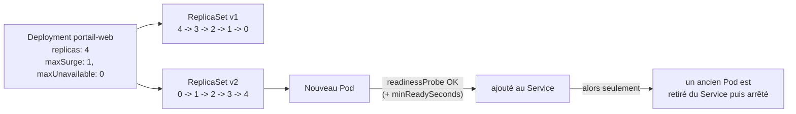
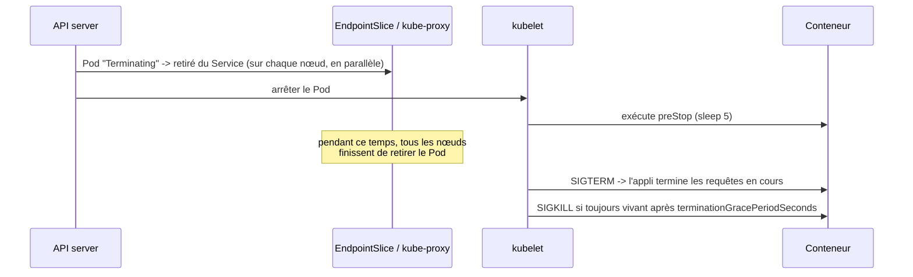

# Lab : Rolling update sans interruption de service (zero downtime)

## Objectifs

- observer **en temps réel** une mise à jour progressive (`watch -n0.1`) et son effet sur le trafic ;
- constater qu'un Deployment « naïf » **coupe le service** pendant une mise à jour, même quand `kubectl rollout status`
  annonce un succès ;
- rendre la mise à jour **réellement** sans interruption : `readinessProbe`, `maxSurge` / `maxUnavailable`,
  `minReadySeconds`, `preStop`, `terminationGracePeriodSeconds` ;
- gérer une **mauvaise version** : image introuvable, appli qui ne devient jamais prête, `progressDeadlineSeconds`,
  `kubectl rollout undo` ;
- faire un **déploiement progressif contrôlé** avec `kubectl rollout pause` / `resume` ;
- utiliser l'**historique** des révisions (`change-cause`, `--to-revision`) ;
- comparer avec la stratégie `Recreate`.

### Contexte métier

Le front **« Banque en ligne »** (`portail-web`) est utilisé en continu par les clients, y compris pendant les heures
de mise en production. La DSI impose : **aucune requête en erreur pendant une livraison**, et un **retour arrière en
moins d'une minute** si la nouvelle version pose problème.

Le planning des livraisons du jour :

| Version | Image                                  | Couleur dans le navigateur | Remarque                        |
|---------|----------------------------------------|----------------------------|---------------------------------|
| v1      | `ghcr.io/stefanprodan/podinfo:6.7.0`   | bleu                       | en production ce matin          |
| v2      | `ghcr.io/stefanprodan/podinfo:6.7.1`   | bleu                       | correctif                       |
| v3      | `ghcr.io/stefanprodan/podinfo:6.8.0`   | vert                       | nouvelle charte graphique       |
| v4      | `ghcr.io/stefanprodan/podinfo:6.9.9`   | –                          | **tag erroné** (n'existe pas)   |

> `podinfo` est une petite appli web de démonstration : sa page affiche sa **version**, le **nom du Pod** et un
> **message/couleur** paramétrables par variables d'environnement (`PODINFO_UI_MESSAGE`, `PODINFO_UI_COLOR`).
> Elle expose `/version` (JSON), `/readyz` et `/healthz`.

### Comment fonctionne un rolling update



Le Deployment ne remplace **jamais** les Pods lui-même : il crée un **nouveau ReplicaSet** (nouveau `pod-template-hash`),
puis fait monter le nouveau et descendre l'ancien, par petits pas, dans les limites fixées par :

| Paramètre        | Signification                                               | Défaut | Ici |
|------------------|-------------------------------------------------------------|--------|-----|
| `maxSurge`       | Pods **en plus** de `replicas` autorisés pendant la mise à jour | 25 %   | 1   |
| `maxUnavailable` | Pods **indisponibles** tolérés par rapport à `replicas`     | 25 %   | 0   |

> **Seule la modification du `template` des Pods déclenche un rollout** (image, variables, ressources, labels du
> template…). Un `kubectl scale` ne crée pas de nouvelle révision.

## Étape 0 : préparer l'environnement et les terminaux

```bash
ssh k8s-master-01
kubectl create namespace rolling-lab
kubectl config set-context --current --namespace=rolling-lab
mkdir -p ~/rolling-lab && cd ~/rolling-lab
```

Ce lab se fait avec **3 terminaux** et un **navigateur** :

| Fenêtre        | Où             | Rôle                                                      |
|----------------|----------------|-----------------------------------------------------------|
| **Terminal 1** | k8s-master-01  | visualiser Deployment / ReplicaSets / Pods en temps réel  |
| **Terminal 2** | votre poste (ou k8s-master-01) | envoyer du trafic en continu et afficher les erreurs |
| **Terminal 3** | k8s-master-01  | lancer les commandes du lab                               |
| Navigateur     | votre poste    | `http://10.10.10.241` (ou `http://10.10.10.21:30400`)     |


# Partie 1 : la version « naïve » en production

## Étape 1 : déployer v1 comme beaucoup d'équipes le font

L'appli met **10 secondes** à démarrer (chargement du cache, connexion aux back-ends… comme une appli Java). On le
simule avec un `sleep 10` avant de lancer le serveur. Aucune sonde n'est définie, et la stratégie est celle par défaut.

```bash
cat > portail-naif.yaml <<'EOF'
apiVersion: apps/v1
kind: Deployment
metadata:
  name: portail-web
  namespace: rolling-lab
  labels:
    app: portail-web
spec:
  replicas: 4
  selector:
    matchLabels:
      app: portail-web
  template:
    metadata:
      labels:
        app: portail-web
    spec:
      containers:
      - name: web
        image: ghcr.io/stefanprodan/podinfo:6.7.0
        command: ["sh", "-c", "echo 'demarrage (10 s)...'; sleep 10; exec ./podinfo --port=9898"]
        env:
        - name: PODINFO_UI_MESSAGE
          value: "Banque en ligne"
        ports:
        - name: http
          containerPort: 9898
EOF
kubectl apply -f portail-naif.yaml
kubectl annotate deployment portail-web kubernetes.io/change-cause="v1 : version initiale (naive)"
kubectl rollout status deployment/portail-web
```

## Étape 2 : un Service pour les clients (et pour votre navigateur)

Un Service `LoadBalancer` (MetalLB, IP fixe `10.10.10.241`) ; son NodePort est fixé à `30400` pour pouvoir aussi passer
par l'IP d'un nœud.

```bash
cat > portail-svc.yaml <<'EOF'
apiVersion: v1
kind: Service
metadata:
  name: portail-web
  namespace: rolling-lab
  annotations:
    metallb.io/loadBalancerIPs: 10.10.10.241
spec:
  type: LoadBalancer
  selector:
    app: portail-web
  ports:
  - name: http
    port: 80
    targetPort: http
    nodePort: 30400
EOF
kubectl apply -f portail-svc.yaml
sleep 12      # laisser les Pods finir de démarrer (10 s)

kubectl get svc portail-web
# NAME          TYPE           CLUSTER-IP   EXTERNAL-IP    PORT(S)        AGE
# portail-web   LoadBalancer   10.x.y.z     10.10.10.241   80:30400/TCP   12s

curl -s http://10.10.10.241/version
# { "commit": "...", "version": "6.7.0" }
```

Ouvrez **`http://10.10.10.241`** dans votre navigateur : la page affiche `Banque en ligne`, la version `6.7.0` et le nom
du Pod qui a répondu (rafraîchissez avec F5 : le nom change, c'est le load-balancing du Service).

## Étape 3 : lancer la visualisation et le trafic

**Terminal 1** (k8s-master-01) : la vue « tour de contrôle », rafraîchie toutes les 0,1 s.

```bash
watch -n0.1 'kubectl get deploy,rs -n rolling-lab -l app=portail-web -o wide; echo; kubectl get pods -n rolling-lab -l app=portail-web -o wide'
```

| Colonne / ligne       | Ce qu'il faut regarder                                                         |
|-----------------------|--------------------------------------------------------------------------------|
| `deployment` `READY` / `UP-TO-DATE` / `AVAILABLE` | progression globale                                 |
| une ligne `replicaset` par version | `DESIRED` / `CURRENT` / `READY` : l'ancien descend, le nouveau monte |
| Pods `READY 0/1` → `1/1` | le Pod est-il dans le Service ?                                            |
| Pods `Terminating`    | un ancien Pod en cours d'arrêt                                                 |

**Terminal 2** (votre poste, ou k8s-master-01) : un client qui appelle l'appli 5 fois par seconde.

```bash
while true; do
  printf '%s  ' "$(date +%T.%N | cut -c1-12)"
  curl -s -m 1 http://10.10.10.241/version | grep -o '"version": "[^"]*"' || echo "********** ERREUR **********"
  sleep 0.2
done
# 10:15:01.120  "version": "6.7.0"
# 10:15:01.341  "version": "6.7.0"
# ...
```

> Gardez les deux terminaux visibles pendant tout le lab. Toutes les commandes suivantes se tapent dans le
> **terminal 3**, dans `~/rolling-lab`.

## Étape 4 : livrer v2 avec le Deployment naïf

```bash
kubectl set image deployment/portail-web web=ghcr.io/stefanprodan/podinfo:6.7.1
kubectl annotate deployment portail-web kubernetes.io/change-cause="v2 : correctif (naive)"
time kubectl rollout status deployment/portail-web
# deployment "portail-web" successfully rolled out
# real  0m2s        <- "succès" en 2 secondes...
```

**Regardez le terminal 2 :** pendant une dizaine de secondes, des lignes `********** ERREUR **********` apparaissent.
Dans le terminal 1, les Pods v2 passent `1/1 Running` **immédiatement**, et les v1 sont arrêtés aussitôt.

**Pourquoi ?**

1. **Sans `readinessProbe`**, un Pod est déclaré `Ready` dès que son conteneur a démarré. Les Pods v2 sont donc ajoutés
   au Service alors que l'appli **n'écoute pas encore** (elle dort 10 s) : `connection refused`.
2. Le Deployment considère ces Pods comme disponibles, il arrête donc les Pods v1 **qui, eux, fonctionnaient**.
3. Avec les valeurs par défaut (`maxUnavailable: 25 %`), 1 Pod sur 4 est arrêté avant même que le remplaçant existe.
4. `kubectl rollout status` ne mesure que l'état **Kubernetes**, pas la santé réelle de l'appli.

> Mesure réalisée sur ce cluster lors de la préparation du lab : **155 requêtes en erreur sur 774** pendant ce rollout.


# Partie 2 : rendre le rollout réellement sans interruption

## Étape 5 : la version « production-ready » du Deployment

```bash
cat > portail-prod.yaml <<'EOF'
apiVersion: apps/v1
kind: Deployment
metadata:
  name: portail-web
  namespace: rolling-lab
  labels:
    app: portail-web
spec:
  replicas: 4
  revisionHistoryLimit: 5            # nombre d'anciens ReplicaSets gardés pour le rollback
  progressDeadlineSeconds: 60        # au-delà : le rollout est déclaré en échec (Progressing=False)
  minReadySeconds: 5                 # un Pod doit rester Ready 5 s avant d'être compté "available"
  strategy:
    type: RollingUpdate
    rollingUpdate:
      maxSurge: 1                    # on crée 1 Pod de plus (5 au maximum pendant la mise à jour)
      maxUnavailable: 0              # on n'enlève JAMAIS un Pod avant que son remplaçant soit prêt
  selector:
    matchLabels:
      app: portail-web
  template:
    metadata:
      labels:
        app: portail-web
    spec:
      terminationGracePeriodSeconds: 30
      containers:
      - name: web
        image: ghcr.io/stefanprodan/podinfo:6.7.1
        command: ["sh", "-c", "echo 'demarrage (10 s)...'; sleep 10; exec ./podinfo --port=9898"]
        env:
        - name: PODINFO_UI_MESSAGE
          value: "Banque en ligne"
        ports:
        - name: http
          containerPort: 9898
        readinessProbe:              # "puis-je recevoir du trafic ?" -> conditionne l'entrée dans le Service
          httpGet:
            path: /readyz
            port: http
          periodSeconds: 2
          failureThreshold: 1
        livenessProbe:               # "suis-je bloqué ?" -> redémarre le conteneur
          httpGet:
            path: /healthz
            port: http
          initialDelaySeconds: 15    # laisser le temps de démarrer (sinon : redémarrages en boucle)
          periodSeconds: 10
        lifecycle:
          preStop:                   # avant le SIGTERM : laisser le temps aux nœuds de retirer le Pod du Service
            exec:
              command: ["sh", "-c", "sleep 5"]
        resources:
          requests:
            cpu: 50m
            memory: 32Mi
          limits:
            memory: 128Mi
EOF
kubectl apply -f portail-prod.yaml
kubectl annotate deployment portail-web kubernetes.io/change-cause="v2 : passage en configuration production"
kubectl rollout status deployment/portail-web
```

**Observez :** ce changement de configuration est lui-même un rollout (le template a changé). Cette fois :

- terminal 1 : un 5e Pod apparaît (`maxSurge: 1`), reste `0/1` pendant ~10 s, passe `1/1`, puis **5 s plus tard**
  (`minReadySeconds`) un ancien Pod passe `Terminating`. Et ainsi de suite, un par un ;
- terminal 2 : **aucune erreur** ;
- `rollout status` dure maintenant ~1 min : c'est le **vrai** temps de la livraison.

### Le rôle de chaque réglage

| Réglage                     | Problème évité                                                                       |
|-----------------------------|--------------------------------------------------------------------------------------|
| `readinessProbe`            | envoyer du trafic à un Pod qui n'est pas encore prêt                                 |
| `maxUnavailable: 0`         | réduire la capacité pendant la livraison                                             |
| `maxSurge: 1`               | limiter la surconsommation (1 Pod de plus) ; plus grand = livraison plus rapide      |
| `minReadySeconds`           | valider une version qui devient prête puis plante quelques secondes après            |
| `preStop: sleep 5`          | la course entre le SIGTERM et la mise à jour des règles kube-proxy / du load-balancer sur **tous** les nœuds : sans lui, quelques requêtes peuvent encore arriver sur un Pod qui s'arrête |
| `terminationGracePeriodSeconds` | temps total (preStop + arrêt propre) avant le SIGKILL ; doit être > preStop     |
| `livenessProbe` + `initialDelaySeconds` | redémarrer un conteneur bloqué, sans tuer un conteneur qui démarre (sinon : `startupProbe`) |
| `progressDeadlineSeconds`   | détecter automatiquement un rollout bloqué                                           |

### Séquence d'arrêt d'un Pod



## Étape 6 : livrer v3 sans interruption

La v3 change à la fois l'image **et** la couleur. On modifie les deux dans **un seul** patch pour ne déclencher **qu'un**
rollout (deux commandes `kubectl set` successives en déclencheraient deux).

```bash
kubectl patch deployment portail-web --type=json -p '[
  {"op":"replace","path":"/spec/template/spec/containers/0/image","value":"ghcr.io/stefanprodan/podinfo:6.8.0"},
  {"op":"add","path":"/spec/template/spec/containers/0/env/-","value":{"name":"PODINFO_UI_COLOR","value":"#2e7d32"}}]'
kubectl annotate deployment portail-web kubernetes.io/change-cause="v3 : nouvelle charte graphique (6.8.0)"
kubectl rollout status deployment/portail-web
```

Pendant le rollout :

- **navigateur** : rafraîchissez plusieurs fois avec F5 : vous tombez tantôt sur l'ancienne page (bleue, 6.7.1), tantôt
  sur la nouvelle (verte, 6.8.0). Les deux versions cohabitent : l'appli doit le supporter (API compatibles) ;
- **terminal 2** : les lignes `6.7.1` deviennent progressivement `6.8.0`, sans aucune `ERREUR`.

```bash
kubectl get rs -l app=portail-web
# NAME                     DESIRED   CURRENT   READY   AGE
# portail-web-aaaaaaaaaa   0         0         0       10m     <- v1 (naïve)
# portail-web-bbbbbbbbbb   0         0         0       8m      <- v2 (naïve)
# portail-web-cccccccccc   0         0         0       5m      <- v2 (prod)
# portail-web-dddddddddd   4         4         4       1m      <- v3 (active)
```

> Les anciens ReplicaSets sont **conservés à 0 réplica** : c'est ce qui permet un rollback instantané.


# Partie 3 : quand la livraison se passe mal

## Étape 7 : un tag d'image erroné (v4)

```bash
kubectl set image deployment/portail-web web=ghcr.io/stefanprodan/podinfo:6.9.9
kubectl annotate deployment portail-web kubernetes.io/change-cause="v4 : tag 6.9.9"
kubectl rollout status deployment/portail-web --timeout=90s
# Waiting for deployment "portail-web" rollout to finish: 1 out of 4 new replicas have been updated...
# error: deployment "portail-web" exceeded its progress deadline
```

Terminal 1 : **un seul** nouveau Pod, en `ErrImagePull` / `ImagePullBackOff` ; les 4 Pods v3 sont intacts.
Terminal 2 : **aucune erreur**, la production continue en v3. C'est l'intérêt de `maxUnavailable: 0`.

```bash
kubectl get deployment portail-web
# NAME          READY   UP-TO-DATE   AVAILABLE   AGE
# portail-web   4/4     1            4           15m

kubectl describe deployment portail-web | grep -A4 Conditions
#   Type           Status  Reason
#   ----           ------  ------
#   Available      True    MinimumReplicasAvailable
#   Progressing    False   ProgressDeadlineExceeded     <- détecté après progressDeadlineSeconds (60 s)
```

> Kubernetes **ne fait pas de rollback automatique** : il signale l'échec (`Progressing=False`), à vous (ou à votre
> CI/CD, ArgoCD, Flux…) de décider.

## Étape 8 : le rollback

```bash
kubectl rollout history deployment/portail-web
# REVISION  CHANGE-CAUSE
# 1         v1 : version initiale (naive)
# 2         v2 : correctif (naive)
# 3         v2 : passage en configuration production
# 4         v3 : nouvelle charte graphique (6.8.0)
# 5         v4 : tag 6.9.9

kubectl rollout undo deployment/portail-web
kubectl rollout status deployment/portail-web
kubectl get deployment portail-web -o jsonpath='{.spec.template.spec.containers[0].image}{"\n"}'
# ghcr.io/stefanprodan/podinfo:6.8.0

kubectl rollout history deployment/portail-web
# REVISION  CHANGE-CAUSE
# 1 2 3 ...
# 5         v4 : tag 6.9.9
# 6         v3 : nouvelle charte graphique (6.8.0)     <- la révision 4 est "remontée" en 6
```

> `rollout undo` = revenir à la révision **précédente**. Il ne crée pas de nouveau ReplicaSet : il réactive l'ancien
> (même `pod-template-hash`), qui reçoit un nouveau numéro de révision.
>
> Vous avez vu l'avertissement `resource deployments/portail-web was previously managed with 'kubectl apply'` :
> `undo` modifie le Deployment **dans le cluster**, mais pas votre fichier YAML (ni Git). Au prochain `kubectl apply`,
> c'est le fichier qui fait foi. En production : rollback en urgence avec `undo`, **puis** corriger le manifeste source.

## Étape 9 : une version qui démarre mais n'est jamais prête

Plus sournois : l'image existe, le conteneur tourne, mais l'appli ne devient jamais prête (base de données
injoignable, mauvaise configuration…). On le simule avec l'option `--unready` de podinfo.

```bash
kubectl patch deployment portail-web --type=json -p '[{"op":"replace",
  "path":"/spec/template/spec/containers/0/command",
  "value":["sh","-c","sleep 10; exec ./podinfo --port=9898 --unready"]}]'
kubectl annotate deployment portail-web kubernetes.io/change-cause="v5 : nouvelle config (KO)"
sleep 30
kubectl get pods -l app=portail-web
# 4 Pods 1/1 Running (v3) + 1 Pod 0/1 Running (v5) qui ne passe jamais Ready
```

Terminal 2 : toujours **aucune erreur** : le Pod v5 n'est jamais entré dans le Service (readiness).

**À vous :** revenez à la version 6.8.0 fonctionnelle **en désignant explicitement la révision**, puis vérifiez.

<details><summary>Solution</summary>

```bash
kubectl rollout history deployment/portail-web
kubectl rollout history deployment/portail-web --revision=6     # vérifier le contenu : image 6.8.0, couleur verte
kubectl rollout undo deployment/portail-web --to-revision=6
kubectl rollout status deployment/portail-web
curl -s http://10.10.10.241/version | grep version
# "version": "6.8.0"
```
</details>


# Partie 4 : livraison contrôlée (canary manuel)

## Étape 10 : `pause` / `resume`

Pour une livraison sensible (nouvelle version majeure 6.9.0 — ici on réutilise `6.7.0` avec une couleur orange), on veut
d'abord **un seul** Pod en nouvelle version, observer les métriques, puis décider.

```bash
kubectl patch deployment portail-web --type=json -p '[
  {"op":"replace","path":"/spec/template/spec/containers/0/image","value":"ghcr.io/stefanprodan/podinfo:6.7.0"},
  {"op":"replace","path":"/spec/template/spec/containers/0/env/1/value","value":"#e65100"}]'
kubectl rollout pause deployment/portail-web
kubectl annotate deployment portail-web kubernetes.io/change-cause="v6 : canary orange"
sleep 20

kubectl get rs -l app=portail-web
# l'ancien ReplicaSet : 4 Pods ; le nouveau : 1 Pod   -> 1/5 du trafic sur la nouvelle version
kubectl rollout status deployment/portail-web --timeout=5s
# Waiting for deployment "portail-web" rollout to finish: 1 out of 4 new replicas have been updated...
```

Dans le navigateur, F5 plusieurs fois : environ **1 fois sur 5**, la page est orange. Dans le terminal 2, `6.7.0`
apparaît de temps en temps.

> Pendant la pause, vous pouvez encore modifier le Deployment (ressources, variables…) : rien ne sera déployé avant
> `resume`. C'est aussi une technique pour **grouper plusieurs modifications** en un seul rollout.

La version est validée, on termine la livraison :

```bash
kubectl rollout resume deployment/portail-web
kubectl rollout status deployment/portail-web
```

> Pour un vrai canary (5 % du trafic, routage par en-tête, analyse automatique des métriques), on utilise des outils
> dédiés : Argo Rollouts, Flagger, ou les poids de la Gateway API.


# Partie 5 : la stratégie `Recreate`

## Étape 11 : quand la cohabitation de deux versions est impossible

Cas réel : la nouvelle version modifie le schéma de la base de données de façon incompatible ; v1 et v2 ne doivent
**jamais** tourner en même temps. On accepte alors une coupure (fenêtre de maintenance).

```bash
kubectl patch deployment portail-web --type=merge -p '{"spec":{"strategy":{"type":"Recreate","rollingUpdate":null}}}'
kubectl set image deployment/portail-web web=ghcr.io/stefanprodan/podinfo:6.8.0
kubectl annotate deployment portail-web kubernetes.io/change-cause="v7 : migration (Recreate)"
kubectl rollout status deployment/portail-web
```

Terminal 1 : les **4** Pods passent `Terminating` en même temps, **puis** 4 nouveaux Pods sont créés.
Terminal 2 : une coupure franche de ~15-20 s (arrêt + démarrage de 10 s), puis la nouvelle version.

| Stratégie       | Cohabitation des versions | Coupure | Ressources en plus | Usage                                   |
|-----------------|---------------------------|---------|--------------------|-----------------------------------------|
| `RollingUpdate` | oui                       | non (si bien réglée) | `maxSurge`          | cas général, applis sans état           |
| `Recreate`      | **jamais**                | **oui** | aucune             | migration incompatible, licence 1 instance, volume `ReadWriteOnce` |

Remettez la stratégie de production :

```bash
kubectl apply -f portail-prod.yaml
kubectl rollout status deployment/portail-web
```

Arrêtez maintenant la boucle du terminal 2 et le `watch` du terminal 1 (Ctrl+C).


# Partie 6 : exercices d'évaluation

**Exercice 1 :** passez `portail-web` à 8 réplicas. Un nouveau ReplicaSet est-il créé ? Une nouvelle révision ?

**Exercice 2 :** modifiez la stratégie pour livrer **plus vite** (2 Pods en plus à la fois) tout en gardant zéro
indisponibilité, puis faites un `kubectl rollout restart` et observez le terminal 1.

**Exercice 3 :** sans faire de rollback, affichez l'image utilisée par l'**avant-dernière** révision listée par
`kubectl rollout history`.

**Exercice 4 :** limitez l'historique à 2 anciens ReplicaSets et vérifiez.

<details><summary><b>Solutions</b></summary>

**1.**
```bash
kubectl scale deployment portail-web --replicas=8
kubectl get rs -l app=portail-web          # même ReplicaSet actif, DESIRED 8
kubectl rollout history deployment/portail-web | tail -2   # pas de nouvelle révision
```
Le nombre de réplicas ne fait pas partie du template : pas de rollout.

**2.**
```bash
kubectl patch deployment portail-web -p '{"spec":{"strategy":{"rollingUpdate":{"maxSurge":2,"maxUnavailable":0}}}}'
kubectl rollout restart deployment/portail-web
kubectl rollout status deployment/portail-web
```
`rollout restart` ajoute l'annotation `kubectl.kubernetes.io/restartedAt` dans le template : c'est un rollout
(utile après la modification d'un ConfigMap ou d'un Secret, voir labs 04_01 et 04_02). Deux nouveaux Pods à la fois.

**3.**
```bash
kubectl rollout history deployment/portail-web
REV=$(kubectl rollout history deployment/portail-web | awk 'NR>2 && NF {print $1}' | tail -2 | head -1)
kubectl rollout history deployment/portail-web --revision=$REV | grep Image
```
Les révisions les plus anciennes ont disparu : seuls `revisionHistoryLimit` (5) anciens ReplicaSets sont gardés, et une
révision « remontée » par `undo` change de numéro. Demander une révision absente donne
`error: unable to find the specified revision`.

**4.**
```bash
kubectl patch deployment portail-web -p '{"spec":{"revisionHistoryLimit":2}}'
kubectl get rs -l app=portail-web
# 1 ReplicaSet actif + 2 anciens au maximum
```
</details>


## Nettoyage

```bash
kubectl delete namespace rolling-lab
kubectl config set-context --current --namespace=default
rm -rf ~/rolling-lab
```

## Questions de compréhension

1. Pourquoi `kubectl rollout status` a-t-il annoncé un succès alors que des clients recevaient des erreurs (étape 4) ?
2. Avec `replicas: 4`, `maxSurge: 1`, `maxUnavailable: 0`, combien de Pods au maximum et au minimum pendant la mise à
   jour ? Et avec les valeurs par défaut ?
3. Que se passe-t-il si `maxSurge` et `maxUnavailable` valent tous deux 0 ?
4. Kubernetes revient-il automatiquement en arrière quand `progressDeadlineSeconds` est dépassé ?
5. Quelle différence entre `readinessProbe` et `livenessProbe` lors d'un rollout ?
6. Pourquoi un `preStop: sleep` améliore-t-il le zero downtime alors que l'appli gère déjà le SIGTERM ?

<details><summary>Réponses</summary>

1. Sans readinessProbe, un Pod est `Ready` dès que le conteneur démarre. Kubernetes croit l'appli prête alors qu'elle
   n'écoute pas encore ; `rollout status` ne voit que l'état Kubernetes.
2. Maximum 5 (4 + 1), minimum 4 Pods disponibles. Par défaut (25 % / 25 %) : maximum 5, minimum 3.
3. C'est refusé par l'API (`may not be 0 when maxSurge is 0`) : le rollout ne pourrait jamais avancer.
4. Non. Il passe la condition `Progressing` à `False` (`ProgressDeadlineExceeded`) ; le rollback est manuel ou outillé.
5. La readiness décide si le Pod reçoit du trafic **et** si le rollout peut avancer ; la liveness redémarre un
   conteneur bloqué. Une liveness trop agressive tue les Pods qui démarrent lentement.
6. Le retrait du Pod des EndpointSlices, puis des règles kube-proxy de **chaque** nœud (et d'un éventuel load-balancer
   externe), est asynchrone. Le `sleep` laisse ces mises à jour se propager avant que l'appli ne cesse d'accepter de
   nouvelles connexions.
</details>

## Commandes

| Commande                                                                      | Utilité                                  |
|-------------------------------------------------------------------------------|------------------------------------------|
| `kubectl set image deploy/D conteneur=image:tag`                              | Changer l'image (déclenche un rollout)   |
| `kubectl annotate deploy/D kubernetes.io/change-cause="..."`                  | Documenter la révision                   |
| `kubectl rollout status deploy/D [--timeout=90s]`                             | Suivre la progression                    |
| `kubectl rollout history deploy/D [--revision=N]`                             | Historique / détail d'une révision       |
| `kubectl rollout undo deploy/D [--to-revision=N]`                             | Rollback                                 |
| `kubectl rollout pause` / `resume deploy/D`                                   | Suspendre / reprendre                    |
| `kubectl rollout restart deploy/D`                                            | Recréer tous les Pods (progressivement)  |
| `kubectl get rs -l app=X`                                                     | ReplicaSets (une ligne par révision)     |
| `watch -n0.1 'kubectl get deploy,rs,pods -l app=X'`                           | Visualisation en temps réel              |
