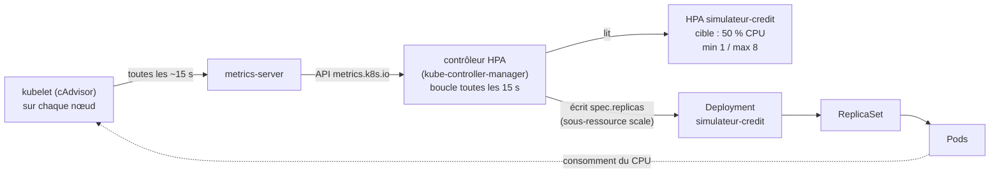

# Lab : HorizontalPodAutoscaler (HPA)

## Objectifs

- comprendre **qui** fait quoi : metrics-server (mesure), contrôleur HPA (décide), Deployment (applique) ;
- comprendre pourquoi les **`requests`** sont **obligatoires** pour un HPA en pourcentage de CPU ;
- créer un HPA en impératif (`kubectl autoscale`) et en YAML (`autoscaling/v2`) ;
- **calculer** à la main le nombre de réplicas que va choisir le HPA ;
- observer une montée en charge puis une **descente** (fenêtre de stabilisation) ;
- régler le comportement avec `behavior` (vitesse de montée / descente) ;
- utiliser plusieurs métriques (CPU **et** mémoire) ;
- dépanner un HPA qui affiche `<unknown>`.

### Contexte métier

Le **simulateur de crédit** de la banque en ligne est très sollicité certains jours (campagne publicitaire, baisse des
taux) et presque pas la nuit. Aujourd'hui il tourne en permanence avec 10 réplicas « au cas où » : c'est cher. L'équipe
plateforme veut :

| Exigence                                                     | Réglage HPA                       |
|--------------------------------------------------------------|-----------------------------------|
| jamais moins de **1** réplica (haute dispo minimale)         | `minReplicas: 1`                  |
| jamais plus de **8** réplicas (budget, capacité du cluster)  | `maxReplicas: 8`                  |
| garder le CPU moyen autour de **50 %** de la demande         | `averageUtilization: 50`          |
| monter **vite** quand le trafic arrive                       | `behavior.scaleUp`                |
| descendre **prudemment** (éviter le yo-yo)                   | `behavior.scaleDown`              |

### Vue d'ensemble



> **À retenir :**
> - le HPA ne mesure rien lui-même : il lit l'API `metrics.k8s.io`, fournie par **metrics-server** ;
> - il ne crée pas de Pods : il modifie seulement `spec.replicas` du Deployment ;
> - le pourcentage de CPU est calculé **par rapport aux `requests`** du conteneur, pas par rapport au CPU du nœud.

### La formule

```
réplicas souhaités = ceil( réplicas actuels × valeur actuelle / valeur cible )
```

Exemple : 2 réplicas, CPU moyen à 150 % de la demande, cible 50 % → `ceil(2 × 150 / 50)` = **6** réplicas.
Le HPA ne bouge pas si le rapport est entre 0,9 et 1,1 (**tolérance de 10 %**).

## Étape 0 : préparer l'environnement

```bash
ssh k8s-master-01
kubectl create namespace autoscaling-lab
kubectl config set-context --current --namespace=autoscaling-lab

# metrics-server est indispensable
kubectl get apiservice v1beta1.metrics.k8s.io
# NAME                     SERVICE                         AVAILABLE
# v1beta1.metrics.k8s.io   metrics-server/metrics-server   True
kubectl top nodes
# NAME            CPU(cores)   CPU(%)   MEMORY(bytes)   MEMORY(%)
# k8s-worker-01   118m         5%       984Mi           30%
```

> Si `kubectl top` répond `error: Metrics API not available`, metrics-server n'est pas installé ou pas prêt : aucun HPA
> ne pourra fonctionner.


# Partie 1 : l'application et ses `requests`

## Étape 1 : déployer le simulateur de crédit

L'image `registry.k8s.io/hpa-example` (exemple officiel de la documentation Kubernetes) est un petit serveur PHP qui
fait un calcul **gourmand en CPU** à chaque requête.

```bash
cat <<'EOF' | kubectl apply -f -
apiVersion: apps/v1
kind: Deployment
metadata:
  name: simulateur-credit
spec:
  replicas: 1
  selector:
    matchLabels: {app: simulateur-credit}
  template:
    metadata:
      labels: {app: simulateur-credit}
    spec:
      containers:
      - name: simulateur
        image: registry.k8s.io/hpa-example:latest
        ports:
        - containerPort: 80
        resources:
          requests:
            cpu: 200m              # 100 % pour le HPA = 200 millicores
            memory: 64Mi
          limits:
            cpu: 500m
            memory: 128Mi
---
apiVersion: v1
kind: Service
metadata:
  name: simulateur-credit
spec:
  selector: {app: simulateur-credit}
  ports:
  - port: 80
EOF
kubectl rollout status deployment/simulateur-credit
```

## Étape 2 : observer la consommation

```bash
# metrics-server a besoin de 1 ou 2 cycles de mesure pour un nouveau Pod ("metrics not available yet")
timeout 120 bash -c 'until kubectl top pods >/dev/null 2>&1; do sleep 5; done'
kubectl top pods
# NAME                                 CPU(cores)   MEMORY(bytes)
# simulateur-credit-xxxx-yyyy          1m           10Mi          <- au repos
```

| Valeur `kubectl top` | % pour le HPA (requête = 200m) |
|----------------------|--------------------------------|
| `20m`                | 10 %                           |
| `100m`               | 50 %   (la cible)              |
| `300m`               | 150 %                          |
| `500m` (la limite)   | 250 % (maximum possible ici)   |

> On peut dépasser 100 % : la référence est la **demande** (`requests`), pas la **limite**.


# Partie 2 : créer le HPA

## Étape 3 : en impératif

```bash
kubectl autoscale deployment simulateur-credit --cpu=50% --min=1 --max=8
kubectl get hpa
# NAME                REFERENCE                      TARGETS              MINPODS   MAXPODS   REPLICAS   AGE
# simulateur-credit   Deployment/simulateur-credit   cpu: <unknown>/50%   1         8         1          3s
```

> Avec le kubectl de ce cluster (v1.37) : `--cpu=50%` (pourcentage de la `request`) ou `--cpu=100m` (valeur absolue par Pod).
> L'ancienne option `--cpu-percent` fonctionne encore mais est **dépréciée**.

`<unknown>` pendant les premières secondes est **normal** (pas encore de mesure). Après ~30 s :

```bash
sleep 30
kubectl get hpa simulateur-credit
# TARGETS  cpu: 0%/50%   REPLICAS 1
```

## Étape 4 : le même en YAML, et ce qu'il contient

```bash
kubectl get hpa simulateur-credit -o yaml | sed -n '/^spec:/,/^status:/p'
```

```yaml
spec:
  maxReplicas: 8
  minReplicas: 1
  metrics:
  - resource:
      name: cpu
      target:
        averageUtilization: 50        # % de la "request" CPU, en moyenne sur tous les Pods
        type: Utilization
    type: Resource
  scaleTargetRef:                     # QUI est mis à l'échelle
    apiVersion: apps/v1
    kind: Deployment
    name: simulateur-credit
```

| Champ                          | Signification                                                              |
|--------------------------------|----------------------------------------------------------------------------|
| `scaleTargetRef`               | l'objet à piloter (Deployment, StatefulSet, ReplicaSet… tout objet avec `/scale`) |
| `minReplicas` / `maxReplicas`  | bornes ; le HPA ne sort jamais de cet intervalle                           |
| `metrics[].type: Resource`     | CPU ou mémoire des conteneurs (via metrics-server)                         |
| `target.type: Utilization`     | en **%** de la `request` (`averageUtilization`)                            |
| `target.type: AverageValue`    | en **valeur absolue** par Pod (`averageValue: 300m`, `200Mi`) : pas besoin de `requests` |
| `behavior`                     | vitesse et prudence de la montée / descente (partie 4)                     |


# Partie 3 : la montée en charge

## Étape 5 : générer du trafic

Ouvrez un **second terminal** pour suivre le HPA en direct :

```bash
kubectl get hpa simulateur-credit -n autoscaling-lab -w
```

Dans le premier terminal, lancez un générateur de charge (une boucle de requêtes sans pause) :

```bash
kubectl create deployment charge --image=busybox:1.37 -- \
  sh -c 'while true; do wget -q -O- http://simulateur-credit > /dev/null; done'
kubectl rollout status deployment/charge
```

Attendez que le HPA réagisse :

```bash
timeout 300 bash -c 'until [ "$(kubectl get hpa simulateur-credit -o jsonpath="{.status.currentReplicas}")" -gt 1 ]; do sleep 5; done'
kubectl get hpa simulateur-credit
# TARGETS  cpu: 249%/50%   REPLICAS 1 -> passe à 4 (ou 5)
sleep 60
kubectl get hpa simulateur-credit
kubectl get pods -l app=simulateur-credit
kubectl top pods -l app=simulateur-credit
```

**Observez** dans le second terminal : le CPU monte (ex : `249%`), les réplicas augmentent par paliers, puis le CPU
moyen redescend vers la cible à mesure que la charge se répartit.

Vérifions la formule avec les événements du HPA :

```bash
kubectl describe hpa simulateur-credit | sed -n '/Events/,$p'
# Normal  SuccessfulRescale  New size: 4; reason: cpu resource utilization (percentage of request) above target
# Normal  SuccessfulRescale  New size: 5; reason: cpu resource utilization (percentage of request) above target
```

> Avec 1 réplica à ~250 % : `ceil(1 × 250 / 50)` = 5. Le HPA limite cependant la vitesse de montée (par défaut :
> au plus ×2 ou +4 Pods toutes les 15 s, la plus grande des deux), d'où des paliers.

## Étape 6 : plus de charge, et le plafond

```bash
kubectl scale deployment charge --replicas=3
timeout 300 bash -c 'until [ "$(kubectl get hpa simulateur-credit -o jsonpath="{.status.currentReplicas}")" -ge 8 ]; do sleep 10; done'
kubectl get hpa simulateur-credit
# REPLICAS 8   <- maxReplicas atteint : le HPA ne va pas plus loin, même si le CPU reste au-dessus de la cible
kubectl describe hpa simulateur-credit | sed -n '/Conditions/,/Events/p'
#   AbleToScale     True   ...
#   ScalingActive   True   ...
#   ScalingLimited  True   TooManyReplicas   the desired replica count is more than the maximum replica count
```

> `ScalingLimited True` : le HPA **voudrait** plus, mais `maxReplicas` l'en empêche. En production, c'est une alerte à
> surveiller (sous-dimensionnement).

## Étape 7 : la charge s'arrête, la descente est lente

```bash
kubectl delete deployment charge
sleep 60
kubectl get hpa simulateur-credit
# TARGETS cpu: 0%/50%   REPLICAS 8      <- toujours 8 !
```

Le HPA attend une **fenêtre de stabilisation** de **5 minutes** (par défaut) avant de réduire : il prend le maximum
des recommandations des 5 dernières minutes. Cela évite le « yo-yo » quand le trafic est irrégulier. On ne va pas
attendre : on règle ce comportement.


# Partie 4 : régler le comportement (`behavior`)

## Étape 8 : HPA complet en YAML

On remplace le HPA impératif par une version complète, versionnable dans Git :

```bash
kubectl delete hpa simulateur-credit
cat <<'EOF' | kubectl apply -f -
apiVersion: autoscaling/v2
kind: HorizontalPodAutoscaler
metadata:
  name: simulateur-credit
spec:
  scaleTargetRef:
    apiVersion: apps/v1
    kind: Deployment
    name: simulateur-credit
  minReplicas: 1
  maxReplicas: 8
  metrics:
  - type: Resource
    resource:
      name: cpu
      target:
        type: Utilization
        averageUtilization: 50
  - type: Resource
    resource:
      name: memory
      target:
        type: AverageValue
        averageValue: 100Mi              # valeur absolue par Pod
  behavior:
    scaleUp:
      stabilizationWindowSeconds: 0      # monter immédiatement
      policies:
      - type: Percent
        value: 100                       # au plus doubler…
        periodSeconds: 15                # …toutes les 15 s
    scaleDown:
      stabilizationWindowSeconds: 30     # 30 s au lieu de 300 s (pour le lab)
      policies:
      - type: Pods
        value: 2                         # retirer au plus 2 Pods…
        periodSeconds: 15                # …toutes les 15 s
EOF
kubectl get hpa simulateur-credit
# TARGETS  cpu: 60%/50%, memory: 22604288/100Mi
#   (la mémoire actuelle est affichée en octets : ~21,5 Mi par Pod, sous la cible de 100Mi)
```

> Avec **plusieurs** métriques, le HPA calcule un nombre de réplicas **par métrique** et prend le **plus grand**.

```bash
for i in $(seq 1 20); do
  echo "$(date +%T)  replicas=$(kubectl get hpa simulateur-credit -o jsonpath='{.status.currentReplicas}')"
  [ "$(kubectl get hpa simulateur-credit -o jsonpath='{.status.currentReplicas}')" -le 1 ] && break
  sleep 15
done
kubectl get hpa simulateur-credit
# REPLICAS 1
```

**Observez :** la descente se fait par paliers de 2 Pods toutes les 15 s, après 30 s de stabilisation.

| Paramètre de `behavior`         | Effet                                                        | Défaut (montée / descente) |
|---------------------------------|--------------------------------------------------------------|----------------------------|
| `stabilizationWindowSeconds`    | durée pendant laquelle on garde la recommandation la plus prudente | 0 s / **300 s**       |
| `policies[].type: Pods`         | changer d'au plus N Pods par période                         | +4 Pods / 15 s             |
| `policies[].type: Percent`      | changer d'au plus N % par période                            | +100 % / 15 s ; −100 % / 15 s |
| `selectPolicy`                  | `Max` (la politique la plus permissive), `Min`, `Disabled`  | `Max`                      |

> `selectPolicy: Disabled` dans `scaleDown` = le HPA ne réduit **jamais** (utile pendant une période critique, comme
> une clôture comptable).


# Partie 5 : dépannage, « mon HPA affiche `<unknown>` »

## Étape 9 : l'API de calcul des intérêts

```bash
kubectl create deployment api-interets --image=registry.k8s.io/hpa-example:latest
kubectl autoscale deployment api-interets --cpu=60% --min=2 --max=5
kubectl rollout status deployment/api-interets
sleep 60
kubectl get hpa api-interets
# TARGETS  cpu: <unknown>/60%      <- toujours inconnu après une minute
```

**À vous :** trouvez pourquoi le HPA ne connaît pas l'utilisation CPU, et corrigez **sans** supprimer le HPA.

<details><summary>Méthode et solution</summary>

```bash
kubectl describe hpa api-interets | sed -n '/Conditions/,$p'
#   ScalingActive  False  FailedGetResourceMetric  the HPA was unable to compute the replica count:
#     failed to get cpu utilization: missing request for cpu in container hpa-example of Pod api-interets-...
# Warning  FailedGetResourceMetric ... missing request for cpu ...
```

Le conteneur n'a **pas** de `requests.cpu` : le pourcentage « d'utilisation de la demande » est impossible à
calculer. (Remarquez quand même `REPLICAS 2` : le HPA a appliqué `minReplicas`.)

```bash
kubectl set resources deployment api-interets --requests=cpu=100m,memory=64Mi --limits=cpu=300m,memory=128Mi
kubectl rollout status deployment/api-interets
sleep 45
kubectl get hpa api-interets
# TARGETS  cpu: 1%/60%
```

Les causes d'un HPA `<unknown>` :

| Message (`kubectl describe hpa`)                          | Cause                                                 |
|-----------------------------------------------------------|-------------------------------------------------------|
| `missing request for cpu`                                 | pas de `requests.cpu` sur **un** des conteneurs du Pod (sidecars compris) |
| `unable to get metrics ... the server could not find the requested resource` | metrics-server absent ou en panne      |
| `did not receive metrics for targeted pods (pods might be unready)` | Pods pas encore prêts / mesurés (attendre)  |
| `the HPA controller was unable to get the target's current scale` | mauvais `scaleTargetRef` (nom, kind)          |
</details>

> **Piège GitOps :** si le manifeste du Deployment contient `replicas: 3` et qu'on le ré-applique, il **écrase** la
> valeur choisie par le HPA (qui la corrigera au cycle suivant). Avec un HPA, retirez `replicas` du manifeste du
> Deployment.


# Partie 6 : exercices d'évaluation

**Exercice 1 :** créez un HPA `web` pour un Deployment `web` (`nginx:1.27`, `requests.cpu: 50m`) : entre 2 et 6
réplicas, cible 70 % de CPU, en **impératif**.

**Exercice 2 :** un Deployment a 3 réplicas avec une utilisation CPU moyenne de 90 % ; la cible est 60 %. Combien de
réplicas le HPA va-t-il demander ? Et si l'utilisation est à 64 % ?

**Exercice 3 :** modifiez le HPA `web` pour qu'il ne réduise **jamais** le nombre de réplicas.

**Exercice 4 :** affichez pour tous les HPA du namespace : cible, min, max, réplicas actuels.

<details><summary><b>Solutions</b></summary>

**1.**
```bash
kubectl create deployment web --image=nginx:1.27
kubectl set resources deployment web --requests=cpu=50m
kubectl autoscale deployment web --cpu=70% --min=2 --max=6
kubectl get hpa web
```

**2.** `ceil(3 × 90 / 60)` = `ceil(4,5)` = **5** réplicas. À 64 % : rapport 64/60 = 1,07, dans la tolérance de
10 % → **aucun changement** (3 réplicas).

**3.**
```bash
kubectl patch hpa web --type=merge -p '{"spec":{"behavior":{"scaleDown":{"selectPolicy":"Disabled"}}}}'
kubectl get hpa web -o jsonpath='{.spec.behavior.scaleDown}{"\n"}'
```

**4.**
```bash
kubectl get hpa -o custom-columns=NAME:.metadata.name,CIBLE:.spec.scaleTargetRef.name,MIN:.spec.minReplicas,MAX:.spec.maxReplicas,ACTUELS:.status.currentReplicas
```
</details>


## Nettoyage

```bash
kubectl delete namespace autoscaling-lab
kubectl config set-context --current --namespace=default
```

## Questions de compréhension

1. Quel composant mesure la consommation CPU ? Lequel décide du nombre de réplicas ? Lequel crée les Pods ?
2. Pourquoi un HPA en `Utilization` exige-t-il des `requests` ?
3. Un Pod consomme 300m avec `requests.cpu: 200m`. Quelle utilisation voit le HPA ?
4. Pourquoi le nombre de réplicas ne redescend-il pas immédiatement quand la charge s'arrête ?
5. Que fait le HPA si deux métriques recommandent respectivement 3 et 6 réplicas ?
6. Quelle différence entre HPA, VPA et Cluster Autoscaler ?

<details><summary>Réponses</summary>

1. Mesure : kubelet (cAdvisor) puis metrics-server. Décision : contrôleur HPA (kube-controller-manager). Création des
   Pods : contrôleurs Deployment et ReplicaSet (le HPA ne modifie que `spec.replicas`).
2. Le pourcentage est calculé **par rapport à la demande** : sans demande, pas de dénominateur.
3. 150 %.
4. La fenêtre de stabilisation de descente (300 s par défaut) évite les oscillations.
5. Il prend la plus grande : 6.
6. HPA : **plus de Pods**. VPA : des Pods **plus gros** (ajuste `requests`/`limits`). Cluster Autoscaler : **plus de
   nœuds** quand des Pods restent `Pending` faute de ressources.
</details>

## Commandes

| Commande                                                                   | Utilité                                      |
|----------------------------------------------------------------------------|----------------------------------------------|
| `kubectl top nodes` / `kubectl top pods`                                   | Consommation actuelle (metrics-server)       |
| `kubectl autoscale deploy D --cpu=50% --min=1 --max=8`              | Créer un HPA                                 |
| `kubectl get hpa -w`                                                       | Suivre le HPA en direct                      |
| `kubectl describe hpa H`                                                   | Conditions, événements, raisons de rescale   |
| `kubectl set resources deploy D --requests=cpu=100m`                       | Ajouter des requests                         |
| `kubectl get --raw /apis/metrics.k8s.io/v1beta1/namespaces/NS/pods`        | Interroger directement l'API de métriques   |
