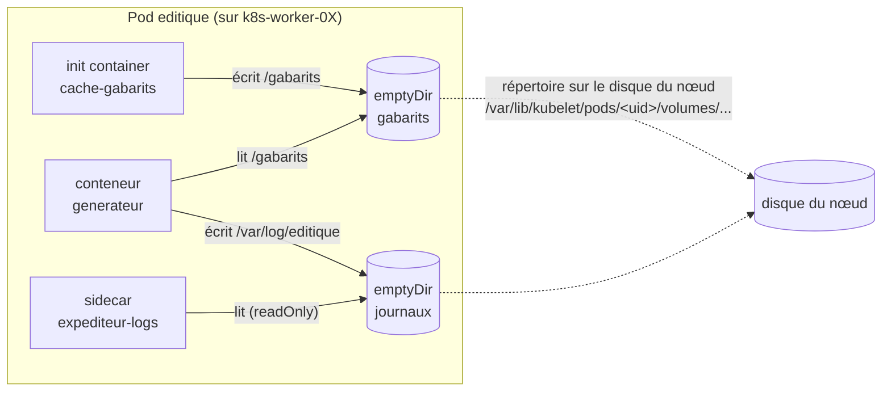

# Lab : Volume emptyDir

## Objectifs

- comprendre pourquoi le système de fichiers d'un conteneur est **éphémère** ;
- déclarer un volume (`spec.volumes`) et le monter (`volumeMounts`) dans un ou plusieurs conteneurs ;
- partager des fichiers entre conteneurs d'un même Pod (pattern **sidecar** et **init container**) ;
- connaître le **cycle de vie** exact d'un `emptyDir` : il survit au redémarrage d'un conteneur, **pas** à la suppression du Pod ;
- utiliser `medium: Memory` (tmpfs) et `sizeLimit` ;
- savoir **où** est stocké un `emptyDir` sur le nœud ;
- dépanner un Pod **évincé** à cause d'un `emptyDir` trop rempli.

### Contexte métier

Vous êtes dans l'équipe plateforme d'une banque. Le service **éditique** génère les relevés de compte en PDF :

| Composant          | Rôle                                                                      | Besoin de stockage                        |
|--------------------|---------------------------------------------------------------------------|-------------------------------------------|
| `generateur`       | génère les PDF et écrit un journal d'activité                             | un répertoire de travail **temporaire**   |
| `expediteur-logs`  | sidecar qui lit le journal du générateur et l'envoie à la supervision     | lire les fichiers **d'un autre conteneur** |
| `cache-gabarits`   | init container qui prépare les gabarits (modèles) avant le démarrage      | déposer des fichiers **avant** l'appli     |

Aucune de ces données n'a besoin de survivre au Pod : c'est exactement le rôle d'un volume `emptyDir`.

### Vue d'ensemble



> **À retenir :** un `emptyDir` est créé **vide** quand le Pod est placé sur un nœud, et **détruit** quand le Pod est
> supprimé. Il appartient au **Pod**, pas au conteneur : tous les conteneurs du Pod peuvent le monter.

### Les grandes familles de volumes (vue d'ensemble de ce module)

| Type de volume                    | Durée de vie                      | Exemple d'usage                          | Lab        |
|-----------------------------------|-----------------------------------|------------------------------------------|------------|
| `emptyDir`                        | celle du **Pod**                  | cache, fichiers temporaires, partage     | **ce lab** |
| `configMap` / `secret`            | celle de l'objet                  | fichiers de configuration, certificats   | –          |
| `hostPath`                        | celle du **nœud**                 | agents système (logs, monitoring)        | 05_02      |
| `persistentVolumeClaim` (PV/PVC)  | **indépendante** du Pod           | bases de données, fichiers métier        | 05_02      |
| PVC + `StorageClass`              | indépendante, créée **à la demande** | provisionnement dynamique              | 05_03      |

## Étape 0 : préparer l'environnement

```bash
ssh k8s-master-01
kubectl create namespace stockage-emptydir
kubectl config set-context --current --namespace=stockage-emptydir
```

> Image utilisée : `busybox:1.37` (shell + outils Unix de base). Les conteneurs « applicatifs » sont simulés par de petites
> boucles shell.


# Partie 1 : le problème, le disque d'un conteneur est éphémère

## Étape 1 : écrire dans un conteneur… puis le faire redémarrer

On déploie un générateur qui **plante** volontairement dès qu'il trouve le fichier `/travail/crash` (simule un bug).
Le répertoire `/travail` n'existe pas dans l'image : le script le crée au démarrage (`mkdir -p`).

```bash
cat <<'EOF' | kubectl apply -f -
apiVersion: v1
kind: Pod
metadata:
  name: generateur-sans-volume
spec:
  terminationGracePeriodSeconds: 2
  containers:
  - name: generateur
    image: busybox:1.37
    command: ["sh", "-c"]
    args:
    - |
      mkdir -p /travail
      echo "$(date +%T) demarrage" >> /travail/journal.txt
      while [ ! -f /travail/crash ]; do sleep 1; done
      rm /travail/crash; echo "crash !"; exit 1
EOF
kubectl wait --for=condition=Ready pod/generateur-sans-volume

kubectl exec generateur-sans-volume -- cat /travail/journal.txt
# 10:00:01 demarrage

# Simulons un plantage
kubectl exec generateur-sans-volume -- touch /travail/crash
sleep 8
kubectl get pod generateur-sans-volume
# RESTARTS : 1
kubectl exec generateur-sans-volume -- cat /travail/journal.txt
# 10:00:15 demarrage     <- UNE seule ligne : le journal précédent a disparu
```

**Constat :** quand kubelet redémarre un conteneur, il repart de l'**image** : tout ce qui a été écrit dans le système de
fichiers du conteneur (la couche en écriture) est perdu. Il faut un volume.


# Partie 2 : déclarer et monter un emptyDir

## Étape 2 : le même générateur avec un emptyDir

Un volume se déclare en **deux** endroits :

1. `spec.volumes` : **quel** volume (au niveau du Pod) ;
2. `spec.containers[].volumeMounts` : **où** le monter dans chaque conteneur (le `name` fait le lien).

```bash
cat <<'EOF' | kubectl apply -f -
apiVersion: v1
kind: Pod
metadata:
  name: generateur
  labels:
    app: editique
spec:
  terminationGracePeriodSeconds: 2
  containers:
  - name: generateur
    image: busybox:1.37
    command: ["sh", "-c"]
    args:
    - |
      echo "$(date +%T) demarrage" >> /travail/journal.txt
      while [ ! -f /travail/crash ]; do sleep 1; done
      rm /travail/crash; echo "crash !"; exit 1
    volumeMounts:
    - name: travail          # <- doit correspondre à un nom dans spec.volumes
      mountPath: /travail    # <- répertoire créé automatiquement dans le conteneur
  volumes:
  - name: travail
    emptyDir: {}             # <- {} = toutes les valeurs par défaut (disque du nœud, pas de limite)
EOF
kubectl wait --for=condition=Ready pod/generateur
```

| Champ (dans `volumeMounts`) | Signification                                                               | Défaut   |
|-----------------------------|-----------------------------------------------------------------------------|----------|
| `name`                      | nom du volume déclaré dans `spec.volumes`                                   | obligatoire |
| `mountPath`                 | chemin dans le conteneur (créé s'il n'existe pas, **masque** son contenu s'il existe) | obligatoire |
| `readOnly`                  | montage en lecture seule pour **ce** conteneur                              | `false`  |
| `subPath`                   | monter seulement un **sous-répertoire** du volume                           | racine   |

| Champ (dans `emptyDir`) | Signification                                                                  | Défaut                 |
|-------------------------|--------------------------------------------------------------------------------|------------------------|
| `medium`                | `""` = disque du nœud ; `Memory` = **tmpfs** (RAM)                             | `""` (disque)          |
| `sizeLimit`             | taille max ; au-delà, le Pod est **évincé** (disque) ou l'écriture échoue (RAM) | aucune limite          |

## Étape 3 : le volume survit au redémarrage du conteneur

```bash
kubectl exec generateur -- touch /travail/crash
sleep 8
kubectl get pod generateur
# RESTARTS : 1

kubectl exec generateur -- cat /travail/journal.txt
# 10:05:01 demarrage
# 10:05:12 demarrage     <- DEUX lignes : le journal a survécu au redémarrage

kubectl logs generateur --previous
# crash !               <- les logs du conteneur précédent (celui qui a planté)
```

> Le volume est rattaché au **Pod**. Tant que le Pod existe (même si ses conteneurs redémarrent), le contenu est conservé.

## Étape 4 : … mais pas à la suppression du Pod

```bash
kubectl delete pod generateur
kubectl apply -f - <<'EOF'
apiVersion: v1
kind: Pod
metadata:
  name: generateur
spec:
  containers:
  - name: generateur
    image: busybox:1.37
    command: ["sh", "-c", "echo \"$(date +%T) demarrage\" >> /travail/journal.txt; sleep infinity"]
    volumeMounts:
    - {name: travail, mountPath: /travail}
  volumes:
  - name: travail
    emptyDir: {}
EOF
kubectl wait --for=condition=Ready pod/generateur
kubectl exec generateur -- cat /travail/journal.txt
# 10:06:30 demarrage     <- UNE ligne : nouveau Pod = nouvel emptyDir, vide
```

| Événement                                     | Données de l'emptyDir      |
|-----------------------------------------------|----------------------------|
| le conteneur plante / est redémarré (liveness) | **conservées**             |
| le Pod est supprimé (`delete`, rollout, scale down) | **perdues**           |
| le Pod est évincé / le nœud tombe             | **perdues**                |
| le Pod est recréé par un Deployment           | **perdues** (nouveau Pod = nouvel UID) |

> **Règle :** `emptyDir` = données **jetables**. Pour des données qui doivent survivre au Pod : PersistentVolume (lab 05_02).

## Étape 5 : où est stocké un emptyDir sur le nœud ?

```bash
NODE=$(kubectl get pod generateur -o jsonpath='{.spec.nodeName}')
UID_POD=$(kubectl get pod generateur -o jsonpath='{.metadata.uid}')
echo "$NODE  $UID_POD"

ssh $NODE "sudo ls -l /var/lib/kubelet/pods/$UID_POD/volumes/kubernetes.io~empty-dir/"
# drwxrwxrwx 2 root root 4096 ... travail
ssh $NODE "sudo cat /var/lib/kubelet/pods/$UID_POD/volumes/kubernetes.io~empty-dir/travail/journal.txt"
# 10:06:30 demarrage
```

> C'est un simple **répertoire** dans le dossier de kubelet (`/var/lib/kubelet/pods/<uid-du-pod>/volumes/`), sur le
> disque du nœud. À la suppression du Pod, kubelet supprime ce répertoire.

```bash
kubectl exec generateur -- df -h /travail
# Filesystem                         Size  Used  Available  Use%  Mounted on
# /dev/mapper/ubuntu--vg-ubuntu--lv  27.5G 14.7G 11.5G      56%   /travail
#  -> on voit le disque racine du NŒUD : l'emptyDir partage l'espace avec tout le reste
```


# Partie 3 : partager des fichiers entre conteneurs

## Étape 6 : un sidecar qui lit le journal du générateur

Le pattern **sidecar** : un conteneur auxiliaire, dans le même Pod, qui travaille sur les fichiers du conteneur principal.
Ici, `expediteur-logs` lit le journal (en lecture seule) pour l'envoyer à la supervision (simulé par un `tail -f`).

On ajoute aussi un **init container** qui prépare les gabarits PDF **avant** le démarrage du générateur.

```bash
kubectl delete pod generateur generateur-sans-volume --grace-period=1
cat <<'EOF' | kubectl apply -f -
apiVersion: v1
kind: Pod
metadata:
  name: editique
  labels:
    app: editique
spec:
  terminationGracePeriodSeconds: 2
  initContainers:
  - name: cache-gabarits                     # s'exécute AVANT les conteneurs, jusqu'au bout
    image: busybox:1.37
    command: ["sh", "-c", "for g in releve-mensuel avis-de-virement; do echo \"gabarit $g v3\" > /gabarits/$g.tpl; done"]
    volumeMounts:
    - {name: gabarits, mountPath: /gabarits}
  containers:
  - name: generateur
    image: busybox:1.37
    command: ["sh", "-c"]
    args:
    - |
      ls /gabarits > /dev/null || exit 1
      i=0
      while true; do
        i=$((i+1))
        echo "$(date +%T) releve-$i.pdf genere avec $(ls /gabarits | head -1)" >> /var/log/editique/activite.log
        sleep 3
      done
    volumeMounts:
    - {name: gabarits, mountPath: /gabarits, readOnly: true}
    - {name: journaux, mountPath: /var/log/editique}
  - name: expediteur-logs                    # sidecar
    image: busybox:1.37
    command: ["sh", "-c", "tail -n+1 -F /logs/activite.log"]
    volumeMounts:
    - {name: journaux, mountPath: /logs, readOnly: true}   # même volume, autre chemin, lecture seule
  volumes:
  - name: gabarits
    emptyDir: {}
  - name: journaux
    emptyDir: {}
EOF
kubectl wait --for=condition=Ready pod/editique
kubectl get pod editique
# READY 2/2  (l'init container est terminé, il n'est pas compté)
```

Vérifications :

```bash
kubectl logs editique -c expediteur-logs --tail=3
# 10:10:03 releve-1.pdf genere avec avis-de-virement.tpl
# 10:10:06 releve-2.pdf genere avec avis-de-virement.tpl
#  -> le sidecar lit le fichier ÉCRIT par l'autre conteneur

kubectl exec editique -c generateur -- ls /gabarits
# avis-de-virement.tpl  releve-mensuel.tpl   <- déposés par l'init container

kubectl exec editique -c expediteur-logs -- touch /logs/test
# touch: /logs/test: Read-only file system  <- readOnly: true est bien appliqué
```

> **Points clés :**
> - un même volume peut être monté à des **chemins différents** et avec des **droits différents** dans chaque conteneur ;
> - les conteneurs d'un Pod sont toujours sur le **même nœud** : l'`emptyDir` est donc toujours accessible par tous ;
> - l'`emptyDir` est le **seul** moyen simple pour un init container de « passer » des fichiers aux conteneurs.

## Étape 7 : `subPath`, monter un seul sous-répertoire

Cas réel : deux conteneurs partagent un volume mais chacun ne doit voir **que son propre** sous-répertoire.

```bash
cat <<'EOF' | kubectl apply -f -
apiVersion: v1
kind: Pod
metadata:
  name: editique-subpath
spec:
  terminationGracePeriodSeconds: 2
  containers:
  - name: releves
    image: busybox:1.37
    command: ["sh", "-c", "echo releve > /sortie/fichier.pdf; sleep infinity"]
    volumeMounts:
    - {name: sortie, mountPath: /sortie, subPath: releves}
  - name: avis
    image: busybox:1.37
    command: ["sh", "-c", "echo avis > /sortie/fichier.pdf; sleep infinity"]
    volumeMounts:
    - {name: sortie, mountPath: /sortie, subPath: avis}
  - name: superviseur
    image: busybox:1.37
    command: ["sleep", "infinity"]
    volumeMounts:
    - {name: sortie, mountPath: /tout}          # pas de subPath : voit la racine du volume
  volumes:
  - name: sortie
    emptyDir: {}
EOF
kubectl wait --for=condition=Ready pod/editique-subpath

kubectl exec editique-subpath -c superviseur -- find /tout -type f
# /tout/avis/fichier.pdf
# /tout/releves/fichier.pdf
kubectl exec editique-subpath -c releves -- cat /sortie/fichier.pdf
# releve      <- pas d'écrasement : chaque conteneur a son sous-répertoire
```


# Partie 4 : emptyDir en mémoire et limite de taille

## Étape 8 : `medium: Memory`, un tmpfs en RAM

Cas réel : le générateur manipule des données **sensibles** (RIB, soldes) dans des fichiers temporaires. On ne veut pas
qu'elles touchent le disque du nœud, et on veut des écritures très rapides.

```bash
cat <<'EOF' | kubectl apply -f -
apiVersion: v1
kind: Pod
metadata:
  name: editique-ram
spec:
  terminationGracePeriodSeconds: 2
  containers:
  - name: generateur
    image: busybox:1.37
    command: ["sleep", "infinity"]
    resources:
      limits:
        memory: 256Mi            # la taille du tmpfs est comptée dans la mémoire du conteneur
    volumeMounts:
    - {name: tampon, mountPath: /tampon}
  volumes:
  - name: tampon
    emptyDir:
      medium: Memory
      sizeLimit: 64Mi
EOF
kubectl wait --for=condition=Ready pod/editique-ram

kubectl exec editique-ram -- df -h /tampon
# Filesystem   Size   Used  Available  Use%  Mounted on
# tmpfs        64.0M  0     64.0M      0%    /tampon    <- tmpfs de 64 Mi (sizeLimit)

kubectl exec editique-ram -- dd if=/dev/zero of=/tampon/gros bs=1M count=100
# dd: error writing '/tampon/gros': No space left on device
# 64+0 records out          <- impossible d'écrire plus que sizeLimit
```

> **Attention :**
> - les fichiers écrits dans un `emptyDir` `Memory` sont **comptés dans la mémoire du conteneur** : ils peuvent
>   provoquer un **OOMKilled** si la `limits.memory` est trop basse ;
> - sans `sizeLimit`, la taille du tmpfs dépend de la mémoire allouable du Pod/nœud : **indiquez toujours un `sizeLimit`** ;
> - un tmpfs est vidé si le **nœud** redémarre (contrairement au disque… mais l'emptyDir disque serait de toute façon
>   supprimé avec le Pod).

Vérification sur le nœud : c'est bien un montage `tmpfs` :

```bash
NODE=$(kubectl get pod editique-ram -o jsonpath='{.spec.nodeName}')
UID_POD=$(kubectl get pod editique-ram -o jsonpath='{.metadata.uid}')
ssh $NODE "mount | grep $UID_POD | grep empty-dir"
# tmpfs on /var/lib/kubelet/pods/<uid>/volumes/kubernetes.io~empty-dir/tampon type tmpfs (rw,relatime,size=65536k,...)
```

## Étape 9 : `sizeLimit` sur disque, l'éviction

Pour un `emptyDir` **disque**, il n'y a **pas** de quota du système de fichiers : kubelet **mesure** périodiquement
l'espace utilisé et **évince** le Pod s'il dépasse `sizeLimit`.

```bash
cat <<'EOF' | kubectl apply -f -
apiVersion: v1
kind: Pod
metadata:
  name: editique-gourmand
spec:
  containers:
  - name: generateur
    image: busybox:1.37
    command: ["sh", "-c", "sleep 5; dd if=/dev/zero of=/travail/archive.tmp bs=1M count=200; sleep infinity"]
    volumeMounts:
    - {name: travail, mountPath: /travail}
  volumes:
  - name: travail
    emptyDir:
      sizeLimit: 100Mi
EOF

kubectl get pod editique-gourmand -w
# editique-gourmand   1/1   Running   0   10s
# ...                                         (jusqu'à ~1 minute : kubelet vérifie périodiquement)
# editique-gourmand   0/1   Error     0   65s
# (Ctrl+C)
```

> Remarquez que `dd` **réussit** à écrire 200 Mi : contrairement au tmpfs, rien n'empêche l'écriture. C'est kubelet qui
> réagit **après coup**.


# Partie 5 : dépannage, « mon Pod a disparu »

## Étape 10 : analyser l'éviction

**À vous :** le Pod `editique-gourmand` n'est plus `Running`. Trouvez **pourquoi**, sans regarder le YAML.

<details><summary>Méthode et solution</summary>

```bash
kubectl get pod editique-gourmand
# NAME                READY   STATUS   RESTARTS   AGE
# editique-gourmand   0/1     Error    0          2m

kubectl get pod editique-gourmand -o jsonpath='{.status.phase} {.status.reason}{"\n"}{.status.message}{"\n"}'
# Failed Evicted
# Usage of EmptyDir volume "travail" exceeds the limit "100Mi".

kubectl get events --field-selector involvedObject.name=editique-gourmand
# Warning  Evicted   pod/editique-gourmand   Usage of EmptyDir volume "travail" exceeds the limit "100Mi".
# Normal   Killing   pod/editique-gourmand   Stopping container generateur
```

Un Pod **évincé** n'est **pas** redémarré (il est en phase `Failed`). S'il appartient à un Deployment, le ReplicaSet en
crée un **nouveau** (avec un nouvel emptyDir, vide). Le Pod évincé reste visible jusqu'à ce qu'on le supprime.

Corrections possibles : augmenter `sizeLimit`, faire nettoyer les fichiers temporaires par l'application, ou utiliser
un PersistentVolume si les données sont volumineuses.
</details>

> **Pourquoi `sizeLimit` est important :** sans limite, un emptyDir disque peut remplir le disque du nœud. kubelet passe
> alors en **DiskPressure** et commence à évincer **d'autres** Pods, qui n'y sont pour rien.
> Pour plafonner tout le stockage éphémère d'un conteneur (couche du conteneur + logs + emptyDir), on utilise aussi
> `resources.limits.ephemeral-storage`.


# Partie 6 : exercices d'évaluation

**Exercice 1 :** créez un Pod `cache-web` avec un conteneur `nginx:1.27` qui monte un `emptyDir` nommé `cache` sur
`/var/cache/nginx`, limité à **50Mi** sur **disque**.

**Exercice 2 :** créez un Pod `partage` avec **deux** conteneurs `busybox:1.37` : `producteur` écrit la date toutes les
2 secondes dans `/sortie/date.txt` ; `consommateur` affiche ce fichier toutes les 5 secondes depuis `/entree` (lecture
seule). Vérifiez avec `kubectl logs partage -c consommateur`.

**Exercice 3 :** créez un Pod `secret-ram` dont le volume `tmp` (monté sur `/tmp`) est en **RAM**, limité à **16Mi**.
Prouvez que c'est un tmpfs.

**Exercice 4 :** affichez, pour le Pod `editique`, le nom et le type de chacun de ses volumes.

<details><summary><b>Solutions</b></summary>

**1.**
```bash
kubectl run cache-web --image=nginx:1.27 --dry-run=client -o yaml > /tmp/cache-web.yaml
# éditer /tmp/cache-web.yaml pour ajouter volumeMounts + volumes, ou directement :
cat <<'EOF' | kubectl apply -f -
apiVersion: v1
kind: Pod
metadata:
  name: cache-web
spec:
  containers:
  - name: cache-web
    image: nginx:1.27
    volumeMounts:
    - {name: cache, mountPath: /var/cache/nginx}
  volumes:
  - name: cache
    emptyDir:
      sizeLimit: 50Mi
EOF
kubectl get pod cache-web -o jsonpath='{.spec.volumes[0]}{"\n"}'
```
Astuce examen : `kubectl run ... --dry-run=client -o yaml` génère le squelette ; la doc officielle (page *Volumes*)
donne le bloc `emptyDir` à copier.

**2.**
```bash
cat <<'EOF' | kubectl apply -f -
apiVersion: v1
kind: Pod
metadata:
  name: partage
spec:
  containers:
  - name: producteur
    image: busybox:1.37
    command: ["sh", "-c", "while true; do date > /sortie/date.txt; sleep 2; done"]
    volumeMounts:
    - {name: echange, mountPath: /sortie}
  - name: consommateur
    image: busybox:1.37
    command: ["sh", "-c", "while true; do cat /entree/date.txt; sleep 5; done"]
    volumeMounts:
    - {name: echange, mountPath: /entree, readOnly: true}
  volumes:
  - name: echange
    emptyDir: {}
EOF
kubectl wait --for=condition=Ready pod/partage
sleep 6
kubectl logs partage -c consommateur --tail=2
```

**3.**
```bash
cat <<'EOF' | kubectl apply -f -
apiVersion: v1
kind: Pod
metadata:
  name: secret-ram
spec:
  containers:
  - name: app
    image: busybox:1.37
    command: ["sleep", "infinity"]
    volumeMounts:
    - {name: tmp, mountPath: /tmp}
  volumes:
  - name: tmp
    emptyDir:
      medium: Memory
      sizeLimit: 16Mi
EOF
kubectl wait --for=condition=Ready pod/secret-ram
kubectl exec secret-ram -- df -h /tmp
# tmpfs   16.0M   0   16.0M   0%   /tmp
```

**4.**
```bash
kubectl get pod editique -o jsonpath='{range .spec.volumes[*]}{.name}{"\t"}{.emptyDir}{"\n"}{end}'
# ou plus lisible :
kubectl describe pod editique | sed -n '/^Volumes:/,/^QoS/p'
```
Vous verrez aussi un volume `kube-api-access-xxxxx` de type `projected` : il est ajouté **automatiquement** à chaque
Pod (jeton du ServiceAccount + certificat de l'API), monté sur `/var/run/secrets/kubernetes.io/serviceaccount`.
</details>


## Nettoyage

```bash
kubectl delete namespace stockage-emptydir
kubectl config set-context --current --namespace=default
rm -f /tmp/cache-web.yaml
```

## Questions de compréhension

1. Un conteneur redémarre suite à un échec de sa `livenessProbe`. Les fichiers de son `emptyDir` sont-ils conservés ?
2. Un Deployment fait un rolling update. Les fichiers de l'`emptyDir` des anciens Pods sont-ils récupérés par les nouveaux ?
3. Deux Pods différents peuvent-ils partager le même `emptyDir` ?
4. Quelle est la différence de comportement de `sizeLimit` entre un `emptyDir` disque et un `emptyDir` `Memory` ?
5. Pourquoi un `emptyDir` `Memory` peut-il provoquer un `OOMKilled` ?

<details><summary>Réponses</summary>

1. Oui : l'emptyDir appartient au Pod, qui n'a pas été supprimé.
2. Non : chaque nouveau Pod a un nouvel `emptyDir`, vide. Les anciens sont supprimés avec leurs Pods.
3. Non : un `emptyDir` est propre à **un** Pod. Pour partager entre Pods, il faut un volume réseau (PV NFS en `ReadWriteMany`, lab 05_02).
4. Disque : l'écriture réussit, kubelet **évince** le Pod après coup. Memory : c'est un tmpfs de taille fixe, l'écriture
   **échoue** (`No space left on device`).
5. Les fichiers d'un tmpfs occupent de la RAM, comptée dans la consommation mémoire du conteneur (cgroup).
</details>

## Commandes

| Commande                                                                     | Utilité                                     |
|------------------------------------------------------------------------------|---------------------------------------------|
| `kubectl describe pod P \| sed -n '/^Volumes:/,/^QoS/p'`                     | Voir les volumes d'un Pod                   |
| `kubectl exec P -c C -- df -h /chemin`                                        | Voir le montage et la taille d'un volume    |
| `kubectl logs P -c C --previous`                                              | Logs du conteneur **avant** son redémarrage |
| `kubectl get pod P -o jsonpath='{.status.reason} {.status.message}'`          | Cause d'une éviction                        |
| `kubectl get events --field-selector involvedObject.name=P`                   | Événements d'un Pod                         |
| `ssh NODE sudo ls /var/lib/kubelet/pods/UID/volumes/kubernetes.io~empty-dir/` | emptyDir sur le disque du nœud              |
