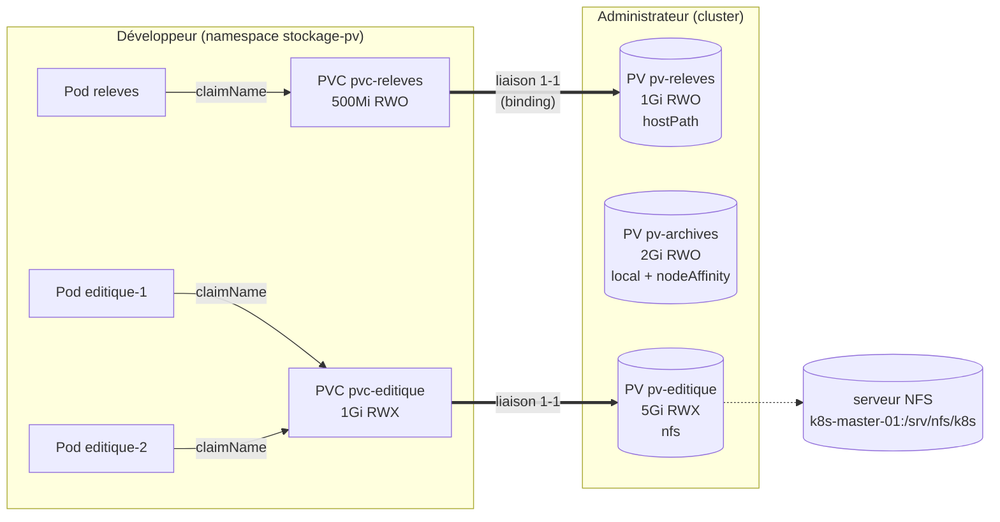

# Lab : PersistentVolume et PersistentVolumeClaim (provisionnement statique)

## Objectifs

- comprendre la séparation des rôles : l'**administrateur** fournit des PersistentVolumes (PV), le **développeur** les
  demande avec des PersistentVolumeClaims (PVC) ;
- créer des PV de type `hostPath`, `local` et `nfs`, et connaître leurs limites ;
- maîtriser les **règles de liaison** (binding) PV ↔ PVC : `storageClassName`, `accessModes`, capacité, `selector`,
  `volumeName` ;
- comprendre les **modes d'accès** (`RWO`, `ROX`, `RWX`, `RWOP`) et ce qu'ils garantissent vraiment ;
- suivre le **cycle de vie** d'un PV (`Available` → `Bound` → `Released`) et la `persistentVolumeReclaimPolicy` ;
- récupérer les données d'un PV `Released` ;
- dépanner une PVC bloquée en `Pending`.

### Contexte métier

L'éditique de la banque (lab 05_01) a maintenant des besoins de stockage **durables** :

| Besoin                           | Contrainte métier                                                   | Solution dans ce lab              |
|----------------------------------|---------------------------------------------------------------------|-----------------------------------|
| `releves` : relevés PDF générés  | doivent survivre au redémarrage / à la suppression du Pod           | PV + PVC                          |
| `archives` : archives réglementaires | conservation **10 ans** : ne **jamais** supprimer automatiquement | `persistentVolumeReclaimPolicy: Retain` |
| `editique` : ferme de génération | **plusieurs Pods sur plusieurs nœuds** écrivent dans le même espace | PV NFS en `ReadWriteMany`         |

L'équipe **stockage** (vous, l'administrateur) prépare les volumes ; l'équipe **éditique** (les développeurs) ne connaît
ni l'IP du serveur NFS ni les chemins sur les nœuds : elle demande juste « 1 Gi en lecture/écriture ».

### Vue d'ensemble



> **À retenir :**
> - un **PV** est une ressource du **cluster** (pas de namespace), comme un nœud : c'est un « morceau de stockage » ;
> - une **PVC** est une **demande** de stockage, dans un **namespace**, comme un Pod demande du CPU ;
> - la liaison PV ↔ PVC est **exclusive** (1 pour 1) : un PV lié à une PVC ne peut servir à aucune autre PVC ;
> - le Pod ne référence **jamais** le PV, seulement la PVC (`persistentVolumeClaim.claimName`).

### PV statique ou dynamique (vue d'ensemble de ce module)

| Approche                        | Qui crée le PV ?                                  | Lab        |
|---------------------------------|---------------------------------------------------|------------|
| `emptyDir` (pas de PV)          | –  (volume éphémère lié au Pod)                   | 05_01      |
| **provisionnement statique**    | l'administrateur, **à l'avance**, à la main       | **ce lab** |
| **provisionnement dynamique**   | un **provisioner**, **à la demande**, via une StorageClass | 05_03 |

## Étape 0 : préparer l'environnement

```bash
ssh k8s-master-01
kubectl create namespace stockage-pv
kubectl config set-context --current --namespace=stockage-pv

kubectl get storageclass
# No resources found   <- aucune StorageClass : rien n'est créé automatiquement dans ce cluster
kubectl get pv
# No resources found
```

### Une StorageClass « manuelle » pour regrouper nos PV statiques

On va ranger tous nos PV statiques dans une classe nommée `manuel`. Pour cela on crée une StorageClass **sans
provisioner** (`kubernetes.io/no-provisioner`) : elle ne crée rien, elle sert juste d'**étiquette** pour la liaison.
Les StorageClass sont détaillées au lab 05_03.

```bash
cat <<'EOF' | kubectl apply -f -
apiVersion: storage.k8s.io/v1
kind: StorageClass
metadata:
  name: manuel
provisioner: kubernetes.io/no-provisioner   # aucun provisionnement automatique
volumeBindingMode: Immediate                # liaison dès la création de la PVC
EOF
```

> Sans cet objet, la liaison fonctionne quand même (le champ `storageClassName` n'est qu'un texte à faire
> correspondre), mais le contrôleur affiche un avertissement trompeur `storageclass "manuel" not found` et la liaison peut
> prendre jusqu'à 15 secondes.

### Préparer un serveur NFS (pour la partie 3)

Le serveur NFS est installé sur `k8s-master-01` ; les workers ont besoin du **client** NFS (`nfs-common`) car c'est
**kubelet** qui fait le `mount` sur le nœud.

```bash
sudo apt-get install -y nfs-kernel-server
sudo mkdir -p /srv/nfs/k8s
sudo chown nobody:nogroup /srv/nfs/k8s && sudo chmod 0777 /srv/nfs/k8s
grep -q /srv/nfs/k8s /etc/exports || \
  echo "/srv/nfs/k8s 10.10.10.0/24(rw,sync,no_subtree_check,no_root_squash)" | sudo tee -a /etc/exports
sudo exportfs -ra
sudo exportfs -v
# /srv/nfs/k8s   10.10.10.0/24(sync,wdelay,hide,no_subtree_check,sec=sys,rw,secure,no_root_squash,no_all_squash)

for n in k8s-worker-01 k8s-worker-02; do ssh $n "sudo apt-get install -y nfs-common >/dev/null && showmount -e 10.10.10.11"; done
# Export list for 10.10.10.11:
# /srv/nfs/k8s 10.10.10.0/24      (x2)
```


# Partie 1 : premier PV, première PVC

## Étape 1 : l'administrateur crée un PV `hostPath`

```bash
cat <<'EOF' | kubectl apply -f -
apiVersion: v1
kind: PersistentVolume
metadata:
  name: pv-releves                         # pas de namespace : objet du cluster
  labels:
    usage: releves
spec:
  capacity:
    storage: 1Gi
  accessModes:
  - ReadWriteOnce
  persistentVolumeReclaimPolicy: Retain
  storageClassName: manuel
  volumeMode: Filesystem
  hostPath:                                # <- le "backend" : un répertoire sur le nœud où tournera le Pod
    path: /srv/k8s-pv/releves
    type: DirectoryOrCreate
EOF

kubectl get pv
# NAME         CAPACITY   ACCESS MODES   RECLAIM POLICY   STATUS      CLAIM   STORAGECLASS   ...
# pv-releves   1Gi        RWO            Retain           Available           manuel
```

| Champ du PV                         | Signification                                                                 | Défaut              |
|-------------------------------------|-------------------------------------------------------------------------------|---------------------|
| `capacity.storage`                  | taille **annoncée** (sert au binding ; pas de quota réel pour hostPath/nfs)   | obligatoire         |
| `accessModes`                       | modes d'accès **proposés** par ce volume (voir tableau ci-dessous)            | obligatoire         |
| `persistentVolumeReclaimPolicy`     | que faire du PV quand sa PVC est supprimée : `Retain` ou `Delete`             | `Retain` (PV manuel) / celle de la StorageClass (PV dynamique) |
| `storageClassName`                  | classe du PV : seule une PVC de **même** classe peut s'y lier                 | `""` (aucune classe) |
| `volumeMode`                        | `Filesystem` (monté dans un répertoire) ou `Block` (périphérique brut)        | `Filesystem`        |
| `mountOptions`                      | options de `mount` (ex : `nfsvers=4.2`)                                       | aucune              |
| `nodeAffinity`                      | nœuds depuis lesquels le volume est accessible (obligatoire pour `local`)     | aucun               |
| backend (`hostPath`, `local`, `nfs`, `csi`…) | **où** sont réellement les données ; **un seul** par PV            | obligatoire         |

Les **modes d'accès** :

| Mode               | Abréviation | Signification                                                        |
|--------------------|-------------|----------------------------------------------------------------------|
| `ReadWriteOnce`    | `RWO`       | lecture/écriture par **un seul nœud** (plusieurs Pods de ce nœud OK) |
| `ReadOnlyMany`     | `ROX`       | lecture seule par **plusieurs nœuds**                                |
| `ReadWriteMany`    | `RWX`       | lecture/écriture par **plusieurs nœuds**                             |
| `ReadWriteOncePod` | `RWOP`      | lecture/écriture par **un seul Pod** du cluster (volumes CSI uniquement) |

> **Piège classique :** `RWO` signifie « un seul **nœud** », **pas** « un seul Pod ». Et ces modes décrivent ce que le
> volume **sait faire** : Kubernetes ne bloque pas un 2e nœud qui monterait un `hostPath` ou un `nfs` déclaré `RWO`.
> Seul `RWOP` (CSI) est réellement appliqué par le scheduler (lab 05_03).

## Étape 2 : le développeur crée une PVC

```bash
cat <<'EOF' | kubectl apply -f -
apiVersion: v1
kind: PersistentVolumeClaim
metadata:
  name: pvc-releves
  namespace: stockage-pv                  # une PVC vit dans un namespace
spec:
  storageClassName: manuel
  accessModes:
  - ReadWriteOnce
  resources:
    requests:
      storage: 500Mi                      # on demande 500Mi…
EOF

kubectl get pvc
# NAME          STATUS   VOLUME       CAPACITY   ACCESS MODES   STORAGECLASS   ...
# pvc-releves   Bound    pv-releves   1Gi        RWO            manuel
#                                     ^^^ …on obtient 1Gi : le PV ENTIER est réservé

kubectl get pv pv-releves
# STATUS  Bound   CLAIM  stockage-pv/pvc-releves
```

**Règles de liaison :** le contrôleur `persistentvolume-controller` (dans `kube-controller-manager`) cherche un PV
`Available` qui respecte **toutes** ces conditions, et prend le **plus petit** qui convient :

| Critère                | Condition                                                                   |
|------------------------|-----------------------------------------------------------------------------|
| `storageClassName`     | **identique** (une PVC `""` ne se lie qu'à un PV `""`)                      |
| `accessModes`          | le PV doit proposer **tous** les modes demandés par la PVC                  |
| capacité               | PV `capacity` **≥** PVC `requests.storage`                                  |
| `volumeMode`           | identique                                                                   |
| `selector` (optionnel) | les labels du PV correspondent au `selector` de la PVC                      |
| `volumeName` (optionnel) | la PVC demande **ce PV précis**                                           |

| Champ de la PVC            | Signification                                              | Modifiable après création ? |
|----------------------------|------------------------------------------------------------|-----------------------------|
| `storageClassName`         | classe demandée (absent = classe par défaut, voir 05_03)   | non                         |
| `accessModes`              | modes nécessaires                                          | non                         |
| `resources.requests.storage` | taille minimale                                          | **augmentation** seulement (si la classe le permet, 05_03) |
| `selector`                 | filtre sur les labels des PV                               | non                         |
| `volumeName`               | lier à un PV précis                                        | non                         |

## Étape 3 : une PVC qui ne trouve pas de PV

```bash
cat <<'EOF' | kubectl apply -f -
apiVersion: v1
kind: PersistentVolumeClaim
metadata:
  name: pvc-gros-volume
spec:
  storageClassName: manuel
  accessModes: [ReadWriteOnce]
  resources:
    requests:
      storage: 5Gi
EOF

kubectl get pvc pvc-gros-volume
# STATUS  Pending
kubectl describe pvc pvc-gros-volume | tail -3
# Warning  ProvisioningFailed  persistentvolume-controller  no volume plugin matched name: kubernetes.io/no-provisioner
```

> La PVC reste `Pending` : aucun PV `Available` de classe `manuel` ne fait 5Gi, et la classe `manuel` ne sait pas en
> créer (`no-provisioner`). Le message est générique : à vous de comparer **classe / modes / taille** avec `kubectl get pv`.

L'administrateur ajoute un PV de 5Gi : la PVC se lie **automatiquement**, sans rien toucher côté développeur.

```bash
cat <<'EOF' | kubectl apply -f -
apiVersion: v1
kind: PersistentVolume
metadata:
  name: pv-5g
spec:
  capacity: {storage: 5Gi}
  accessModes: [ReadWriteOnce]
  storageClassName: manuel
  hostPath: {path: /srv/k8s-pv/gros, type: DirectoryOrCreate}
EOF
kubectl wait --for=jsonpath='{.status.phase}'=Bound pvc/pvc-gros-volume --timeout=60s
kubectl get pvc pvc-gros-volume
# STATUS  Bound   VOLUME  pv-5g
kubectl delete pvc pvc-gros-volume
```

> La liaison peut prendre **jusqu'à ~15 secondes** : le contrôleur re-examine périodiquement les PVC `Pending`. Si le PV
> existe **avant** la PVC (étape 2), la liaison est immédiate.

## Étape 4 : utiliser la PVC dans un Deployment

```bash
cat <<'EOF' | kubectl apply -f -
apiVersion: apps/v1
kind: Deployment
metadata:
  name: releves
spec:
  replicas: 1
  selector:
    matchLabels: {app: releves}
  template:
    metadata:
      labels: {app: releves}
    spec:
      terminationGracePeriodSeconds: 2
      nodeSelector:
        kubernetes.io/hostname: k8s-worker-01     # on force le nœud (pour la démonstration suivante)
      containers:
      - name: app
        image: busybox:1.37
        command: ["sleep", "infinity"]
        volumeMounts:
        - name: donnees
          mountPath: /releves
      volumes:
      - name: donnees
        persistentVolumeClaim:
          claimName: pvc-releves                  # <- le Pod référence la PVC, jamais le PV
EOF
kubectl rollout status deployment/releves

kubectl exec deploy/releves -- sh -c 'echo "releve client 4242 - novembre" > /releves/4242-11.pdf; ls -l /releves'
# -rw-r--r--  1 root  root  30 ... 4242-11.pdf
```

Le Pod est supprimé (crash, mise à jour…) : les données **survivent**.

```bash
kubectl delete pod -l app=releves
kubectl rollout status deployment/releves
kubectl exec deploy/releves -- cat /releves/4242-11.pdf
# releve client 4242 - novembre      <- contrairement à l'emptyDir, rien n'est perdu
```

## Étape 5 : le piège du `hostPath` multi-nœuds

Le nœud `k8s-worker-01` part en maintenance : l'équipe déplace l'application sur `k8s-worker-02`.

```bash
kubectl patch deployment releves -p '{"spec":{"template":{"spec":{"nodeSelector":{"kubernetes.io/hostname":"k8s-worker-02"}}}}}'
kubectl rollout status deployment/releves
kubectl get pod -l app=releves -o wide
# NODE  k8s-worker-02

kubectl exec deploy/releves -- ls -l /releves
# total 0        <- le relevé a DISPARU !
```

Explication : un PV `hostPath` pointe vers un **répertoire du nœud où tourne le Pod**. Le PV ne contient aucune
information de nœud : sur worker-02, kubelet a créé un **nouveau** répertoire vide.

```bash
ssh k8s-worker-01 'sudo ls -l /srv/k8s-pv/releves'
# -rw-r--r-- 1 root root 30 ... 4242-11.pdf    <- les données sont restées sur worker-01
ssh k8s-worker-02 'sudo ls -l /srv/k8s-pv/releves'
# total 0
```

> **`hostPath` est à réserver** aux clusters à un seul nœud (tests) et aux agents système (DaemonSet de logs,
> monitoring). Pour du stockage attaché à un nœud **en production**, on utilise un PV `local` (partie 2) ; pour des
> données accessibles de partout, un stockage **réseau** (partie 3).


# Partie 2 : PV `local`, le scheduler suit les données

## Étape 6 : un disque dédié sur k8s-worker-01

Un PV `local` représente un disque (ou une partition, un répertoire) **attaché à un nœud précis**. Contrairement à
`hostPath`, il **déclare** ce nœud via `nodeAffinity` : le scheduler placera **toujours** le Pod sur ce nœud.

```bash
# L'administrateur prépare le "disque" (un PV local doit exister AVANT d'être utilisé : pas de DirectoryOrCreate)
ssh k8s-worker-01 'sudo mkdir -p /mnt/disques/archives'

cat <<'EOF' | kubectl apply -f -
apiVersion: v1
kind: PersistentVolume
metadata:
  name: pv-archives
  labels:
    usage: archives
spec:
  capacity:
    storage: 2Gi
  accessModes: [ReadWriteOnce]
  persistentVolumeReclaimPolicy: Retain      # archives réglementaires : on ne supprime JAMAIS automatiquement
  storageClassName: manuel
  local:
    path: /mnt/disques/archives
  nodeAffinity:                              # OBLIGATOIRE pour un PV local
    required:
      nodeSelectorTerms:
      - matchExpressions:
        - key: kubernetes.io/hostname
          operator: In
          values: [k8s-worker-01]
---
apiVersion: v1
kind: PersistentVolumeClaim
metadata:
  name: pvc-archives
spec:
  storageClassName: manuel
  accessModes: [ReadWriteOnce]
  resources:
    requests:
      storage: 2Gi
  selector:                                  # on veut CE type de PV, pas n'importe quel PV de 2Gi
    matchLabels:
      usage: archives
---
apiVersion: apps/v1
kind: Deployment
metadata:
  name: archives
spec:
  replicas: 1
  selector:
    matchLabels: {app: archives}
  template:
    metadata:
      labels: {app: archives}
    spec:
      terminationGracePeriodSeconds: 2
      containers:                            # AUCUN nodeSelector : c'est le PV qui impose le nœud
      - name: app
        image: busybox:1.37
        command: ["sleep", "infinity"]
        volumeMounts:
        - {name: donnees, mountPath: /archives}
      volumes:
      - name: donnees
        persistentVolumeClaim:
          claimName: pvc-archives
EOF
kubectl rollout status deployment/archives
kubectl get pvc pvc-archives
# STATUS Bound   VOLUME pv-archives
kubectl get pod -l app=archives -o wide
# NODE  k8s-worker-01    <- placé automatiquement sur le nœud du PV

kubectl exec deploy/archives -- sh -c 'echo "archive 2016 - client 4242" > /archives/2016.txt'
```

Redémarrez plusieurs fois l'application : elle revient **toujours** sur worker-01 et retrouve ses données.

```bash
kubectl rollout restart deployment/archives
kubectl rollout status deployment/archives
kubectl get pod -l app=archives -o wide        # NODE k8s-worker-01
kubectl exec deploy/archives -- cat /archives/2016.txt
# archive 2016 - client 4242
```

## Étape 7 : et si le nœud n'est plus disponible ?

```bash
kubectl cordon k8s-worker-01
kubectl rollout restart deployment/archives
sleep 5
kubectl get pod -l app=archives
# archives-xxxx-new   0/1   Pending   ...    <- le nouveau Pod ne peut aller nulle part
# archives-xxxx-old   1/1   Running   ...    <- l'ancien continue (rolling update)

kubectl describe $(kubectl get pod -l app=archives --field-selector=status.phase=Pending -o name) | grep FailedScheduling
# 0/5 nodes are available: 1 node(s) didn't match PersistentVolume's node affinity,
#   1 node(s) were unschedulable, 3 node(s) had untolerated taint(s).

kubectl uncordon k8s-worker-01
kubectl rollout status deployment/archives
```

> **Compromis du PV `local` :** excellentes performances (disque local, idéal pour les bases de données répliquées par
> l'application), mais si le nœud meurt, les données sont inaccessibles et le Pod reste `Pending`.

| Backend    | Données accessibles depuis…            | Le scheduler connaît le nœud ? | Usage                               |
|------------|----------------------------------------|--------------------------------|-------------------------------------|
| `hostPath` | le nœud où le Pod **atterrit**         | non                            | tests mono-nœud, agents système     |
| `local`    | **un** nœud déclaré (`nodeAffinity`)   | **oui**                        | BDD/stockage haute performance      |
| `nfs`      | **tous** les nœuds (réseau)            | sans objet                     | fichiers partagés, `RWX`            |
| `csi`      | dépend du driver (cloud, SAN, Ceph…)   | via la topologie du driver     | production (lab 05_03)              |


# Partie 3 : PV NFS, partager entre plusieurs nœuds (`ReadWriteMany`)

## Étape 8 : une ferme de génération sur deux nœuds

La ferme `editique` tourne avec 2 Pods, **un par worker**, qui écrivent dans le **même** journal.

```bash
cat <<'EOF' | kubectl apply -f -
apiVersion: v1
kind: PersistentVolume
metadata:
  name: pv-editique
spec:
  capacity:
    storage: 5Gi
  accessModes:
  - ReadWriteMany
  persistentVolumeReclaimPolicy: Retain
  storageClassName: manuel
  mountOptions:
  - nfsvers=4.2
  - hard                                     # en cas de coupure réseau, les E/S attendent (pas d'erreur silencieuse)
  nfs:
    server: 10.10.10.11
    path: /srv/nfs/k8s
---
apiVersion: v1
kind: PersistentVolumeClaim
metadata:
  name: pvc-editique
spec:
  storageClassName: manuel
  accessModes: [ReadWriteMany]
  resources:
    requests:
      storage: 1Gi
---
apiVersion: apps/v1
kind: Deployment
metadata:
  name: editique
spec:
  replicas: 2
  selector:
    matchLabels: {app: editique}
  template:
    metadata:
      labels: {app: editique}
    spec:
      terminationGracePeriodSeconds: 2
      affinity:
        podAntiAffinity:                     # 1 Pod par nœud, pour prouver le partage ENTRE nœuds
          requiredDuringSchedulingIgnoredDuringExecution:
          - topologyKey: kubernetes.io/hostname
            labelSelector:
              matchLabels: {app: editique}
      containers:
      - name: generateur
        image: busybox:1.37
        command: ["sh", "-c"]
        args:
        - while true; do echo "$(date +%T) $HOSTNAME sur $NODE" >> /partage/journal.txt; sleep 3; done
        env:
        - name: NODE
          valueFrom:
            fieldRef: {fieldPath: spec.nodeName}
        volumeMounts:
        - {name: partage, mountPath: /partage}
      volumes:
      - name: partage
        persistentVolumeClaim:
          claimName: pvc-editique
EOF
kubectl rollout status deployment/editique
kubectl get pod -l app=editique -o wide
# un Pod sur k8s-worker-01, un sur k8s-worker-02

sleep 6
kubectl exec deploy/editique -- tail -4 /partage/journal.txt
# 10:30:01 editique-xxxx-aaaaa sur k8s-worker-01
# 10:30:01 editique-xxxx-bbbbb sur k8s-worker-02
# 10:30:04 editique-xxxx-aaaaa sur k8s-worker-01
# 10:30:04 editique-xxxx-bbbbb sur k8s-worker-02     <- deux nœuds, un seul fichier

cat /srv/nfs/k8s/journal.txt | tail -2      # côté serveur NFS (sur k8s-master-01)
```

Qui fait le montage ? **kubelet**, sur chaque nœud, avant de démarrer le conteneur :

```bash
ssh k8s-worker-02 'mount | grep /srv/nfs/k8s'
# 10.10.10.11:/srv/nfs/k8s on /var/lib/kubelet/pods/<uid>/volumes/kubernetes.io~nfs/pv-editique type nfs4
#   (rw,relatime,vers=4.2,...,hard,...)      <- nos mountOptions sont appliquées
```

> Si `nfs-common` n'est pas installé sur un nœud, le Pod reste en `ContainerCreating` avec un événement
> `FailedMount ... bad option; for several filesystems (e.g. nfs, cifs) you might need a /sbin/mount.<type> helper program`.

> **Attention :** la `capacity` (5Gi) et la demande (1Gi) ne sont **pas** des quotas : rien n'empêche d'écrire plus,
> jusqu'à remplir le disque du serveur NFS. Elles ne servent qu'à la **liaison**.


# Partie 4 : cycle de vie et politique de récupération

## Étape 9 : protection d'une PVC en cours d'utilisation

Un développeur supprime par erreur la PVC d'une application qui tourne :

```bash
kubectl delete pvc pvc-editique --wait=false
kubectl get pvc pvc-editique
# STATUS  Terminating     <- bloquée !
kubectl get pvc pvc-editique -o jsonpath='{.metadata.finalizers}{"\n"}'
# ["kubernetes.io/pvc-protection"]

kubectl exec deploy/editique -- tail -1 /partage/journal.txt
# l'application continue d'écrire normalement
```

> Le **finalizer** `kubernetes.io/pvc-protection` empêche la suppression effective d'une PVC tant qu'un Pod l'utilise
> (même chose pour un PV lié : `kubernetes.io/pv-protection`). La PVC sera supprimée dès que plus aucun Pod ne s'en sert.

```bash
kubectl delete deployment editique
sleep 5
kubectl get pvc pvc-editique
# Error from server (NotFound)   <- maintenant supprimée
```

## Étape 10 : `Retain`, le PV passe en `Released`

```bash
kubectl get pv pv-editique
# STATUS  Released   CLAIM  stockage-pv/pvc-editique     <- le PV garde la trace de son ancienne PVC

ls /srv/nfs/k8s/
# journal.txt     <- les données sont TOUJOURS là
```

Les **phases** d'un PV :

| Phase       | Signification                                                                      |
|-------------|------------------------------------------------------------------------------------|
| `Available` | libre, aucune PVC liée                                                             |
| `Bound`     | lié à une PVC                                                                      |
| `Released`  | la PVC a été supprimée, mais le PV n'est **pas** réutilisable en l'état (`Retain`) |
| `Failed`    | la récupération automatique (`Delete`) a échoué                                    |

Les **politiques de récupération** (`persistentVolumeReclaimPolicy`) :

| Politique | Quand la PVC est supprimée…                                                         | Usage                                  |
|-----------|-------------------------------------------------------------------------------------|----------------------------------------|
| `Retain`  | le PV passe `Released`, données **conservées** ; l'admin décide quoi en faire       | données précieuses (par défaut pour un PV manuel) |
| `Delete`  | le PV **et** le stockage sous-jacent sont supprimés (par le provisioner)            | volumes dynamiques jetables (lab 05_03) |
| `Recycle` | `rm -rf` du contenu puis `Available` : **obsolète**, ne plus utiliser               | –                                      |

## Étape 11 : récupérer un PV `Released`

Le développeur recrée sa PVC à l'identique… mais elle ne se lie **pas** au PV `Released` :

```bash
cat <<'EOF' | kubectl apply -f -
apiVersion: v1
kind: PersistentVolumeClaim
metadata:
  name: pvc-editique
spec:
  storageClassName: manuel
  accessModes: [ReadWriteMany]
  resources:
    requests:
      storage: 1Gi
  volumeName: pv-editique                     # on demande explicitement CE PV
EOF
sleep 3
kubectl get pvc pvc-editique
# STATUS  Pending   VOLUME pv-editique   CAPACITY 0    <- elle VEUT ce PV, mais ne l'obtient pas

kubectl get pv pv-editique -o jsonpath='{.spec.claimRef}{"\n"}'
# {"kind":"PersistentVolumeClaim","name":"pvc-editique","namespace":"stockage-pv","uid":"aaaa-..."}
#   -> le PV est encore "réservé" pour l'ANCIENNE PVC (identifiée par son uid)
```

> Un PV `Released` contient des données d'un ancien utilisateur : Kubernetes refuse de le donner à quelqu'un d'autre
> **sans décision humaine**. C'est l'administrateur qui « libère » le PV en supprimant la référence `claimRef`.

```bash
kubectl patch pv pv-editique --type=json -p '[{"op":"remove","path":"/spec/claimRef"}]'
kubectl get pv pv-editique
# STATUS  Available        <- libéré…
kubectl wait --for=jsonpath='{.status.phase}'=Bound pvc/pvc-editique --timeout=60s
kubectl get pv pv-editique
# STATUS  Bound   CLAIM  stockage-pv/pvc-editique    <- …puis lié à la nouvelle PVC (jusqu'à ~15 s)

# Vérifions que les données sont bien là, avec un Pod jetable
cat <<'EOF' | kubectl apply -f -
apiVersion: v1
kind: Pod
metadata:
  name: lecteur
spec:
  restartPolicy: Never
  containers:
  - name: lecteur
    image: busybox:1.37
    command: ["tail", "-2", "/partage/journal.txt"]
    volumeMounts:
    - {name: partage, mountPath: /partage}
  volumes:
  - name: partage
    persistentVolumeClaim:
      claimName: pvc-editique
EOF
kubectl wait --for=jsonpath='{.status.phase}'=Succeeded pod/lecteur --timeout=60s
kubectl logs lecteur
# 10:31:10 editique-xxxx-aaaaa sur k8s-worker-01      <- données récupérées
kubectl delete pod lecteur
```

> **Pré-réservation :** l'administrateur peut aussi remplir **à l'avance** `spec.claimRef` (`name` + `namespace`) d'un
> PV `Available` pour le réserver à une PVC précise. Côté développeur, `spec.volumeName` dans la PVC fait l'inverse.


# Partie 5 : dépannage, « ma PVC reste en Pending »

## Étape 12 : un nouveau service livré par l'équipe de dev

L'administrateur a préparé un PV pour le service de **scoring** ; l'équipe de dev livre sa PVC et son Pod.

```bash
cat <<'EOF' | kubectl apply -f -
apiVersion: v1
kind: PersistentVolume
metadata:
  name: pv-scoring
spec:
  capacity: {storage: 1Gi}
  accessModes: [ReadWriteOnce]
  storageClassName: manuel
  hostPath: {path: /srv/k8s-pv/scoring, type: DirectoryOrCreate}
---
apiVersion: v1
kind: PersistentVolumeClaim
metadata:
  name: pvc-scoring
spec:
  storageClassName: manuel
  accessModes: [ReadWriteMany]
  resources:
    requests:
      storage: 2Gi
---
apiVersion: v1
kind: Pod
metadata:
  name: scoring
spec:
  terminationGracePeriodSeconds: 2
  containers:
  - name: app
    image: busybox:1.37
    command: ["sleep", "infinity"]
    volumeMounts:
    - {name: donnees, mountPath: /donnees}
  volumes:
  - name: donnees
    persistentVolumeClaim:
      claimName: pvc-scorring
EOF
sleep 3
kubectl get pod scoring
# STATUS  Pending
kubectl get pvc pvc-scoring
# STATUS  Pending
```

**À vous :** trouvez les **trois** erreurs (une dans le Pod, deux dans la PVC). Le PV est correct et ne doit pas être
modifié. Corrigez, puis vérifiez que le Pod est `Running` et la PVC `Bound` sur `pv-scoring`.

<details><summary>Méthode et solution</summary>

La démarche, toujours de l'application vers le stockage : **Pod → PVC → PV**.

```bash
# 1. Pourquoi le Pod n'est-il pas planifié ?
kubectl describe pod scoring | grep -A3 Events
# FailedScheduling  0/5 nodes are available: persistentvolumeclaim "pvc-scorring" not found.
#   -> faute de frappe dans claimName (erreur n°1)

# 2. Pourquoi la PVC ne se lie-t-elle pas ? Comparer PVC et PV disponibles, critère par critère
kubectl get pvc pvc-scoring -o custom-columns=NAME:.metadata.name,CLASS:.spec.storageClassName,MODES:.spec.accessModes,SIZE:.spec.resources.requests.storage
# pvc-scoring   manuel   [ReadWriteMany]   2Gi
kubectl get pv pv-scoring -o custom-columns=NAME:.metadata.name,CLASS:.spec.storageClassName,MODES:.spec.accessModes,SIZE:.spec.capacity.storage,STATUS:.status.phase
# pv-scoring    manuel   [ReadWriteOnce]   1Gi   Available
#   -> mode RWX demandé mais le PV n'offre que RWO (erreur n°2)
#   -> 2Gi demandés mais le PV ne fait que 1Gi        (erreur n°3)
```

La spec d'une PVC est **immuable** (sauf l'augmentation de taille) : il faut la supprimer et la recréer.

```bash
kubectl patch pvc pvc-scoring -p '{"spec":{"accessModes":["ReadWriteOnce"]}}'
# The PersistentVolumeClaim "pvc-scoring" is invalid: spec: Forbidden: spec is immutable after creation
#   except resources.requests and volumeAttributesClassName for bound claims

kubectl delete pod scoring --grace-period=1
kubectl delete pvc pvc-scoring
cat <<'EOF' | kubectl apply -f -
apiVersion: v1
kind: PersistentVolumeClaim
metadata:
  name: pvc-scoring
spec:
  storageClassName: manuel
  accessModes: [ReadWriteOnce]
  resources:
    requests:
      storage: 1Gi
---
apiVersion: v1
kind: Pod
metadata:
  name: scoring
spec:
  terminationGracePeriodSeconds: 2
  containers:
  - name: app
    image: busybox:1.37
    command: ["sleep", "infinity"]
    volumeMounts:
    - {name: donnees, mountPath: /donnees}
  volumes:
  - name: donnees
    persistentVolumeClaim:
      claimName: pvc-scoring
EOF
kubectl wait --for=condition=Ready pod/scoring
kubectl get pvc pvc-scoring
# STATUS Bound   VOLUME pv-scoring
```

> Les causes d'une PVC `Pending` (provisionnement statique) : `storageClassName` différent, mode d'accès non proposé,
> taille insuffisante, `selector` qui ne correspond à aucun PV, ou PV déjà `Bound` / `Released`.
</details>


# Partie 6 : exercices d'évaluation

**Exercice 1 :** créez un PV `pv-ex1` de **200Mi**, `ReadWriteOnce`, politique `Retain`, **sans** classe
(`storageClassName: ""`), backend `hostPath` `/srv/k8s-pv/ex1`. Créez la PVC `pvc-ex1` (100Mi, sans classe) qui s'y lie,
puis un Pod `ex1` (`nginx:1.27`) qui la monte sur `/usr/share/nginx/html`.

**Exercice 2 :** trouvez quel(s) Pod(s) du namespace utilisent la PVC `pvc-archives`.

**Exercice 3 :** listez tous les PV triés par capacité, avec leur nom, capacité, politique de récupération, statut et PVC.

**Exercice 4 :** passez la politique de récupération du PV `pv-releves` de `Retain` à `Delete` sans le recréer.

<details><summary><b>Solutions</b></summary>

**1.**
```bash
cat <<'EOF' | kubectl apply -f -
apiVersion: v1
kind: PersistentVolume
metadata:
  name: pv-ex1
spec:
  capacity: {storage: 200Mi}
  accessModes: [ReadWriteOnce]
  persistentVolumeReclaimPolicy: Retain
  storageClassName: ""
  hostPath: {path: /srv/k8s-pv/ex1, type: DirectoryOrCreate}
---
apiVersion: v1
kind: PersistentVolumeClaim
metadata:
  name: pvc-ex1
spec:
  storageClassName: ""            # "" explicite : PAS de classe par défaut, liaison à un PV sans classe
  accessModes: [ReadWriteOnce]
  resources:
    requests:
      storage: 100Mi
---
apiVersion: v1
kind: Pod
metadata:
  name: ex1
spec:
  containers:
  - name: web
    image: nginx:1.27
    volumeMounts:
    - {name: html, mountPath: /usr/share/nginx/html}
  volumes:
  - name: html
    persistentVolumeClaim:
      claimName: pvc-ex1
EOF
kubectl wait --for=condition=Ready pod/ex1
kubectl get pvc pvc-ex1          # Bound -> pv-ex1
```
`storageClassName: ""` et « champ absent » ne sont **pas** équivalents : absent = « classe par défaut » s'il en existe une
(lab 05_03), `""` = « aucune classe ».

**2.**
```bash
kubectl describe pvc pvc-archives | grep "Used By"
# Used By:  archives-xxxxxxxxxx-yyyyy
# ou, pour tout le namespace :
kubectl get pods -o custom-columns=POD:.metadata.name,PVC:.spec.volumes[*].persistentVolumeClaim.claimName
```

**3.**
```bash
kubectl get pv --sort-by=.spec.capacity.storage \
  -o custom-columns=NAME:.metadata.name,CAPACITY:.spec.capacity.storage,RECLAIM:.spec.persistentVolumeReclaimPolicy,STATUS:.status.phase,CLAIM:.spec.claimRef.name
```

**4.**
```bash
kubectl patch pv pv-releves -p '{"spec":{"persistentVolumeReclaimPolicy":"Delete"}}'
kubectl get pv pv-releves        # RECLAIM POLICY  Delete
```
C'est l'un des rares champs d'un PV modifiables à chaud. Utile dans l'autre sens : passer un PV dynamique en `Retain`
**avant** de supprimer sa PVC pour sauver les données.
</details>


## Nettoyage

```bash
kubectl delete namespace stockage-pv
kubectl delete pv pv-releves pv-5g pv-archives pv-editique pv-scoring pv-ex1 --ignore-not-found
kubectl delete storageclass manuel
kubectl config set-context --current --namespace=default
sudo rm -rf /srv/nfs/k8s/*                  # on garde le serveur NFS pour le lab 05_03
for n in k8s-worker-01 k8s-worker-02; do ssh $n 'sudo rm -rf /srv/k8s-pv /mnt/disques'; done
```

## Questions de compréhension

1. Une PVC demande 300Mi ; deux PV `Available` de même classe et mode existent : 500Mi et 10Gi. Lequel est choisi ? Quelle capacité affiche la PVC ?
2. Un PV `ReadWriteOnce` peut-il être utilisé par deux Pods en même temps ?
3. Que devient le PV (politique `Retain`) et ses données quand on supprime la PVC ?
4. Pourquoi un PV `local` doit-il avoir une `nodeAffinity`, alors que `hostPath` n'en a pas besoin ?
5. Le développeur supprime une PVC utilisée par un Pod en cours d'exécution. Que se passe-t-il ?

<details><summary>Réponses</summary>

1. Le PV de 500Mi (le plus petit qui convient). La PVC affiche `CAPACITY 500Mi` : elle obtient le PV entier.
2. Oui, s'ils tournent sur le **même nœud** : `RWO` limite à un nœud, pas à un Pod. Pour un seul Pod : `ReadWriteOncePod`.
3. Le PV passe en `Released` et garde son `claimRef` ; les données sont conservées. Il faut une action de
   l'administrateur (supprimer `claimRef`, ou supprimer le PV et nettoyer le stockage) pour le réutiliser.
4. Le PV `local` est un objet géré par le scheduler : la `nodeAffinity` lui indique où sont les données, il place le
   Pod en conséquence. `hostPath` est « aveugle » : il utilise le nœud où le Pod atterrit, d'où le risque de perte.
5. La PVC passe `Terminating` mais n'est pas supprimée (finalizer `kubernetes.io/pvc-protection`) ; l'application
   continue. La suppression se termine quand plus aucun Pod ne l'utilise.
</details>

## Commandes

| Commande                                                                    | Utilité                                         |
|-----------------------------------------------------------------------------|-------------------------------------------------|
| `kubectl get pv`                                                            | PV du cluster : capacité, modes, politique, statut, PVC |
| `kubectl get pvc`                                                           | PVC du namespace et PV liés                     |
| `kubectl describe pvc C`                                                    | Événements de liaison, `Used By`                |
| `kubectl get pv P -o jsonpath='{.spec.claimRef}'`                            | PVC (ancienne ou actuelle) d'un PV              |
| `kubectl patch pv P --type=json -p '[{"op":"remove","path":"/spec/claimRef"}]'` | Libérer un PV `Released`                    |
| `kubectl patch pv P -p '{"spec":{"persistentVolumeReclaimPolicy":"Retain"}}'` | Changer la politique de récupération          |
| `kubectl describe pod P \| grep -A5 Events`                                 | `FailedScheduling` / `FailedMount`              |
| `ssh NODE 'mount \| grep kubelet'`                                          | Montages réalisés par kubelet sur un nœud       |
