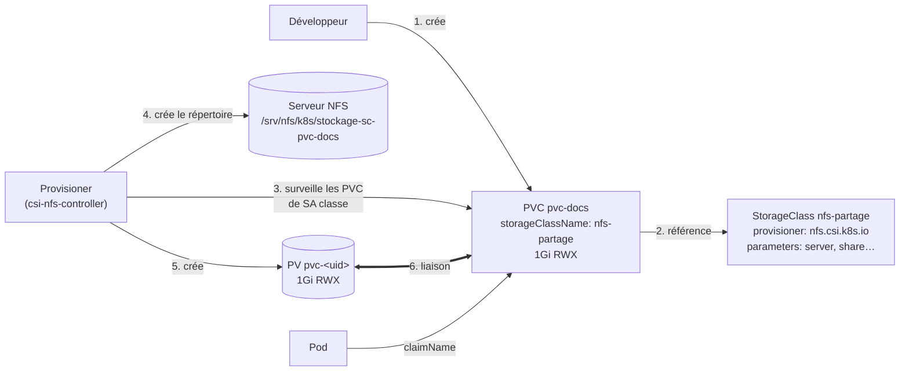

# Lab : StorageClass et provisionnement dynamique

## Objectifs

- comprendre le **provisionnement dynamique** : la PVC déclenche la **création automatique** du PV ;
- installer deux provisioners : `local-path` (disque local) et le driver **CSI NFS** (stockage réseau) ;
- maîtriser les paramètres d'une StorageClass : `provisioner`, `parameters`, `reclaimPolicy`, `volumeBindingMode`,
  `allowVolumeExpansion`, `mountOptions` ;
- comprendre `WaitForFirstConsumer` vs `Immediate` ;
- gérer la **StorageClass par défaut** et la différence entre `storageClassName` absent et `""` ;
- **agrandir** un volume à chaud ;
- utiliser `ReadWriteOncePod` ;
- utiliser les `volumeClaimTemplates` d'un **StatefulSet** ;
- dépanner une PVC dynamique bloquée en `Pending`.

### Contexte métier

Au lab 05_02, chaque demande de stockage passait par un **ticket** à l'équipe stockage, qui créait le PV à la main.
Avec 40 équipes de dev, ce n'est plus tenable. L'équipe plateforme met en place un **catalogue de stockage en
libre-service** :

| Classe (StorageClass) | Backend                       | Caractéristiques                                    | Pour qui ?                            |
|-----------------------|-------------------------------|-----------------------------------------------------|---------------------------------------|
| `local-path`          | disque local des workers      | rapide, `RWO`, lié à un nœud ; **classe par défaut** | caches, bases répliquées (`cache-sessions`) |
| `nfs-partage`         | serveur NFS (driver CSI)      | `RWX`, **agrandissable**, supprimé avec la PVC      | fichiers partagés (`editique`)        |
| `nfs-archives`        | serveur NFS (driver CSI)      | `RWX`, **conservé** après suppression (`Retain`)    | archives réglementaires               |

Le développeur écrit seulement : « je veux 1Gi de classe `nfs-partage` ». Le reste est automatique.

### Vue d'ensemble



> **À retenir :** une StorageClass est un **modèle** (« comment créer un volume de ce type ») ; le **provisioner** est
> le programme qui exécute ce modèle. Kubernetes lui-même ne sait créer aucun stockage : sans provisioner installé, une
> StorageClass ne fait rien.

### Récapitulatif du module

| Lab        | Qui crée le volume ?                         | Durée de vie                  |
|------------|----------------------------------------------|-------------------------------|
| 05_01      | kubelet (`emptyDir`)                         | celle du Pod                  |
| 05_02      | l'administrateur (PV statique)               | indépendante du Pod           |
| **05_03**  | un **provisioner**, à la demande (StorageClass) | indépendante, gérée par `reclaimPolicy` |

## Étape 0 : préparer l'environnement

```bash
ssh k8s-master-01
kubectl create namespace stockage-sc
kubectl config set-context --current --namespace=stockage-sc

kubectl get storageclass
# No resources found       <- point de départ : aucune classe, aucun provisioner
```

Le serveur NFS installé au lab 05_02 doit être actif :

```bash
showmount -e 10.10.10.11
# Export list for 10.10.10.11:
# /srv/nfs/k8s 10.10.10.0/24
```

> Si ce n'est pas le cas, refaites la section « Préparer un serveur NFS » de l'étape 0 du lab 05_02.


# Partie 1 : un premier provisioner, `local-path`

## Étape 1 : installer local-path-provisioner

[local-path-provisioner](https://github.com/rancher/local-path-provisioner) (Rancher) crée des volumes dans un
répertoire du nœud (`/opt/local-path-provisioner`). C'est le provisioner par défaut de k3s et de kind.

```bash
kubectl apply -f https://raw.githubusercontent.com/rancher/local-path-provisioner/v0.0.37/deploy/local-path-storage.yaml
kubectl -n local-path-storage rollout status deployment/local-path-provisioner

kubectl get storageclass
# NAME         PROVISIONER             RECLAIMPOLICY   VOLUMEBINDINGMODE      ALLOWVOLUMEEXPANSION   AGE
# local-path   rancher.io/local-path   Delete          WaitForFirstConsumer   false                  10s
```

Le manifeste a créé deux choses distinctes :

```bash
kubectl -n local-path-storage get deployment     # le PROVISIONER (le programme qui crée les volumes)
kubectl get storageclass local-path -o yaml      # la STORAGECLASS (le modèle)
```

```yaml
apiVersion: storage.k8s.io/v1
kind: StorageClass
metadata:
  name: local-path
provisioner: rancher.io/local-path           # QUI crée les volumes (nom annoncé par le provisioner)
reclaimPolicy: Delete                        # que faire du PV quand la PVC est supprimée
volumeBindingMode: WaitForFirstConsumer      # QUAND créer le volume
```

Les paramètres d'une StorageClass :

| Champ                   | Signification                                                                           | Défaut         |
|-------------------------|-----------------------------------------------------------------------------------------|----------------|
| `provisioner`           | nom du provisioner chargé de créer les PV (`nfs.csi.k8s.io`, `ebs.csi.aws.com`…)       | obligatoire    |
| `parameters`            | paramètres **propres au provisioner** (serveur NFS, type de disque, IOPS…), libres      | aucun          |
| `reclaimPolicy`         | politique copiée dans chaque PV créé : `Delete` ou `Retain`                             | `Delete`       |
| `volumeBindingMode`     | `Immediate` : créer dès la PVC ; `WaitForFirstConsumer` : attendre un Pod               | `Immediate`    |
| `allowVolumeExpansion`  | autoriser l'agrandissement des PVC (si le provisioner le supporte)                      | `false`        |
| `mountOptions`          | options de montage copiées dans chaque PV                                               | aucune         |
| `allowedTopologies`     | restreindre les zones/nœuds où créer les volumes                                        | aucune         |
| annotation `storageclass.kubernetes.io/is-default-class: "true"` | classe **par défaut**                         | –              |

> Une StorageClass est **immuable** (sauf ses annotations/labels) : pour changer un paramètre, il faut la supprimer et
> la recréer. Les PV déjà créés ne sont pas affectés.

## Étape 2 : une PVC qui attend son consommateur

```bash
cat <<'EOF' | kubectl apply -f -
apiVersion: v1
kind: PersistentVolumeClaim
metadata:
  name: pvc-cache
spec:
  storageClassName: local-path
  accessModes: [ReadWriteOnce]
  resources:
    requests:
      storage: 1Gi
EOF
sleep 3
kubectl get pvc pvc-cache
# STATUS  Pending
kubectl describe pvc pvc-cache | tail -2
# Normal  WaitForFirstConsumer  persistentvolume-controller  waiting for first consumer to be created before binding
kubectl get pv
# No resources found      <- aucun volume créé pour l'instant
```

> `Pending` n'est **pas** une erreur ici. Avec `WaitForFirstConsumer`, le volume n'est créé que lorsqu'un Pod utilise la
> PVC. Pourquoi ? Un disque local (ou un disque cloud dans une zone) doit être créé **là où le Pod va tourner**. Si on
> le créait tout de suite, sur un nœud au hasard, le Pod pourrait ensuite être impossible à planifier (CPU insuffisant,
> taint…). Le scheduler choisit d'abord le nœud, **puis** le volume est créé sur ce nœud.

## Étape 3 : le Pod déclenche le provisionnement

```bash
cat <<'EOF' | kubectl apply -f -
apiVersion: v1
kind: Pod
metadata:
  name: cache
spec:
  terminationGracePeriodSeconds: 2
  containers:
  - name: app
    image: busybox:1.37
    command: ["sh", "-c", "echo 'session client 4242' > /cache/s.txt; sleep infinity"]
    volumeMounts:
    - {name: donnees, mountPath: /cache}
  volumes:
  - name: donnees
    persistentVolumeClaim:
      claimName: pvc-cache
EOF
kubectl wait --for=condition=Ready pod/cache --timeout=120s

kubectl get pvc pvc-cache
# STATUS  Bound   VOLUME  pvc-89a3ca3b-...     <- PV créé automatiquement, nommé pvc-<uid de la PVC>
kubectl get events --sort-by=.lastTimestamp | grep pvc-cache
# Normal  WaitForFirstConsumer   waiting for first consumer to be created before binding
# Normal  ExternalProvisioning   Waiting for a volume to be created either by the external provisioner 'rancher.io/local-path' ...
# Normal  Provisioning           External provisioner is provisioning volume for claim "stockage-sc/pvc-cache"
# Normal  ProvisioningSucceeded  Successfully provisioned volume pvc-89a3ca3b-...
```

> Le premier provisionnement peut prendre quelques dizaines de secondes : local-path lance un Pod « helper » sur le nœud
> pour créer le répertoire (`kubectl -n local-path-storage get pods`).

Examinons le PV créé :

```bash
PV=$(kubectl get pvc pvc-cache -o jsonpath='{.spec.volumeName}')
kubectl get pv $PV -o yaml | sed -n '/^spec:/,/^status:/p'
```

```yaml
spec:
  accessModes: [ReadWriteOnce]
  capacity:
    storage: 1Gi
  claimRef:                         # déjà lié à notre PVC
    name: pvc-cache
    namespace: stockage-sc
  hostPath:
    path: /opt/local-path-provisioner/pvc-89a3..._stockage-sc_pvc-cache
    type: DirectoryOrCreate
  nodeAffinity:                     # ajoutée par le provisioner : le volume est lié au nœud choisi
    required:
      nodeSelectorTerms:
      - matchExpressions:
        - key: kubernetes.io/hostname
          operator: In
          values: [k8s-worker-01]
  persistentVolumeReclaimPolicy: Delete   # copiée depuis la StorageClass
  storageClassName: local-path
```

```bash
kubectl get pvc pvc-cache -o jsonpath='{.metadata.annotations.volume\.kubernetes\.io/selected-node}{"\n"}'
# k8s-worker-01      <- le nœud choisi par le scheduler, transmis au provisioner

NODE=$(kubectl get pod cache -o jsonpath='{.spec.nodeName}')
ssh $NODE 'sudo ls -R /opt/local-path-provisioner'
# /opt/local-path-provisioner/pvc-89a3..._stockage-sc_pvc-cache:
# s.txt
```

> C'est exactement le PV `hostPath` + `nodeAffinity` que l'on écrivait à la main au lab 05_02… généré automatiquement.

## Étape 4 : `reclaimPolicy: Delete`, tout est nettoyé

```bash
kubectl delete pod cache
kubectl delete pvc pvc-cache
sleep 10
kubectl get pv $PV
# Error from server (NotFound)    <- le PV a été supprimé…
ssh $NODE 'sudo ls /opt/local-path-provisioner'
#                                  <- …et le répertoire (les données) aussi
```

> **Attention en production :** avec `Delete`, supprimer une PVC (ou un namespace !) **détruit les données**. Pour les
> données importantes : une classe `Retain`, ou passer le PV en `Retain` avant de supprimer la PVC
> (`kubectl patch pv ... -p '{"spec":{"persistentVolumeReclaimPolicy":"Retain"}}'`).


# Partie 2 : la StorageClass par défaut

## Étape 5 : une PVC sans `storageClassName`

La plupart des charts Helm et des manifestes du marché ne précisent **pas** de classe : ils comptent sur la classe par
défaut du cluster.

```bash
cat <<'EOF' | kubectl apply -f -
apiVersion: v1
kind: PersistentVolumeClaim
metadata:
  name: pvc-sans-classe
spec:                                  # pas de storageClassName
  accessModes: [ReadWriteOnce]
  resources:
    requests:
      storage: 1Gi
EOF
sleep 3
kubectl get pvc pvc-sans-classe
# STATUS  Pending   STORAGECLASS  <vide>
kubectl describe pvc pvc-sans-classe | tail -1
# Normal  FailedBinding  no persistent volumes available for this claim and no storage class is set
```

Aucune classe par défaut : la PVC attend un PV statique **sans classe**, qui n'existe pas.

## Étape 6 : déclarer `local-path` comme classe par défaut

```bash
kubectl patch storageclass local-path \
  -p '{"metadata":{"annotations":{"storageclass.kubernetes.io/is-default-class":"true"}}}'

kubectl get storageclass
# NAME                   PROVISIONER             RECLAIMPOLICY   VOLUMEBINDINGMODE      ...
# local-path (default)   rancher.io/local-path   Delete          WaitForFirstConsumer

kubectl wait --for=jsonpath='{.spec.storageClassName}'=local-path pvc/pvc-sans-classe --timeout=60s
kubectl get pvc pvc-sans-classe
# STATUS  Pending   STORAGECLASS  local-path      <- classe attribuée APRÈS COUP (rétroactivement)
```

> Depuis Kubernetes 1.28, les PVC `Pending` **sans** `storageClassName` reçoivent **rétroactivement** la classe par défaut
> quand elle apparaît (le contrôleur repasse périodiquement : comptez jusqu'à ~15 s). Elle est maintenant en
> `WaitForFirstConsumer` (normal).

Comparons avec `storageClassName: ""` :

```bash
cat <<'EOF' | kubectl apply -f -
apiVersion: v1
kind: PersistentVolumeClaim
metadata:
  name: pvc-classe-vide
spec:
  storageClassName: ""                 # chaîne VIDE explicite
  accessModes: [ReadWriteOnce]
  resources:
    requests:
      storage: 1Gi
---
apiVersion: v1
kind: PersistentVolumeClaim
metadata:
  name: pvc-defaut
spec:
  accessModes: [ReadWriteOnce]
  resources:
    requests:
      storage: 1Gi
EOF
kubectl get pvc pvc-classe-vide pvc-defaut -o custom-columns=NAME:.metadata.name,CLASS:.spec.storageClassName,STATUS:.status.phase
# NAME              CLASS        STATUS
# pvc-classe-vide   <none>       Pending   <- pas de classe : provisionnement dynamique DÉSACTIVÉ
# pvc-defaut        local-path   Pending   <- la classe par défaut a été injectée à la création
```

| `storageClassName` dans la PVC | Comportement                                                                       |
|--------------------------------|------------------------------------------------------------------------------------|
| `"local-path"`                 | provisionnement par **cette** classe                                               |
| **absent**                     | la classe **par défaut** est injectée (par l'admission controller `DefaultStorageClass`) ; s'il n'y en a pas, liaison à un PV statique sans classe |
| `""` (vide)                    | **jamais** de provisionnement dynamique : uniquement un PV statique sans classe    |

> Il ne doit y avoir **qu'une** classe par défaut. S'il y en a plusieurs, Kubernetes prend la plus récente : source de
> surprises. Vérifiez toujours avec `kubectl get sc`.

```bash
kubectl delete pvc pvc-sans-classe pvc-classe-vide pvc-defaut
```


# Partie 3 : un driver CSI, stockage NFS dynamique

## Étape 7 : installer le driver CSI NFS

**CSI** (*Container Storage Interface*) est le standard pour brancher un système de stockage à Kubernetes : chaque
fournisseur (AWS EBS, Azure Disk, Ceph, NetApp, vSphere, NFS…) publie son **driver CSI**. Il se compose de :

- un **controller** (Deployment) : crée/supprime/agrandit les volumes (avec des sidecars `csi-provisioner`, `csi-resizer`…) ;
- un **node plugin** (DaemonSet, un Pod par nœud) : monte les volumes sur le nœud pour kubelet.

```bash
helm repo add csi-driver-nfs https://raw.githubusercontent.com/kubernetes-csi/csi-driver-nfs/master/charts
helm repo update
helm install csi-driver-nfs csi-driver-nfs/csi-driver-nfs \
  --namespace kube-system --version 4.13.6 --wait --timeout 10m

kubectl get csidrivers
# NAME             ATTACHREQUIRED   PODINFOONMOUNT   ...   MODES
# nfs.csi.k8s.io   false            false                  Persistent
kubectl -n kube-system get pods -l app.kubernetes.io/instance=csi-driver-nfs -o wide
# csi-nfs-controller-xxxx   5/5   Running   ...   (le controller)
# csi-nfs-node-xxxxx        3/3   Running   ...   (un par nœud : 5 au total)
```

> Le téléchargement des images peut être long (plusieurs minutes) au premier déploiement.

## Étape 8 : la classe `nfs-partage`

```bash
cat <<'EOF' | kubectl apply -f -
apiVersion: storage.k8s.io/v1
kind: StorageClass
metadata:
  name: nfs-partage
provisioner: nfs.csi.k8s.io
parameters:                                         # propres au driver NFS (voir sa documentation)
  server: 10.10.10.11
  share: /srv/nfs/k8s
  subDir: ${pvc.metadata.namespace}-${pvc.metadata.name}   # nom lisible du répertoire créé
reclaimPolicy: Delete
volumeBindingMode: Immediate                        # un volume réseau est accessible de partout : inutile d'attendre
allowVolumeExpansion: true
mountOptions:
- nfsvers=4.2
- hard
EOF
kubectl get storageclass
# local-path (default)   rancher.io/local-path   Delete   WaitForFirstConsumer   false
# nfs-partage            nfs.csi.k8s.io          Delete   Immediate              true
```

## Étape 9 : une PVC `ReadWriteMany` en libre-service

```bash
cat <<'EOF' | kubectl apply -f -
apiVersion: v1
kind: PersistentVolumeClaim
metadata:
  name: pvc-docs
spec:
  storageClassName: nfs-partage
  accessModes: [ReadWriteMany]
  resources:
    requests:
      storage: 1Gi
EOF
sleep 5
kubectl get pvc pvc-docs
# STATUS  Bound   VOLUME pvc-47ee...   1Gi   RWX   nfs-partage    <- Immediate : Bound SANS Pod

ls -l /srv/nfs/k8s/
# drwxr-xr-x 2 root root 4096 ... stockage-sc-pvc-docs       <- répertoire créé par le driver

kubectl get pv $(kubectl get pvc pvc-docs -o jsonpath='{.spec.volumeName}') -o jsonpath='{.spec.csi}{"\n"}'
# {"driver":"nfs.csi.k8s.io","volumeAttributes":{...,"server":"10.10.10.11","share":"/srv/nfs/k8s",
#  "subDir":"stockage-sc-pvc-docs"},"volumeHandle":"10.10.10.11#srv/nfs/k8s#stockage-sc-pvc-docs#..."}
```

Deux Pods, sur deux nœuds, utilisent la même PVC :

```bash
cat <<'EOF' | kubectl apply -f -
apiVersion: apps/v1
kind: Deployment
metadata:
  name: editique
spec:
  replicas: 2
  selector:
    matchLabels: {app: editique}
  template:
    metadata:
      labels: {app: editique}
    spec:
      terminationGracePeriodSeconds: 2
      affinity:
        podAntiAffinity:
          requiredDuringSchedulingIgnoredDuringExecution:
          - topologyKey: kubernetes.io/hostname
            labelSelector:
              matchLabels: {app: editique}
      containers:
      - name: app
        image: busybox:1.37
        command: ["sh", "-c", "while true; do echo \"$(date +%T) $HOSTNAME\" >> /docs/journal.txt; sleep 3; done"]
        volumeMounts:
        - {name: docs, mountPath: /docs}
      volumes:
      - name: docs
        persistentVolumeClaim:
          claimName: pvc-docs
EOF
kubectl rollout status deployment/editique
sleep 6
kubectl exec deploy/editique -- tail -4 /docs/journal.txt
# deux noms de Pods différents (un par worker) dans le même fichier
```

## Étape 10 : agrandir un volume à chaud

L'éditique manque de place : on passe de 1Gi à 3Gi, **sans** arrêter l'application.

```bash
kubectl patch pvc pvc-docs -p '{"spec":{"resources":{"requests":{"storage":"3Gi"}}}}'
sleep 5
kubectl get pvc pvc-docs
# CAPACITY  3Gi
kubectl get pv $(kubectl get pvc pvc-docs -o jsonpath='{.spec.volumeName}') -o jsonpath='{.spec.capacity.storage}{"\n"}'
# 3Gi
kubectl get pods -l app=editique
# toujours Running, RESTARTS 0
```

On ne peut **pas** réduire :

```bash
kubectl patch pvc pvc-docs -p '{"spec":{"resources":{"requests":{"storage":"2Gi"}}}}'
# The PersistentVolumeClaim "pvc-docs" is invalid: spec.resources.requests.storage: Forbidden:
#   field can not be less than status.capacity
```

Et on ne peut pas agrandir si la classe ne l'autorise pas (`local-path` : `allowVolumeExpansion: false`) :

```bash
cat <<'EOF' | kubectl apply -f -
apiVersion: v1
kind: PersistentVolumeClaim
metadata:
  name: pvc-fixe
spec:
  storageClassName: local-path
  accessModes: [ReadWriteOnce]
  resources:
    requests:
      storage: 1Gi
---
apiVersion: v1
kind: Pod
metadata:
  name: fixe
spec:
  terminationGracePeriodSeconds: 2
  containers:
  - name: app
    image: busybox:1.37
    command: ["sleep", "infinity"]
    volumeMounts:
    - {name: d, mountPath: /data}
  volumes:
  - name: d
    persistentVolumeClaim:
      claimName: pvc-fixe
EOF
kubectl wait --for=condition=Ready pod/fixe --timeout=120s     # la PVC doit être Bound pour tenter l'expansion
kubectl patch pvc pvc-fixe -p '{"spec":{"resources":{"requests":{"storage":"2Gi"}}}}'
# Error from server (Forbidden): persistentvolumeclaims "pvc-fixe" is forbidden: only dynamically provisioned pvc
#   can be resized and the storageclass that provisions the pvc must support resize
kubectl delete pod fixe
kubectl delete pvc pvc-fixe
```

> Pour un driver de **disque bloc** (EBS, Ceph RBD…), l'agrandissement se fait en deux temps : le controller agrandit le
> disque, puis kubelet agrandit le **système de fichiers** au (re)montage. Suivez-le avec les `conditions` de la PVC
> (`FileSystemResizePending`).

## Étape 11 : `ReadWriteOncePod`, un seul Pod dans tout le cluster

Cas réel : un batch de calcul des intérêts ne doit **jamais** tourner en deux exemplaires sur les mêmes fichiers.
`ReadWriteOncePod` (volumes **CSI** uniquement) est le seul mode d'accès réellement **appliqué** par le scheduler.

```bash
cat <<'EOF' | kubectl apply -f -
apiVersion: v1
kind: PersistentVolumeClaim
metadata:
  name: pvc-interets
spec:
  storageClassName: nfs-partage
  accessModes: [ReadWriteOncePod]
  resources:
    requests:
      storage: 100Mi
EOF
for i in 1 2; do
cat <<EOF | kubectl apply -f -
apiVersion: v1
kind: Pod
metadata:
  name: batch-interets-$i
spec:
  terminationGracePeriodSeconds: 2
  containers:
  - name: batch
    image: busybox:1.37
    command: ["sleep", "infinity"]
    volumeMounts:
    - {name: donnees, mountPath: /donnees}
  volumes:
  - name: donnees
    persistentVolumeClaim:
      claimName: pvc-interets
EOF
sleep 5
done

kubectl get pods -l '!app' -o wide
# batch-interets-1   1/1   Running   ...
# batch-interets-2   0/1   Pending   ...
kubectl describe pod batch-interets-2 | grep FailedScheduling
# 0/5 nodes are available: 2 node(s) unavailable due to PersistentVolumeClaim with ReadWriteOncePod access mode
#   already in-use by another pod, 3 node(s) had untolerated taint(s).

kubectl delete pod batch-interets-1 batch-interets-2
kubectl delete pvc pvc-interets
```

## Étape 12 : la classe `nfs-archives`, `reclaimPolicy: Retain`

```bash
cat <<'EOF' | kubectl apply -f -
apiVersion: storage.k8s.io/v1
kind: StorageClass
metadata:
  name: nfs-archives
provisioner: nfs.csi.k8s.io
parameters:
  server: 10.10.10.11
  share: /srv/nfs/k8s
reclaimPolicy: Retain                    # les PV créés par cette classe ne sont JAMAIS supprimés automatiquement
volumeBindingMode: Immediate
---
apiVersion: v1
kind: PersistentVolumeClaim
metadata:
  name: pvc-archives-2016
spec:
  storageClassName: nfs-archives
  accessModes: [ReadWriteMany]
  resources:
    requests:
      storage: 100Mi
EOF
sleep 5
PV_ARCH=$(kubectl get pvc pvc-archives-2016 -o jsonpath='{.spec.volumeName}')
kubectl get pv $PV_ARCH
# RECLAIM POLICY  Retain    STATUS  Bound

kubectl delete pvc pvc-archives-2016
sleep 5
kubectl get pv $PV_ARCH
# STATUS  Released          <- le PV reste…
ls /srv/nfs/k8s/
# pvc-97396022-...   stockage-sc-pvc-docs      <- …et le répertoire aussi (pas de subDir : nommé d'après le PV)
```

> Les PV `Released` d'une classe `Retain` s'accumulent : c'est à l'équipe stockage de les archiver puis de les supprimer
> (`kubectl delete pv` ne supprime **pas** les données d'un PV `Retain` : il faut aussi nettoyer le backend).


# Partie 4 : StatefulSet et `volumeClaimTemplates`

## Étape 13 : un volume par réplica

Un Deployment partage **une** PVC entre tous ses Pods. Une base de données répliquée a besoin d'**un volume par
réplica**, qui suit toujours le même Pod : c'est le rôle des `volumeClaimTemplates` d'un StatefulSet.

```bash
cat <<'EOF' | kubectl apply -f -
apiVersion: v1
kind: Service
metadata:
  name: cache-sessions
spec:
  clusterIP: None
  selector: {app: cache-sessions}
  ports:
  - port: 6379
---
apiVersion: apps/v1
kind: StatefulSet
metadata:
  name: cache-sessions
spec:
  serviceName: cache-sessions
  replicas: 2
  selector:
    matchLabels: {app: cache-sessions}
  persistentVolumeClaimRetentionPolicy:
    whenScaled: Retain                   # garder les PVC des réplicas supprimés par un scale down
    whenDeleted: Retain                  # garder les PVC si le StatefulSet est supprimé
  template:
    metadata:
      labels: {app: cache-sessions}
    spec:
      terminationGracePeriodSeconds: 2
      containers:
      - name: app
        image: busybox:1.37
        command: ["sh", "-c", "echo \"$(date +%T) demarrage de $HOSTNAME\" >> /data/identite.txt; sleep infinity"]
        volumeMounts:
        - {name: donnees, mountPath: /data}
  volumeClaimTemplates:                  # un MODÈLE de PVC : une PVC est créée par réplica
  - metadata:
      name: donnees
    spec:
      accessModes: [ReadWriteOnce]       # pas de storageClassName -> classe par défaut (local-path)
      resources:
        requests:
          storage: 500Mi
EOF
kubectl rollout status statefulset/cache-sessions --timeout=180s

kubectl get pvc -l app=cache-sessions
# NAME                       STATUS   VOLUME        CAPACITY   STORAGECLASS
# donnees-cache-sessions-0   Bound    pvc-0c5b...   500Mi      local-path
# donnees-cache-sessions-1   Bound    pvc-8cfd...   500Mi      local-path
#   -> nom = <nom du template>-<nom du Pod>
kubectl get pods -l app=cache-sessions -o wide
```

Le Pod `cache-sessions-0` est recréé : il retrouve **sa** PVC (et, avec local-path, **son** nœud).

```bash
kubectl delete pod cache-sessions-0
sleep 3
kubectl wait --for=condition=Ready pod/cache-sessions-0 --timeout=60s
kubectl exec cache-sessions-0 -- cat /data/identite.txt
# 10:40:02 demarrage de cache-sessions-0
# 10:40:10 demarrage de cache-sessions-0     <- même volume, même identité

kubectl scale statefulset cache-sessions --replicas=1
sleep 5
kubectl get pvc -l app=cache-sessions
# donnees-cache-sessions-1 est TOUJOURS là (whenScaled: Retain) : un futur scale up la réutilisera
```


# Partie 5 : dépannage, « ma PVC dynamique reste en Pending »

## Étape 14 : deux demandes livrées par les équipes de dev

```bash
cat <<'EOF' | kubectl apply -f -
apiVersion: v1
kind: PersistentVolumeClaim
metadata:
  name: pvc-reporting
spec:
  storageClassName: local-paht
  accessModes: [ReadWriteOnce]
  resources:
    requests:
      storage: 1Gi
---
apiVersion: v1
kind: PersistentVolumeClaim
metadata:
  name: pvc-exports
spec:
  storageClassName: local-path
  accessModes: [ReadWriteMany]
  resources:
    requests:
      storage: 1Gi
---
apiVersion: v1
kind: Pod
metadata:
  name: exports
spec:
  terminationGracePeriodSeconds: 2
  containers:
  - name: app
    image: busybox:1.37
    command: ["sleep", "infinity"]
    volumeMounts:
    - {name: donnees, mountPath: /exports}
  volumes:
  - name: donnees
    persistentVolumeClaim:
      claimName: pvc-exports
EOF
sleep 10
kubectl get pvc pvc-reporting pvc-exports
# les deux sont Pending
```

**À vous :** expliquez pourquoi chacune des deux PVC reste `Pending`, puis corrigez-les (l'export doit être partagé
entre plusieurs Pods de plusieurs nœuds).

<details><summary>Méthode et solution</summary>

Pour une PVC dynamique, regardez **les événements de la PVC** : ils viennent du contrôleur **et du provisioner**.

```bash
kubectl describe pvc pvc-reporting | grep -A5 Events
# Warning  ProvisioningFailed  persistentvolume-controller  storageclass.storage.k8s.io "local-paht" not found
#   -> faute de frappe dans le nom de la classe

kubectl describe pvc pvc-exports | grep -A5 Events
# Warning  ProvisioningFailed  rancher.io/local-path_local-path-provisioner-...  failed to provision volume with
#   StorageClass "local-path": NodePath only supports ReadWriteOnce and ReadWriteOncePod (1.22+) access modes
#   -> le provisioner refuse : un disque local ne peut pas être partagé entre nœuds
```

Correction (la spec d'une PVC est immuable : on supprime et on recrée) :

```bash
kubectl delete pod exports --grace-period=1
kubectl delete pvc pvc-reporting pvc-exports
cat <<'EOF' | kubectl apply -f -
apiVersion: v1
kind: PersistentVolumeClaim
metadata:
  name: pvc-reporting
spec:
  storageClassName: local-path
  accessModes: [ReadWriteOnce]
  resources:
    requests:
      storage: 1Gi
---
apiVersion: v1
kind: PersistentVolumeClaim
metadata:
  name: pvc-exports
spec:
  storageClassName: nfs-partage           # RWX -> la classe NFS
  accessModes: [ReadWriteMany]
  resources:
    requests:
      storage: 1Gi
EOF
sleep 5
kubectl get pvc pvc-reporting pvc-exports
# pvc-reporting   Pending (WaitForFirstConsumer : normal, en attente d'un Pod)
# pvc-exports     Bound
```

Les causes d'une PVC dynamique `Pending` :

| Symptôme (événements de la PVC)                              | Cause                                                   |
|--------------------------------------------------------------|---------------------------------------------------------|
| `WaitForFirstConsumer`                                       | **normal** : aucun Pod n'utilise encore la PVC          |
| `storageclass ... not found`                                 | nom de classe erroné                                    |
| `no persistent volumes available ... no storage class is set` | pas de classe et pas de classe par défaut               |
| `Waiting for a volume to be created ... by the external provisioner` (seul, répété) | provisioner absent/arrêté : vérifier ses Pods et ses logs |
| `ProvisioningFailed` venant du provisioner                   | paramètres refusés (mode d'accès, taille, serveur injoignable…) |
</details>


# Partie 6 : exercices d'évaluation

**Exercice 1 :** créez une StorageClass `rapide-retain` utilisant le provisioner `rancher.io/local-path`, avec
`reclaimPolicy: Retain` et `volumeBindingMode: WaitForFirstConsumer`. Créez une PVC `pvc-ex1` (200Mi) de cette classe et
un Pod `ex1` qui la monte. Supprimez le Pod puis la PVC : vérifiez que le PV est `Released`.

**Exercice 2 :** faites de `nfs-partage` la classe par défaut **à la place** de `local-path`.

**Exercice 3 :** affichez, pour toutes les PVC du namespace, leur nom, leur classe, la taille demandée et la taille réelle.

**Exercice 4 :** trouvez quel provisioner a créé le PV de la PVC `pvc-docs`, sans regarder la StorageClass.

<details><summary><b>Solutions</b></summary>

**1.**
```bash
cat <<'EOF' | kubectl apply -f -
apiVersion: storage.k8s.io/v1
kind: StorageClass
metadata:
  name: rapide-retain
provisioner: rancher.io/local-path
reclaimPolicy: Retain
volumeBindingMode: WaitForFirstConsumer
---
apiVersion: v1
kind: PersistentVolumeClaim
metadata:
  name: pvc-ex1
spec:
  storageClassName: rapide-retain
  accessModes: [ReadWriteOnce]
  resources:
    requests:
      storage: 200Mi
---
apiVersion: v1
kind: Pod
metadata:
  name: ex1
spec:
  terminationGracePeriodSeconds: 2
  containers:
  - name: app
    image: busybox:1.37
    command: ["sleep", "infinity"]
    volumeMounts:
    - {name: d, mountPath: /data}
  volumes:
  - name: d
    persistentVolumeClaim:
      claimName: pvc-ex1
EOF
kubectl wait --for=condition=Ready pod/ex1 --timeout=120s
PV_EX1=$(kubectl get pvc pvc-ex1 -o jsonpath='{.spec.volumeName}')
kubectl delete pod ex1
kubectl delete pvc pvc-ex1
sleep 5
kubectl get pv $PV_EX1          # RECLAIM POLICY Retain, STATUS Released
```

**2.**
```bash
kubectl patch storageclass local-path \
  -p '{"metadata":{"annotations":{"storageclass.kubernetes.io/is-default-class":"false"}}}'
kubectl patch storageclass nfs-partage \
  -p '{"metadata":{"annotations":{"storageclass.kubernetes.io/is-default-class":"true"}}}'
kubectl get storageclass         # (default) sur nfs-partage uniquement
```
Toujours **retirer** l'ancienne classe par défaut, pour n'en garder qu'une.

**3.**
```bash
kubectl get pvc -o custom-columns=NAME:.metadata.name,CLASS:.spec.storageClassName,DEMANDE:.spec.resources.requests.storage,REEL:.status.capacity.storage
```

**4.**
```bash
kubectl get pvc pvc-docs -o jsonpath='{.metadata.annotations.volume\.kubernetes\.io/storage-provisioner}{"\n"}'
# nfs.csi.k8s.io
kubectl get pv $(kubectl get pvc pvc-docs -o jsonpath='{.spec.volumeName}') -o jsonpath='{.spec.csi.driver}{"\n"}'
# nfs.csi.k8s.io
```
</details>


## Nettoyage

```bash
kubectl delete namespace stockage-sc
kubectl get pv                                   # les PV Retain (Released) restent : à supprimer à la main
kubectl get pv -o jsonpath='{range .items[?(@.spec.persistentVolumeReclaimPolicy=="Retain")]}{.metadata.name}{"\n"}{end}' | xargs -r kubectl delete pv
kubectl delete storageclass nfs-partage nfs-archives rapide-retain --ignore-not-found
kubectl config set-context --current --namespace=default
sudo rm -rf /srv/nfs/k8s/*
for n in k8s-worker-01 k8s-worker-02; do ssh $n 'sudo rm -rf /opt/local-path-provisioner/*'; done
```

Pour remettre le cluster dans son état initial (facultatif) :

```bash
helm -n kube-system uninstall csi-driver-nfs
kubectl delete -f https://raw.githubusercontent.com/rancher/local-path-provisioner/v0.0.37/deploy/local-path-storage.yaml
```

## Questions de compréhension

1. Une PVC de classe `local-path` reste `Pending` avec l'événement `WaitForFirstConsumer`. Est-ce un problème ?
2. Pourquoi utilise-t-on `WaitForFirstConsumer` pour des disques locaux (ou des disques cloud zonaux) et `Immediate` pour NFS ?
3. Quelle est la différence entre une PVC sans `storageClassName` et une PVC avec `storageClassName: ""` ?
4. On supprime le namespace d'une application dont les PVC sont de classe `local-path`. Que deviennent les données ?
5. Peut-on réduire la taille d'une PVC ? L'agrandir ?
6. Quelle est la différence entre un Deployment de 3 réplicas avec une PVC, et un StatefulSet de 3 réplicas avec un `volumeClaimTemplate` ?

<details><summary>Réponses</summary>

1. Non : le volume sera créé quand un Pod utilisera la PVC, sur le nœud choisi par le scheduler.
2. Un disque local/zonal n'est accessible que depuis un nœud/une zone : il faut connaître le nœud du Pod avant de le
   créer. Un volume NFS est accessible de tous les nœuds : on peut le créer tout de suite.
3. Absent : la classe par défaut est utilisée (provisionnement dynamique). `""` : aucune classe, uniquement liaison à un
   PV statique sans classe.
4. Elles sont **détruites** : les PVC sont supprimées avec le namespace, et `reclaimPolicy: Delete` supprime PV et données.
5. Réduire : jamais. Agrandir : oui, si la StorageClass a `allowVolumeExpansion: true` et que le driver le supporte.
6. Le Deployment partage **une seule** PVC entre ses 3 Pods (il faut `RWX` s'ils sont sur plusieurs nœuds). Le
   StatefulSet crée **3 PVC**, une par Pod (`donnees-app-0`, `-1`, `-2`), chacune rattachée durablement à son Pod.
</details>

## Commandes

| Commande                                                                         | Utilité                                         |
|----------------------------------------------------------------------------------|-------------------------------------------------|
| `kubectl get storageclass` (`sc`)                                                | Classes, provisioner, politique, binding mode, `(default)` |
| `kubectl patch sc S -p '{"metadata":{"annotations":{"storageclass.kubernetes.io/is-default-class":"true"}}}'` | Définir la classe par défaut |
| `kubectl get csidrivers`                                                         | Drivers CSI installés                           |
| `kubectl describe pvc C`                                                         | Événements de provisionnement                   |
| `kubectl patch pvc C -p '{"spec":{"resources":{"requests":{"storage":"3Gi"}}}}'` | Agrandir un volume                              |
| `kubectl get pvc C -o jsonpath='{.spec.volumeName}'`                             | PV créé pour une PVC                            |
| `kubectl get pvc -l app=X`                                                       | PVC d'un StatefulSet                            |
| `kubectl -n local-path-storage logs deploy/local-path-provisioner`               | Logs d'un provisioner                           |
