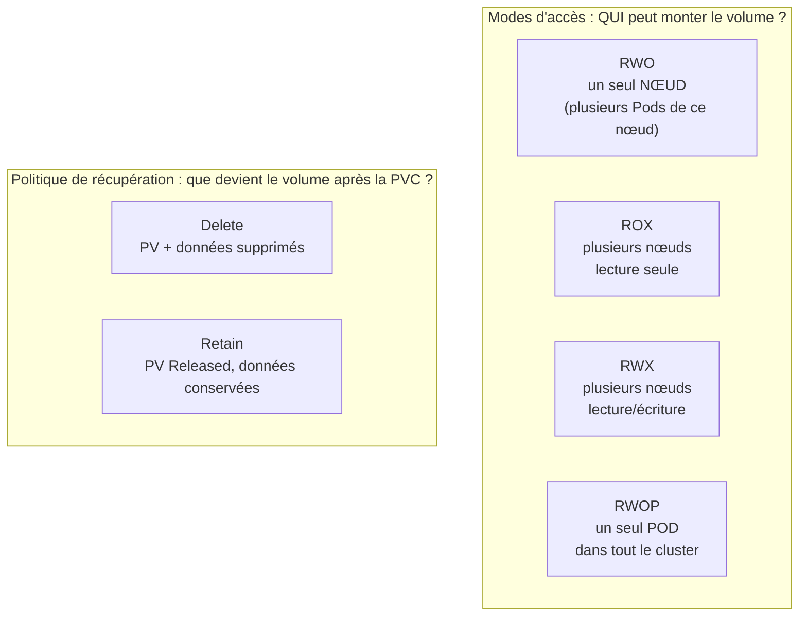

# Lab : Modes d'accès (RWO, ROX, RWX, RWOP) et politiques de récupération (Retain, Delete)

## Objectifs

- comprendre **précisément** les quatre modes d'accès : `ReadWriteOnce`, `ReadOnlyMany`, `ReadWriteMany`,
  `ReadWriteOncePod` ;
- distinguer ce qu'un mode **promet** de ce que Kubernetes **applique réellement** ;
- voir l'effet de chaque mode sur un **Deployment** : placement des réplicas, montée en charge, rolling update ;
- choisir la bonne **stratégie de Deployment** (`RollingUpdate` ou `Recreate`) selon le mode d'accès ;
- comparer `reclaimPolicy: Delete` et `Retain` sur des Deployments réels ;
- **récupérer** les données d'un volume `Retain` et **sauver** un volume `Delete` avant sa suppression.

### Contexte métier

L'équipe plateforme de la banque reçoit des questions récurrentes des équipes de dev : « pourquoi mes 3 réplicas sont
tous sur le même nœud ? », « pourquoi mon rolling update est bloqué ? », « où sont passées mes données ? ». Ce lab
reprend chacun de ces cas avec une application de la banque, **toujours déployée par un Deployment** :

| Application          | Besoin                                                    | Mode d'accès   | Politique |
|----------------------|-----------------------------------------------------------|----------------|-----------|
| `api-comptes`        | cache local rapide                                        | `RWO`          | `Delete`  |
| `editique`           | plusieurs réplicas sur plusieurs nœuds, mêmes fichiers    | `RWX`          | `Delete`  |
| `simulateur-credit`  | lit un **référentiel de taux** publié par une autre équipe | `ROX`          | `Retain`  |
| `batch-interets`     | ne doit **jamais** tourner en double                      | `RWOP`         | `Delete`  |
| `archives`           | archives réglementaires, conservation 10 ans              | `RWX`          | `Retain`  |

### Vue d'ensemble



### Les modes d'accès en un tableau

| Mode               | Abrév. | Promesse                                     | Appliqué par Kubernetes ?                                                     |
|--------------------|--------|----------------------------------------------|-------------------------------------------------------------------------------|
| `ReadWriteOnce`    | `RWO`  | lecture/écriture depuis **un seul nœud**     | **seulement** pour les disques « attachables » (disques cloud, iSCSI, Ceph RBD…) via l'erreur `Multi-Attach`. **Pas** pour NFS, hostPath, local-path |
| `ReadOnlyMany`     | `ROX`  | lecture seule depuis **plusieurs nœuds**     | **non** : le montage n'est en lecture seule que si on le demande (`readOnly: true`) |
| `ReadWriteMany`    | `RWX`  | lecture/écriture depuis **plusieurs nœuds**  | c'est une **capacité** du stockage (NFS, CephFS, Azure Files…) ; impossible sur un disque bloc |
| `ReadWriteOncePod` | `RWOP` | lecture/écriture par **un seul Pod**         | **oui**, par le scheduler (volumes **CSI** uniquement)                         |

> **À retenir :** les modes d'accès servent d'abord à la **liaison** PVC ↔ PV (la PVC ne se lie qu'à un PV qui propose
> le mode demandé) et à **décrire** les capacités du stockage. Seul `RWOP` est un vrai verrou appliqué par Kubernetes.

## Étape 0 : préparer l'environnement

```bash
ssh k8s-master-01
kubectl create namespace stockage-modes
kubectl config set-context --current --namespace=stockage-modes
```

Ce lab utilise les deux provisioners du lab 05_03 et le serveur NFS du lab 05_02. Les commandes suivantes les
installent s'ils sont absents (sans effet s'ils sont déjà là) :

```bash
showmount -e 10.10.10.11                     # /srv/nfs/k8s 10.10.10.0/24  (sinon : étape 0 du lab 05_02)

kubectl apply -f https://raw.githubusercontent.com/rancher/local-path-provisioner/v0.0.37/deploy/local-path-storage.yaml
helm repo add csi-driver-nfs https://raw.githubusercontent.com/kubernetes-csi/csi-driver-nfs/master/charts
helm -n kube-system upgrade --install csi-driver-nfs csi-driver-nfs/csi-driver-nfs --version 4.13.6 --wait --timeout 10m
kubectl -n local-path-storage rollout status deployment/local-path-provisioner
```

Deux classes NFS, identiques **sauf** leur politique de récupération :

```bash
cat <<'EOF' | kubectl apply -f -
apiVersion: storage.k8s.io/v1
kind: StorageClass
metadata:
  name: nfs-delete
provisioner: nfs.csi.k8s.io
parameters:
  server: 10.10.10.11
  share: /srv/nfs/k8s
  subDir: ${pvc.metadata.namespace}-${pvc.metadata.name}-${pv.metadata.name}
reclaimPolicy: Delete
volumeBindingMode: Immediate
---
apiVersion: storage.k8s.io/v1
kind: StorageClass
metadata:
  name: nfs-retain
provisioner: nfs.csi.k8s.io
parameters:
  server: 10.10.10.11
  share: /srv/nfs/k8s
  subDir: ${pvc.metadata.namespace}-${pvc.metadata.name}-${pv.metadata.name}
reclaimPolicy: Retain
volumeBindingMode: Immediate
EOF
kubectl get storageclass
# local-path   rancher.io/local-path   Delete   WaitForFirstConsumer
# nfs-delete   nfs.csi.k8s.io          Delete   Immediate
# nfs-retain   nfs.csi.k8s.io          Retain   Immediate
```

> Le `subDir` contient le nom du PV (unique) : deux PVC successives de même nom n'écrivent pas dans le même répertoire.
> C'est important pour la partie 2.


# Partie 1 : les modes d'accès avec des Deployments

## Étape 1 : `RWO` sur un disque local, tous les réplicas sur le même nœud

```bash
cat <<'EOF' | kubectl apply -f -
apiVersion: v1
kind: PersistentVolumeClaim
metadata:
  name: pvc-api-comptes
spec:
  storageClassName: local-path
  accessModes: [ReadWriteOnce]
  resources:
    requests:
      storage: 200Mi
---
apiVersion: apps/v1
kind: Deployment
metadata:
  name: api-comptes
spec:
  replicas: 3
  selector:
    matchLabels: {app: api-comptes}
  template:
    metadata:
      labels: {app: api-comptes}
    spec:
      terminationGracePeriodSeconds: 2
      containers:
      - name: api
        image: busybox:1.37
        command: ["sh", "-c", "echo \"$(date +%T) $HOSTNAME\" >> /cache/acces.log; sleep infinity"]
        volumeMounts:
        - {name: cache, mountPath: /cache}
      volumes:
      - name: cache
        persistentVolumeClaim:
          claimName: pvc-api-comptes
EOF
kubectl rollout status deployment/api-comptes --timeout=120s
kubectl get pods -l app=api-comptes -o wide
# les 3 Pods sont sur le MÊME nœud (ex : k8s-worker-01)
kubectl exec deploy/api-comptes -- cat /cache/acces.log
# 3 lignes, une par Pod : les 3 Pods partagent le volume
```

Explication : le **premier** Pod a déclenché la création du volume sur son nœud (`WaitForFirstConsumer`) ; le PV porte
une `nodeAffinity` vers ce nœud ; les Pods suivants sont donc **obligés** d'aller sur le même nœud.

```bash
kubectl get pv $(kubectl get pvc pvc-api-comptes -o jsonpath='{.spec.volumeName}') \
  -o jsonpath='{.spec.nodeAffinity.required.nodeSelectorTerms[0].matchExpressions[0].values}{"\n"}'
# ["k8s-worker-01"]
```

> `RWO` = **un nœud**, pas un Pod : plusieurs Pods du même nœud peuvent écrire en même temps dans le volume. Si
> l'application ne le supporte pas (fichiers de base de données…), c'est `RWOP` qu'il faut (étape 5).

L'équipe veut répartir les réplicas sur deux nœuds pour la haute disponibilité :

```bash
kubectl patch deployment api-comptes --type=merge -p '
{"spec":{"template":{"spec":{"affinity":{"podAntiAffinity":{"requiredDuringSchedulingIgnoredDuringExecution":[
 {"topologyKey":"kubernetes.io/hostname","labelSelector":{"matchLabels":{"app":"api-comptes"}}}]}}}}}}'
sleep 10
kubectl get pods -l app=api-comptes -o wide
# les 3 anciens Pods : Running (sur k8s-worker-01)
# 1 NOUVEAU Pod     : Pending   <- le rolling update est bloqué dès le premier Pod
kubectl describe pod $(kubectl get pods -l app=api-comptes --field-selector=status.phase=Pending -o name | head -1 | cut -d/ -f2) | grep FailedScheduling
# 0/5 nodes are available: 1 node(s) didn't match pod anti-affinity rules,
#   1 node(s) didn't match PersistentVolume's node affinity, 3 node(s) had untolerated taint(s).
```

> Contradiction : l'anti-affinité veut un Pod par nœud, le volume local impose un seul nœud. Un volume `RWO` local et
> plusieurs réplicas répartis sont **incompatibles** : il faut un volume `RWX` (étape 3) ou un StatefulSet (un volume
> par réplica, lab 05_03).

```bash
kubectl delete deployment api-comptes
kubectl delete pvc pvc-api-comptes
```

## Étape 2 : `RWO` sur NFS, la promesse n'est pas vérifiée

Même Deployment, 2 réplicas forcés sur 2 nœuds, mais avec un volume NFS déclaré `RWO` :

```bash
cat <<'EOF' | kubectl apply -f -
apiVersion: v1
kind: PersistentVolumeClaim
metadata:
  name: pvc-rwo-nfs
spec:
  storageClassName: nfs-delete
  accessModes: [ReadWriteOnce]
  resources:
    requests:
      storage: 100Mi
---
apiVersion: apps/v1
kind: Deployment
metadata:
  name: rwo-nfs
spec:
  replicas: 2
  selector:
    matchLabels: {app: rwo-nfs}
  template:
    metadata:
      labels: {app: rwo-nfs}
    spec:
      terminationGracePeriodSeconds: 2
      affinity:
        podAntiAffinity:
          requiredDuringSchedulingIgnoredDuringExecution:
          - topologyKey: kubernetes.io/hostname
            labelSelector:
              matchLabels: {app: rwo-nfs}
      containers:
      - name: app
        image: busybox:1.37
        command: ["sh", "-c", "echo \"$(date +%T) $HOSTNAME\" >> /data/acces.log; sleep infinity"]
        volumeMounts:
        - {name: data, mountPath: /data}
      volumes:
      - name: data
        persistentVolumeClaim:
          claimName: pvc-rwo-nfs
EOF
kubectl rollout status deployment/rwo-nfs --timeout=120s
kubectl get pods -l app=rwo-nfs -o wide
# 2 Pods Running, sur k8s-worker-01 ET k8s-worker-02
kubectl exec deploy/rwo-nfs -- cat /data/acces.log
# 2 lignes : deux NŒUDS écrivent dans un volume "ReadWriteOnce" !
```

> Kubernetes n'a **aucun** moyen d'empêcher deux nœuds de monter un partage NFS. Pour un disque **bloc** (AWS EBS, Azure
> Disk, Ceph RBD…), le disque doit être **attaché** au nœud : le 2e Pod reste en `ContainerCreating` avec l'événement
> `Multi-Attach error for volume ... Volume is already used by pod(s)`. Sur ce type de stockage, `RWO` est donc bien
> appliqué, mais par le **stockage**, pas par le scheduler.

```bash
kubectl delete deployment rwo-nfs
kubectl delete pvc pvc-rwo-nfs
```

## Étape 3 : `RWX`, plusieurs nœuds en lecture/écriture

```bash
cat <<'EOF' | kubectl apply -f -
apiVersion: v1
kind: PersistentVolumeClaim
metadata:
  name: pvc-editique
spec:
  storageClassName: nfs-delete
  accessModes: [ReadWriteMany]
  resources:
    requests:
      storage: 500Mi
---
apiVersion: apps/v1
kind: Deployment
metadata:
  name: editique
spec:
  replicas: 4
  selector:
    matchLabels: {app: editique}
  template:
    metadata:
      labels: {app: editique}
    spec:
      terminationGracePeriodSeconds: 2
      containers:
      - name: generateur
        image: busybox:1.37
        command: ["sh", "-c"]
        args:
        - while true; do echo "$(date +%T) $HOSTNAME sur $NODE" >> /partage/journal.txt; sleep 4; done
        env:
        - name: NODE
          valueFrom:
            fieldRef: {fieldPath: spec.nodeName}
        volumeMounts:
        - {name: partage, mountPath: /partage}
      volumes:
      - name: partage
        persistentVolumeClaim:
          claimName: pvc-editique
EOF
kubectl rollout status deployment/editique --timeout=120s
kubectl get pods -l app=editique -o wide
# 4 Pods répartis LIBREMENT par le scheduler sur les 2 workers
sleep 5
kubectl exec deploy/editique -- tail -4 /partage/journal.txt
```

`RWX` est le mode naturel d'un Deployment à plusieurs réplicas : **mise à l'échelle** et **rolling update** sans
aucune contrainte.

```bash
kubectl scale deployment editique --replicas=6
kubectl rollout status deployment/editique
kubectl rollout restart deployment/editique
kubectl rollout status deployment/editique
# Les deux opérations se passent sans blocage
```

Et si on demande `RWX` à un stockage qui ne sait pas le faire ?

```bash
cat <<'EOF' | kubectl apply -f -
apiVersion: v1
kind: PersistentVolumeClaim
metadata:
  name: pvc-rwx-local
spec:
  storageClassName: local-path
  accessModes: [ReadWriteMany]
  resources:
    requests:
      storage: 100Mi
---
apiVersion: apps/v1
kind: Deployment
metadata:
  name: rwx-local
spec:
  replicas: 1
  selector:
    matchLabels: {app: rwx-local}
  template:
    metadata:
      labels: {app: rwx-local}
    spec:
      containers:
      - name: app
        image: busybox:1.37
        command: ["sleep", "infinity"]
        volumeMounts:
        - {name: data, mountPath: /data}
      volumes:
      - name: data
        persistentVolumeClaim:
          claimName: pvc-rwx-local
EOF
sleep 8
kubectl get pvc pvc-rwx-local
# STATUS Pending
kubectl describe pvc pvc-rwx-local | grep ProvisioningFailed
# failed to provision volume with StorageClass "local-path": NodePath only supports ReadWriteOnce
#   and ReadWriteOncePod (1.22+) access modes
kubectl delete deployment rwx-local
kubectl delete pvc pvc-rwx-local
```

## Étape 4 : `ROX`, un référentiel partagé en lecture seule

L'équipe « Marchés » publie chaque matin un **référentiel de taux** sur le serveur NFS. Le `simulateur-credit` doit le
lire depuis tous ses réplicas, mais ne doit **jamais** pouvoir le modifier.

L'équipe Marchés (simulée ici par l'administrateur) dépose les données :

```bash
sudo mkdir -p /srv/nfs/k8s/referentiel-taux
echo "immobilier-20ans 3.45" | sudo tee /srv/nfs/k8s/referentiel-taux/taux.txt
echo "conso-5ans 5.90"       | sudo tee -a /srv/nfs/k8s/referentiel-taux/taux.txt
```

### 4a. Le piège : `ROX` seul ne protège rien

```bash
cat <<'EOF' | kubectl apply -f -
apiVersion: v1
kind: PersistentVolume
metadata:
  name: pv-referentiel-taux
spec:
  capacity: {storage: 100Mi}
  accessModes: [ReadOnlyMany]
  persistentVolumeReclaimPolicy: Retain      # données d'une autre équipe : on ne supprime jamais
  storageClassName: ""
  nfs:
    server: 10.10.10.11
    path: /srv/nfs/k8s/referentiel-taux
---
apiVersion: v1
kind: PersistentVolumeClaim
metadata:
  name: pvc-referentiel-taux
spec:
  storageClassName: ""
  volumeName: pv-referentiel-taux
  accessModes: [ReadOnlyMany]
  resources:
    requests:
      storage: 100Mi
---
apiVersion: apps/v1
kind: Deployment
metadata:
  name: simulateur-credit
spec:
  replicas: 3
  selector:
    matchLabels: {app: simulateur-credit}
  template:
    metadata:
      labels: {app: simulateur-credit}
    spec:
      terminationGracePeriodSeconds: 2
      containers:
      - name: simulateur
        image: busybox:1.37
        command: ["sleep", "infinity"]
        volumeMounts:
        - {name: taux, mountPath: /referentiel}
      volumes:
      - name: taux
        persistentVolumeClaim:
          claimName: pvc-referentiel-taux
EOF
kubectl rollout status deployment/simulateur-credit --timeout=120s
kubectl get pvc pvc-referentiel-taux
# STATUS Bound   ACCESS MODES ROX

kubectl exec deploy/simulateur-credit -- cat /referentiel/taux.txt
# immobilier-20ans 3.45
# conso-5ans 5.90

kubectl exec deploy/simulateur-credit -- sh -c 'echo "immobilier-20ans 0.01" > /referentiel/taux.txt && echo ECRITURE REUSSIE'
# ECRITURE REUSSIE        <- un bug du simulateur vient d'écraser le référentiel de toute la banque !
cat /srv/nfs/k8s/referentiel-taux/taux.txt
# immobilier-20ans 0.01
```

> `ReadOnlyMany` n'a **pas** monté le volume en lecture seule : il n'a servi qu'à la **liaison** PVC ↔ PV.

On restaure le référentiel :

```bash
printf 'immobilier-20ans 3.45\nconso-5ans 5.90\n' | sudo tee /srv/nfs/k8s/referentiel-taux/taux.txt
```

### 4b. La bonne pratique : `readOnly: true` côté Pod

```bash
kubectl patch deployment simulateur-credit --type=json -p '[
  {"op":"add","path":"/spec/template/spec/volumes/0/persistentVolumeClaim/readOnly","value":true}]'
kubectl rollout status deployment/simulateur-credit

kubectl exec deploy/simulateur-credit -- cat /referentiel/taux.txt
# immobilier-20ans 3.45     <- lecture OK
kubectl exec deploy/simulateur-credit -- sh -c 'echo "immobilier-20ans 0.01" > /referentiel/taux.txt'
# sh: can't create /referentiel/taux.txt: Read-only file system      <- protégé
```

| Où mettre la lecture seule ?                         | Portée                                                  |
|------------------------------------------------------|---------------------------------------------------------|
| `volumes[].persistentVolumeClaim.readOnly: true`     | tous les conteneurs du Pod                              |
| `volumeMounts[].readOnly: true`                      | un seul conteneur (ex : un sidecar en lecture seule)    |
| `mountOptions: [ro]` dans le **PV** (administrateur) | tous les Pods qui utilisent ce PV, quoi qu'ils demandent |

> Bonne pratique pour un `ROX` : `readOnly: true` côté Pod **et**, si l'administrateur veut l'imposer, `mountOptions:
> [ro]` dans le PV (ou un export NFS en `ro` côté serveur). Le champ `nfs.readOnly` du PV n'a pas suffi sur ce cluster :
> testez toujours.

```bash
kubectl delete deployment simulateur-credit
kubectl delete pvc pvc-referentiel-taux
kubectl get pv pv-referentiel-taux
# STATUS Released   <- Retain : le référentiel de l'équipe Marchés est intact
```

## Étape 5 : `RWOP`, un seul Pod… et le piège du rolling update

Le `batch-interets` calcule les intérêts dans un fichier de travail. Deux instances simultanées corrompraient le
calcul : on utilise `ReadWriteOncePod`.

```bash
cat <<'EOF' | kubectl apply -f -
apiVersion: v1
kind: PersistentVolumeClaim
metadata:
  name: pvc-batch-interets
spec:
  storageClassName: nfs-delete
  accessModes: [ReadWriteOncePod]
  resources:
    requests:
      storage: 100Mi
---
apiVersion: apps/v1
kind: Deployment
metadata:
  name: batch-interets
spec:
  replicas: 1
  selector:
    matchLabels: {app: batch-interets}
  template:
    metadata:
      labels: {app: batch-interets}
    spec:
      terminationGracePeriodSeconds: 2
      containers:
      - name: batch
        image: busybox:1.37
        command: ["sh", "-c", "echo \"$(date +%T) $HOSTNAME demarre\" >> /travail/batch.log; sleep infinity"]
        volumeMounts:
        - {name: travail, mountPath: /travail}
      volumes:
      - name: travail
        persistentVolumeClaim:
          claimName: pvc-batch-interets
EOF
kubectl rollout status deployment/batch-interets --timeout=120s
kubectl get pvc pvc-batch-interets
# ACCESS MODES  RWOP
```

Quelqu'un passe le Deployment à 2 réplicas :

```bash
kubectl scale deployment batch-interets --replicas=2
sleep 5
kubectl get pods -l app=batch-interets
# 1 Running, 1 Pending
kubectl describe pod $(kubectl get pods -l app=batch-interets --field-selector=status.phase=Pending -o name | cut -d/ -f2) | grep FailedScheduling
# 0/5 nodes are available: 2 node(s) unavailable due to PersistentVolumeClaim with ReadWriteOncePod
#   access mode already in-use by another pod, 3 node(s) had untolerated taint(s).
kubectl scale deployment batch-interets --replicas=1
```

> Le verrou fonctionne : le 2e Pod n'est **jamais** démarré.

Une nouvelle version du batch est livrée (`rollout restart` simule une nouvelle image) :

```bash
kubectl rollout restart deployment/batch-interets
sleep 15
kubectl get pods -l app=batch-interets
# batch-interets-NEW   0/1   Pending   <- attend que l'ancien libère le volume
# batch-interets-OLD   1/1   Running   <- attend que le nouveau soit prêt pour s'arrêter
kubectl rollout status deployment/batch-interets --timeout=10s
# error: timed out waiting for the condition      <- INTERBLOCAGE
```

Explication : la stratégie par défaut `RollingUpdate` (`maxSurge: 25%`, `maxUnavailable: 25%`, arrondis à 1 et 0 pour
1 réplica) crée **d'abord** le nouveau Pod et ne supprime l'ancien **qu'une fois** le nouveau prêt. Avec `RWOP`, le
nouveau ne sera jamais prêt tant que l'ancien existe.

Solution : la stratégie `Recreate` (arrêter l'ancien, **puis** démarrer le nouveau) :

```bash
kubectl patch deployment batch-interets -p '{"spec":{"strategy":{"type":"Recreate","rollingUpdate":null}}}'
kubectl rollout status deployment/batch-interets --timeout=60s
# successfully rolled out

kubectl rollout restart deployment/batch-interets       # une nouvelle livraison
kubectl rollout status deployment/batch-interets --timeout=60s
kubectl exec deploy/batch-interets -- cat /travail/batch.log
# une ligne par démarrage : jamais deux Pods en même temps
```

| Mode d'accès du volume          | Stratégie de Deployment adaptée                                       |
|---------------------------------|-----------------------------------------------------------------------|
| `RWX`                           | `RollingUpdate` (défaut), plusieurs réplicas sans contrainte          |
| `RWO` (local / disque bloc)     | 1 réplica + `Recreate`, ou `RollingUpdate` avec `maxSurge: 0` (si le nouveau Pod peut aller sur le même nœud) |
| `RWOP`                          | **1 réplica + `Recreate`** obligatoire                                |
| un volume **par réplica**       | pas un Deployment : un **StatefulSet** (lab 05_03)                     |

```bash
kubectl delete deployment batch-interets
kubectl delete pvc pvc-batch-interets
```


# Partie 2 : `Delete` et `Retain` avec des Deployments

## Étape 6 : `reclaimPolicy: Delete`

```bash
cat <<'EOF' | kubectl apply -f -
apiVersion: v1
kind: PersistentVolumeClaim
metadata:
  name: pvc-export
spec:
  storageClassName: nfs-delete
  accessModes: [ReadWriteMany]
  resources:
    requests:
      storage: 100Mi
---
apiVersion: apps/v1
kind: Deployment
metadata:
  name: export-comptable
spec:
  replicas: 1
  selector:
    matchLabels: {app: export-comptable}
  template:
    metadata:
      labels: {app: export-comptable}
    spec:
      terminationGracePeriodSeconds: 2
      containers:
      - name: export
        image: busybox:1.37
        command: ["sh", "-c", "echo 'ecritures du 24/11' > /export/compta.csv; sleep infinity"]
        volumeMounts:
        - {name: export, mountPath: /export}
      volumes:
      - name: export
        persistentVolumeClaim:
          claimName: pvc-export
EOF
kubectl rollout status deployment/export-comptable --timeout=120s
PV_EXPORT=$(kubectl get pvc pvc-export -o jsonpath='{.spec.volumeName}')
kubectl get pv $PV_EXPORT
# RECLAIM POLICY Delete   STATUS Bound
ls /srv/nfs/k8s/ | grep pvc-export
# stockage-modes-pvc-export-pvc-xxxx
```

Supprimer le Deployment ne touche **pas** au volume :

```bash
kubectl delete deployment export-comptable
kubectl get pvc pvc-export
# STATUS Bound   <- la PVC est un objet indépendant du Deployment
```

Supprimer la PVC détruit tout :

```bash
kubectl delete pvc pvc-export
sleep 5
kubectl get pv $PV_EXPORT
# Error from server (NotFound)
ls /srv/nfs/k8s/ | grep pvc-export
#                       <- répertoire et données supprimés par le driver
```

## Étape 7 : `reclaimPolicy: Retain`, puis récupération

```bash
cat <<'EOF' | kubectl apply -f -
apiVersion: v1
kind: PersistentVolumeClaim
metadata:
  name: pvc-archives
spec:
  storageClassName: nfs-retain
  accessModes: [ReadWriteMany]
  resources:
    requests:
      storage: 100Mi
---
apiVersion: apps/v1
kind: Deployment
metadata:
  name: archives
spec:
  replicas: 2
  selector:
    matchLabels: {app: archives}
  template:
    metadata:
      labels: {app: archives}
    spec:
      terminationGracePeriodSeconds: 2
      containers:
      - name: archiveur
        image: busybox:1.37
        command: ["sh", "-c", "echo \"archive deposee par $HOSTNAME\" >> /archives/registre.txt; sleep infinity"]
        volumeMounts:
        - {name: archives, mountPath: /archives}
      volumes:
      - name: archives
        persistentVolumeClaim:
          claimName: pvc-archives
EOF
kubectl rollout status deployment/archives --timeout=120s
PV_ARCH=$(kubectl get pvc pvc-archives -o jsonpath='{.spec.volumeName}')
kubectl exec deploy/archives -- cat /archives/registre.txt
# archive deposee par archives-xxxx-aaaaa
# archive deposee par archives-xxxx-bbbbb
```

L'application est décommissionnée : Deployment **et** PVC supprimés.

```bash
kubectl delete deployment archives
kubectl delete pvc pvc-archives
sleep 5
kubectl get pv $PV_ARCH
# RECLAIM POLICY Retain   STATUS Released   CLAIM stockage-modes/pvc-archives
ls /srv/nfs/k8s/ | grep pvc-archives
# stockage-modes-pvc-archives-pvc-xxxx     <- données conservées
```

Six mois plus tard, un audit demande ces archives. L'équipe redéploie **à l'identique** :

```bash
cat <<'EOF' | kubectl apply -f -
apiVersion: v1
kind: PersistentVolumeClaim
metadata:
  name: pvc-archives
spec:
  storageClassName: nfs-retain
  accessModes: [ReadWriteMany]
  resources:
    requests:
      storage: 100Mi
EOF
sleep 5
kubectl get pvc pvc-archives
# Bound sur un NOUVEAU PV (pvc-yyyy), pas sur $PV_ARCH
kubectl get pv
# $PV_ARCH  Released    <- l'ancien est toujours là, inutilisé
# pvc-yyyy  Bound       <- un nouveau volume VIDE a été provisionné
```

> Un PV `Released` n'est **jamais** réutilisé automatiquement, et une classe dynamique préfère créer un nouveau volume.
> Pour retrouver les données il faut une action **explicite** de l'administrateur.

Récupération des archives :

```bash
# 1. supprimer la PVC vide créée par erreur (son PV, Retain lui aussi, passe Released : à nettoyer plus tard)
PV_VIDE=$(kubectl get pvc pvc-archives -o jsonpath='{.spec.volumeName}')
kubectl delete pvc pvc-archives

# 2. libérer l'ancien PV : retirer la référence à l'ancienne PVC
kubectl patch pv $PV_ARCH --type=json -p '[{"op":"remove","path":"/spec/claimRef"}]'
kubectl get pv $PV_ARCH
# STATUS Available

# 3. recréer la PVC en désignant CE PV
cat <<EOF | kubectl apply -f -
apiVersion: v1
kind: PersistentVolumeClaim
metadata:
  name: pvc-archives
spec:
  storageClassName: nfs-retain
  volumeName: $PV_ARCH
  accessModes: [ReadWriteMany]
  resources:
    requests:
      storage: 100Mi
EOF
kubectl wait --for=jsonpath='{.status.phase}'=Bound pvc/pvc-archives --timeout=60s

# 4. redéployer l'application
cat <<'EOF' | kubectl apply -f -
apiVersion: apps/v1
kind: Deployment
metadata:
  name: archives
spec:
  replicas: 1
  selector:
    matchLabels: {app: archives}
  template:
    metadata:
      labels: {app: archives}
    spec:
      terminationGracePeriodSeconds: 2
      containers:
      - name: lecteur
        image: busybox:1.37
        command: ["sleep", "infinity"]
        volumeMounts:
        - {name: archives, mountPath: /archives}
      volumes:
      - name: archives
        persistentVolumeClaim:
          claimName: pvc-archives
EOF
kubectl rollout status deployment/archives --timeout=120s
kubectl exec deploy/archives -- cat /archives/registre.txt
# archive deposee par archives-xxxx-aaaaa
# archive deposee par archives-xxxx-bbbbb       <- archives retrouvées
```

## Étape 8 : sauver un volume `Delete` avant de supprimer sa PVC

Une équipe veut supprimer son application (classe `nfs-delete`) mais l'audit exige de garder une copie des données.
La `persistentVolumeReclaimPolicy` d'un PV **existant** est modifiable à chaud :

```bash
cat <<'EOF' | kubectl apply -f -
apiVersion: v1
kind: PersistentVolumeClaim
metadata:
  name: pvc-scoring
spec:
  storageClassName: nfs-delete
  accessModes: [ReadWriteMany]
  resources:
    requests:
      storage: 100Mi
---
apiVersion: apps/v1
kind: Deployment
metadata:
  name: scoring
spec:
  replicas: 1
  selector:
    matchLabels: {app: scoring}
  template:
    metadata:
      labels: {app: scoring}
    spec:
      terminationGracePeriodSeconds: 2
      containers:
      - name: scoring
        image: busybox:1.37
        command: ["sh", "-c", "echo 'modele de scoring v7' > /modeles/v7.bin; sleep infinity"]
        volumeMounts:
        - {name: modeles, mountPath: /modeles}
      volumes:
      - name: modeles
        persistentVolumeClaim:
          claimName: pvc-scoring
EOF
kubectl rollout status deployment/scoring --timeout=120s
PV_SCORING=$(kubectl get pvc pvc-scoring -o jsonpath='{.spec.volumeName}')

kubectl patch pv $PV_SCORING -p '{"spec":{"persistentVolumeReclaimPolicy":"Retain"}}'
kubectl get pv $PV_SCORING
# RECLAIM POLICY Retain     <- ce PV-là seulement ; la StorageClass reste en Delete

kubectl delete deployment scoring
kubectl delete pvc pvc-scoring
sleep 5
kubectl get pv $PV_SCORING
# STATUS Released            <- sauvé
ls /srv/nfs/k8s/ | grep pvc-scoring
```

| Politique | Supprimer le **Deployment** | Supprimer la **PVC**                         | Supprimer le **namespace**         |
|-----------|-----------------------------|----------------------------------------------|------------------------------------|
| `Delete`  | volume intact               | PV **et données supprimés**                  | toutes les PVC → **données perdues** |
| `Retain`  | volume intact               | PV `Released`, données **conservées**        | PV `Released`, données conservées  |

> `kubectl delete pv` d'un PV `Retain` supprime l'**objet** Kubernetes, **pas** les données du stockage : le nettoyage
> du backend (ici le répertoire NFS) reste à faire par l'administrateur.


# Partie 3 : dépannage, « mon Deployment ne passe pas à 3 réplicas »

## Étape 9 : la nouvelle version de l'éditique

```bash
cat <<'EOF' | kubectl apply -f -
apiVersion: v1
kind: PersistentVolumeClaim
metadata:
  name: pvc-courriers
spec:
  storageClassName: local-path
  accessModes: [ReadWriteOnce]
  resources:
    requests:
      storage: 100Mi
---
apiVersion: apps/v1
kind: Deployment
metadata:
  name: courriers
spec:
  replicas: 3
  selector:
    matchLabels: {app: courriers}
  template:
    metadata:
      labels: {app: courriers}
    spec:
      terminationGracePeriodSeconds: 2
      topologySpreadConstraints:
      - maxSkew: 1
        topologyKey: kubernetes.io/hostname
        whenUnsatisfiable: DoNotSchedule
        nodeTaintsPolicy: Honor
        labelSelector:
          matchLabels: {app: courriers}
      containers:
      - name: app
        image: busybox:1.37
        command: ["sleep", "infinity"]
        volumeMounts:
        - {name: courriers, mountPath: /courriers}
      volumes:
      - name: courriers
        persistentVolumeClaim:
          claimName: pvc-courriers
EOF
sleep 20
kubectl get pods -l app=courriers -o wide
# 2 Pods Running sur le même nœud, 1 Pending (ou 1 Running et 2 Pending)
```

**À vous :** l'équipe veut 3 réplicas **répartis sur les deux workers**, qui partagent les mêmes fichiers. Expliquez
pourquoi certains Pods restent `Pending`, puis corrigez.

<details><summary>Méthode et solution</summary>

```bash
kubectl describe pod $(kubectl get pods -l app=courriers --field-selector=status.phase=Pending -o name | head -1 | cut -d/ -f2) | grep FailedScheduling
# ... node(s) didn't match pod topology spread constraints ...
# ... node(s) didn't match PersistentVolume's node affinity ...
kubectl get pvc pvc-courriers
# ACCESS MODES RWO, STORAGECLASS local-path
```

La contrainte de répartition veut des Pods sur les deux workers ; le volume `local-path` (`RWO`) est attaché au nœud
du premier Pod. Les deux exigences sont incompatibles. Il faut un volume partageable entre nœuds : `RWX` sur NFS.

```bash
kubectl delete deployment courriers
kubectl delete pvc pvc-courriers
cat <<'EOF' | kubectl apply -f -
apiVersion: v1
kind: PersistentVolumeClaim
metadata:
  name: pvc-courriers
spec:
  storageClassName: nfs-delete
  accessModes: [ReadWriteMany]
  resources:
    requests:
      storage: 100Mi
---
apiVersion: apps/v1
kind: Deployment
metadata:
  name: courriers
spec:
  replicas: 3
  selector:
    matchLabels: {app: courriers}
  template:
    metadata:
      labels: {app: courriers}
    spec:
      terminationGracePeriodSeconds: 2
      topologySpreadConstraints:
      - maxSkew: 1
        topologyKey: kubernetes.io/hostname
        whenUnsatisfiable: DoNotSchedule
        nodeTaintsPolicy: Honor
        labelSelector:
          matchLabels: {app: courriers}
      containers:
      - name: app
        image: busybox:1.37
        command: ["sleep", "infinity"]
        volumeMounts:
        - {name: courriers, mountPath: /courriers}
      volumes:
      - name: courriers
        persistentVolumeClaim:
          claimName: pvc-courriers
EOF
kubectl rollout status deployment/courriers --timeout=120s
kubectl get pods -l app=courriers -o wide        # 3 Running, répartis sur les 2 workers
```
</details>


# Partie 4 : exercices d'évaluation

**Exercice 1 :** créez un Deployment `rapport` (1 réplica, `busybox:1.37`, `sleep infinity`) qui monte une PVC
`pvc-rapport` de 100Mi en `ReadWriteOncePod` (classe `nfs-delete`). Configurez-le pour que `kubectl rollout restart`
fonctionne.

**Exercice 2 :** un PV dynamique d'une classe `Delete` est utilisé par la PVC `pvc-editique`. Sans toucher à la
StorageClass, faites en sorte que la suppression de `pvc-editique` ne supprime pas les données.

**Exercice 3 :** affichez pour toutes les PVC du namespace : nom, modes d'accès, classe, et la politique de
récupération de leur PV.

**Exercice 4 :** le Deployment `editique` doit pouvoir lire `/partage` mais un de ses conteneurs, `audit`, ne doit pas
pouvoir y écrire. Quel champ utiliser ?

<details><summary><b>Solutions</b></summary>

**1.**
```bash
cat <<'EOF' | kubectl apply -f -
apiVersion: v1
kind: PersistentVolumeClaim
metadata:
  name: pvc-rapport
spec:
  storageClassName: nfs-delete
  accessModes: [ReadWriteOncePod]
  resources:
    requests:
      storage: 100Mi
---
apiVersion: apps/v1
kind: Deployment
metadata:
  name: rapport
spec:
  replicas: 1
  strategy:
    type: Recreate                       # indispensable avec RWOP
  selector:
    matchLabels: {app: rapport}
  template:
    metadata:
      labels: {app: rapport}
    spec:
      terminationGracePeriodSeconds: 2
      containers:
      - name: rapport
        image: busybox:1.37
        command: ["sleep", "infinity"]
        volumeMounts:
        - {name: d, mountPath: /data}
      volumes:
      - name: d
        persistentVolumeClaim:
          claimName: pvc-rapport
EOF
kubectl rollout status deployment/rapport --timeout=120s
kubectl rollout restart deployment/rapport
kubectl rollout status deployment/rapport --timeout=60s
```

**2.**
```bash
kubectl patch pv $(kubectl get pvc pvc-editique -o jsonpath='{.spec.volumeName}') \
  -p '{"spec":{"persistentVolumeReclaimPolicy":"Retain"}}'
```

**3.**
```bash
for pvc in $(kubectl get pvc -o name); do
  kubectl get $pvc -o jsonpath='{.metadata.name}{"\t"}{.spec.accessModes}{"\t"}{.spec.storageClassName}{"\t"}'
  kubectl get pv $(kubectl get $pvc -o jsonpath='{.spec.volumeName}') -o jsonpath='{.spec.persistentVolumeReclaimPolicy}{"\n"}'
done
```

**4.** `readOnly: true` dans le `volumeMounts` du conteneur `audit` uniquement (et pas dans
`volumes[].persistentVolumeClaim.readOnly`, qui s'appliquerait à tout le Pod).
</details>


## Nettoyage

```bash
kubectl delete namespace stockage-modes
kubectl get pv -o jsonpath='{range .items[?(@.spec.persistentVolumeReclaimPolicy=="Retain")]}{.metadata.name}{"\n"}{end}' | xargs -r kubectl delete pv
kubectl delete storageclass nfs-delete nfs-retain
kubectl config set-context --current --namespace=default
sudo rm -rf /srv/nfs/k8s/*
```

## Questions de compréhension

1. Un Deployment de 3 réplicas utilise une PVC `RWO` de classe `local-path`. Où sont placés les Pods ? Pourquoi ?
2. Deux Pods sur deux nœuds différents montent un volume NFS déclaré `RWO`. Kubernetes l'empêche-t-il ?
3. Une PVC `ROX` garantit-elle que l'application ne pourra pas écrire dans le volume ?
4. Pourquoi un Deployment avec une PVC `RWOP` doit-il utiliser la stratégie `Recreate` ?
5. On supprime un Deployment dont la PVC est en classe `Delete`. Les données sont-elles perdues ?
6. Un PV `Retain` est `Released`. On recrée une PVC de même nom et même classe dynamique : retrouve-t-on les données ?

<details><summary>Réponses</summary>

1. Tous sur le même nœud : le PV créé pour le premier Pod a une `nodeAffinity` vers ce nœud, que les suivants doivent respecter.
2. Non : NFS n'a pas d'étape d'attachement. Seuls les disques attachables (cloud, iSCSI, RBD) déclenchent `Multi-Attach error`.
3. Non : `ROX` ne sert qu'à la liaison. Il faut `readOnly: true` côté Pod (ou `mountOptions: [ro]` / export `ro`).
4. `RollingUpdate` démarre le nouveau Pod avant d'arrêter l'ancien ; avec `RWOP` le nouveau reste `Pending` pour
   toujours (interblocage). `Recreate` arrête l'ancien d'abord.
5. Non : la PVC survit au Deployment. Les données ne sont supprimées que lorsque la **PVC** est supprimée.
6. Non : un nouveau volume vide est provisionné. Il faut retirer le `claimRef` de l'ancien PV et le désigner avec
   `volumeName` dans la PVC.
</details>

## Commandes

| Commande                                                                                 | Utilité                                      |
|------------------------------------------------------------------------------------------|----------------------------------------------|
| `kubectl get pvc -o custom-columns=NAME:.metadata.name,MODES:.spec.accessModes,CLASS:.spec.storageClassName` | Modes d'accès des PVC |
| `kubectl get pv -o custom-columns=NAME:.metadata.name,RECLAIM:.spec.persistentVolumeReclaimPolicy,STATUS:.status.phase` | Politiques et statuts |
| `kubectl patch pv P -p '{"spec":{"persistentVolumeReclaimPolicy":"Retain"}}'`            | Sauver un volume avant suppression           |
| `kubectl patch pv P --type=json -p '[{"op":"remove","path":"/spec/claimRef"}]'`           | Rendre `Available` un PV `Released`          |
| `kubectl patch deploy D -p '{"spec":{"strategy":{"type":"Recreate","rollingUpdate":null}}}'` | Passer un Deployment en `Recreate`        |
| `kubectl describe pod P \| grep FailedScheduling`                                        | Conflits de placement liés aux volumes       |
